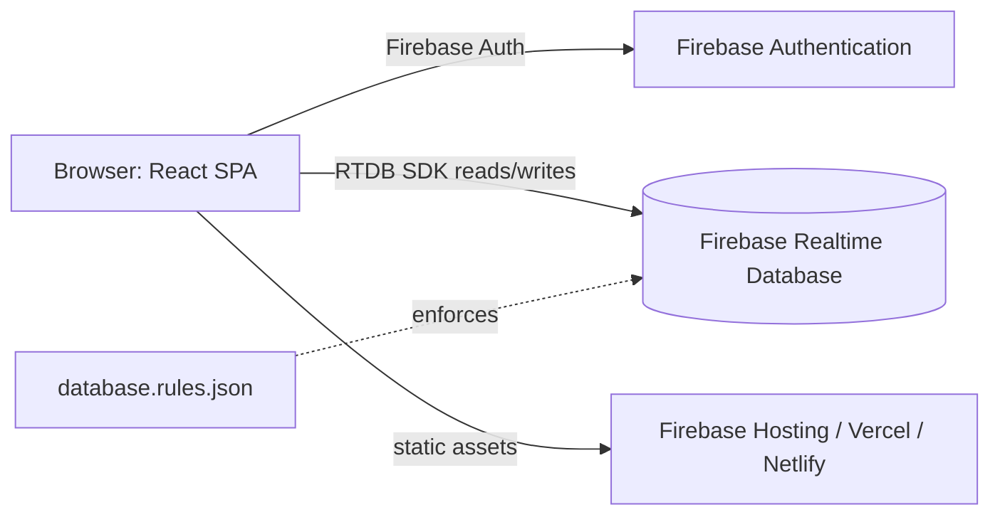
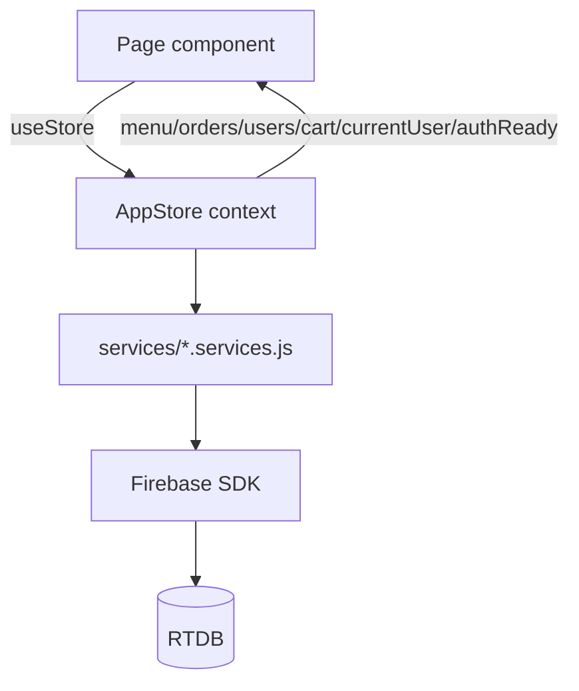

# SYSTEM.md — CuccuPOS

> Self-contained documentation for the CuccuPOS codebase. Covers frontend, backend (Firebase), data model, build, test, and deployment.

## Table of contents
1. [Project Overview](#1-project-overview)
2. [Tech Stack](#2-tech-stack)
3. [Architecture](#3-architecture)
4. [Repository Structure](#4-repository-structure)
5. [Frontend](#5-frontend)
6. [Backend / API](#6-backend--api)
7. [Data Layer](#7-data-layer)
8. [Configuration](#8-configuration)
9. [Build & Run](#9-build--run)
10. [Testing](#10-testing)
11. [Deployment](#11-deployment)
12. [Key Workflows / Data Flow](#12-key-workflows--data-flow)
13. [External Services & Integrations](#13-external-services--integrations)
14. [Gotchas & Technical Debt](#14-gotchas--technical-debt)
15. [Glossary](#15-glossary)

---

## 1. Project Overview

CuccuPOS is a **staff-only coffee-shop point-of-sale (POS) web app** (React SPA). Customers are walk-ins who pay at the counter; there is no customer-facing site and no custom server. Firebase Authentication + Realtime Database (RTDB) is the entire backend.

**Two roles** (stored in `users/<uid>/role`):
- **Cashier** — builds orders, records cash, applies discounts, sees only their own order history.
- **Admin / Owner-Manager** — dashboard, orders board, menu, cashier accounts, reports.

**Main features**
- Order building with typed quantities (1–99), sold-out gating, category filters.
- Cash checkout with PWD / Senior Citizen 20% discount; change computed before commit.
- Order lifecycle: `pending → preparing → ready → completed` (or `cancelled`).
- Cashier history with live status tracker, receipt print/PDF, reorder (UI trigger removed; store logic remains).
- Admin dashboard: KPIs, sales chart (hourly/daily), best sellers, recent orders, cashier filter.
- Admin orders board: status advance, cancel, details, receipt/PDF, void request review.
- Menu CRUD, sold-out toggle, duplicate-name detection.
- Cashier account management (create manually in console, disable access).
- Period reports: gross/net, cash summary, category split, top items, CSV export, print/PDF.
- Void workflow: cashier requests void → admin approves (→ cancelled) or declines (→ restore previous status).

---

## 2. Tech Stack

From `package.json` (no lockfile-based version pinning beyond ranges; `package-lock.json` present):

| Concern | Choice | Version |
|---|---|---|
| UI | React | ^18.3.1 |
| Language | JavaScript (ES2020+, JSX) | — |
| Build / dev server | Vite | ^5.4.11 |
| Routing | react-router-dom | ^6.28.0 |
| Styling | Tailwind CSS | ^3.4.17 |
| Components | shadcn/ui (Radix primitives) | dialog, dropdown-menu, label, select, slot, switch |
| Charts | Recharts | ^2.13.3 |
| Icons | lucide-react | ^0.460.0 |
| Toasts | sonner | ^1.7.0 |
| Backend | Firebase (Auth + RTDB) | ^13.0.0 |
| Validation | Zod | ^4.6.7 |
| Tests | Vitest | ^2.1.9 |
| PDF | jspdf + jspdf-autotable | ^4.2.1 / ^5.0.9 |
| Utilities | clsx, tailwind-merge, class-variance-authority, tailwindcss-animate | — |
| Node engine | 24.x | — |

Dev: `@vitejs/plugin-react`, `autoprefixer`, `postcss`, `targaryen` (rules simulator).

---

## 3. Architecture



- **Frontend**: React SPA built by Vite. No custom server.
- **Backend**: Firebase Auth + RTDB. Access control enforced by `docs/database.rules.json`.
- **Privileged logic**: runs as client-side transactions against RTDB (void workflow) or service-layer functions; rules gate writes.
- **Data flow**: Pages → `useStore()` (AppStore context) → `src/services/*.services.js` → Firebase SDK → RTDB.



---

## 4. Repository Structure

```
JS-CUCCUPOS-/
├── .env.local                 # Firebase web config (gitignored)
├── .gitignore
├── components.json            # shadcn/ui config
├── docs/
│   ├── DESIGN.md              # Consolidated design + system docs
│   ├── database.rules.json    # Deployed RTDB security rules (source of truth)
│   └── README.md              # Backend/deploy notes
├── firebase.json              # Firebase CLI config (rules + hosting)
├── index.html                 # Vite entry; loads Quicksand + receipt.css
├── jsconfig.json              # Path alias @/ → src/
├── package.json
├── package-lock.json
├── postcss.config.js
├── public/
│   ├── cuccupos-logo.svg
│   ├── menu/                  # Drink photos (empty, .gitkeep)
│   └── receipt.css            # Print-only rules for receipts
├── src/
│   ├── App.jsx                # Route table + role guards
│   ├── main.jsx               # Router + StoreProvider + Toaster mount
│   ├── types.js               # JSDoc typedefs + CATEGORIES export
│   ├── index.css              # Tailwind layers + CSS variables
│   ├── components/            # Shared UI
│   ├── lib/                   # Pure logic + hooks
│   ├── pages/                 # Route pages (auth, customer, admin)
│   ├── services/              # Firebase/Auth calls
│   ├── store/AppStore.jsx     # React context state
│   └── test/setup.js          # Vitest setup (system time pin)
├── tailwind.config.js
├── vercel.json                # SPA rewrite for Vercel
├── vite.config.js
└── vitest.config.js
```

### Per-directory purpose
- `src/components/` — shared components: `AppShell` (layout), `RangePicker`, `DiscountPicker`, `ReceiptDialog`, `StatusBadge`, `QuantityStepper`, `MenuImage`, `Logo`, `OrderSummary`, `Void*` dialogs/audit, `ui/` (shadcn primitives).
- `src/lib/` — pure logic modules (no Firebase): `stats`, `finance`, `discounts`, `duplicates`, `receipt`, `roles`, `format`, `voids`, `schemas`, `utils`, `useMenuFilters`, `useGuardedSubmit`. Plus `firebase.js` (SDK init).
- `src/pages/` — route pages: `auth/Login`, `auth/AuthLayout`, `customer/Order`, `customer/History`, `admin/{Dashboard,Orders,Menu,Cashiers,Reports}`.
- `src/services/` — all Firebase Auth/RTDB calls: `auth.services`, `menu.services`, `orders.services`, `users.services`.
- `src/store/` — `AppStore.jsx`: global React context, subscriptions, cart, auth.
- `docs/` — design/system docs + security rules.

---

## 5. Frontend

### Framework & entry
- `src/main.jsx` mounts `BrowserRouter`, `StoreProvider`, `App`, and sonner `Toaster`.
- `src/App.jsx` defines routes and guards (`Waiting`, `RequireRole`, `PublicOnly`, `RootRedirect`), gated on `authReady`.

### Routing
See [Part 5 of DESIGN.md / section 1]. Paths: `/login`, `/order`, `/history`, `/admin/*` (dashboard, orders, menu, cashiers, reports), `*` → redirect.

### State management
- `AppStore` (React context) is the single source of truth. `useStore()` consumed by pages.
- Holds `users`, `menu`, `orders`, `cart`, `currentUser`, `loading`, `authReady`.
- Role-scoped RTDB subscriptions re-established on user change.
- Cart is local React state, never persisted.

### Data fetching
- Services expose `getX(callback)` (live `onValue`) and `getXOnce()` (promise).
- Store subscribes on mount/user change and pushes into state.
- Mutations return `{ success, message, data }`.

### Styling
- Tailwind CSS with CSS variables in `src/index.css` (olive/cream theme). No dark mode.
- shadcn/ui primitives in `src/components/ui/`. `cn()` for conditional classes.

### Key pages/components
- `Order.jsx` — menu grid, cart panel (desktop + mobile), checkout dialog with discount + cash + change.
- `History.jsx` — own orders, status progress, void request, receipt.
- `Dashboard.jsx` — KPIs, chart, best sellers, recent orders, cashier filter.
- `Orders.jsx` — order board, status advance, cancel, details, receipt, void decisions.
- `Menu.jsx` — CRUD, sold-out toggle, duplicate review.
- `Cashiers.jsx` — staff list, disable access.
- `Reports.jsx` — period report, CSV, print/PDF.

### UI ↔ backend
Pages never import Firebase. All access goes through `useStore()` → services → Firebase SDK.

---

## 6. Backend / API

There is no custom HTTP server. The "API" is the Firebase SDK + RTDB, mediated by `src/services/`. Service functions are the callable surface.

### Service modules

**`src/services/auth.services.js`**
- `loginUser(email, password)` → validates, signs in, checks `disabled`/role.
- `registerUser(name, email, password)` → creates auth user + profile (role `cashier`).
- `logoutUser()`.
- `onAuthChange(callback)` → auth state + profile.

**`src/services/menu.services.js`**
- `addMenuItem(itemData)` (Zod + duplicate check).
- `getMenuItems(callback)` / `getMenuItemsOnce()`.
- `updateMenuItem(id, itemData)` (duplicate check).
- `deleteMenuItem(id)`.
- `toggleAvailability(id, current)`.

**`src/services/orders.services.js`**
- `makeDisplayId()`.
- `placeOrder(orderData)` (Zod validation, push under `orders/<customerId>`).
- `getOrders(callback, customerId)`.
- `getOrdersOnce(customerId)`.
- `updateOrderStatus(customerId, id, status)` (locate order across customers).
- `requestVoid(orderId, reason)` (RTDB transaction: eligible statuses → `pending_void`, store `previousStatus`).
- `approveVoid(customerId, orderId, decision)` (transaction: `pending_void` → `cancelled` or restore previous).

**`src/services/users.services.js`**
- `getUsers(callback)`.
- `subscribeUserProfile(uid, callback)`.
- `setCashierEnabled(uid, enabled)` (admin-only guard, self-disable blocked).

### Validation
- Zod schemas in `src/lib/schemas.js`: `orderSchema`, `menuItemSchema`, `userSchema`.
- `orderSchema` superRefine recomputes subtotal/discount/total/change and rejects mismatches.
- RTDB rules enforce shape, ranges, and access.

### Error handling
- Services catch and return `{ success: false, message }`. Pages surface via toast/inline.

### Background jobs
None (no Cloud Functions in current code). Void/refund logic runs client-side against RTDB with transactions; rules gate writes.

---

## 7. Data Layer

### Database
Firebase Realtime Database. No ORM. Direct SDK calls via `ref`, `get`, `set`, `update`, `remove`, `push`, `onValue`, `runTransaction`.

### Schema
See Part 6 of DESIGN.md / data model. Top-level: `users`, `menu`, `orders`.

```
users/<uid>                 name, email, role, createdAt, disabled?
menu/<itemId>               name, price, description, category, tag, image, available
orders/<customerId>/<id>    customerId, customerName, displayId, items{}, subtotal?,
                           discountType?, discountAmount?, total, paymentMethod,
                           cashTendered?, changeGiven?, refunds{}, refundedTotal?,
                           status, createdAt, note?, voidRequest?, voidHistory?
```

Items keyed by menu item id. Refunds appended. Void fields written only via service transactions.

### Migrations / seed
No migration tooling. Seed data documented in `docs/DESIGN.md` (menu items m_1..m_10). Demo accounts created manually in Firebase console; first admin promoted by editing `users/<uid>/role` to `admin`.

### Caching
None beyond RTDB SDK client cache and React state.

---

## 8. Configuration

Environment variables (from `.env.local`; `.env.example` absent from repo [UNKNOWN — verify]):

| Variable | Purpose |
|---|---|
| `VITE_FIREBASE_API_KEY` | Firebase web API key |
| `VITE_FIREBASE_AUTH_DOMAIN` | Auth domain |
| `VITE_FIREBASE_PROJECT_ID` | Project ID |
| `VITE_FIREBASE_STORAGE_BUCKET` | Storage bucket |
| `VITE_FIREBASE_MESSAGING_SENDER_ID` | Messaging sender ID |
| `VITE_FIREBASE_APP_ID` | App ID |
| `VITE_FIREBASE_MEASUREMENT_ID` | Analytics measurement ID |
| `VITE_FIREBASE_DATABASE_URL` | RTDB URL |

Config files:
- `vite.config.js` — React plugin + `@` alias.
- `jsconfig.json` — path alias + ES2020/bundler.
- `vitest.config.js` — node env, TZ=UTC, setup file.
- `tailwind.config.js` — theme tokens, Quicksand font, animate plugin.
- `postcss.config.js` — tailwind + autoprefixer.
- `firebase.json` — rules path `docs/database.rules.json`, hosting public `dist`, SPA rewrite.
- `vercel.json` — SPA rewrite.
- `components.json` — shadcn/ui config.
- `.gitignore` — ignores node_modules, dist, *.local, service account keys, functions build output.

Feature flags: none.

---

## 9. Build & Run

Scripts (`package.json`):
| Script | Command | Purpose |
|---|---|---|
| `dev` | `vite` | Dev server (localhost:5173) |
| `build` | `vite build` | Production build → `dist/` |
| `preview` | `vite preview` | Preview built bundle |
| `test` | `vitest run` | Run unit tests (TZ=UTC) |
| `test:watch` | `vitest` | Watch mode |
| `test:tz` | loop TZs | Run tests in UTC, Asia/Manila, America/New_York, Australia/Lord_Howe |
| `emulators` | `firebase emulators:start` | Local Auth + RTDB |
| `deploy:rules` | `firebase deploy --only database` | Publish security rules |

Run dev: `npm install && cp .env.example .env.local` (example absent [UNKNOWN]) then fill values; `npm run dev`.

---

## 10. Testing

- Framework: Vitest 2.1, node environment, setup file `tests/setup.js` (pins system time to 2026-10-18T12:00:00).
- Location: `tests/` (10 suites, 200 cases): dashboard, discounts, discounts.schema, duplicates, finance, quantity, receipt, roles, stats, store.sorting.
- Covers: date ranges/boundaries/timezones, order sorting, discount/change arithmetic, cashier filtering, receipt data/filenames, duplicate matching, quantity parsing.
- No integration/emulator tests for rules or services.
- Run: `npm test` or `npm run test:tz`.

---

## 11. Deployment

- Hosting: Firebase Hosting (config in `firebase.json`: public `dist`, SPA rewrite) or any static host (Vercel via `vercel.json` rewrite, Netlify).
- Backend: Firebase project (Auth + RTDB). Rules published via `npm run deploy:rules`.
- CI/CD: [UNKNOWN — verify] no pipeline config present in repo.
- Database provisioning: create Firebase project, enable Auth (email/password) and RTDB; seed menu/users per docs.
- Secrets: `.env.local` (gitignored). Firebase API key is public by design; access controlled by rules. No service-account keys in repo.
- Infrastructure-as-code: none beyond `firebase.json`.

---

## 12. Key Workflows / Data Flow

### A. Cashier places an order
1. `Order.jsx` taps `+` → `addToCart` (store) checks `available`, clamps qty.
2. Cart panel computes `previewDiscount` → `computeDiscount` (discounts.js).
3. Checkout dialog: tender cash → `changeFor` → `sufficient` gate.
4. `pay()` → `placeOrder(tender, note, discountType)` (store) recomputes breakdown, validates tender ≥ total.
5. `placeOrderAction` (orders.services) runs `orderSchema.safeParse`, generates `displayId`, pushes to `orders/<uid>`.
6. Success screen shows order number + change. Cart cleared.
7. RTDB listener updates History live.

### B. Admin advances order status
1. `Orders.jsx` filter/search → rows from store (`sortedOrders`).
2. Advance button → `updateOrderStatus(id, status)` (store) → `updateOrderStatusAction` locates customer, `set(status)`.
3. Rules allow admin writes to existing orders. Listener updates board.

### C. Void request & decision
1. Cashier History: "Request Void" on eligible order → `requestVoid` service transaction: eligible status → `pending_void`, store `previousStatus`.
2. Admin Orders "Pending Void" tab lists requests (live).
3. Approve: `approveVoid(..., "cancelled")` transaction → `cancelled`. Decline: restore `previousStatus`, clear it.
4. Both sides update via listeners; audit stays on order.

---

## 13. External Services & Integrations

- **Firebase Authentication** — email/password sign-in. Called in `src/services/auth.services.js`.
- **Firebase Realtime Database** — all data. Called in `src/services/*.services.js` and `src/lib/firebase.js`.
- **Google Fonts** — Quicksand (index.html).
- **(Optional) Firebase Hosting/Emulators** — deploy/emulate via CLI.

No payment gateway, analytics SDK, or other third-party APIs. `measurementId` present but no analytics calls in code [UNKNOWN — verify].

---

## 14. Gotchas & Technical Debt

- **Prices are client-supplied** — schema recomputes totals but doesn't verify prices against live menu. Known gap.
- **Discount entitlement not evidenced** — no ID capture; law requires name/ID/TIN for tax deduction.
- **`/register` removed** — file deleted; route never existed. Accounts created manually/console or by admin.
- **Reorder button removed** from History; store `reorder` logic remains.
- **Orders cap at 100 rows** in admin board; search reaches older.
- **No offline support** — cart lost on disconnect.
- **No PIN login** — deliberately dropped.
- **Rules may be behind deployed** — compare `docs/database.rules.json` with console.
- **`.env.example` absent** from repo despite README referencing it [UNKNOWN — verify].
- **No Cloud Functions** despite `docs/void_workflow.md` (stale) referencing them; `functions/` not present.
- **Admin self-demotion** blocked by rules; known gap.
- **`parseDayInput` rejects impossible dates** — don't revert to `new Date(y,m,d)`.
- **Admin feed grouped by cashier** — store sorts; don't assume sorted.
- **Single-field writes use `set()`** not `update()`.
- **Stale docs**: `docs/void_workflow.md` and `firebase_structure.md` removed/consolidated; use `docs/DESIGN.md` + `docs/database.rules.json`.

---

## 15. Glossary

- **AppShell** — shared layout (sidebar, header, notifications, logout).
- **AppStore / useStore** — React context holding subscriptions, currentUser, authReady, cart.
- **Services** — `src/services/*.services.js`: all Firebase calls; mutations return `{success, message, data}`.
- **Role-scoped subscriptions** — AppStore listens to different DB paths by role.
- **RangePicker** — shared period picker (Dashboard + Reports); hourly/daily buckets.
- **CATEGORIES** — unified export in `src/types.js`: Coffee, Milk Tea, Frappe, Others.
- **QuantityStepper** — +/- and typed quantity; clamps 1–99.
- **Order number** — client-generated `ORD-…` (`makeDisplayId`); `orderNo()` in format.js.
- **Cash only** — single payment method; records `cashTendered`/`changeGiven`.
- **DISCOUNT RATE = 0.2** — statutory floor (RA 10754 / RA 7432).
- **Waiting** — spinner while `!authReady` (deep-link safety).
- **History price** — `peso(i.price)` in Orders so admin sees price at order time.
- **Receipt zero-fix** — `qty > 0` filter + cash/change > 0 guards to avoid stray ₱0.
- **pending_void** — status set by void request; separate from order operational status.
- **validOrders()** — filters out cancelled orders from sales figures.