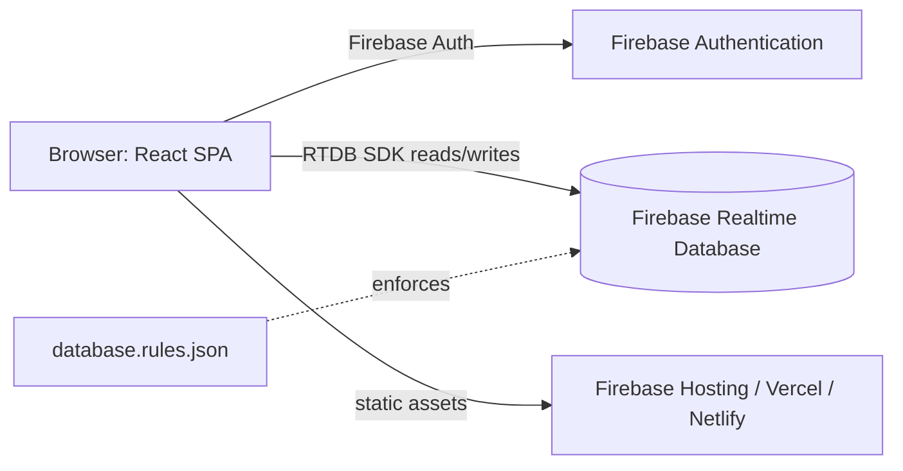
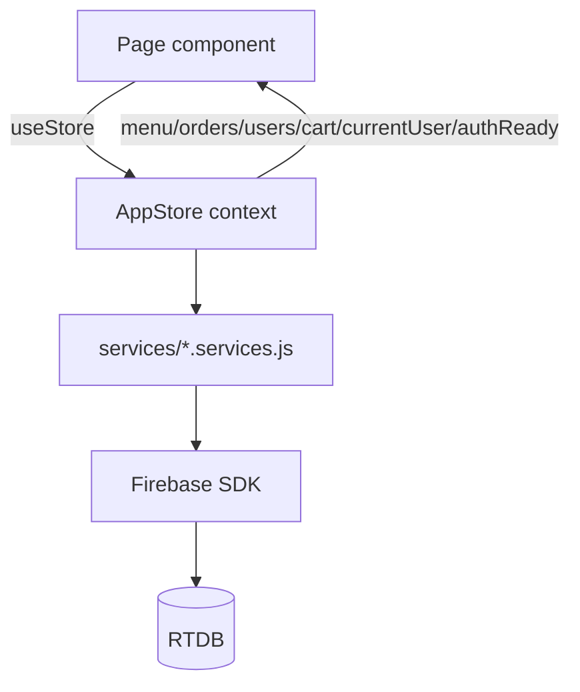

# CUCCUPOS Codebase

## Project overview

CuccuPOS is a staff-only coffee-shop point-of-sale (POS) web app delivered as a React single-page application. Customers are walk-ins who pay at the counter; there is no customer-facing site and no custom backend server. The backend is Firebase Authentication plus the Firebase Realtime Database (RTDB), with access controlled by `docs/database.rules.json`. The frontend is built with Vite, styled with Tailwind CSS and shadcn/ui, and uses React Router for navigation. State is held in a React context (`AppStore`) with role-scoped RTDB subscriptions. Pure business logic (discounts, stats, finance, receipts, duplicates, roles, voids) lives in `src/lib` and is covered by Vitest unit tests. Orders, menu, and user profiles are stored in RTDB; privileged operations rely on database rules and client-side transactions.

## Complete file tree

```
docs/
  DESIGN.md
  README.md
  USERSTORY.md
  database.rules.json
public/
  menu/
    .gitkeep
  cuccupos-logo.svg
  receipt.css
src/
  components/
    ui/
      badge.jsx
      button.jsx
      card.jsx
      dialog.jsx
      dropdown-menu.jsx
      input.jsx
      label.jsx
      select.jsx
      switch.jsx
      table.jsx
    AppShell.jsx
    DiscountPicker.jsx
    Logo.jsx
    MenuImage.jsx
    OrderSummary.jsx
    QuantityStepper.jsx
    RangePicker.jsx
    ReceiptDialog.jsx
    StatusBadge.jsx
    VoidAudit.jsx
    VoidDecisionDialog.jsx
    VoidRequestDialog.jsx
  lib/
    discounts.js
    duplicates.js
    finance.js
    firebase.js
    format.js
    receipt.js
    roles.js
    schemas.js
    stats.js
    useGuardedSubmit.js
    useMenuFilters.js
    utils.js
    voids.js
  pages/
    admin/
      Cashiers.jsx
      Dashboard.jsx
      Menu.jsx
      Orders.jsx
      Reports.jsx
    auth/
      AuthLayout.jsx
      Login.jsx
    customer/
      History.jsx
      Order.jsx
  services/
    auth.services.js
    menu.services.js
    orders.services.js
    users.services.js
  store/
    AppStore.jsx
  App.jsx
  index.css
  main.jsx
tests/
  dashboard.test.js
  discounts.schema.test.js
  discounts.test.js
  duplicates.test.js
  finance.test.js
  quantity.test.js
  receipt.test.js
  roles.test.js
  setup.js
  stats.test.js
  store.sorting.test.js
.gitignore
SYSTEM.md
components.json
firebase.json
index.html
jsconfig.json
package-lock.json
package.json
postcss.config.js
skills-lock.json
tailwind.config.js
vercel.json
vite.config.js
vitest.config.js
```

## File index

| Path | Purpose | Lines |
|---|---|---:|
| `.gitignore` | Git ignore rules | 33 |
| `SYSTEM.md` | Generated system documentation | 397 |
| `components.json` | shadcn/ui config | 20 |
| `firebase.json` | Firebase CLI config (rules + hosting) | 10 |
| `index.html` | Vite HTML entry | 17 |
| `jsconfig.json` | JS path alias config | 12 |
| `package-lock.json` | Dependency lockfile (not pasted) | 7371 |
| `package.json` | Project manifest and scripts | 56 |
| `postcss.config.js` | PostCSS plugins | 1 |
| `skills-lock.json` | File | 17 |
| `tailwind.config.js` | Tailwind theme config | 32 |
| `vercel.json` | Vercel SPA rewrite | 3 |
| `vite.config.js` | Vite config and path alias | 8 |
| `vitest.config.js` | Vitest config and TZ | 14 |
| `src/App.jsx` | Route table and role guards | 68 |
| `src/components/AppShell.jsx` | Shared component | 290 |
| `src/components/DiscountPicker.jsx` | Shared component | 41 |
| `src/components/Logo.jsx` | Shared component | 14 |
| `src/components/MenuImage.jsx` | Shared component | 15 |
| `src/components/OrderSummary.jsx` | Shared component | 23 |
| `src/components/QuantityStepper.jsx` | Shared component | 121 |
| `src/components/RangePicker.jsx` | Shared component | 100 |
| `src/components/ReceiptDialog.jsx` | Shared component | 215 |
| `src/components/StatusBadge.jsx` | Shared component | 14 |
| `src/components/VoidAudit.jsx` | Shared component | 21 |
| `src/components/VoidDecisionDialog.jsx` | Shared component | 63 |
| `src/components/VoidRequestDialog.jsx` | Shared component | 70 |
| `src/components/ui/badge.jsx` | shadcn UI primitive | 28 |
| `src/components/ui/button.jsx` | shadcn UI primitive | 37 |
| `src/components/ui/card.jsx` | shadcn UI primitive | 34 |
| `src/components/ui/dialog.jsx` | shadcn UI primitive | 61 |
| `src/components/ui/dropdown-menu.jsx` | shadcn UI primitive | 45 |
| `src/components/ui/input.jsx` | shadcn UI primitive | 19 |
| `src/components/ui/label.jsx` | shadcn UI primitive | 14 |
| `src/components/ui/select.jsx` | shadcn UI primitive | 68 |
| `src/components/ui/switch.jsx` | shadcn UI primitive | 19 |
| `src/components/ui/table.jsx` | shadcn UI primitive | 36 |
| `src/index.css` | Tailwind layers and CSS variables | 42 |
| `src/lib/discounts.js` | Pure logic or hook | 67 |
| `src/lib/duplicates.js` | Pure logic or hook | 65 |
| `src/lib/finance.js` | Pure logic or hook | 22 |
| `src/lib/firebase.js` | Firebase SDK init | 20 |
| `src/lib/format.js` | Pure logic or hook | 13 |
| `src/lib/receipt.js` | Pure logic or hook | 58 |
| `src/lib/roles.js` | Pure logic or hook | 23 |
| `src/lib/schemas.js` | Pure logic or hook | 82 |
| `src/lib/stats.js` | Pure logic or hook | 189 |
| `src/lib/useGuardedSubmit.js` | Pure logic or hook | 32 |
| `src/lib/useMenuFilters.js` | Pure logic or hook | 54 |
| `src/lib/utils.js` | Pure logic or hook | 6 |
| `src/lib/voids.js` | Pure logic or hook | 23 |
| `src/main.jsx` | App entry mount | 18 |
| `src/pages/admin/Cashiers.jsx` | Route page component | 145 |
| `src/pages/admin/Dashboard.jsx` | Route page component | 239 |
| `src/pages/admin/Menu.jsx` | Route page component | 177 |
| `src/pages/admin/Orders.jsx` | Route page component | 220 |
| `src/pages/admin/Reports.jsx` | Route page component | 231 |
| `src/pages/auth/AuthLayout.jsx` | Route page component | 16 |
| `src/pages/auth/Login.jsx` | Route page component | 49 |
| `src/pages/customer/History.jsx` | Route page component | 98 |
| `src/pages/customer/Order.jsx` | Route page component | 429 |
| `src/services/auth.services.js` | Firebase/Auth service calls | 85 |
| `src/services/menu.services.js` | Firebase/Auth service calls | 98 |
| `src/services/orders.services.js` | Firebase/Auth service calls | 170 |
| `src/services/users.services.js` | Firebase/Auth service calls | 76 |
| `src/store/AppStore.jsx` | Global React state and subscriptions | 287 |
| `tests/dashboard.test.js` | Unit test suite | 228 |
| `tests/discounts.schema.test.js` | Unit test suite | 127 |
| `tests/discounts.test.js` | Unit test suite | 192 |
| `tests/duplicates.test.js` | Unit test suite | 155 |
| `tests/finance.test.js` | Unit test suite | 69 |
| `tests/quantity.test.js` | Unit test suite | 73 |
| `tests/receipt.test.js` | Unit test suite | 128 |
| `tests/roles.test.js` | Unit test suite | 47 |
| `tests/setup.js` | Unit test suite | 7 |
| `tests/stats.test.js` | Unit test suite | 288 |
| `tests/store.sorting.test.js` | Unit test suite | 144 |
| `public/cuccupos-logo.svg` | Static asset | 10 |
| `public/menu/.gitkeep` | Static asset | 0 |
| `public/receipt.css` | Static asset | 46 |
| `docs/DESIGN.md` | Documentation | 513 |
| `docs/README.md` | Documentation | 118 |
| `docs/USERSTORY.md` | Documentation | 223 |
| `docs/database.rules.json` | Documentation | 27 |

## Full source code

## .gitignore

```text
node_modules
dist
.DS_Store
*.local

# Environment files
.env
.env.*
!.env.example

# Firebase Admin SDK service account keys — these grant full project access
serviceAccountKey.json
*-firebase-adminsdk-*.json

# Firebase tooling caches (emulators, hosting)
.firebase/

# Logs
*.log
npm-debug.log*
yarn-debug.log*
yarn-error.log*
pnpm-debug.log*

# Editor
.vscode/
.idea/

# Test coverage
coverage/
# Firebase Functions build output
functions/lib/
functions/node_modules/

```

## SYSTEM.md

```md
# SYSTEM.md — CuccuPOS

> Self-contained documentation for the CuccuPOS codebase. Covers frontend, backend (Firebase), data model, build, test, and deployment.

## Table of contents
1. [Project Overview](#1-project-overview)
2. [Tech Stack](#2-tech-stack)
3. [Architecture](#3-architecture)
4. [Repository Structure](#4-repository-structure)
5. [Frontend](#5-frontend)
6. [Backend / API](#6-backend--api)
7. [Data Layer](#7-data-layer)
8. [Configuration](#8-configuration)
9. [Build & Run](#9-build--run)
10. [Testing](#10-testing)
11. [Deployment](#11-deployment)
12. [Key Workflows / Data Flow](#12-key-workflows--data-flow)
13. [External Services & Integrations](#13-external-services--integrations)
14. [Gotchas & Technical Debt](#14-gotchas--technical-debt)
15. [Glossary](#15-glossary)

---

## 1. Project Overview

CuccuPOS is a **staff-only coffee-shop point-of-sale (POS) web app** (React SPA). Customers are walk-ins who pay at the counter; there is no customer-facing site and no custom server. Firebase Authentication + Realtime Database (RTDB) is the entire backend.

**Two roles** (stored in `users/<uid>/role`):
- **Cashier** — builds orders, records cash, applies discounts, sees only their own order history.
- **Admin / Owner-Manager** — dashboard, orders board, menu, cashier accounts, reports.

**Main features**
- Order building with typed quantities (1–99), sold-out gating, category filters.
- Cash checkout with PWD / Senior Citizen 20% discount; change computed before commit.
- Order lifecycle: `pending → preparing → ready → completed` (or `cancelled`).
- Cashier history with live status tracker, receipt print/PDF, reorder (UI trigger removed; store logic remains).
- Admin dashboard: KPIs, sales chart (hourly/daily), best sellers, recent orders, cashier filter.
- Admin orders board: status advance, cancel, details, receipt/PDF, void request review.
- Menu CRUD, sold-out toggle, duplicate-name detection.
- Cashier account management (create manually in console, disable access).
- Period reports: gross/net, cash summary, category split, top items, CSV export, print/PDF.
- Void workflow: cashier requests void → admin approves (→ cancelled) or declines (→ restore previous status).

---

## 2. Tech Stack

From `package.json` (no lockfile-based version pinning beyond ranges; `package-lock.json` present):

| Concern | Choice | Version |
|---|---|---|
| UI | React | ^18.3.1 |
| Language | JavaScript (ES2020+, JSX) | — |
| Build / dev server | Vite | ^5.4.11 |
| Routing | react-router-dom | ^6.28.0 |
| Styling | Tailwind CSS | ^3.4.17 |
| Components | shadcn/ui (Radix primitives) | dialog, dropdown-menu, label, select, slot, switch |
| Charts | Recharts | ^2.13.3 |
| Icons | lucide-react | ^0.460.0 |
| Toasts | sonner | ^1.7.0 |
| Backend | Firebase (Auth + RTDB) | ^13.0.0 |
| Validation | Zod | ^4.6.7 |
| Tests | Vitest | ^2.1.9 |
| PDF | jspdf + jspdf-autotable | ^4.2.1 / ^5.0.9 |
| Utilities | clsx, tailwind-merge, class-variance-authority, tailwindcss-animate | — |
| Node engine | 24.x | — |

Dev: `@vitejs/plugin-react`, `autoprefixer`, `postcss`, `targaryen` (rules simulator).

---

## 3. Architecture



- **Frontend**: React SPA built by Vite. No custom server.
- **Backend**: Firebase Auth + RTDB. Access control enforced by `docs/database.rules.json`.
- **Privileged logic**: runs as client-side transactions against RTDB (void workflow) or service-layer functions; rules gate writes.
- **Data flow**: Pages → `useStore()` (AppStore context) → `src/services/*.services.js` → Firebase SDK → RTDB.



---

## 4. Repository Structure

```
JS-CUCCUPOS-/
├── .env.local                 # Firebase web config (gitignored)
├── .gitignore
├── components.json            # shadcn/ui config
├── docs/
│   ├── DESIGN.md              # Consolidated design + system docs
│   ├── database.rules.json    # Deployed RTDB security rules (source of truth)
│   └── README.md              # Backend/deploy notes
├── firebase.json              # Firebase CLI config (rules + hosting)
├── index.html                 # Vite entry; loads Quicksand + receipt.css
├── jsconfig.json              # Path alias @/ → src/
├── package.json
├── package-lock.json
├── postcss.config.js
├── public/
│   ├── cuccupos-logo.svg
│   ├── menu/                  # Drink photos (empty, .gitkeep)
│   └── receipt.css            # Print-only rules for receipts
├── src/
│   ├── App.jsx                # Route table + role guards
│   ├── main.jsx               # Router + StoreProvider + Toaster mount
│   (no types.js — CATEGORIES inlined in pages)
│   ├── index.css              # Tailwind layers + CSS variables
│   ├── components/            # Shared UI
│   ├── lib/                   # Pure logic + hooks
│   ├── pages/                 # Route pages (auth, customer, admin)
│   ├── services/              # Firebase/Auth calls
│   ├── store/AppStore.jsx     # React context state
│   └── test/setup.js          # Vitest setup (system time pin)
├── tailwind.config.js
├── vercel.json                # SPA rewrite for Vercel
├── vite.config.js
└── vitest.config.js
```

### Per-directory purpose
- `src/components/` — shared components: `AppShell` (layout), `RangePicker`, `DiscountPicker`, `ReceiptDialog`, `StatusBadge`, `QuantityStepper`, `MenuImage`, `Logo`, `OrderSummary`, `Void*` dialogs/audit, `ui/` (shadcn primitives).
- `src/lib/` — pure logic modules (no Firebase): `stats`, `finance`, `discounts`, `duplicates`, `receipt`, `roles`, `format`, `voids`, `schemas`, `utils`, `useMenuFilters`, `useGuardedSubmit`. Plus `firebase.js` (SDK init).
- `src/pages/` — route pages: `auth/Login`, `auth/AuthLayout`, `customer/Order`, `customer/History`, `admin/{Dashboard,Orders,Menu,Cashiers,Reports}`.
- `src/services/` — all Firebase Auth/RTDB calls: `auth.services`, `menu.services`, `orders.services`, `users.services`.
- `src/store/` — `AppStore.jsx`: global React context, subscriptions, cart, auth.
- `docs/` — design/system docs + security rules.

---

## 5. Frontend

### Framework & entry
- `src/main.jsx` mounts `BrowserRouter`, `StoreProvider`, `App`, and sonner `Toaster`.
- `src/App.jsx` defines routes and guards (`Waiting`, `RequireRole`, `PublicOnly`, `RootRedirect`), gated on `authReady`.

### Routing
See [Part 5 of DESIGN.md / section 1]. Paths: `/login`, `/order`, `/history`, `/admin/*` (dashboard, orders, menu, cashiers, reports), `*` → redirect.

### State management
- `AppStore` (React context) is the single source of truth. `useStore()` consumed by pages.
- Holds `users`, `menu`, `orders`, `cart`, `currentUser`, `loading`, `authReady`.
- Role-scoped RTDB subscriptions re-established on user change.
- Cart is local React state, never persisted.

### Data fetching
- Services expose `getX(callback)` (live `onValue`) and `getXOnce()` (promise).
- Store subscribes on mount/user change and pushes into state.
- Mutations return `{ success, message, data }`.

### Styling
- Tailwind CSS with CSS variables in `src/index.css` (olive/cream theme). No dark mode.
- shadcn/ui primitives in `src/components/ui/`. `cn()` for conditional classes.

### Key pages/components
- `Order.jsx` — menu grid, cart panel (desktop + mobile), checkout dialog with discount + cash + change.
- `History.jsx` — own orders, status progress, void request, receipt.
- `Dashboard.jsx` — KPIs, chart, best sellers, recent orders, cashier filter.
- `Orders.jsx` — order board, status advance, cancel, details, receipt, void decisions.
- `Menu.jsx` — CRUD, sold-out toggle, duplicate review.
- `Cashiers.jsx` — staff list, disable access.
- `Reports.jsx` — period report, CSV, print/PDF.

### UI ↔ backend
Pages never import Firebase. All access goes through `useStore()` → services → Firebase SDK.

---

## 6. Backend / API

There is no custom HTTP server. The "API" is the Firebase SDK + RTDB, mediated by `src/services/`. Service functions are the callable surface.

### Service modules

**`src/services/auth.services.js`**
- `loginUser(email, password)` → validates, signs in, checks `disabled`/role.
- `registerUser(name, email, password)` → creates auth user + profile (role `cashier`).
- `logoutUser()`.
- `onAuthChange(callback)` → auth state + profile.

**`src/services/menu.services.js`**
- `addMenuItem(itemData)` (Zod + duplicate check).
- `getMenuItems(callback)` / `getMenuItemsOnce()`.
- `updateMenuItem(id, itemData)` (duplicate check).
- `deleteMenuItem(id)`.
- `toggleAvailability(id, current)`.

**`src/services/orders.services.js`**
- `makeDisplayId()`.
- `placeOrder(orderData)` (Zod validation, push under `orders/<customerId>`).
- `getOrders(callback, customerId)`.
- `getOrdersOnce(customerId)`.
- `updateOrderStatus(customerId, id, status)` (locate order across customers).
- `requestVoid(orderId, reason)` (RTDB transaction: eligible statuses → `pending_void`, store `previousStatus`).
- `approveVoid(customerId, orderId, decision)` (transaction: `pending_void` → `cancelled` or restore previous).

**`src/services/users.services.js`**
- `getUsers(callback)`.
- `subscribeUserProfile(uid, callback)`.
- `setCashierEnabled(uid, enabled)` (admin-only guard, self-disable blocked).

### Validation
- Zod schemas in `src/lib/schemas.js`: `orderSchema`, `menuItemSchema`, `userSchema`.
- `orderSchema` superRefine recomputes subtotal/discount/total/change and rejects mismatches.
- RTDB rules enforce shape, ranges, and access.

### Error handling
- Services catch and return `{ success: false, message }`. Pages surface via toast/inline.

### Background jobs
None (no Cloud Functions in current code). Void/refund logic runs client-side against RTDB with transactions; rules gate writes.

---

## 7. Data Layer

### Database
Firebase Realtime Database. No ORM. Direct SDK calls via `ref`, `get`, `set`, `update`, `remove`, `push`, `onValue`, `runTransaction`.

### Schema
See Part 6 of DESIGN.md / data model. Top-level: `users`, `menu`, `orders`.

```
users/<uid>                 name, email, role, createdAt, disabled?
menu/<itemId>               name, price, description, category, tag, image, available
orders/<customerId>/<id>    customerId, customerName, displayId, items{}, subtotal?,
                           discountType?, discountAmount?, total, paymentMethod,
                           cashTendered?, changeGiven?, refunds{}, refundedTotal?,
                           status, createdAt, note?, voidRequest?, voidHistory?
```

Items keyed by menu item id. Refunds appended. Void fields written only via service transactions.

### Migrations / seed
No migration tooling. Seed data documented in `docs/DESIGN.md` (menu items m_1..m_10). Demo accounts created manually in Firebase console; first admin promoted by editing `users/<uid>/role` to `admin`.

### Caching
None beyond RTDB SDK client cache and React state.

---

## 8. Configuration

Environment variables (from `.env.local`; `.env.example` absent from repo [UNKNOWN — verify]):

| Variable | Purpose |
|---|---|
| `VITE_FIREBASE_API_KEY` | Firebase web API key |
| `VITE_FIREBASE_AUTH_DOMAIN` | Auth domain |
| `VITE_FIREBASE_PROJECT_ID` | Project ID |
| `VITE_FIREBASE_STORAGE_BUCKET` | Storage bucket |
| `VITE_FIREBASE_MESSAGING_SENDER_ID` | Messaging sender ID |
| `VITE_FIREBASE_APP_ID` | App ID |
| `VITE_FIREBASE_MEASUREMENT_ID` | Analytics measurement ID |
| `VITE_FIREBASE_DATABASE_URL` | RTDB URL |

Config files:
- `vite.config.js` — React plugin + `@` alias.
- `jsconfig.json` — path alias + ES2020/bundler.
- `vitest.config.js` — node env, TZ=UTC, setup file.
- `tailwind.config.js` — theme tokens, Quicksand font, animate plugin.
- `postcss.config.js` — tailwind + autoprefixer.
- `firebase.json` — rules path `docs/database.rules.json`, hosting public `dist`, SPA rewrite.
- `vercel.json` — SPA rewrite.
- `components.json` — shadcn/ui config.
- `.gitignore` — ignores node_modules, dist, *.local, service account keys, functions build output.

Feature flags: none.

---

## 9. Build & Run

Scripts (`package.json`):
| Script | Command | Purpose |
|---|---|---|
| `dev` | `vite` | Dev server (localhost:5173) |
| `build` | `vite build` | Production build → `dist/` |
| `preview` | `vite preview` | Preview built bundle |
| `test` | `vitest run` | Run unit tests (TZ=UTC) |
| `test:watch` | `vitest` | Watch mode |
| `test:tz` | loop TZs | Run tests in UTC, Asia/Manila, America/New_York, Australia/Lord_Howe |
| `emulators` | `firebase emulators:start` | Local Auth + RTDB |
| `deploy:rules` | `firebase deploy --only database` | Publish security rules |

Run dev: `npm install && cp .env.example .env.local` (example absent [UNKNOWN]) then fill values; `npm run dev`.

---

## 10. Testing

- Framework: Vitest 2.1, node environment, setup file `tests/setup.js` (pins system time to 2026-10-18T12:00:00).
- Location: `tests/` (10 suites, 200 cases): dashboard, discounts, discounts.schema, duplicates, finance, quantity, receipt, roles, stats, store.sorting.
- Covers: date ranges/boundaries/timezones, order sorting, discount/change arithmetic, cashier filtering, receipt data/filenames, duplicate matching, quantity parsing.
- No integration/emulator tests for rules or services.
- Run: `npm test` or `npm run test:tz`.

---

## 11. Deployment

- Hosting: Firebase Hosting (config in `firebase.json`: public `dist`, SPA rewrite) or any static host (Vercel via `vercel.json` rewrite, Netlify).
- Backend: Firebase project (Auth + RTDB). Rules published via `npm run deploy:rules`.
- CI/CD: [UNKNOWN — verify] no pipeline config present in repo.
- Database provisioning: create Firebase project, enable Auth (email/password) and RTDB; seed menu/users per docs.
- Secrets: `.env.local` (gitignored). Firebase API key is public by design; access controlled by rules. No service-account keys in repo.
- Infrastructure-as-code: none beyond `firebase.json`.

---

## 12. Key Workflows / Data Flow

### A. Cashier places an order
1. `Order.jsx` taps `+` → `addToCart` (store) checks `available`, clamps qty.
2. Cart panel computes `previewDiscount` → `computeDiscount` (discounts.js).
3. Checkout dialog: tender cash → `changeFor` → `sufficient` gate.
4. `pay()` → `placeOrder(tender, note, discountType)` (store) recomputes breakdown, validates tender ≥ total.
5. `placeOrderAction` (orders.services) runs `orderSchema.safeParse`, generates `displayId`, pushes to `orders/<uid>`.
6. Success screen shows order number + change. Cart cleared.
7. RTDB listener updates History live.

### B. Admin advances order status
1. `Orders.jsx` filter/search → rows from store (`sortedOrders`).
2. Advance button → `updateOrderStatus(id, status)` (store) → `updateOrderStatusAction` locates customer, `set(status)`.
3. Rules allow admin writes to existing orders. Listener updates board.

### C. Void request & decision
1. Cashier History: "Request Void" on eligible order → `requestVoid` service transaction: eligible status → `pending_void`, store `previousStatus`.
2. Admin Orders "Pending Void" tab lists requests (live).
3. Approve: `approveVoid(..., "cancelled")` transaction → `cancelled`. Decline: restore `previousStatus`, clear it.
4. Both sides update via listeners; audit stays on order.

---

## 13. External Services & Integrations

- **Firebase Authentication** — email/password sign-in. Called in `src/services/auth.services.js`.
- **Firebase Realtime Database** — all data. Called in `src/services/*.services.js` and `src/lib/firebase.js`.
- **Google Fonts** — Quicksand (index.html).
- **(Optional) Firebase Hosting/Emulators** — deploy/emulate via CLI.

No payment gateway, analytics SDK, or other third-party APIs. `measurementId` present but no analytics calls in code [UNKNOWN — verify].

---

## 14. Gotchas & Technical Debt

- **Prices are client-supplied** — schema recomputes totals but doesn't verify prices against live menu. Known gap.
- **Discount entitlement not evidenced** — no ID capture; law requires name/ID/TIN for tax deduction.
- **`/register` removed** — file deleted; route never existed. Accounts created manually/console or by admin.
- **Reorder button removed** from History; store `reorder` logic remains.
- **Orders cap at 100 rows** in admin board; search reaches older.
- **No offline support** — cart lost on disconnect.
- **No PIN login** — deliberately dropped.
- **Rules may be behind deployed** — compare `docs/database.rules.json` with console.
- **`.env.example` absent** from repo despite README referencing it [UNKNOWN — verify].
- **No Cloud Functions** despite `docs/void_workflow.md` (stale) referencing them; `functions/` not present.
- **Admin self-demotion** blocked by rules; known gap.
- **`parseDayInput` rejects impossible dates** — don't revert to `new Date(y,m,d)`.
- **Admin feed grouped by cashier** — store sorts; don't assume sorted.
- **Single-field writes use `set()`** not `update()`.
- **Stale docs**: `docs/void_workflow.md` and `firebase_structure.md` removed/consolidated; use `docs/DESIGN.md` + `docs/database.rules.json`.

---

## 15. Glossary

- **AppShell** — shared layout (sidebar, header, notifications, logout).
- **AppStore / useStore** — React context holding subscriptions, currentUser, authReady, cart.
- **Services** — `src/services/*.services.js`: all Firebase calls; mutations return `{success, message, data}`.
- **Role-scoped subscriptions** — AppStore listens to different DB paths by role.
- **RangePicker** — shared period picker (Dashboard + Reports); hourly/daily buckets.
- **CATEGORIES** — inlined in `src/pages/admin/Menu.jsx` and `src/pages/customer/Order.jsx`: Coffee, Milk Tea, Frappe, Others.
- **QuantityStepper** — +/- and typed quantity; clamps 1–99.
- **Order number** — client-generated `ORD-…` (`makeDisplayId`); `orderNo()` in format.js.
- **Cash only** — single payment method; records `cashTendered`/`changeGiven`.
- **DISCOUNT RATE = 0.2** — statutory floor (RA 10754 / RA 7432).
- **Waiting** — spinner while `!authReady` (deep-link safety).
- **History price** — `peso(i.price)` in Orders so admin sees price at order time.
- **Receipt zero-fix** — `qty > 0` filter + cash/change > 0 guards to avoid stray ₱0.
- **pending_void** — status set by void request; separate from order operational status.
- **validOrders()** — filters out cancelled orders from sales figures.
```

## components.json

```json
{
  "$schema": "https://ui.shadcn.com/schema.json",
  "style": "default",
  "rsc": false,
  "tsx": false,
  "tailwind": {
    "config": "tailwind.config.js",
    "css": "src/index.css",
    "baseColor": "neutral",
    "cssVariables": true,
    "prefix": ""
  },
  "aliases": {
    "components": "@/components",
    "utils": "@/lib/utils",
    "ui": "@/components/ui",
    "lib": "@/lib",
    "hooks": "@/hooks"
  }
}

```

## firebase.json

```json
{
  "database": {
    "rules": "docs/database.rules.json"
  },
  "hosting": {
    "public": "dist",
    "ignore": ["firebase.json", "**/.*", "**/node_modules/**"],
    "rewrites": [{ "source": "**", "destination": "/index.html" }]
  }
}
```

## index.html

```html
<!doctype html>
<html lang="en">
  <head>
    <meta charset="UTF-8" />
    <meta name="viewport" content="width=device-width, initial-scale=1.0" />
    <title>CuccuPOS</title>
    <link rel="preconnect" href="https://fonts.googleapis.com" />
    <link rel="preconnect" href="https://fonts.gstatic.com" crossorigin />
    <link href="https://fonts.googleapis.com/css2?family=Quicksand:wght@400;500;600;700&display=swap" rel="stylesheet" />
    <!-- Print-only rules for single-transaction receipts. See src/receipt.css. -->
    <link rel="stylesheet" href="/receipt.css" />
  </head>
  <body>
    <div id="root"></div>
    <script type="module" src="/src/main.jsx"></script>
  </body>
</html>

```

## jsconfig.json

```json
{
  "compilerOptions": {
    "target": "ES2020",
    "module": "ESNext",
    "moduleResolution": "bundler",
    "jsx": "react-jsx",
    "checkJs": false,
    "baseUrl": ".",
    "paths": { "@/*": ["./src/*"] }
  },
  "include": ["src"]
}

```

## package-lock.json

```json
{
  "name": "cuccupos-frontend",
  "version": "1.0.0",
  "lockfileVersion": 3,
  "requires": true,
  "packages": {
    "": {
      "name": "cuccupos-frontend",
      "version": "1.0.0",
      "dependencies": {
        "@radix-ui/react-dialog": "^1.1.2",
        "@radix-ui/react-dropdown-menu": "^2.1.2",
        "@radix-ui/react-label": "^2.1.0",
        "@radix-ui/react-select": "^2.1.2",
        "@radix-ui/react-slot": "^1.1.0",
        "@radix-ui/react-switch": "^1.1.1",
        "class-variance-authority": "^0.7.1",
        "clsx": "^2.1.1",
        "firebase": "^13.0.0",
        "jspdf": "^4.2.1",
        "jspdf-autotable": "^5.0.9",
        "lucide-react": "^0.460.0",
        "react": "^18.3.1",
        "react-dom": "^18.3.1",
        "react-router-dom": "^6.28.0",
        "recharts": "^2.13.3",
        "sonner": "^1.7.0",
        "tailwind-merge": "^2.5.5",
        "tailwindcss-animate": "^1.0.7",
        "zod": "^4.6.7"
      },
      "devDependencies": {
        "@vitejs/plugin-react": "^4.3.4",
        "autoprefixer": "^10.4.20",
        "postcss": "^8.4.49",
        "tailwindcss": "^3.4.17",
        "targaryen": "^3.1.0",
        "vite": "^5.4.11",
        "vitest": "^2.1.9"
      },
      "engines": {
        "node": "24.x"
      }
    },
    "node_modules/@alloc/quick-lru": {
      "version": "5.3.0",
      "resolved": "https://registry.npmjs.org/@alloc/quick-lru/-/quick-lru-5.3.0.tgz",
      "integrity": "sha512-U4+70Pc5ZS9osnCBCE5Jha/ciHM+Yp+CNMNC/7HvYbNRk1Ldd+f7qO65W5qfhu/TCv+/ozljlXXe9Nj8419DMA==",
      "license": "MIT",
      "engines": {
        "node": ">=10"
      },
      "funding": {
        "url": "https://github.com/sponsors/sindresorhus"
      }
    },
    "node_modules/@babel/code-frame": {
      "version": "7.29.7",
      "resolved": "https://registry.npmjs.org/@babel/code-frame/-/code-frame-7.29.7.tgz",
      "integrity": "sha512-Aup7aUOfpbAUg2ROOJN6Iw5f9DMBlzu0mIkm/malLQFN/YQgO48wCj0Kxa3sEHJvPVFg7siR+qRInwXd2qhQKw==",
      "dev": true,
      "license": "MIT",
      "dependencies": {
        "@babel/helper-validator-identifier": "^7.29.7",
        "js-tokens": "^4.0.0",
        "picocolors": "^1.1.1"
      },
      "engines": {
        "node": ">=6.9.0"
      }
    },
    "node_modules/@babel/compat-data": {
      "version": "7.29.7",
      "resolved": "https://registry.npmjs.org/@babel/compat-data/-/compat-data-7.29.7.tgz",
      "integrity": "sha512-locTkQyKvwIEgBzVrn8693ebc97F2U8ZHjbXwDXJ5Fn2TCpNwTlKcaKLkdHop5c/icOFE7qt7Q9JC5hnKNa6Gg==",
      "dev": true,
      "license": "MIT",
      "engines": {
        "node": ">=6.9.0"
      }
    },
    "node_modules/@babel/core": {
      "version": "7.29.7",
      "resolved": "https://registry.npmjs.org/@babel/core/-/core-7.29.7.tgz",
      "integrity": "sha512-RgHBCvtjbOK2gXSNBNIkNoEc9qoVEtau3hj8gEqKQuL3HZAibKarWFEI3Lfm6EYKkLalOh8eSrj9b+ch9H/VBA==",
      "dev": true,
      "license": "MIT",
      "dependencies": {
        "@babel/code-frame": "^7.29.7",
        "@babel/generator": "^7.29.7",
        "@babel/helper-compilation-targets": "^7.29.7",
        "@babel/helper-module-transforms": "^7.29.7",
        "@babel/helpers": "^7.29.7",
        "@babel/parser": "^7.29.7",
        "@babel/template": "^7.29.7",
        "@babel/traverse": "^7.29.7",
        "@babel/types": "^7.29.7",
        "@jridgewell/remapping": "^2.3.5",
        "convert-source-map": "^2.0.0",
        "debug": "^4.1.0",
        "gensync": "^1.0.0-beta.2",
        "json5": "^2.2.3",
        "semver": "^6.3.1"
      },
      "engines": {
        "node": ">=6.9.0"
      },
      "funding": {
        "type": "opencollective",
        "url": "https://opencollective.com/babel"
      }
    },
    "node_modules/@babel/core/node_modules/debug": {
      "version": "4.4.3",
      "resolved": "https://registry.npmjs.org/debug/-/debug-4.4.3.tgz",
      "integrity": "sha512-RGwwWnwQvkVfavKVt22FGLw+xYSdzARwm0ru6DhTVA3umU5hZc28V3kO4stgYryrTlLpuvgI9GiijltAjNbcqA==",
      "dev": true,
      "license": "MIT",
      "dependencies": {
        "ms": "^2.1.3"
      },
      "engines": {
        "node": ">=6.0"
      },
      "peerDependenciesMeta": {
        "supports-color": {
          "optional": true
        }
      }
    },
    "node_modules/@babel/core/node_modules/ms": {
      "version": "2.1.3",
      "resolved": "https://registry.npmjs.org/ms/-/ms-2.1.3.tgz",
      "integrity": "sha512-6FlzubTLZG3J2a/NVCAleEhjzq5oxgHyaCU9yYXvcLsvoVaHJq/s5xXI6/XXP6tz7R9xAOtHnSO/tXtF3WRTlA==",
      "dev": true,
      "license": "MIT"
    },
    "node_modules/@babel/core/node_modules/semver": {
      "version": "6.3.1",
      "resolved": "https://registry.npmjs.org/semver/-/semver-6.3.1.tgz",
      "integrity": "sha512-BR7VvDCVHO+q2xBEWskxS6DJE1qRnb7DxzUrogb71CWoSficBxYsiAGd+Kl0mmq/MprG9yArRkyrQxTO6XjMzA==",
      "dev": true,
      "license": "ISC",
      "bin": {
        "semver": "bin/semver.js"
      }
    },
    "node_modules/@babel/generator": {
      "version": "7.29.8",
      "resolved": "https://registry.npmjs.org/@babel/generator/-/generator-7.29.8.tgz",
      "integrity": "sha512-gZbepsdh3WDtgZKWL+vTPh71LSBrm/Y4/QDZBVCcYfmeTEEuoOYwlSy+G1StfJg+/Zy550u/3TATbm7qDbbMtg==",
      "dev": true,
      "license": "MIT",
      "dependencies": {
        "@babel/parser": "^7.29.8",
        "@babel/types": "^7.29.8",
        "@jridgewell/gen-mapping": "^0.3.12",
        "@jridgewell/trace-mapping": "^0.3.28",
        "jsesc": "^3.0.2"
      },
      "engines": {
        "node": ">=6.9.0"
      }
    },
    "node_modules/@babel/helper-compilation-targets": {
      "version": "7.29.7",
      "resolved": "https://registry.npmjs.org/@babel/helper-compilation-targets/-/helper-compilation-targets-7.29.7.tgz",
      "integrity": "sha512-wem6WaBj4NaVYVdNhLPPVacES6ZJ+KBBfSkTMD3YZxbP3rm3Di85tJU5ljaUNhaOynt+Aj0xruhYuzQBt8n71g==",
      "dev": true,
      "license": "MIT",
      "dependencies": {
        "@babel/compat-data": "^7.29.7",
        "@babel/helper-validator-option": "^7.29.7",
        "browserslist": "^4.24.0",
        "lru-cache": "^5.1.1",
        "semver": "^6.3.1"
      },
      "engines": {
        "node": ">=6.9.0"
      }
    },
    "node_modules/@babel/helper-compilation-targets/node_modules/lru-cache": {
      "version": "5.1.1",
      "resolved": "https://registry.npmjs.org/lru-cache/-/lru-cache-5.1.1.tgz",
      "integrity": "sha512-KpNARQA3Iwv+jTA0utUVVbrh+Jlrr1Fv0e56GGzAFOXN7dk/FviaDW8LHmK52DlcH4WP2n6gI8vN1aesBFgo9w==",
      "dev": true,
      "license": "ISC",
      "dependencies": {
        "yallist": "^3.0.2"
      }
    },
    "node_modules/@babel/helper-compilation-targets/node_modules/semver": {
      "version": "6.3.1",
      "resolved": "https://registry.npmjs.org/semver/-/semver-6.3.1.tgz",
      "integrity": "sha512-BR7VvDCVHO+q2xBEWskxS6DJE1qRnb7DxzUrogb71CWoSficBxYsiAGd+Kl0mmq/MprG9yArRkyrQxTO6XjMzA==",
      "dev": true,
      "license": "ISC",
      "bin": {
        "semver": "bin/semver.js"
      }
    },
    "node_modules/@babel/helper-compilation-targets/node_modules/yallist": {
      "version": "3.1.1",
      "resolved": "https://registry.npmjs.org/yallist/-/yallist-3.1.1.tgz",
      "integrity": "sha512-a4UGQaWPH59mOXUYnAG2ewncQS4i4F43Tv3JoAM+s2VDAmS9NsK8GpDMLrCHPksFT7h3K6TOoUNn2pb7RoXx4g==",
      "dev": true,
      "license": "ISC"
    },
    "node_modules/@babel/helper-globals": {
      "version": "7.29.7",
      "resolved": "https://registry.npmjs.org/@babel/helper-globals/-/helper-globals-7.29.7.tgz",
      "integrity": "sha512-3nQVUAtvkKH9zahfWgw96Jc/uFOmjACE1kQz82E2lqWmHBgjzbNlsC22nuQTfahmWeQtTq5nQ/4Nnd2A1wj4zA==",
      "dev": true,
      "license": "MIT",
      "engines": {
        "node": ">=6.9.0"
      }
    },
    "node_modules/@babel/helper-module-imports": {
      "version": "7.29.7",
      "resolved": "https://registry.npmjs.org/@babel/helper-module-imports/-/helper-module-imports-7.29.7.tgz",
      "integrity": "sha512-ejHwrQQYcm9xnTivShn2IDOlIzInN34AXskvq9QicvCtEzq1Vzclu/tKF8Jq1Cg8JG2GL6/EmjgsCT7lXepE3g==",
      "dev": true,
      "license": "MIT",
      "dependencies": {
        "@babel/traverse": "^7.29.7",
        "@babel/types": "^7.29.7"
      },
      "engines": {
        "node": ">=6.9.0"
      }
    },
    "node_modules/@babel/helper-module-transforms": {
      "version": "7.29.7",
      "resolved": "https://registry.npmjs.org/@babel/helper-module-transforms/-/helper-module-transforms-7.29.7.tgz",
      "integrity": "sha512-UPUVSyXbOh627KiCIGQSgwWzGeBKLkaJ9PJEdrngIwMSzxLR4jS4+f1f1jb7VzBbg8nFLaYotvVPFCTqdrmTAg==",
      "dev": true,
      "license": "MIT",
      "dependencies": {
        "@babel/helper-module-imports": "^7.29.7",
        "@babel/helper-validator-identifier": "^7.29.7",
        "@babel/traverse": "^7.29.7"
      },
      "engines": {
        "node": ">=6.9.0"
      },
      "peerDependencies": {
        "@babel/core": "^7.0.0"
      }
    },
    "node_modules/@babel/helper-plugin-utils": {
      "version": "7.29.7",
      "resolved": "https://registry.npmjs.org/@babel/helper-plugin-utils/-/helper-plugin-utils-7.29.7.tgz",
      "integrity": "sha512-G7sHYigPY17oO5SYWnfD/0MTBwVR781S/JI643e/JhUYgVgWE/61SoW3NH9KWUKyKq5LVh3npif99Wkt6j86Jw==",
      "dev": true,
      "license": "MIT",
      "engines": {
        "node": ">=6.9.0"
      }
    },
    "node_modules/@babel/helper-string-parser": {
      "version": "7.29.11",
      "resolved": "https://registry.npmjs.org/@babel/helper-string-parser/-/helper-string-parser-7.29.11.tgz",
      "integrity": "sha512-snZbO7MEDOof+hvNa97EjEY7qD7h2kwvQr5AJC3ZhQudKW5dnej6k3kP9NQV88hJwaS8vDqRLFo9rivLEhle2g==",
      "dev": true,
      "license": "MIT",
      "engines": {
        "node": ">=6.9.0"
      }
    },
    "node_modules/@babel/helper-validator-identifier": {
      "version": "7.29.7",
      "resolved": "https://registry.npmjs.org/@babel/helper-validator-identifier/-/helper-validator-identifier-7.29.7.tgz",
      "integrity": "sha512-qehxGkRj55h/ff8EMaJ+cYhyaKlHIxqYDn682wQD7RNp9UujOQsHog2uS0r2vzr4pW+sXf90NeeayjcNaX3fFg==",
      "dev": true,
      "license": "MIT",
      "engines": {
        "node": ">=6.9.0"
      }
    },
    "node_modules/@babel/helper-validator-option": {
      "version": "7.29.7",
      "resolved": "https://registry.npmjs.org/@babel/helper-validator-option/-/helper-validator-option-7.29.7.tgz",
      "integrity": "sha512-N9ZErrD+yW5geCDtBqnOoxmR8+tNKiGuxKlDpuJxfsqpa2dFcexaziGAE/qoHLiDDreVNMupxGmSoNlyvsA3gw==",
      "dev": true,
      "license": "MIT",
      "engines": {
        "node": ">=6.9.0"
      }
    },
    "node_modules/@babel/helpers": {
      "version": "7.29.10",
      "resolved": "https://registry.npmjs.org/@babel/helpers/-/helpers-7.29.10.tgz",
      "integrity": "sha512-EMCx3AGZ3WfAl6ht7AyQoPm2Lh+BGYEMdc4Q6Hf7uSCDOZFuLq44qNwL+iaim8VlyYhRAo4X43+weadK8ZB4Yg==",
      "dev": true,
      "license": "MIT",
      "dependencies": {
        "@babel/template": "^7.29.7",
        "@babel/types": "^7.29.8"
      },
      "engines": {
        "node": ">=6.9.0"
      }
    },
    "node_modules/@babel/parser": {
      "version": "7.29.11",
      "resolved": "https://registry.npmjs.org/@babel/parser/-/parser-7.29.11.tgz",
      "integrity": "sha512-OZ6+oaK7GMyg3IfCpj8JOmn8n+w2rJbDT0LLfVDTLb1ZFeKDh3AiNELgCMUw175IJHSkLl74hG0M0VLsvx+gag==",
      "dev": true,
      "license": "MIT",
      "dependencies": {
        "@babel/types": "^7.29.11"
      },
      "bin": {
        "parser": "bin/babel-parser.js"
      },
      "engines": {
        "node": ">=6.0.0"
      }
    },
    "node_modules/@babel/plugin-transform-react-jsx-self": {
      "version": "7.29.7",
      "resolved": "https://registry.npmjs.org/@babel/plugin-transform-react-jsx-self/-/plugin-transform-react-jsx-self-7.29.7.tgz",
      "integrity": "sha512-TL0hMc9xzy86VD31nUiwzd5otRAcyEPcsegCxolO0PvcXuH1v0kECe/UIznYFihpkvU5wg/jk4v0TTEFfm53fw==",
      "dev": true,
      "license": "MIT",
      "dependencies": {
        "@babel/helper-plugin-utils": "^7.29.7"
      },
      "engines": {
        "node": ">=6.9.0"
      },
      "peerDependencies": {
        "@babel/core": "^7.0.0-0"
      }
    },
    "node_modules/@babel/plugin-transform-react-jsx-source": {
      "version": "7.29.7",
      "resolved": "https://registry.npmjs.org/@babel/plugin-transform-react-jsx-source/-/plugin-transform-react-jsx-source-7.29.7.tgz",
      "integrity": "sha512-06IyK09H3wi4cGbhDBwp5gUGo0IKtnYa8tyTiephirPCK6fbobVGiXMMI5zLQ4aKEYP3wZ3ArU44o+8KMrSG/Q==",
      "dev": true,
      "license": "MIT",
      "dependencies": {
        "@babel/helper-plugin-utils": "^7.29.7"
      },
      "engines": {
        "node": ">=6.9.0"
      },
      "peerDependencies": {
        "@babel/core": "^7.0.0-0"
      }
    },
    "node_modules/@babel/runtime": {
      "version": "7.29.10",
      "resolved": "https://registry.npmjs.org/@babel/runtime/-/runtime-7.29.10.tgz",
      "integrity": "sha512-NpugTzbKgGrNe45Ui32cN8vCFFMxVtP/9rtfwv0nP5FRDAjvYBxJcLVpYA9mr1jxP6cnIT7x9LUzuDTbWYYNRA==",
      "license": "MIT",
      "engines": {
        "node": ">=6.9.0"
      }
    },
    "node_modules/@babel/template": {
      "version": "7.29.7",
      "resolved": "https://registry.npmjs.org/@babel/template/-/template-7.29.7.tgz",
      "integrity": "sha512-puq+Gf35oI24FeN11LkoUQFqv9uwNeWpxXZi/Ji3rRIoKAzKnxRaZ+Gkj0vKS9ZCiTESfng1N9LyOyXvo+m+Gg==",
      "dev": true,
      "license": "MIT",
      "dependencies": {
        "@babel/code-frame": "^7.29.7",
        "@babel/parser": "^7.29.7",
        "@babel/types": "^7.29.7"
      },
      "engines": {
        "node": ">=6.9.0"
      }
    },
    "node_modules/@babel/traverse": {
      "version": "7.29.10",
      "resolved": "https://registry.npmjs.org/@babel/traverse/-/traverse-7.29.10.tgz",
      "integrity": "sha512-B3lYAs2nkKskbgQ1nfy8Ma9ao9Q1rntTAQHrzzyDuj+TSO+X3le6PfWwqDvodsb+OumE10eMFfuMCTQSQ5iuIQ==",
      "dev": true,
      "license": "MIT",
      "dependencies": {
        "@babel/code-frame": "^7.29.7",
        "@babel/generator": "^7.29.8",
        "@babel/helper-globals": "^7.29.7",
        "@babel/parser": "^7.29.9",
        "@babel/template": "^7.29.7",
        "@babel/types": "^7.29.8",
        "debug": "^4.3.1"
      },
      "engines": {
        "node": ">=6.9.0"
      }
    },
    "node_modules/@babel/traverse/node_modules/debug": {
      "version": "4.4.3",
      "resolved": "https://registry.npmjs.org/debug/-/debug-4.4.3.tgz",
      "integrity": "sha512-RGwwWnwQvkVfavKVt22FGLw+xYSdzARwm0ru6DhTVA3umU5hZc28V3kO4stgYryrTlLpuvgI9GiijltAjNbcqA==",
      "dev": true,
      "license": "MIT",
      "dependencies": {
        "ms": "^2.1.3"
      },
      "engines": {
        "node": ">=6.0"
      },
      "peerDependenciesMeta": {
        "supports-color": {
          "optional": true
        }
      }
    },
    "node_modules/@babel/traverse/node_modules/ms": {
      "version": "2.1.3",
      "resolved": "https://registry.npmjs.org/ms/-/ms-2.1.3.tgz",
      "integrity": "sha512-6FlzubTLZG3J2a/NVCAleEhjzq5oxgHyaCU9yYXvcLsvoVaHJq/s5xXI6/XXP6tz7R9xAOtHnSO/tXtF3WRTlA==",
      "dev": true,
      "license": "MIT"
    },
    "node_modules/@babel/types": {
      "version": "7.29.11",
      "resolved": "https://registry.npmjs.org/@babel/types/-/types-7.29.11.tgz",
      "integrity": "sha512-WCsemW40Cpc6gouC1SrY6PBaZ+oLRlEVY9XBvZBI7il/HyUrb2nJ505wE1MHEFyDZNnrWDEuy4jL50WVHfTTSQ==",
      "dev": true,
      "license": "MIT",
      "dependencies": {
        "@babel/helper-string-parser": "^7.29.11",
        "@babel/helper-validator-identifier": "^7.29.7"
      },
      "engines": {
        "node": ">=6.9.0"
      }
    },
    "node_modules/@esbuild/aix-ppc64": {
      "version": "0.21.5",
      "resolved": "https://registry.npmjs.org/@esbuild/aix-ppc64/-/aix-ppc64-0.21.5.tgz",
      "integrity": "sha512-1SDgH6ZSPTlggy1yI6+Dbkiz8xzpHJEVAlF/AM1tHPLsf5STom9rwtjE4hKAF20FfXXNTFqEYXyJNWh1GiZedQ==",
      "cpu": [
        "ppc64"
      ],
      "dev": true,
      "license": "MIT",
      "optional": true,
      "os": [
        "aix"
      ],
      "engines": {
        "node": ">=12"
      }
    },
    "node_modules/@esbuild/android-arm": {
      "version": "0.21.5",
      "resolved": "https://registry.npmjs.org/@esbuild/android-arm/-/android-arm-0.21.5.tgz",
      "integrity": "sha512-vCPvzSjpPHEi1siZdlvAlsPxXl7WbOVUBBAowWug4rJHb68Ox8KualB+1ocNvT5fjv6wpkX6o/iEpbDrf68zcg==",
      "cpu": [
        "arm"
      ],
      "dev": true,
      "license": "MIT",
      "optional": true,
      "os": [
        "android"
      ],
      "engines": {
        "node": ">=12"
      }
    },
    "node_modules/@esbuild/android-arm64": {
      "version": "0.21.5",
      "resolved": "https://registry.npmjs.org/@esbuild/android-arm64/-/android-arm64-0.21.5.tgz",
      "integrity": "sha512-c0uX9VAUBQ7dTDCjq+wdyGLowMdtR/GoC2U5IYk/7D1H1JYC0qseD7+11iMP2mRLN9RcCMRcjC4YMclCzGwS/A==",
      "cpu": [
        "arm64"
      ],
      "dev": true,
      "license": "MIT",
      "optional": true,
      "os": [
        "android"
      ],
      "engines": {
        "node": ">=12"
      }
    },
    "node_modules/@esbuild/android-x64": {
      "version": "0.21.5",
      "resolved": "https://registry.npmjs.org/@esbuild/android-x64/-/android-x64-0.21.5.tgz",
      "integrity": "sha512-D7aPRUUNHRBwHxzxRvp856rjUHRFW1SdQATKXH2hqA0kAZb1hKmi02OpYRacl0TxIGz/ZmXWlbZgjwWYaCakTA==",
      "cpu": [
        "x64"
      ],
      "dev": true,
      "license": "MIT",
      "optional": true,
      "os": [
        "android"
      ],
      "engines": {
        "node": ">=12"
      }
    },
    "node_modules/@esbuild/darwin-arm64": {
      "version": "0.21.5",
      "resolved": "https://registry.npmjs.org/@esbuild/darwin-arm64/-/darwin-arm64-0.21.5.tgz",
      "integrity": "sha512-DwqXqZyuk5AiWWf3UfLiRDJ5EDd49zg6O9wclZ7kUMv2WRFr4HKjXp/5t8JZ11QbQfUS6/cRCKGwYhtNAY88kQ==",
      "cpu": [
        "arm64"
      ],
      "dev": true,
      "license": "MIT",
      "optional": true,
      "os": [
        "darwin"
      ],
      "engines": {
        "node": ">=12"
      }
    },
    "node_modules/@esbuild/darwin-x64": {
      "version": "0.21.5",
      "resolved": "https://registry.npmjs.org/@esbuild/darwin-x64/-/darwin-x64-0.21.5.tgz",
      "integrity": "sha512-se/JjF8NlmKVG4kNIuyWMV/22ZaerB+qaSi5MdrXtd6R08kvs2qCN4C09miupktDitvh8jRFflwGFBQcxZRjbw==",
      "cpu": [
        "x64"
      ],
      "dev": true,
      "license": "MIT",
      "optional": true,
      "os": [
        "darwin"
      ],
      "engines": {
        "node": ">=12"
      }
    },
    "node_modules/@esbuild/freebsd-arm64": {
      "version": "0.21.5",
      "resolved": "https://registry.npmjs.org/@esbuild/freebsd-arm64/-/freebsd-arm64-0.21.5.tgz",
      "integrity": "sha512-5JcRxxRDUJLX8JXp/wcBCy3pENnCgBR9bN6JsY4OmhfUtIHe3ZW0mawA7+RDAcMLrMIZaf03NlQiX9DGyB8h4g==",
      "cpu": [
        "arm64"
      ],
      "dev": true,
      "license": "MIT",
      "optional": true,
      "os": [
        "freebsd"
      ],
      "engines": {
        "node": ">=12"
      }
    },
    "node_modules/@esbuild/freebsd-x64": {
      "version": "0.21.5",
      "resolved": "https://registry.npmjs.org/@esbuild/freebsd-x64/-/freebsd-x64-0.21.5.tgz",
      "integrity": "sha512-J95kNBj1zkbMXtHVH29bBriQygMXqoVQOQYA+ISs0/2l3T9/kj42ow2mpqerRBxDJnmkUDCaQT/dfNXWX/ZZCQ==",
      "cpu": [
        "x64"
      ],
      "dev": true,
      "license": "MIT",
      "optional": true,
      "os": [
        "freebsd"
      ],
      "engines": {
        "node": ">=12"
      }
    },
    "node_modules/@esbuild/linux-arm": {
      "version": "0.21.5",
      "resolved": "https://registry.npmjs.org/@esbuild/linux-arm/-/linux-arm-0.21.5.tgz",
      "integrity": "sha512-bPb5AHZtbeNGjCKVZ9UGqGwo8EUu4cLq68E95A53KlxAPRmUyYv2D6F0uUI65XisGOL1hBP5mTronbgo+0bFcA==",
      "cpu": [
        "arm"
      ],
      "dev": true,
      "license": "MIT",
      "optional": true,
      "os": [
        "linux"
      ],
      "engines": {
        "node": ">=12"
      }
    },
    "node_modules/@esbuild/linux-arm64": {
      "version": "0.21.5",
      "resolved": "https://registry.npmjs.org/@esbuild/linux-arm64/-/linux-arm64-0.21.5.tgz",
      "integrity": "sha512-ibKvmyYzKsBeX8d8I7MH/TMfWDXBF3db4qM6sy+7re0YXya+K1cem3on9XgdT2EQGMu4hQyZhan7TeQ8XkGp4Q==",
      "cpu": [
        "arm64"
      ],
      "dev": true,
      "license": "MIT",
      "optional": true,
      "os": [
        "linux"
      ],
      "engines": {
        "node": ">=12"
      }
    },
    "node_modules/@esbuild/linux-ia32": {
      "version": "0.21.5",
      "resolved": "https://registry.npmjs.org/@esbuild/linux-ia32/-/linux-ia32-0.21.5.tgz",
      "integrity": "sha512-YvjXDqLRqPDl2dvRODYmmhz4rPeVKYvppfGYKSNGdyZkA01046pLWyRKKI3ax8fbJoK5QbxblURkwK/MWY18Tg==",
      "cpu": [
        "ia32"
      ],
      "dev": true,
      "license": "MIT",
      "optional": true,
      "os": [
        "linux"
      ],
      "engines": {
        "node": ">=12"
      }
    },
    "node_modules/@esbuild/linux-loong64": {
      "version": "0.21.5",
      "resolved": "https://registry.npmjs.org/@esbuild/linux-loong64/-/linux-loong64-0.21.5.tgz",
      "integrity": "sha512-uHf1BmMG8qEvzdrzAqg2SIG/02+4/DHB6a9Kbya0XDvwDEKCoC8ZRWI5JJvNdUjtciBGFQ5PuBlpEOXQj+JQSg==",
      "cpu": [
        "loong64"
      ],
      "dev": true,
      "license": "MIT",
      "optional": true,
      "os": [
        "linux"
      ],
      "engines": {
        "node": ">=12"
      }
    },
    "node_modules/@esbuild/linux-mips64el": {
      "version": "0.21.5",
      "resolved": "https://registry.npmjs.org/@esbuild/linux-mips64el/-/linux-mips64el-0.21.5.tgz",
      "integrity": "sha512-IajOmO+KJK23bj52dFSNCMsz1QP1DqM6cwLUv3W1QwyxkyIWecfafnI555fvSGqEKwjMXVLokcV5ygHW5b3Jbg==",
      "cpu": [
        "mips64el"
      ],
      "dev": true,
      "license": "MIT",
      "optional": true,
      "os": [
        "linux"
      ],
      "engines": {
        "node": ">=12"
      }
    },
    "node_modules/@esbuild/linux-ppc64": {
      "version": "0.21.5",
      "resolved": "https://registry.npmjs.org/@esbuild/linux-ppc64/-/linux-ppc64-0.21.5.tgz",
      "integrity": "sha512-1hHV/Z4OEfMwpLO8rp7CvlhBDnjsC3CttJXIhBi+5Aj5r+MBvy4egg7wCbe//hSsT+RvDAG7s81tAvpL2XAE4w==",
      "cpu": [
        "ppc64"
      ],
      "dev": true,
      "license": "MIT",
      "optional": true,
      "os": [
        "linux"
      ],
      "engines": {
        "node": ">=12"
      }
    },
    "node_modules/@esbuild/linux-riscv64": {
      "version": "0.21.5",
      "resolved": "https://registry.npmjs.org/@esbuild/linux-riscv64/-/linux-riscv64-0.21.5.tgz",
      "integrity": "sha512-2HdXDMd9GMgTGrPWnJzP2ALSokE/0O5HhTUvWIbD3YdjME8JwvSCnNGBnTThKGEB91OZhzrJ4qIIxk/SBmyDDA==",
      "cpu": [
        "riscv64"
      ],
      "dev": true,
      "license": "MIT",
      "optional": true,
      "os": [
        "linux"
      ],
      "engines": {
        "node": ">=12"
      }
    },
    "node_modules/@esbuild/linux-s390x": {
      "version": "0.21.5",
      "resolved": "https://registry.npmjs.org/@esbuild/linux-s390x/-/linux-s390x-0.21.5.tgz",
      "integrity": "sha512-zus5sxzqBJD3eXxwvjN1yQkRepANgxE9lgOW2qLnmr8ikMTphkjgXu1HR01K4FJg8h1kEEDAqDcZQtbrRnB41A==",
      "cpu": [
        "s390x"
      ],
      "dev": true,
      "license": "MIT",
      "optional": true,
      "os": [
        "linux"
      ],
      "engines": {
        "node": ">=12"
      }
    },
    "node_modules/@esbuild/linux-x64": {
      "version": "0.21.5",
      "resolved": "https://registry.npmjs.org/@esbuild/linux-x64/-/linux-x64-0.21.5.tgz",
      "integrity": "sha512-1rYdTpyv03iycF1+BhzrzQJCdOuAOtaqHTWJZCWvijKD2N5Xu0TtVC8/+1faWqcP9iBCWOmjmhoH94dH82BxPQ==",
      "cpu": [
        "x64"
      ],
      "dev": true,
      "license": "MIT",
      "optional": true,
      "os": [
        "linux"
      ],
      "engines": {
        "node": ">=12"
      }
    },
    "node_modules/@esbuild/netbsd-x64": {
      "version": "0.21.5",
      "resolved": "https://registry.npmjs.org/@esbuild/netbsd-x64/-/netbsd-x64-0.21.5.tgz",
      "integrity": "sha512-Woi2MXzXjMULccIwMnLciyZH4nCIMpWQAs049KEeMvOcNADVxo0UBIQPfSmxB3CWKedngg7sWZdLvLczpe0tLg==",
      "cpu": [
        "x64"
      ],
      "dev": true,
      "license": "MIT",
      "optional": true,
      "os": [
        "netbsd"
      ],
      "engines": {
        "node": ">=12"
      }
    },
    "node_modules/@esbuild/openbsd-x64": {
      "version": "0.21.5",
      "resolved": "https://registry.npmjs.org/@esbuild/openbsd-x64/-/openbsd-x64-0.21.5.tgz",
      "integrity": "sha512-HLNNw99xsvx12lFBUwoT8EVCsSvRNDVxNpjZ7bPn947b8gJPzeHWyNVhFsaerc0n3TsbOINvRP2byTZ5LKezow==",
      "cpu": [
        "x64"
      ],
      "dev": true,
      "license": "MIT",
      "optional": true,
      "os": [
        "openbsd"
      ],
      "engines": {
        "node": ">=12"
      }
    },
    "node_modules/@esbuild/sunos-x64": {
      "version": "0.21.5",
      "resolved": "https://registry.npmjs.org/@esbuild/sunos-x64/-/sunos-x64-0.21.5.tgz",
      "integrity": "sha512-6+gjmFpfy0BHU5Tpptkuh8+uw3mnrvgs+dSPQXQOv3ekbordwnzTVEb4qnIvQcYXq6gzkyTnoZ9dZG+D4garKg==",
      "cpu": [
        "x64"
      ],
      "dev": true,
      "license": "MIT",
      "optional": true,
      "os": [
        "sunos"
      ],
      "engines": {
        "node": ">=12"
      }
    },
    "node_modules/@esbuild/win32-arm64": {
      "version": "0.21.5",
      "resolved": "https://registry.npmjs.org/@esbuild/win32-arm64/-/win32-arm64-0.21.5.tgz",
      "integrity": "sha512-Z0gOTd75VvXqyq7nsl93zwahcTROgqvuAcYDUr+vOv8uHhNSKROyU961kgtCD1e95IqPKSQKH7tBTslnS3tA8A==",
      "cpu": [
        "arm64"
      ],
      "dev": true,
      "license": "MIT",
      "optional": true,
      "os": [
        "win32"
      ],
      "engines": {
        "node": ">=12"
      }
    },
    "node_modules/@esbuild/win32-ia32": {
      "version": "0.21.5",
      "resolved": "https://registry.npmjs.org/@esbuild/win32-ia32/-/win32-ia32-0.21.5.tgz",
      "integrity": "sha512-SWXFF1CL2RVNMaVs+BBClwtfZSvDgtL//G/smwAc5oVK/UPu2Gu9tIaRgFmYFFKrmg3SyAjSrElf0TiJ1v8fYA==",
      "cpu": [
        "ia32"
      ],
      "dev": true,
      "license": "MIT",
      "optional": true,
      "os": [
        "win32"
      ],
      "engines": {
        "node": ">=12"
      }
    },
    "node_modules/@esbuild/win32-x64": {
      "version": "0.21.5",
      "resolved": "https://registry.npmjs.org/@esbuild/win32-x64/-/win32-x64-0.21.5.tgz",
      "integrity": "sha512-tQd/1efJuzPC6rCFwEvLtci/xNFcTZknmXs98FYDfGE4wP9ClFV98nyKrzJKVPMhdDnjzLhdUyMX4PsQAPjwIw==",
      "cpu": [
        "x64"
      ],
      "dev": true,
      "license": "MIT",
      "optional": true,
      "os": [
        "win32"
      ],
      "engines": {
        "node": ">=12"
      }
    },
    "node_modules/@firebase/ai": {
      "version": "3.0.0",
      "resolved": "https://registry.npmjs.org/@firebase/ai/-/ai-3.0.0.tgz",
      "integrity": "sha512-66jJAi6JUmyXna89xaDONmfvupO1wNc3f2BegPwUImagbbpKdVeycE3kMqbU4jiDLL14N5PHzadovvxpaqD2hw==",
      "license": "Apache-2.0",
      "dependencies": {
        "@firebase/app-check-interop-types": "0.3.5",
        "@firebase/component": "0.7.5",
        "@firebase/logger": "0.5.2",
        "@firebase/util": "1.15.3",
        "tslib": "^2.1.0"
      },
      "engines": {
        "node": ">=24.12.0"
      },
      "peerDependencies": {
        "@firebase/app": "0.x",
        "@firebase/app-types": "0.x"
      }
    },
    "node_modules/@firebase/ai/node_modules/@firebase/app-check-interop-types": {
      "version": "0.3.5",
      "resolved": "https://registry.npmjs.org/@firebase/app-check-interop-types/-/app-check-interop-types-0.3.5.tgz",
      "integrity": "sha512-qId34pVZ2CXTmtu4ofW5leiI93DvnOvIcr/5GT7MZPw5WXAi6nZoU+g9cNRgl7K90UJSbK0cXxten4meYMPyZg==",
      "license": "Apache-2.0"
    },
    "node_modules/@firebase/ai/node_modules/@firebase/component": {
      "version": "0.7.5",
      "resolved": "https://registry.npmjs.org/@firebase/component/-/component-0.7.5.tgz",
      "integrity": "sha512-vuFDcL91Q+2ZuBJkyOh86T4q0B4ffNTDjc/A38tybO56odQABxRTFLTIowCWqAKeIcgo37GowWMVgFF73gD8Qw==",
      "license": "Apache-2.0",
      "dependencies": {
        "@firebase/util": "1.15.3",
        "tslib": "^2.1.0"
      },
      "engines": {
        "node": ">=20.0.0"
      }
    },
    "node_modules/@firebase/ai/node_modules/@firebase/logger": {
      "version": "0.5.2",
      "resolved": "https://registry.npmjs.org/@firebase/logger/-/logger-0.5.2.tgz",
      "integrity": "sha512-J2VO4NFTc0xQFrxV1B/lm5balicm9cwuX2acR9Yn41fN8KgUeQFo+VJV222IqW2FPSXKDu9uo5WdQFWf9TPbYg==",
      "license": "Apache-2.0",
      "dependencies": {
        "tslib": "^2.1.0"
      },
      "engines": {
        "node": ">=20.0.0"
      }
    },
    "node_modules/@firebase/ai/node_modules/@firebase/util": {
      "version": "1.15.3",
      "resolved": "https://registry.npmjs.org/@firebase/util/-/util-1.15.3.tgz",
      "integrity": "sha512-c/z/gaIlaaLZEuGbE6sLUuJ61tskg1JghvhcNQzW948ASBinbVBBRnZTC4b4yt4LaEtJQkYlyzqLHcutFwEIvA==",
      "hasInstallScript": true,
      "license": "Apache-2.0",
      "dependencies": {
        "tslib": "^2.1.0"
      },
      "engines": {
        "node": ">=20.0.0"
      }
    },
    "node_modules/@firebase/analytics": {
      "version": "0.10.25",
      "resolved": "https://registry.npmjs.org/@firebase/analytics/-/analytics-0.10.25.tgz",
      "integrity": "sha512-oDagV3PHeNXBdxemksZCdj+GmUT19eCnTOcLdQePIIovFXlm3zWy3Gjeaokt9Nqx24kc4ljK8lU0XGcGmmKZ1A==",
      "license": "Apache-2.0",
      "dependencies": {
        "@firebase/component": "0.7.5",
        "@firebase/installations": "0.6.24",
        "@firebase/logger": "0.5.2",
        "@firebase/util": "1.15.3",
        "tslib": "^2.1.0"
      },
      "peerDependencies": {
        "@firebase/app": "0.x"
      }
    },
    "node_modules/@firebase/analytics-compat": {
      "version": "0.2.31",
      "resolved": "https://registry.npmjs.org/@firebase/analytics-compat/-/analytics-compat-0.2.31.tgz",
      "integrity": "sha512-msTlG9REujk5rjtOHNLngiuPmvaWGQte8ugL4/F6ZCMb+92Ue7SgjSEpNxINkM8ZtTrbGS83j5SZkt0r+M1Tjw==",
      "license": "Apache-2.0",
      "dependencies": {
        "@firebase/analytics": "0.10.25",
        "@firebase/analytics-types": "0.8.5",
        "@firebase/component": "0.7.5",
        "@firebase/util": "1.15.3",
        "tslib": "^2.1.0"
      },
      "peerDependencies": {
        "@firebase/app": "0.x",
        "@firebase/app-compat": "0.x"
      }
    },
    "node_modules/@firebase/analytics-compat/node_modules/@firebase/component": {
      "version": "0.7.5",
      "resolved": "https://registry.npmjs.org/@firebase/component/-/component-0.7.5.tgz",
      "integrity": "sha512-vuFDcL91Q+2ZuBJkyOh86T4q0B4ffNTDjc/A38tybO56odQABxRTFLTIowCWqAKeIcgo37GowWMVgFF73gD8Qw==",
      "license": "Apache-2.0",
      "dependencies": {
        "@firebase/util": "1.15.3",
        "tslib": "^2.1.0"
      },
      "engines": {
        "node": ">=20.0.0"
      }
    },
    "node_modules/@firebase/analytics-compat/node_modules/@firebase/util": {
      "version": "1.15.3",
      "resolved": "https://registry.npmjs.org/@firebase/util/-/util-1.15.3.tgz",
      "integrity": "sha512-c/z/gaIlaaLZEuGbE6sLUuJ61tskg1JghvhcNQzW948ASBinbVBBRnZTC4b4yt4LaEtJQkYlyzqLHcutFwEIvA==",
      "hasInstallScript": true,
      "license": "Apache-2.0",
      "dependencies": {
        "tslib": "^2.1.0"
      },
      "engines": {
        "node": ">=20.0.0"
      }
    },
    "node_modules/@firebase/analytics-types": {
      "version": "0.8.5",
      "resolved": "https://registry.npmjs.org/@firebase/analytics-types/-/analytics-types-0.8.5.tgz",
      "integrity": "sha512-kdnooE7Bis2jEnsqcerRwn/UQpH5D3uvHpku7OdUM9TJN3omlu6iYtbyAQ6XkAJRgJtO0aNf9OOkW8J6D59oCA==",
      "license": "Apache-2.0"
    },
    "node_modules/@firebase/analytics/node_modules/@firebase/component": {
      "version": "0.7.5",
      "resolved": "https://registry.npmjs.org/@firebase/component/-/component-0.7.5.tgz",
      "integrity": "sha512-vuFDcL91Q+2ZuBJkyOh86T4q0B4ffNTDjc/A38tybO56odQABxRTFLTIowCWqAKeIcgo37GowWMVgFF73gD8Qw==",
      "license": "Apache-2.0",
      "dependencies": {
        "@firebase/util": "1.15.3",
        "tslib": "^2.1.0"
      },
      "engines": {
        "node": ">=20.0.0"
      }
    },
    "node_modules/@firebase/analytics/node_modules/@firebase/logger": {
      "version": "0.5.2",
      "resolved": "https://registry.npmjs.org/@firebase/logger/-/logger-0.5.2.tgz",
      "integrity": "sha512-J2VO4NFTc0xQFrxV1B/lm5balicm9cwuX2acR9Yn41fN8KgUeQFo+VJV222IqW2FPSXKDu9uo5WdQFWf9TPbYg==",
      "license": "Apache-2.0",
      "dependencies": {
        "tslib": "^2.1.0"
      },
      "engines": {
        "node": ">=20.0.0"
      }
    },
    "node_modules/@firebase/analytics/node_modules/@firebase/util": {
      "version": "1.15.3",
      "resolved": "https://registry.npmjs.org/@firebase/util/-/util-1.15.3.tgz",
      "integrity": "sha512-c/z/gaIlaaLZEuGbE6sLUuJ61tskg1JghvhcNQzW948ASBinbVBBRnZTC4b4yt4LaEtJQkYlyzqLHcutFwEIvA==",
      "hasInstallScript": true,
      "license": "Apache-2.0",
      "dependencies": {
        "tslib": "^2.1.0"
      },
      "engines": {
        "node": ">=20.0.0"
      }
    },
    "node_modules/@firebase/app": {
      "version": "0.16.4",
      "resolved": "https://registry.npmjs.org/@firebase/app/-/app-0.16.4.tgz",
      "integrity": "sha512-eW9MgxKQFNif18lOGor/dqVm4tb5lySwxkid1nbU6ymS6hSVh7r/MREf9zmnGhHQ6ZGC4KJye6PCT+C//9R+hQ==",
      "license": "Apache-2.0",
      "dependencies": {
        "@firebase/component": "0.7.5",
        "@firebase/logger": "0.5.2",
        "@firebase/util": "1.15.3",
        "idb": "7.1.1",
        "tslib": "^2.1.0"
      },
      "engines": {
        "node": ">=24.12.0"
      }
    },
    "node_modules/@firebase/app-check": {
      "version": "0.13.1",
      "resolved": "https://registry.npmjs.org/@firebase/app-check/-/app-check-0.13.1.tgz",
      "integrity": "sha512-l8y3dmnhodXks/APAwx4tWqRl3tk8b9874KF1FJyKg1DIU+kMD0l52iz7S9/MW+eK8k6cjJg0G0iJ5KQAsQpow==",
      "license": "Apache-2.0",
      "dependencies": {
        "@firebase/component": "0.7.5",
        "@firebase/logger": "0.5.2",
        "@firebase/util": "1.15.3",
        "tslib": "^2.1.0"
      },
      "engines": {
        "node": ">=20.0.0"
      },
      "peerDependencies": {
        "@firebase/app": "0.x"
      }
    },
    "node_modules/@firebase/app-check-compat": {
      "version": "0.4.7",
      "resolved": "https://registry.npmjs.org/@firebase/app-check-compat/-/app-check-compat-0.4.7.tgz",
      "integrity": "sha512-fBb/xSMyIKv1nDmccfzz3IAGBzx/cQOxmZai66rJzifb1hMMkztf824Xx7LhpTUe7HNUbXwY90IvJ66fi8q6yg==",
      "license": "Apache-2.0",
      "dependencies": {
        "@firebase/app-check": "0.13.1",
        "@firebase/app-check-types": "0.5.5",
        "@firebase/component": "0.7.5",
        "@firebase/logger": "0.5.2",
        "@firebase/util": "1.15.3",
        "tslib": "^2.1.0"
      },
      "engines": {
        "node": ">=20.0.0"
      },
      "peerDependencies": {
        "@firebase/app": "0.x",
        "@firebase/app-compat": "0.x"
      }
    },
    "node_modules/@firebase/app-check-compat/node_modules/@firebase/component": {
      "version": "0.7.5",
      "resolved": "https://registry.npmjs.org/@firebase/component/-/component-0.7.5.tgz",
      "integrity": "sha512-vuFDcL91Q+2ZuBJkyOh86T4q0B4ffNTDjc/A38tybO56odQABxRTFLTIowCWqAKeIcgo37GowWMVgFF73gD8Qw==",
      "license": "Apache-2.0",
      "dependencies": {
        "@firebase/util": "1.15.3",
        "tslib": "^2.1.0"
      },
      "engines": {
        "node": ">=20.0.0"
      }
    },
    "node_modules/@firebase/app-check-compat/node_modules/@firebase/logger": {
      "version": "0.5.2",
      "resolved": "https://registry.npmjs.org/@firebase/logger/-/logger-0.5.2.tgz",
      "integrity": "sha512-J2VO4NFTc0xQFrxV1B/lm5balicm9cwuX2acR9Yn41fN8KgUeQFo+VJV222IqW2FPSXKDu9uo5WdQFWf9TPbYg==",
      "license": "Apache-2.0",
      "dependencies": {
        "tslib": "^2.1.0"
      },
      "engines": {
        "node": ">=20.0.0"
      }
    },
    "node_modules/@firebase/app-check-compat/node_modules/@firebase/util": {
      "version": "1.15.3",
      "resolved": "https://registry.npmjs.org/@firebase/util/-/util-1.15.3.tgz",
      "integrity": "sha512-c/z/gaIlaaLZEuGbE6sLUuJ61tskg1JghvhcNQzW948ASBinbVBBRnZTC4b4yt4LaEtJQkYlyzqLHcutFwEIvA==",
      "hasInstallScript": true,
      "license": "Apache-2.0",
      "dependencies": {
        "tslib": "^2.1.0"
      },
      "engines": {
        "node": ">=20.0.0"
      }
    },
    "node_modules/@firebase/app-check-types": {
      "version": "0.5.5",
      "resolved": "https://registry.npmjs.org/@firebase/app-check-types/-/app-check-types-0.5.5.tgz",
      "integrity": "sha512-+DF4gzFrlwGFyky38o4T/YN/r51l70yCtJ2HTkwmRj8FCMwPjm4hLH4fQbj6BUvzkiFqliBkitFsRpf1/YZkWA==",
      "license": "Apache-2.0"
    },
    "node_modules/@firebase/app-check/node_modules/@firebase/component": {
      "version": "0.7.5",
      "resolved": "https://registry.npmjs.org/@firebase/component/-/component-0.7.5.tgz",
      "integrity": "sha512-vuFDcL91Q+2ZuBJkyOh86T4q0B4ffNTDjc/A38tybO56odQABxRTFLTIowCWqAKeIcgo37GowWMVgFF73gD8Qw==",
      "license": "Apache-2.0",
      "dependencies": {
        "@firebase/util": "1.15.3",
        "tslib": "^2.1.0"
      },
      "engines": {
        "node": ">=20.0.0"
      }
    },
    "node_modules/@firebase/app-check/node_modules/@firebase/logger": {
      "version": "0.5.2",
      "resolved": "https://registry.npmjs.org/@firebase/logger/-/logger-0.5.2.tgz",
      "integrity": "sha512-J2VO4NFTc0xQFrxV1B/lm5balicm9cwuX2acR9Yn41fN8KgUeQFo+VJV222IqW2FPSXKDu9uo5WdQFWf9TPbYg==",
      "license": "Apache-2.0",
      "dependencies": {
        "tslib": "^2.1.0"
      },
      "engines": {
        "node": ">=20.0.0"
      }
    },
    "node_modules/@firebase/app-check/node_modules/@firebase/util": {
      "version": "1.15.3",
      "resolved": "https://registry.npmjs.org/@firebase/util/-/util-1.15.3.tgz",
      "integrity": "sha512-c/z/gaIlaaLZEuGbE6sLUuJ61tskg1JghvhcNQzW948ASBinbVBBRnZTC4b4yt4LaEtJQkYlyzqLHcutFwEIvA==",
      "hasInstallScript": true,
      "license": "Apache-2.0",
      "dependencies": {
        "tslib": "^2.1.0"
      },
      "engines": {
        "node": ">=20.0.0"
      }
    },
    "node_modules/@firebase/app-compat": {
      "version": "0.5.20",
      "resolved": "https://registry.npmjs.org/@firebase/app-compat/-/app-compat-0.5.20.tgz",
      "integrity": "sha512-LHB8/Vuviximj7SxERlr58AhbKM7DVnFFg0DCOjETJREUDx84wOjdPkPPcpsG2/KlXUN6m+EKtKwIr2/gD/7lw==",
      "license": "Apache-2.0",
      "dependencies": {
        "@firebase/app": "0.16.4",
        "@firebase/component": "0.7.5",
        "@firebase/logger": "0.5.2",
        "@firebase/util": "1.15.3",
        "tslib": "^2.1.0"
      },
      "engines": {
        "node": ">=24.12.0"
      }
    },
    "node_modules/@firebase/app-compat/node_modules/@firebase/component": {
      "version": "0.7.5",
      "resolved": "https://registry.npmjs.org/@firebase/component/-/component-0.7.5.tgz",
      "integrity": "sha512-vuFDcL91Q+2ZuBJkyOh86T4q0B4ffNTDjc/A38tybO56odQABxRTFLTIowCWqAKeIcgo37GowWMVgFF73gD8Qw==",
      "license": "Apache-2.0",
      "dependencies": {
        "@firebase/util": "1.15.3",
        "tslib": "^2.1.0"
      },
      "engines": {
        "node": ">=20.0.0"
      }
    },
    "node_modules/@firebase/app-compat/node_modules/@firebase/logger": {
      "version": "0.5.2",
      "resolved": "https://registry.npmjs.org/@firebase/logger/-/logger-0.5.2.tgz",
      "integrity": "sha512-J2VO4NFTc0xQFrxV1B/lm5balicm9cwuX2acR9Yn41fN8KgUeQFo+VJV222IqW2FPSXKDu9uo5WdQFWf9TPbYg==",
      "license": "Apache-2.0",
      "dependencies": {
        "tslib": "^2.1.0"
      },
      "engines": {
        "node": ">=20.0.0"
      }
    },
    "node_modules/@firebase/app-compat/node_modules/@firebase/util": {
      "version": "1.15.3",
      "resolved": "https://registry.npmjs.org/@firebase/util/-/util-1.15.3.tgz",
      "integrity": "sha512-c/z/gaIlaaLZEuGbE6sLUuJ61tskg1JghvhcNQzW948ASBinbVBBRnZTC4b4yt4LaEtJQkYlyzqLHcutFwEIvA==",
      "hasInstallScript": true,
      "license": "Apache-2.0",
      "dependencies": {
        "tslib": "^2.1.0"
      },
      "engines": {
        "node": ">=20.0.0"
      }
    },
    "node_modules/@firebase/app-types": {
      "version": "0.9.2",
      "resolved": "https://registry.npmjs.org/@firebase/app-types/-/app-types-0.9.2.tgz",
      "integrity": "sha512-oMEZ1TDlBz479lmABwWsWjzHwheQKiAgnuKxE0pz0IXCVx7/rtlkx1fQ6GfgK24WCrxDKMplZrT50Kh04iMbXQ==",
      "license": "Apache-2.0",
      "peer": true
    },
    "node_modules/@firebase/app/node_modules/@firebase/component": {
      "version": "0.7.5",
      "resolved": "https://registry.npmjs.org/@firebase/component/-/component-0.7.5.tgz",
      "integrity": "sha512-vuFDcL91Q+2ZuBJkyOh86T4q0B4ffNTDjc/A38tybO56odQABxRTFLTIowCWqAKeIcgo37GowWMVgFF73gD8Qw==",
      "license": "Apache-2.0",
      "dependencies": {
        "@firebase/util": "1.15.3",
        "tslib": "^2.1.0"
      },
      "engines": {
        "node": ">=20.0.0"
      }
    },
    "node_modules/@firebase/app/node_modules/@firebase/logger": {
      "version": "0.5.2",
      "resolved": "https://registry.npmjs.org/@firebase/logger/-/logger-0.5.2.tgz",
      "integrity": "sha512-J2VO4NFTc0xQFrxV1B/lm5balicm9cwuX2acR9Yn41fN8KgUeQFo+VJV222IqW2FPSXKDu9uo5WdQFWf9TPbYg==",
      "license": "Apache-2.0",
      "dependencies": {
        "tslib": "^2.1.0"
      },
      "engines": {
        "node": ">=20.0.0"
      }
    },
    "node_modules/@firebase/app/node_modules/@firebase/util": {
      "version": "1.15.3",
      "resolved": "https://registry.npmjs.org/@firebase/util/-/util-1.15.3.tgz",
      "integrity": "sha512-c/z/gaIlaaLZEuGbE6sLUuJ61tskg1JghvhcNQzW948ASBinbVBBRnZTC4b4yt4LaEtJQkYlyzqLHcutFwEIvA==",
      "hasInstallScript": true,
      "license": "Apache-2.0",
      "dependencies": {
        "tslib": "^2.1.0"
      },
      "engines": {
        "node": ">=20.0.0"
      }
    },
    "node_modules/@firebase/auth-compat": {
      "version": "0.6.13",
      "resolved": "https://registry.npmjs.org/@firebase/auth-compat/-/auth-compat-0.6.13.tgz",
      "integrity": "sha512-LqX9fIm3ToeSVbjoGn0jOy2j0M8J8IV20qEVksaqnAejERxgKXeUWHG/xUDa58gqC/2lClZav/9MYLj1VQiZ8w==",
      "license": "Apache-2.0",
      "dependencies": {
        "@firebase/auth": "1.13.8",
        "@firebase/auth-types": "0.13.2",
        "@firebase/component": "0.7.5",
        "@firebase/util": "1.15.3",
        "tslib": "^2.1.0"
      },
      "engines": {
        "node": ">=24.12.0"
      },
      "peerDependencies": {
        "@firebase/app": "0.x",
        "@firebase/app-compat": "0.x"
      }
    },
    "node_modules/@firebase/auth-compat/node_modules/@firebase/auth": {
      "version": "1.13.8",
      "resolved": "https://registry.npmjs.org/@firebase/auth/-/auth-1.13.8.tgz",
      "integrity": "sha512-JPW7S7Hwp5qhn8VwEEHWfI1P2kqCqpKbJVTWlKT5UWl1NNbVjrYOGKTZHCVqUeVhLs7BjMWWkCnkoa8tzUjSjQ==",
      "license": "Apache-2.0",
      "dependencies": {
        "@firebase/component": "0.7.5",
        "@firebase/logger": "0.5.2",
        "@firebase/util": "1.15.3",
        "tslib": "^2.1.0"
      },
      "engines": {
        "node": ">=24.12.0"
      },
      "peerDependencies": {
        "@firebase/app": "0.x",
        "@react-native-async-storage/async-storage": "^2.2.0 || ^3.0.0"
      },
      "peerDependenciesMeta": {
        "@react-native-async-storage/async-storage": {
          "optional": true
        }
      }
    },
    "node_modules/@firebase/auth-compat/node_modules/@firebase/component": {
      "version": "0.7.5",
      "resolved": "https://registry.npmjs.org/@firebase/component/-/component-0.7.5.tgz",
      "integrity": "sha512-vuFDcL91Q+2ZuBJkyOh86T4q0B4ffNTDjc/A38tybO56odQABxRTFLTIowCWqAKeIcgo37GowWMVgFF73gD8Qw==",
      "license": "Apache-2.0",
      "dependencies": {
        "@firebase/util": "1.15.3",
        "tslib": "^2.1.0"
      },
      "engines": {
        "node": ">=20.0.0"
      }
    },
    "node_modules/@firebase/auth-compat/node_modules/@firebase/logger": {
      "version": "0.5.2",
      "resolved": "https://registry.npmjs.org/@firebase/logger/-/logger-0.5.2.tgz",
      "integrity": "sha512-J2VO4NFTc0xQFrxV1B/lm5balicm9cwuX2acR9Yn41fN8KgUeQFo+VJV222IqW2FPSXKDu9uo5WdQFWf9TPbYg==",
      "license": "Apache-2.0",
      "dependencies": {
        "tslib": "^2.1.0"
      },
      "engines": {
        "node": ">=20.0.0"
      }
    },
    "node_modules/@firebase/auth-compat/node_modules/@firebase/util": {
      "version": "1.15.3",
      "resolved": "https://registry.npmjs.org/@firebase/util/-/util-1.15.3.tgz",
      "integrity": "sha512-c/z/gaIlaaLZEuGbE6sLUuJ61tskg1JghvhcNQzW948ASBinbVBBRnZTC4b4yt4LaEtJQkYlyzqLHcutFwEIvA==",
      "hasInstallScript": true,
      "license": "Apache-2.0",
      "dependencies": {
        "tslib": "^2.1.0"
      },
      "engines": {
        "node": ">=20.0.0"
      }
    },
    "node_modules/@firebase/auth-types": {
      "version": "0.13.2",
      "resolved": "https://registry.npmjs.org/@firebase/auth-types/-/auth-types-0.13.2.tgz",
      "integrity": "sha512-OU+miuoSxIWYN7GT291d2ylVJBL3k/OePo7/JDSoQtkFQoEiGBc4AHuMjj/seqFIsHrqnjrAfRCk4pfufoJolQ==",
      "license": "Apache-2.0",
      "peerDependencies": {
        "@firebase/app-types": "0.x",
        "@firebase/util": "1.x"
      }
    },
    "node_modules/@firebase/data-connect": {
      "version": "0.7.4",
      "resolved": "https://registry.npmjs.org/@firebase/data-connect/-/data-connect-0.7.4.tgz",
      "integrity": "sha512-su1aGWlzhxb+xtggCUSsufJn1FDa06SBDK71y+fpQ+g2zMhMExik6FUv/odkKzOF/xfWVjabCbWBcjJY3MceDA==",
      "license": "Apache-2.0",
      "dependencies": {
        "@firebase/auth-interop-types": "0.2.6",
        "@firebase/component": "0.7.5",
        "@firebase/logger": "0.5.2",
        "@firebase/util": "1.15.3",
        "tslib": "^2.1.0"
      },
      "peerDependencies": {
        "@firebase/app": "0.x"
      }
    },
    "node_modules/@firebase/data-connect/node_modules/@firebase/auth-interop-types": {
      "version": "0.2.6",
      "resolved": "https://registry.npmjs.org/@firebase/auth-interop-types/-/auth-interop-types-0.2.6.tgz",
      "integrity": "sha512-FgwZqDrBqgK0BHI70QTv1v/5wmuDF9f8fsJFvKSxoRlK2PPfSQtZAk2jhXu4pe9BZzFi/e4UYusU/bEQHdf6Qg==",
      "license": "Apache-2.0"
    },
    "node_modules/@firebase/data-connect/node_modules/@firebase/component": {
      "version": "0.7.5",
      "resolved": "https://registry.npmjs.org/@firebase/component/-/component-0.7.5.tgz",
      "integrity": "sha512-vuFDcL91Q+2ZuBJkyOh86T4q0B4ffNTDjc/A38tybO56odQABxRTFLTIowCWqAKeIcgo37GowWMVgFF73gD8Qw==",
      "license": "Apache-2.0",
      "dependencies": {
        "@firebase/util": "1.15.3",
        "tslib": "^2.1.0"
      },
      "engines": {
        "node": ">=20.0.0"
      }
    },
    "node_modules/@firebase/data-connect/node_modules/@firebase/logger": {
      "version": "0.5.2",
      "resolved": "https://registry.npmjs.org/@firebase/logger/-/logger-0.5.2.tgz",
      "integrity": "sha512-J2VO4NFTc0xQFrxV1B/lm5balicm9cwuX2acR9Yn41fN8KgUeQFo+VJV222IqW2FPSXKDu9uo5WdQFWf9TPbYg==",
      "license": "Apache-2.0",
      "dependencies": {
        "tslib": "^2.1.0"
      },
      "engines": {
        "node": ">=20.0.0"
      }
    },
    "node_modules/@firebase/data-connect/node_modules/@firebase/util": {
      "version": "1.15.3",
      "resolved": "https://registry.npmjs.org/@firebase/util/-/util-1.15.3.tgz",
      "integrity": "sha512-c/z/gaIlaaLZEuGbE6sLUuJ61tskg1JghvhcNQzW948ASBinbVBBRnZTC4b4yt4LaEtJQkYlyzqLHcutFwEIvA==",
      "hasInstallScript": true,
      "license": "Apache-2.0",
      "dependencies": {
        "tslib": "^2.1.0"
      },
      "engines": {
        "node": ">=20.0.0"
      }
    },
    "node_modules/@firebase/firestore": {
      "version": "4.19.0",
      "resolved": "https://registry.npmjs.org/@firebase/firestore/-/firestore-4.19.0.tgz",
      "integrity": "sha512-PH+lpkZldrNd1XLypP/xq0SS/CCKuCVykvWdbFpR8euwJnysE7vMlYMhtRckizrwCsshUyEPP5cel7McHFfJ6w==",
      "license": "Apache-2.0",
      "dependencies": {
        "@firebase/component": "0.7.5",
        "@firebase/logger": "0.5.2",
        "@firebase/util": "1.15.3",
        "@firebase/webchannel-wrapper": "1.0.7",
        "@grpc/grpc-js": "~1.9.0",
        "@grpc/proto-loader": "^0.7.8",
        "re2js": "^2.8.3",
        "tslib": "^2.1.0"
      },
      "engines": {
        "node": ">=24.12.0"
      },
      "peerDependencies": {
        "@firebase/app": "0.x"
      }
    },
    "node_modules/@firebase/firestore-compat": {
      "version": "0.4.16",
      "resolved": "https://registry.npmjs.org/@firebase/firestore-compat/-/firestore-compat-0.4.16.tgz",
      "integrity": "sha512-ffI0xU10be9ykgzU4OsCH5uarMfB1gR3HuNYRiQgNAs8NGcPObh/YMeuQne4zbA9gZakppGwQz3smyra8ZFnDA==",
      "license": "Apache-2.0",
      "dependencies": {
        "@firebase/component": "0.7.5",
        "@firebase/firestore": "4.19.0",
        "@firebase/firestore-types": "3.0.5",
        "@firebase/util": "1.15.3",
        "tslib": "^2.1.0"
      },
      "engines": {
        "node": ">=24.12.0"
      },
      "peerDependencies": {
        "@firebase/app": "0.x",
        "@firebase/app-compat": "0.x"
      }
    },
    "node_modules/@firebase/firestore-compat/node_modules/@firebase/component": {
      "version": "0.7.5",
      "resolved": "https://registry.npmjs.org/@firebase/component/-/component-0.7.5.tgz",
      "integrity": "sha512-vuFDcL91Q+2ZuBJkyOh86T4q0B4ffNTDjc/A38tybO56odQABxRTFLTIowCWqAKeIcgo37GowWMVgFF73gD8Qw==",
      "license": "Apache-2.0",
      "dependencies": {
        "@firebase/util": "1.15.3",
        "tslib": "^2.1.0"
      },
      "engines": {
        "node": ">=20.0.0"
      }
    },
    "node_modules/@firebase/firestore-compat/node_modules/@firebase/util": {
      "version": "1.15.3",
      "resolved": "https://registry.npmjs.org/@firebase/util/-/util-1.15.3.tgz",
      "integrity": "sha512-c/z/gaIlaaLZEuGbE6sLUuJ61tskg1JghvhcNQzW948ASBinbVBBRnZTC4b4yt4LaEtJQkYlyzqLHcutFwEIvA==",
      "hasInstallScript": true,
      "license": "Apache-2.0",
      "dependencies": {
        "tslib": "^2.1.0"
      },
      "engines": {
        "node": ">=20.0.0"
      }
    },
    "node_modules/@firebase/firestore-types": {
      "version": "3.0.5",
      "resolved": "https://registry.npmjs.org/@firebase/firestore-types/-/firestore-types-3.0.5.tgz",
      "integrity": "sha512-dbdMAQkMd5dwWc48eupz/Y6/E9ruat3+gY5lhVKscvvT/HnDBEEMzJW38zdKhgdnglZHGk2vUsJMOHAphMHGMA==",
      "license": "Apache-2.0",
      "peerDependencies": {
        "@firebase/app-types": "0.x",
        "@firebase/util": "1.x"
      }
    },
    "node_modules/@firebase/firestore/node_modules/@firebase/component": {
      "version": "0.7.5",
      "resolved": "https://registry.npmjs.org/@firebase/component/-/component-0.7.5.tgz",
      "integrity": "sha512-vuFDcL91Q+2ZuBJkyOh86T4q0B4ffNTDjc/A38tybO56odQABxRTFLTIowCWqAKeIcgo37GowWMVgFF73gD8Qw==",
      "license": "Apache-2.0",
      "dependencies": {
        "@firebase/util": "1.15.3",
        "tslib": "^2.1.0"
      },
      "engines": {
        "node": ">=20.0.0"
      }
    },
    "node_modules/@firebase/firestore/node_modules/@firebase/logger": {
      "version": "0.5.2",
      "resolved": "https://registry.npmjs.org/@firebase/logger/-/logger-0.5.2.tgz",
      "integrity": "sha512-J2VO4NFTc0xQFrxV1B/lm5balicm9cwuX2acR9Yn41fN8KgUeQFo+VJV222IqW2FPSXKDu9uo5WdQFWf9TPbYg==",
      "license": "Apache-2.0",
      "dependencies": {
        "tslib": "^2.1.0"
      },
      "engines": {
        "node": ">=20.0.0"
      }
    },
    "node_modules/@firebase/firestore/node_modules/@firebase/util": {
      "version": "1.15.3",
      "resolved": "https://registry.npmjs.org/@firebase/util/-/util-1.15.3.tgz",
      "integrity": "sha512-c/z/gaIlaaLZEuGbE6sLUuJ61tskg1JghvhcNQzW948ASBinbVBBRnZTC4b4yt4LaEtJQkYlyzqLHcutFwEIvA==",
      "hasInstallScript": true,
      "license": "Apache-2.0",
      "dependencies": {
        "tslib": "^2.1.0"
      },
      "engines": {
        "node": ">=20.0.0"
      }
    },
    "node_modules/@firebase/firestore/node_modules/@grpc/grpc-js": {
      "version": "1.9.16",
      "resolved": "https://registry.npmjs.org/@grpc/grpc-js/-/grpc-js-1.9.16.tgz",
      "integrity": "sha512-wE4Ut/olIzfKqp631XrG+wbF0v1vWFN4YL9FyXC2LJiG33DsV7PLzURjrCvY/6je2ntdRkeLpPDluzSRGaVltQ==",
      "license": "Apache-2.0",
      "dependencies": {
        "@grpc/proto-loader": "^0.7.8",
        "@types/node": ">=12.12.47"
      },
      "engines": {
        "node": "^8.13.0 || >=10.10.0"
      }
    },
    "node_modules/@firebase/functions": {
      "version": "0.14.0",
      "resolved": "https://registry.npmjs.org/@firebase/functions/-/functions-0.14.0.tgz",
      "integrity": "sha512-DhuYFr0eMhp+s/PNEk6SiMsYkc00+XVOUeKbrl8MOzQNZI3SKQpqoDR1d+keNDAutwmHRWTUAdXBoVPD+xxVUw==",
      "license": "Apache-2.0",
      "dependencies": {
        "@firebase/app-check-interop-types": "0.3.5",
        "@firebase/auth-interop-types": "0.2.6",
        "@firebase/component": "0.7.5",
        "@firebase/messaging-interop-types": "0.2.6",
        "@firebase/util": "1.15.3",
        "tslib": "^2.1.0"
      },
      "engines": {
        "node": ">=20.0.0"
      },
      "peerDependencies": {
        "@firebase/app": "0.x"
      }
    },
    "node_modules/@firebase/functions-compat": {
      "version": "0.5.0",
      "resolved": "https://registry.npmjs.org/@firebase/functions-compat/-/functions-compat-0.5.0.tgz",
      "integrity": "sha512-T3BDIToESZUHt7438wyKYMkRjKg3m1xAIux5fVpNvTRQlDOFLukWniQWBDhJ2znpU9kxMTR6+e31TVo8P15PZw==",
      "license": "Apache-2.0",
      "dependencies": {
        "@firebase/component": "0.7.5",
        "@firebase/functions": "0.14.0",
        "@firebase/functions-types": "0.6.5",
        "@firebase/util": "1.15.3",
        "tslib": "^2.1.0"
      },
      "engines": {
        "node": ">=20.0.0"
      },
      "peerDependencies": {
        "@firebase/app": "0.x",
        "@firebase/app-compat": "0.x"
      }
    },
    "node_modules/@firebase/functions-compat/node_modules/@firebase/component": {
      "version": "0.7.5",
      "resolved": "https://registry.npmjs.org/@firebase/component/-/component-0.7.5.tgz",
      "integrity": "sha512-vuFDcL91Q+2ZuBJkyOh86T4q0B4ffNTDjc/A38tybO56odQABxRTFLTIowCWqAKeIcgo37GowWMVgFF73gD8Qw==",
      "license": "Apache-2.0",
      "dependencies": {
        "@firebase/util": "1.15.3",
        "tslib": "^2.1.0"
      },
      "engines": {
        "node": ">=20.0.0"
      }
    },
    "node_modules/@firebase/functions-compat/node_modules/@firebase/util": {
      "version": "1.15.3",
      "resolved": "https://registry.npmjs.org/@firebase/util/-/util-1.15.3.tgz",
      "integrity": "sha512-c/z/gaIlaaLZEuGbE6sLUuJ61tskg1JghvhcNQzW948ASBinbVBBRnZTC4b4yt4LaEtJQkYlyzqLHcutFwEIvA==",
      "hasInstallScript": true,
      "license": "Apache-2.0",
      "dependencies": {
        "tslib": "^2.1.0"
      },
      "engines": {
        "node": ">=20.0.0"
      }
    },
    "node_modules/@firebase/functions-types": {
      "version": "0.6.5",
      "resolved": "https://registry.npmjs.org/@firebase/functions-types/-/functions-types-0.6.5.tgz",
      "integrity": "sha512-Zc0pURjthHXzSj54ZivCkzKDSV1r/wIpnmHdhq82q2yFFPVoncG/ZJjnVMiANvQfeww/QnElhzODpfwUucVwdA==",
      "license": "Apache-2.0"
    },
    "node_modules/@firebase/functions/node_modules/@firebase/app-check-interop-types": {
      "version": "0.3.5",
      "resolved": "https://registry.npmjs.org/@firebase/app-check-interop-types/-/app-check-interop-types-0.3.5.tgz",
      "integrity": "sha512-qId34pVZ2CXTmtu4ofW5leiI93DvnOvIcr/5GT7MZPw5WXAi6nZoU+g9cNRgl7K90UJSbK0cXxten4meYMPyZg==",
      "license": "Apache-2.0"
    },
    "node_modules/@firebase/functions/node_modules/@firebase/auth-interop-types": {
      "version": "0.2.6",
      "resolved": "https://registry.npmjs.org/@firebase/auth-interop-types/-/auth-interop-types-0.2.6.tgz",
      "integrity": "sha512-FgwZqDrBqgK0BHI70QTv1v/5wmuDF9f8fsJFvKSxoRlK2PPfSQtZAk2jhXu4pe9BZzFi/e4UYusU/bEQHdf6Qg==",
      "license": "Apache-2.0"
    },
    "node_modules/@firebase/functions/node_modules/@firebase/component": {
      "version": "0.7.5",
      "resolved": "https://registry.npmjs.org/@firebase/component/-/component-0.7.5.tgz",
      "integrity": "sha512-vuFDcL91Q+2ZuBJkyOh86T4q0B4ffNTDjc/A38tybO56odQABxRTFLTIowCWqAKeIcgo37GowWMVgFF73gD8Qw==",
      "license": "Apache-2.0",
      "dependencies": {
        "@firebase/util": "1.15.3",
        "tslib": "^2.1.0"
      },
      "engines": {
        "node": ">=20.0.0"
      }
    },
    "node_modules/@firebase/functions/node_modules/@firebase/util": {
      "version": "1.15.3",
      "resolved": "https://registry.npmjs.org/@firebase/util/-/util-1.15.3.tgz",
      "integrity": "sha512-c/z/gaIlaaLZEuGbE6sLUuJ61tskg1JghvhcNQzW948ASBinbVBBRnZTC4b4yt4LaEtJQkYlyzqLHcutFwEIvA==",
      "hasInstallScript": true,
      "license": "Apache-2.0",
      "dependencies": {
        "tslib": "^2.1.0"
      },
      "engines": {
        "node": ">=20.0.0"
      }
    },
    "node_modules/@firebase/installations": {
      "version": "0.6.24",
      "resolved": "https://registry.npmjs.org/@firebase/installations/-/installations-0.6.24.tgz",
      "integrity": "sha512-Ui52ey8wHoWqkBbXRKJEKYWylI0JZogZmoLS+o8Anh1bxWtK27ZYjLla1UJAAdC5DCKLJ2qAp0VpJOjg8VOX1g==",
      "license": "Apache-2.0",
      "dependencies": {
        "@firebase/component": "0.7.5",
        "@firebase/util": "1.15.3",
        "idb": "7.1.1",
        "tslib": "^2.1.0"
      },
      "peerDependencies": {
        "@firebase/app": "0.x"
      }
    },
    "node_modules/@firebase/installations-compat": {
      "version": "0.2.24",
      "resolved": "https://registry.npmjs.org/@firebase/installations-compat/-/installations-compat-0.2.24.tgz",
      "integrity": "sha512-8M5nlcWwYt881x83COP2odq5vgf+NgwJh+RMd4LRSv8JI1pxwDfgrDJOERrjTgfC9J5Z0vnQX4b1pdN914e0Zw==",
      "license": "Apache-2.0",
      "dependencies": {
        "@firebase/component": "0.7.5",
        "@firebase/installations": "0.6.24",
        "@firebase/installations-types": "0.5.5",
        "@firebase/util": "1.15.3",
        "tslib": "^2.1.0"
      },
      "peerDependencies": {
        "@firebase/app": "0.x",
        "@firebase/app-compat": "0.x"
      }
    },
    "node_modules/@firebase/installations-compat/node_modules/@firebase/component": {
      "version": "0.7.5",
      "resolved": "https://registry.npmjs.org/@firebase/component/-/component-0.7.5.tgz",
      "integrity": "sha512-vuFDcL91Q+2ZuBJkyOh86T4q0B4ffNTDjc/A38tybO56odQABxRTFLTIowCWqAKeIcgo37GowWMVgFF73gD8Qw==",
      "license": "Apache-2.0",
      "dependencies": {
        "@firebase/util": "1.15.3",
        "tslib": "^2.1.0"
      },
      "engines": {
        "node": ">=20.0.0"
      }
    },
    "node_modules/@firebase/installations-compat/node_modules/@firebase/util": {
      "version": "1.15.3",
      "resolved": "https://registry.npmjs.org/@firebase/util/-/util-1.15.3.tgz",
      "integrity": "sha512-c/z/gaIlaaLZEuGbE6sLUuJ61tskg1JghvhcNQzW948ASBinbVBBRnZTC4b4yt4LaEtJQkYlyzqLHcutFwEIvA==",
      "hasInstallScript": true,
      "license": "Apache-2.0",
      "dependencies": {
        "tslib": "^2.1.0"
      },
      "engines": {
        "node": ">=20.0.0"
      }
    },
    "node_modules/@firebase/installations-types": {
      "version": "0.5.5",
      "resolved": "https://registry.npmjs.org/@firebase/installations-types/-/installations-types-0.5.5.tgz",
      "integrity": "sha512-e9UYcju3puDl1vdrcKIi5dExzHLameOT/Tc61Q48PYwxtsM1NzZh/ikGbdBQTsbRgg0EMZqdPr0/m5ODUBobrg==",
      "license": "Apache-2.0",
      "peerDependencies": {
        "@firebase/app-types": "0.x"
      }
    },
    "node_modules/@firebase/installations/node_modules/@firebase/component": {
      "version": "0.7.5",
      "resolved": "https://registry.npmjs.org/@firebase/component/-/component-0.7.5.tgz",
      "integrity": "sha512-vuFDcL91Q+2ZuBJkyOh86T4q0B4ffNTDjc/A38tybO56odQABxRTFLTIowCWqAKeIcgo37GowWMVgFF73gD8Qw==",
      "license": "Apache-2.0",
      "dependencies": {
        "@firebase/util": "1.15.3",
        "tslib": "^2.1.0"
      },
      "engines": {
        "node": ">=20.0.0"
      }
    },
    "node_modules/@firebase/installations/node_modules/@firebase/util": {
      "version": "1.15.3",
      "resolved": "https://registry.npmjs.org/@firebase/util/-/util-1.15.3.tgz",
      "integrity": "sha512-c/z/gaIlaaLZEuGbE6sLUuJ61tskg1JghvhcNQzW948ASBinbVBBRnZTC4b4yt4LaEtJQkYlyzqLHcutFwEIvA==",
      "hasInstallScript": true,
      "license": "Apache-2.0",
      "dependencies": {
        "tslib": "^2.1.0"
      },
      "engines": {
        "node": ">=20.0.0"
      }
    },
    "node_modules/@firebase/messaging": {
      "version": "0.13.3",
      "resolved": "https://registry.npmjs.org/@firebase/messaging/-/messaging-0.13.3.tgz",
      "integrity": "sha512-nRXPAp+z0kA3KziJtRY9kktHECvRwaaONzHvislFgllhCwJMscW7icWNQA5IjyP8Uc2+GS/4px8Uz6rx6ftTag==",
      "license": "Apache-2.0",
      "dependencies": {
        "@firebase/component": "0.7.5",
        "@firebase/installations": "0.6.24",
        "@firebase/messaging-interop-types": "0.2.6",
        "@firebase/util": "1.15.3",
        "idb": "7.1.1",
        "tslib": "^2.1.0"
      },
      "peerDependencies": {
        "@firebase/app": "0.x"
      }
    },
    "node_modules/@firebase/messaging-compat": {
      "version": "0.2.30",
      "resolved": "https://registry.npmjs.org/@firebase/messaging-compat/-/messaging-compat-0.2.30.tgz",
      "integrity": "sha512-m1DPT2ET5x0qYqXLoHwKMAyf1mgZZOhuoE6H6/H4OPsp8zSxMIDEFPaW7MaffPJsCA5J7kHzo+BHVNXK4ZoV+w==",
      "license": "Apache-2.0",
      "dependencies": {
        "@firebase/component": "0.7.5",
        "@firebase/messaging": "0.13.3",
        "@firebase/util": "1.15.3",
        "tslib": "^2.1.0"
      },
      "peerDependencies": {
        "@firebase/app": "0.x",
        "@firebase/app-compat": "0.x"
      }
    },
    "node_modules/@firebase/messaging-compat/node_modules/@firebase/component": {
      "version": "0.7.5",
      "resolved": "https://registry.npmjs.org/@firebase/component/-/component-0.7.5.tgz",
      "integrity": "sha512-vuFDcL91Q+2ZuBJkyOh86T4q0B4ffNTDjc/A38tybO56odQABxRTFLTIowCWqAKeIcgo37GowWMVgFF73gD8Qw==",
      "license": "Apache-2.0",
      "dependencies": {
        "@firebase/util": "1.15.3",
        "tslib": "^2.1.0"
      },
      "engines": {
        "node": ">=20.0.0"
      }
    },
    "node_modules/@firebase/messaging-compat/node_modules/@firebase/util": {
      "version": "1.15.3",
      "resolved": "https://registry.npmjs.org/@firebase/util/-/util-1.15.3.tgz",
      "integrity": "sha512-c/z/gaIlaaLZEuGbE6sLUuJ61tskg1JghvhcNQzW948ASBinbVBBRnZTC4b4yt4LaEtJQkYlyzqLHcutFwEIvA==",
      "hasInstallScript": true,
      "license": "Apache-2.0",
      "dependencies": {
        "tslib": "^2.1.0"
      },
      "engines": {
        "node": ">=20.0.0"
      }
    },
    "node_modules/@firebase/messaging-interop-types": {
      "version": "0.2.6",
      "resolved": "https://registry.npmjs.org/@firebase/messaging-interop-types/-/messaging-interop-types-0.2.6.tgz",
      "integrity": "sha512-MVzvkKe2V4H2dHu5oOxRfeKQcfTwWmCgnzsC4V1q3ixun5iiL8riCZ2qI35rDhCL4glPGiu0jHxDbpVNuTKfow==",
      "license": "Apache-2.0"
    },
    "node_modules/@firebase/messaging/node_modules/@firebase/component": {
      "version": "0.7.5",
      "resolved": "https://registry.npmjs.org/@firebase/component/-/component-0.7.5.tgz",
      "integrity": "sha512-vuFDcL91Q+2ZuBJkyOh86T4q0B4ffNTDjc/A38tybO56odQABxRTFLTIowCWqAKeIcgo37GowWMVgFF73gD8Qw==",
      "license": "Apache-2.0",
      "dependencies": {
        "@firebase/util": "1.15.3",
        "tslib": "^2.1.0"
      },
      "engines": {
        "node": ">=20.0.0"
      }
    },
    "node_modules/@firebase/messaging/node_modules/@firebase/util": {
      "version": "1.15.3",
      "resolved": "https://registry.npmjs.org/@firebase/util/-/util-1.15.3.tgz",
      "integrity": "sha512-c/z/gaIlaaLZEuGbE6sLUuJ61tskg1JghvhcNQzW948ASBinbVBBRnZTC4b4yt4LaEtJQkYlyzqLHcutFwEIvA==",
      "hasInstallScript": true,
      "license": "Apache-2.0",
      "dependencies": {
        "tslib": "^2.1.0"
      },
      "engines": {
        "node": ">=20.0.0"
      }
    },
    "node_modules/@firebase/performance": {
      "version": "0.7.14",
      "resolved": "https://registry.npmjs.org/@firebase/performance/-/performance-0.7.14.tgz",
      "integrity": "sha512-9PH1XEZVHErxGdbXluvGz4Uyjw4W955H8v7Mv9rHIybRrg5F2Ac2tvf5+mSf5EtnxWNmxrD2WLnvMFaZP4sMrQ==",
      "license": "Apache-2.0",
      "dependencies": {
        "@firebase/component": "0.7.5",
        "@firebase/installations": "0.6.24",
        "@firebase/logger": "0.5.2",
        "@firebase/util": "1.15.3",
        "tslib": "^2.1.0",
        "web-vitals": "^4.2.4"
      },
      "peerDependencies": {
        "@firebase/app": "0.x"
      }
    },
    "node_modules/@firebase/performance-compat": {
      "version": "0.2.27",
      "resolved": "https://registry.npmjs.org/@firebase/performance-compat/-/performance-compat-0.2.27.tgz",
      "integrity": "sha512-O/ozTf/EbChN94Pk7bd1eUC0PAC36726AwsaiJyC0bZzSBWfLGSWASGPH5pebUWXQPJtGxIJYRkkbX5l0Qa+Hw==",
      "license": "Apache-2.0",
      "dependencies": {
        "@firebase/component": "0.7.5",
        "@firebase/logger": "0.5.2",
        "@firebase/performance": "0.7.14",
        "@firebase/performance-types": "0.2.5",
        "@firebase/util": "1.15.3",
        "tslib": "^2.1.0"
      },
      "peerDependencies": {
        "@firebase/app": "0.x",
        "@firebase/app-compat": "0.x"
      }
    },
    "node_modules/@firebase/performance-compat/node_modules/@firebase/component": {
      "version": "0.7.5",
      "resolved": "https://registry.npmjs.org/@firebase/component/-/component-0.7.5.tgz",
      "integrity": "sha512-vuFDcL91Q+2ZuBJkyOh86T4q0B4ffNTDjc/A38tybO56odQABxRTFLTIowCWqAKeIcgo37GowWMVgFF73gD8Qw==",
      "license": "Apache-2.0",
      "dependencies": {
        "@firebase/util": "1.15.3",
        "tslib": "^2.1.0"
      },
      "engines": {
        "node": ">=20.0.0"
      }
    },
    "node_modules/@firebase/performance-compat/node_modules/@firebase/logger": {
      "version": "0.5.2",
      "resolved": "https://registry.npmjs.org/@firebase/logger/-/logger-0.5.2.tgz",
      "integrity": "sha512-J2VO4NFTc0xQFrxV1B/lm5balicm9cwuX2acR9Yn41fN8KgUeQFo+VJV222IqW2FPSXKDu9uo5WdQFWf9TPbYg==",
      "license": "Apache-2.0",
      "dependencies": {
        "tslib": "^2.1.0"
      },
      "engines": {
        "node": ">=20.0.0"
      }
    },
    "node_modules/@firebase/performance-compat/node_modules/@firebase/util": {
      "version": "1.15.3",
      "resolved": "https://registry.npmjs.org/@firebase/util/-/util-1.15.3.tgz",
      "integrity": "sha512-c/z/gaIlaaLZEuGbE6sLUuJ61tskg1JghvhcNQzW948ASBinbVBBRnZTC4b4yt4LaEtJQkYlyzqLHcutFwEIvA==",
      "hasInstallScript": true,
      "license": "Apache-2.0",
      "dependencies": {
        "tslib": "^2.1.0"
      },
      "engines": {
        "node": ">=20.0.0"
      }
    },
    "node_modules/@firebase/performance-types": {
      "version": "0.2.5",
      "resolved": "https://registry.npmjs.org/@firebase/performance-types/-/performance-types-0.2.5.tgz",
      "integrity": "sha512-PRzOgB+/M+6AKlEkY8a9xy5Ff5SfZPIh4iShXhn2WAcL/euSbK7bdLqWysHduunNJhGFsXa22Ag3ixqL6rQtYg==",
      "license": "Apache-2.0"
    },
    "node_modules/@firebase/performance/node_modules/@firebase/component": {
      "version": "0.7.5",
      "resolved": "https://registry.npmjs.org/@firebase/component/-/component-0.7.5.tgz",
      "integrity": "sha512-vuFDcL91Q+2ZuBJkyOh86T4q0B4ffNTDjc/A38tybO56odQABxRTFLTIowCWqAKeIcgo37GowWMVgFF73gD8Qw==",
      "license": "Apache-2.0",
      "dependencies": {
        "@firebase/util": "1.15.3",
        "tslib": "^2.1.0"
      },
      "engines": {
        "node": ">=20.0.0"
      }
    },
    "node_modules/@firebase/performance/node_modules/@firebase/logger": {
      "version": "0.5.2",
      "resolved": "https://registry.npmjs.org/@firebase/logger/-/logger-0.5.2.tgz",
      "integrity": "sha512-J2VO4NFTc0xQFrxV1B/lm5balicm9cwuX2acR9Yn41fN8KgUeQFo+VJV222IqW2FPSXKDu9uo5WdQFWf9TPbYg==",
      "license": "Apache-2.0",
      "dependencies": {
        "tslib": "^2.1.0"
      },
      "engines": {
        "node": ">=20.0.0"
      }
    },
    "node_modules/@firebase/performance/node_modules/@firebase/util": {
      "version": "1.15.3",
      "resolved": "https://registry.npmjs.org/@firebase/util/-/util-1.15.3.tgz",
      "integrity": "sha512-c/z/gaIlaaLZEuGbE6sLUuJ61tskg1JghvhcNQzW948ASBinbVBBRnZTC4b4yt4LaEtJQkYlyzqLHcutFwEIvA==",
      "hasInstallScript": true,
      "license": "Apache-2.0",
      "dependencies": {
        "tslib": "^2.1.0"
      },
      "engines": {
        "node": ">=20.0.0"
      }
    },
    "node_modules/@firebase/remote-config": {
      "version": "0.9.3",
      "resolved": "https://registry.npmjs.org/@firebase/remote-config/-/remote-config-0.9.3.tgz",
      "integrity": "sha512-9DbuFNAFeUbVJQZmwLZfdoLRNFWV43V4UqaRpDkaSIdTmVWhzctPeISGkWe4sKTsqpoyldRumquS0gqWZg05fQ==",
      "license": "Apache-2.0",
      "dependencies": {
        "@firebase/component": "0.7.5",
        "@firebase/installations": "0.6.24",
        "@firebase/logger": "0.5.2",
        "@firebase/util": "1.15.3",
        "tslib": "^2.1.0"
      },
      "peerDependencies": {
        "@firebase/app": "0.x"
      }
    },
    "node_modules/@firebase/remote-config-compat": {
      "version": "0.2.30",
      "resolved": "https://registry.npmjs.org/@firebase/remote-config-compat/-/remote-config-compat-0.2.30.tgz",
      "integrity": "sha512-Q4sQKhQ8TPEMOcCUvUBfGeAP1DfcG7FGBfA9yFUn/XRr4vSToY0DTmK28Nh7lgLQYzs6D5Ng6knSoXH+aGn1Tg==",
      "license": "Apache-2.0",
      "dependencies": {
        "@firebase/component": "0.7.5",
        "@firebase/logger": "0.5.2",
        "@firebase/remote-config": "0.9.3",
        "@firebase/remote-config-types": "0.5.2",
        "@firebase/util": "1.15.3",
        "tslib": "^2.1.0"
      },
      "peerDependencies": {
        "@firebase/app": "0.x",
        "@firebase/app-compat": "0.x"
      }
    },
    "node_modules/@firebase/remote-config-compat/node_modules/@firebase/component": {
      "version": "0.7.5",
      "resolved": "https://registry.npmjs.org/@firebase/component/-/component-0.7.5.tgz",
      "integrity": "sha512-vuFDcL91Q+2ZuBJkyOh86T4q0B4ffNTDjc/A38tybO56odQABxRTFLTIowCWqAKeIcgo37GowWMVgFF73gD8Qw==",
      "license": "Apache-2.0",
      "dependencies": {
        "@firebase/util": "1.15.3",
        "tslib": "^2.1.0"
      },
      "engines": {
        "node": ">=20.0.0"
      }
    },
    "node_modules/@firebase/remote-config-compat/node_modules/@firebase/logger": {
      "version": "0.5.2",
      "resolved": "https://registry.npmjs.org/@firebase/logger/-/logger-0.5.2.tgz",
      "integrity": "sha512-J2VO4NFTc0xQFrxV1B/lm5balicm9cwuX2acR9Yn41fN8KgUeQFo+VJV222IqW2FPSXKDu9uo5WdQFWf9TPbYg==",
      "license": "Apache-2.0",
      "dependencies": {
        "tslib": "^2.1.0"
      },
      "engines": {
        "node": ">=20.0.0"
      }
    },
    "node_modules/@firebase/remote-config-compat/node_modules/@firebase/util": {
      "version": "1.15.3",
      "resolved": "https://registry.npmjs.org/@firebase/util/-/util-1.15.3.tgz",
      "integrity": "sha512-c/z/gaIlaaLZEuGbE6sLUuJ61tskg1JghvhcNQzW948ASBinbVBBRnZTC4b4yt4LaEtJQkYlyzqLHcutFwEIvA==",
      "hasInstallScript": true,
      "license": "Apache-2.0",
      "dependencies": {
        "tslib": "^2.1.0"
      },
      "engines": {
        "node": ">=20.0.0"
      }
    },
    "node_modules/@firebase/remote-config-types": {
      "version": "0.5.2",
      "resolved": "https://registry.npmjs.org/@firebase/remote-config-types/-/remote-config-types-0.5.2.tgz",
      "integrity": "sha512-i8k1omVfoAnaT1ZPv2FFjxMZrATYsO/GnFgHEj5+7fAJLzi8wLnGGv1WK06oEAD6ltrWXSO1HzeNyajn/NjMWw==",
      "license": "Apache-2.0"
    },
    "node_modules/@firebase/remote-config/node_modules/@firebase/component": {
      "version": "0.7.5",
      "resolved": "https://registry.npmjs.org/@firebase/component/-/component-0.7.5.tgz",
      "integrity": "sha512-vuFDcL91Q+2ZuBJkyOh86T4q0B4ffNTDjc/A38tybO56odQABxRTFLTIowCWqAKeIcgo37GowWMVgFF73gD8Qw==",
      "license": "Apache-2.0",
      "dependencies": {
        "@firebase/util": "1.15.3",
        "tslib": "^2.1.0"
      },
      "engines": {
        "node": ">=20.0.0"
      }
    },
    "node_modules/@firebase/remote-config/node_modules/@firebase/logger": {
      "version": "0.5.2",
      "resolved": "https://registry.npmjs.org/@firebase/logger/-/logger-0.5.2.tgz",
      "integrity": "sha512-J2VO4NFTc0xQFrxV1B/lm5balicm9cwuX2acR9Yn41fN8KgUeQFo+VJV222IqW2FPSXKDu9uo5WdQFWf9TPbYg==",
      "license": "Apache-2.0",
      "dependencies": {
        "tslib": "^2.1.0"
      },
      "engines": {
        "node": ">=20.0.0"
      }
    },
    "node_modules/@firebase/remote-config/node_modules/@firebase/util": {
      "version": "1.15.3",
      "resolved": "https://registry.npmjs.org/@firebase/util/-/util-1.15.3.tgz",
      "integrity": "sha512-c/z/gaIlaaLZEuGbE6sLUuJ61tskg1JghvhcNQzW948ASBinbVBBRnZTC4b4yt4LaEtJQkYlyzqLHcutFwEIvA==",
      "hasInstallScript": true,
      "license": "Apache-2.0",
      "dependencies": {
        "tslib": "^2.1.0"
      },
      "engines": {
        "node": ">=20.0.0"
      }
    },
    "node_modules/@firebase/storage": {
      "version": "0.14.6",
      "resolved": "https://registry.npmjs.org/@firebase/storage/-/storage-0.14.6.tgz",
      "integrity": "sha512-9WjohxpjbfcySjCp8kIbd1ZhtmCQFQLqPtDQ+wmZ5PVXimTDjDsSx/RZjwwK89MjCTXB9fCdmvZkJxplZn4W1A==",
      "license": "Apache-2.0",
      "dependencies": {
        "@firebase/component": "0.7.5",
        "@firebase/util": "1.15.3",
        "tslib": "^2.1.0"
      },
      "engines": {
        "node": ">=24.12.0"
      },
      "peerDependencies": {
        "@firebase/app": "0.x"
      }
    },
    "node_modules/@firebase/storage-compat": {
      "version": "0.4.6",
      "resolved": "https://registry.npmjs.org/@firebase/storage-compat/-/storage-compat-0.4.6.tgz",
      "integrity": "sha512-te0IsqX1bM+OZCJF7jNSKXcMqCA2yYmpshRHjX4axy0lI/P9ZP9GLjEZMVL8wrjUWF4e3cZxMZTbck3Zd5E1hA==",
      "license": "Apache-2.0",
      "dependencies": {
        "@firebase/component": "0.7.5",
        "@firebase/storage": "0.14.6",
        "@firebase/storage-types": "0.8.5",
        "@firebase/util": "1.15.3",
        "tslib": "^2.1.0"
      },
      "engines": {
        "node": ">=24.12.0"
      },
      "peerDependencies": {
        "@firebase/app": "0.x",
        "@firebase/app-compat": "0.x"
      }
    },
    "node_modules/@firebase/storage-compat/node_modules/@firebase/component": {
      "version": "0.7.5",
      "resolved": "https://registry.npmjs.org/@firebase/component/-/component-0.7.5.tgz",
      "integrity": "sha512-vuFDcL91Q+2ZuBJkyOh86T4q0B4ffNTDjc/A38tybO56odQABxRTFLTIowCWqAKeIcgo37GowWMVgFF73gD8Qw==",
      "license": "Apache-2.0",
      "dependencies": {
        "@firebase/util": "1.15.3",
        "tslib": "^2.1.0"
      },
      "engines": {
        "node": ">=20.0.0"
      }
    },
    "node_modules/@firebase/storage-compat/node_modules/@firebase/util": {
      "version": "1.15.3",
      "resolved": "https://registry.npmjs.org/@firebase/util/-/util-1.15.3.tgz",
      "integrity": "sha512-c/z/gaIlaaLZEuGbE6sLUuJ61tskg1JghvhcNQzW948ASBinbVBBRnZTC4b4yt4LaEtJQkYlyzqLHcutFwEIvA==",
      "hasInstallScript": true,
      "license": "Apache-2.0",
      "dependencies": {
        "tslib": "^2.1.0"
      },
      "engines": {
        "node": ">=20.0.0"
      }
    },
    "node_modules/@firebase/storage-types": {
      "version": "0.8.5",
      "resolved": "https://registry.npmjs.org/@firebase/storage-types/-/storage-types-0.8.5.tgz",
      "integrity": "sha512-GEDs5P+rNUfNcS+wxIdOLAHficife2YXtvTJnyi3ssrX11AAtBg+nDUdbYh8vuBzWehVQZPmztGUUnud4L+4yg==",
      "license": "Apache-2.0",
      "peerDependencies": {
        "@firebase/app-types": "0.x",
        "@firebase/util": "1.x"
      }
    },
    "node_modules/@firebase/storage/node_modules/@firebase/component": {
      "version": "0.7.5",
      "resolved": "https://registry.npmjs.org/@firebase/component/-/component-0.7.5.tgz",
      "integrity": "sha512-vuFDcL91Q+2ZuBJkyOh86T4q0B4ffNTDjc/A38tybO56odQABxRTFLTIowCWqAKeIcgo37GowWMVgFF73gD8Qw==",
      "license": "Apache-2.0",
      "dependencies": {
        "@firebase/util": "1.15.3",
        "tslib": "^2.1.0"
      },
      "engines": {
        "node": ">=20.0.0"
      }
    },
    "node_modules/@firebase/storage/node_modules/@firebase/util": {
      "version": "1.15.3",
      "resolved": "https://registry.npmjs.org/@firebase/util/-/util-1.15.3.tgz",
      "integrity": "sha512-c/z/gaIlaaLZEuGbE6sLUuJ61tskg1JghvhcNQzW948ASBinbVBBRnZTC4b4yt4LaEtJQkYlyzqLHcutFwEIvA==",
      "hasInstallScript": true,
      "license": "Apache-2.0",
      "dependencies": {
        "tslib": "^2.1.0"
      },
      "engines": {
        "node": ">=20.0.0"
      }
    },
    "node_modules/@firebase/util": {
      "version": "1.10.0",
      "resolved": "https://registry.npmjs.org/@firebase/util/-/util-1.10.0.tgz",
      "integrity": "sha512-xKtx4A668icQqoANRxyDLBLz51TAbDP9KRfpbKGxiCAW346d0BeJe5vN6/hKxxmWwnZ0mautyv39JxviwwQMOQ==",
      "license": "Apache-2.0",
      "peer": true,
      "dependencies": {
        "tslib": "^2.1.0"
      }
    },
    "node_modules/@firebase/webchannel-wrapper": {
      "version": "1.0.7",
      "resolved": "https://registry.npmjs.org/@firebase/webchannel-wrapper/-/webchannel-wrapper-1.0.7.tgz",
      "integrity": "sha512-phBFwieDLvkZGYN9CE9ZFNEIoBVksprzsnCzQejCmCHtgwCXReeuRpoEGN9C4EbhONztv8NRV1tau6Rb9pONwQ==",
      "license": "Apache-2.0"
    },
    "node_modules/@floating-ui/core": {
      "version": "1.8.0",
      "resolved": "https://registry.npmjs.org/@floating-ui/core/-/core-1.8.0.tgz",
      "integrity": "sha512-0CIZ5itps/8x7BG8dEIhs53BvCUH2PCoogtakwRTut+Arm58sJooJ0AuZhLw2HJYIR5cMLNPBSS728sPho2khQ==",
      "license": "MIT",
      "dependencies": {
        "@floating-ui/utils": "^0.2.12"
      }
    },
    "node_modules/@floating-ui/dom": {
      "version": "1.8.0",
      "resolved": "https://registry.npmjs.org/@floating-ui/dom/-/dom-1.8.0.tgz",
      "integrity": "sha512-yXSrzeHZBTZadLOlfyhCkJHNeLJnHRnRInwdZ40L7ZiaAtrBwoYlsDrX3v5zB1Utk7CLfzcOVnVVWoXEky7Ceg==",
      "license": "MIT",
      "dependencies": {
        "@floating-ui/core": "^1.8.0",
        "@floating-ui/utils": "^0.2.12"
      }
    },
    "node_modules/@floating-ui/react-dom": {
      "version": "2.1.9",
      "resolved": "https://registry.npmjs.org/@floating-ui/react-dom/-/react-dom-2.1.9.tgz",
      "integrity": "sha512-JDjEFGCpImxDCA7JJKviA0M9+RtmJdj0m/NVU5IMgBK+AmZouAQQ7/+2GLH0GXXY0YMw9oXPB8hKdbPYg5QLYg==",
      "license": "MIT",
      "dependencies": {
        "@floating-ui/dom": "^1.8.0"
      },
      "peerDependencies": {
        "react": ">=16.8.0",
        "react-dom": ">=16.8.0"
      }
    },
    "node_modules/@floating-ui/utils": {
      "version": "0.2.12",
      "resolved": "https://registry.npmjs.org/@floating-ui/utils/-/utils-0.2.12.tgz",
      "integrity": "sha512-HpCo8tmWzLVad5s2d19EhAz5zqrrQ6s69qd6moPMQvkOuSwDT1YgRfWSVuc4ennqrgv3OHppiOGMQ7oC13yIww==",
      "license": "MIT"
    },
    "node_modules/@grpc/proto-loader": {
      "version": "0.7.15",
      "resolved": "https://registry.npmjs.org/@grpc/proto-loader/-/proto-loader-0.7.15.tgz",
      "integrity": "sha512-tMXdRCfYVixjuFK+Hk0Q1s38gV9zDiDJfWL3h1rv4Qc39oILCu1TRTDt7+fGUI8K4G1Fj125Hx/ru3azECWTyQ==",
      "license": "Apache-2.0",
      "dependencies": {
        "lodash.camelcase": "^4.3.0",
        "long": "^5.0.0",
        "protobufjs": "^7.2.5",
        "yargs": "^17.7.2"
      },
      "bin": {
        "proto-loader-gen-types": "build/bin/proto-loader-gen-types.js"
      },
      "engines": {
        "node": ">=6"
      }
    },
    "node_modules/@jridgewell/gen-mapping": {
      "version": "0.3.13",
      "resolved": "https://registry.npmjs.org/@jridgewell/gen-mapping/-/gen-mapping-0.3.13.tgz",
      "integrity": "sha512-2kkt/7niJ6MgEPxF0bYdQ6etZaA+fQvDcLKckhy1yIQOzaoKjBBjSj63/aLVjYE3qhRt5dvM+uUyfCg6UKCBbA==",
      "license": "MIT",
      "dependencies": {
        "@jridgewell/sourcemap-codec": "^1.5.0",
        "@jridgewell/trace-mapping": "^0.3.24"
      }
    },
    "node_modules/@jridgewell/remapping": {
      "version": "2.3.5",
      "resolved": "https://registry.npmjs.org/@jridgewell/remapping/-/remapping-2.3.5.tgz",
      "integrity": "sha512-LI9u/+laYG4Ds1TDKSJW2YPrIlcVYOwi2fUC6xB43lueCjgxV4lffOCZCtYFiH6TNOX+tQKXx97T4IKHbhyHEQ==",
      "dev": true,
      "license": "MIT",
      "dependencies": {
        "@jridgewell/gen-mapping": "^0.3.5",
        "@jridgewell/trace-mapping": "^0.3.24"
      }
    },
    "node_modules/@jridgewell/resolve-uri": {
      "version": "3.1.2",
      "resolved": "https://registry.npmjs.org/@jridgewell/resolve-uri/-/resolve-uri-3.1.2.tgz",
      "integrity": "sha512-bRISgCIjP20/tbWSPWMEi54QVPRZExkuD9lJL+UIxUKtwVJA8wW1Trb1jMs1RFXo1CBTNZ/5hpC9QvmKWdopKw==",
      "license": "MIT",
      "engines": {
        "node": ">=6.0.0"
      }
    },
    "node_modules/@jridgewell/sourcemap-codec": {
      "version": "1.6.0",
      "resolved": "https://registry.npmjs.org/@jridgewell/sourcemap-codec/-/sourcemap-codec-1.6.0.tgz",
      "integrity": "sha512-T7jf+5zgsZHwNJ4lvQ7/aezbyk0nNX+zJVWpmHA7VYsEx7a7qr5Rg5IbtJFqkgze5Y2sruq1RUY8Q837Od7iFw==",
      "license": "MIT"
    },
    "node_modules/@jridgewell/trace-mapping": {
      "version": "0.3.31",
      "resolved": "https://registry.npmjs.org/@jridgewell/trace-mapping/-/trace-mapping-0.3.31.tgz",
      "integrity": "sha512-zzNR+SdQSDJzc8joaeP8QQoCQr8NuYx2dIIytl1QeBEZHJ9uW6hebsrYgbz8hJwUQao3TWCMtmfV8Nu1twOLAw==",
      "license": "MIT",
      "dependencies": {
        "@jridgewell/resolve-uri": "^3.1.0",
        "@jridgewell/sourcemap-codec": "^1.4.14"
      }
    },
    "node_modules/@napi-rs/lzma-linux-x64-gnu": {
      "version": "1.5.1",
      "resolved": "https://registry.npmjs.org/@napi-rs/lzma-linux-x64-gnu/-/lzma-linux-x64-gnu-1.5.1.tgz",
      "integrity": "sha512-oTXEIha4SsuXdTA4Iyskj0kpdx2yVXdhd75c2v3xGrHFfVMsbhTPZU/nMPL4sWKo4pBHm3aucLaqGlF696dTyQ==",
      "cpu": [
        "x64"
      ],
      "dev": true,
      "libc": [
        "glibc"
      ],
      "license": "MIT",
      "optional": true,
      "os": [
        "linux"
      ],
      "engines": {
        "node": "^22.20 || ^24.12 || >=25"
      }
    },
    "node_modules/@nodelib/fs.scandir": {
      "version": "2.1.5",
      "resolved": "https://registry.npmjs.org/@nodelib/fs.scandir/-/fs.scandir-2.1.5.tgz",
      "integrity": "sha512-vq24Bq3ym5HEQm2NKCr3yXDwjc7vTsEThRDnkp2DK9p1uqLR+DHurm/NOTo0KG7HYHU7eppKZj3MyqYuMBf62g==",
      "license": "MIT",
      "dependencies": {
        "@nodelib/fs.stat": "2.0.5",
        "run-parallel": "^1.1.9"
      },
      "engines": {
        "node": ">= 8"
      }
    },
    "node_modules/@nodelib/fs.stat": {
      "version": "2.0.5",
      "resolved": "https://registry.npmjs.org/@nodelib/fs.stat/-/fs.stat-2.0.5.tgz",
      "integrity": "sha512-RkhPPp2zrqDAQA/2jNhnztcPAlv64XdhIp7a7454A5ovI7Bukxgt7MX7udwAu3zg1DcpPU0rz3VV1SeaqvY4+A==",
      "license": "MIT",
      "engines": {
        "node": ">= 8"
      }
    },
    "node_modules/@nodelib/fs.walk": {
      "version": "1.2.8",
      "resolved": "https://registry.npmjs.org/@nodelib/fs.walk/-/fs.walk-1.2.8.tgz",
      "integrity": "sha512-oGB+UxlgWcgQkgwo8GcEGwemoTFt3FIO9ababBmaGwXIoBKZ+GTy0pP185beGg7Llih/NSHSV2XAs1lnznocSg==",
      "license": "MIT",
      "dependencies": {
        "@nodelib/fs.scandir": "2.1.5",
        "fastq": "^1.6.0"
      },
      "engines": {
        "node": ">= 8"
      }
    },
    "node_modules/@protobufjs/aspromise": {
      "version": "1.1.2",
      "resolved": "https://registry.npmjs.org/@protobufjs/aspromise/-/aspromise-1.1.2.tgz",
      "integrity": "sha512-j+gKExEuLmKwvz3OgROXtrJ2UG2x8Ch2YZUxahh+s1F2HZ+wAceUNLkvy6zKCPVRkU++ZWQrdxsUeQXmcg4uoQ==",
      "license": "BSD-3-Clause"
    },
    "node_modules/@protobufjs/base64": {
      "version": "1.1.2",
      "resolved": "https://registry.npmjs.org/@protobufjs/base64/-/base64-1.1.2.tgz",
      "integrity": "sha512-AZkcAA5vnN/v4PDqKyMR5lx7hZttPDgClv83E//FMNhR2TMcLUhfRUBHCmSl0oi9zMgDDqRUJkSxO3wm85+XLg==",
      "license": "BSD-3-Clause"
    },
    "node_modules/@protobufjs/codegen": {
      "version": "2.0.5",
      "resolved": "https://registry.npmjs.org/@protobufjs/codegen/-/codegen-2.0.5.tgz",
      "integrity": "sha512-zgXFLzW3Ap33e6d0Wlj4MGIm6Ce8O89n/apUaGNB/jx+hw+ruWEp7EwGUshdLKVRCxZW12fp9r40E1mQrf/34g==",
      "license": "BSD-3-Clause"
    },
    "node_modules/@protobufjs/eventemitter": {
      "version": "1.1.1",
      "resolved": "https://registry.npmjs.org/@protobufjs/eventemitter/-/eventemitter-1.1.1.tgz",
      "integrity": "sha512-vW1GmwMZNnL+gMRaovlh9yZX74kc+TTU3FObkkurpMaRtBfLP3ldjS9KQWlwZgraRE0+dheEEoAxdzcJQ8eXZg==",
      "license": "BSD-3-Clause"
    },
    "node_modules/@protobufjs/fetch": {
      "version": "1.1.1",
      "resolved": "https://registry.npmjs.org/@protobufjs/fetch/-/fetch-1.1.1.tgz",
      "integrity": "sha512-GpptLrs57adMSuHi3VNj0mAF8dwh36LMaYF6XyJ6JMWlVsc+t42tm1HSEDmOs3A8fC9yyeisgLhsTVQokOZ0zw==",
      "license": "BSD-3-Clause",
      "dependencies": {
        "@protobufjs/aspromise": "^1.1.1"
      }
    },
    "node_modules/@protobufjs/float": {
      "version": "1.0.2",
      "resolved": "https://registry.npmjs.org/@protobufjs/float/-/float-1.0.2.tgz",
      "integrity": "sha512-Ddb+kVXlXst9d+R9PfTIxh1EdNkgoRe5tOX6t01f1lYWOvJnSPDBlG241QLzcyPdoNTsblLUdujGSE4RzrTZGQ==",
      "license": "BSD-3-Clause"
    },
    "node_modules/@protobufjs/path": {
      "version": "1.1.2",
      "resolved": "https://registry.npmjs.org/@protobufjs/path/-/path-1.1.2.tgz",
      "integrity": "sha512-6JOcJ5Tm08dOHAbdR3GrvP+yUUfkjG5ePsHYczMFLq3ZmMkAD98cDgcT2iA1lJ9NVwFd4tH/iSSoe44YWkltEA==",
      "license": "BSD-3-Clause"
    },
    "node_modules/@protobufjs/pool": {
      "version": "1.1.0",
      "resolved": "https://registry.npmjs.org/@protobufjs/pool/-/pool-1.1.0.tgz",
      "integrity": "sha512-0kELaGSIDBKvcgS4zkjz1PeddatrjYcmMWOlAuAPwAeccUrPHdUqo/J6LiymHHEiJT5NrF1UVwxY14f+fy4WQw==",
      "license": "BSD-3-Clause"
    },
    "node_modules/@protobufjs/utf8": {
      "version": "1.1.2",
      "resolved": "https://registry.npmjs.org/@protobufjs/utf8/-/utf8-1.1.2.tgz",
      "integrity": "sha512-b1UQwcEZ4yCnMCD8DAL1VlbvBJE9/IX4FTIp7BG1xYpf29SLazLSrqUkj4w7Y5y7cCVP6E5tcqqcI0xemPkHug==",
      "license": "BSD-3-Clause"
    },
    "node_modules/@radix-ui/number": {
      "version": "1.1.3",
      "resolved": "https://registry.npmjs.org/@radix-ui/number/-/number-1.1.3.tgz",
      "integrity": "sha512-Road2bidD0uu/1BGDOWNdPI06g0lIRy6IF9GZcIrDK2KGItfor8IQwQa+yM2ERgHM1MmHxaxpTzk0/Jp42lNfA==",
      "license": "MIT"
    },
    "node_modules/@radix-ui/primitive": {
      "version": "1.2.0",
      "resolved": "https://registry.npmjs.org/@radix-ui/primitive/-/primitive-1.2.0.tgz",
      "integrity": "sha512-KABY+VMIRPJL+Vyzv/335FEhXXD/xDv8BMb1kl48/aXJZMH0LtHCTx5ga5RnxaEP3nZHtmTLf1P9vanmFX46bw==",
      "license": "MIT"
    },
    "node_modules/@radix-ui/react-arrow": {
      "version": "1.1.17",
      "resolved": "https://registry.npmjs.org/@radix-ui/react-arrow/-/react-arrow-1.1.17.tgz",
      "integrity": "sha512-67jjcVvxjXCCStnTW3Z+M7jmaFMuMR7M2JgpDzH4w7JSRrikmzhjfYgP/09ECb8n7whnsgh1ifJ+Ie96qEj+pQ==",
      "license": "MIT",
      "dependencies": {
        "@radix-ui/react-primitive": "2.2.0"
      },
      "peerDependencies": {
        "@types/react": "*",
        "@types/react-dom": "*",
        "react": "^16.8 || ^17.0 || ^18.0 || ^19.0 || ^19.0.0-rc",
        "react-dom": "^16.8 || ^17.0 || ^18.0 || ^19.0 || ^19.0.0-rc"
      },
      "peerDependenciesMeta": {
        "@types/react": {
          "optional": true
        },
        "@types/react-dom": {
          "optional": true
        }
      }
    },
    "node_modules/@radix-ui/react-collection": {
      "version": "1.2.0",
      "resolved": "https://registry.npmjs.org/@radix-ui/react-collection/-/react-collection-1.2.0.tgz",
      "integrity": "sha512-+yiQzqcc7Sy7/5s0jrMCjpPRFB3538VNrXPWdTLZhE/SCfgEws4aI6lHWN/vvcnyhHndROWBzqmqB4QBrITZ9Q==",
      "license": "MIT",
      "dependencies": {
        "@radix-ui/react-compose-refs": "1.1.5",
        "@radix-ui/react-context": "1.3.0",
        "@radix-ui/react-primitive": "2.2.0",
        "@radix-ui/react-slot": "1.5.0",
        "@radix-ui/react-use-layout-effect": "1.1.4"
      },
      "peerDependencies": {
        "@types/react": "*",
        "@types/react-dom": "*",
        "react": "^16.8 || ^17.0 || ^18.0 || ^19.0 || ^19.0.0-rc",
        "react-dom": "^16.8 || ^17.0 || ^18.0 || ^19.0 || ^19.0.0-rc"
      },
      "peerDependenciesMeta": {
        "@types/react": {
          "optional": true
        },
        "@types/react-dom": {
          "optional": true
        }
      }
    },
    "node_modules/@radix-ui/react-compose-refs": {
      "version": "1.1.5",
      "resolved": "https://registry.npmjs.org/@radix-ui/react-compose-refs/-/react-compose-refs-1.1.5.tgz",
      "integrity": "sha512-+48PbAAbq3didjJxa+OaWY2ZwgAKsNiRGyeHKszblZMQ+kcpd9pAaT11cMkGEie0vsOi3QdeTE6d5Fe3Gn61kA==",
      "license": "MIT",
      "peerDependencies": {
        "@types/react": "*",
        "react": "^16.8 || ^17.0 || ^18.0 || ^19.0 || ^19.0.0-rc"
      },
      "peerDependenciesMeta": {
        "@types/react": {
          "optional": true
        }
      }
    },
    "node_modules/@radix-ui/react-context": {
      "version": "1.3.0",
      "resolved": "https://registry.npmjs.org/@radix-ui/react-context/-/react-context-1.3.0.tgz",
      "integrity": "sha512-v5AYEocMISkbJ+1fTXzZpiFv7NRr3D2WiYbLIKf+FkmJ8VkP6d503eV2n34MFussHXY1pcoq3yfJiQH77dc4Mg==",
      "license": "MIT",
      "peerDependencies": {
        "@types/react": "*",
        "react": "^16.8 || ^17.0 || ^18.0 || ^19.0 || ^19.0.0-rc"
      },
      "peerDependenciesMeta": {
        "@types/react": {
          "optional": true
        }
      }
    },
    "node_modules/@radix-ui/react-dialog": {
      "version": "1.3.1",
      "resolved": "https://registry.npmjs.org/@radix-ui/react-dialog/-/react-dialog-1.3.1.tgz",
      "integrity": "sha512-+0E4qvVTwjAWra9sEhJ+9BTsvHE00zkUuNw1VGh7S+Gc13dfYk+S1PVQdchWDj+XYHhAai7Z7IpzXVDCGsDplg==",
      "license": "MIT",
      "dependencies": {
        "@radix-ui/primitive": "1.2.0",
        "@radix-ui/react-compose-refs": "1.1.5",
        "@radix-ui/react-context": "1.3.0",
        "@radix-ui/react-dismissable-layer": "1.2.1",
        "@radix-ui/react-focus-guards": "1.2.0",
        "@radix-ui/react-focus-scope": "1.3.1",
        "@radix-ui/react-id": "1.1.4",
        "@radix-ui/react-portal": "1.2.0",
        "@radix-ui/react-presence": "1.1.11",
        "@radix-ui/react-primitive": "2.2.0",
        "@radix-ui/react-slot": "1.5.0",
        "@radix-ui/react-use-controllable-state": "1.3.0",
        "@radix-ui/react-use-layout-effect": "1.1.4",
        "aria-hidden": "^1.2.4",
        "react-remove-scroll": "^2.7.2"
      },
      "peerDependencies": {
        "@types/react": "*",
        "@types/react-dom": "*",
        "react": "^16.8 || ^17.0 || ^18.0 || ^19.0 || ^19.0.0-rc",
        "react-dom": "^16.8 || ^17.0 || ^18.0 || ^19.0 || ^19.0.0-rc"
      },
      "peerDependenciesMeta": {
        "@types/react": {
          "optional": true
        },
        "@types/react-dom": {
          "optional": true
        }
      }
    },
    "node_modules/@radix-ui/react-direction": {
      "version": "1.2.0",
      "resolved": "https://registry.npmjs.org/@radix-ui/react-direction/-/react-direction-1.2.0.tgz",
      "integrity": "sha512-FtRA52a/r+LKStFT+neLUm+8vSe7wbzkbQGGeU8ixFiwC8NU14Evoq9ATECqL3eGbcUzJR4fyfA4KkK/q6dfqg==",
      "license": "MIT",
      "peerDependencies": {
        "@types/react": "*",
        "react": "^16.8 || ^17.0 || ^18.0 || ^19.0 || ^19.0.0-rc"
      },
      "peerDependenciesMeta": {
        "@types/react": {
          "optional": true
        }
      }
    },
    "node_modules/@radix-ui/react-dismissable-layer": {
      "version": "1.2.1",
      "resolved": "https://registry.npmjs.org/@radix-ui/react-dismissable-layer/-/react-dismissable-layer-1.2.1.tgz",
      "integrity": "sha512-KIfDcAsx+oVylFZ4xryVKusJUrLLhTQmfnJW4kwk4Km5myvhHCrj04hnWWUC166+xD4DHdH8tQGylwYX1h6+Pg==",
      "license": "MIT",
      "dependencies": {
        "@radix-ui/primitive": "1.2.0",
        "@radix-ui/react-compose-refs": "1.1.5",
        "@radix-ui/react-primitive": "2.2.0",
        "@radix-ui/react-use-callback-ref": "1.1.5",
        "@radix-ui/react-use-effect-event": "0.0.5"
      },
      "peerDependencies": {
        "@types/react": "*",
        "@types/react-dom": "*",
        "react": "^16.8 || ^17.0 || ^18.0 || ^19.0 || ^19.0.0-rc",
        "react-dom": "^16.8 || ^17.0 || ^18.0 || ^19.0 || ^19.0.0-rc"
      },
      "peerDependenciesMeta": {
        "@types/react": {
          "optional": true
        },
        "@types/react-dom": {
          "optional": true
        }
      }
    },
    "node_modules/@radix-ui/react-dropdown-menu": {
      "version": "2.2.1",
      "resolved": "https://registry.npmjs.org/@radix-ui/react-dropdown-menu/-/react-dropdown-menu-2.2.1.tgz",
      "integrity": "sha512-XsHcmYG2AcqnvTqrOXXWcMrhquEIlqucizuDH1MV/qMRW+DndpBCMvNeTRXOxqmG1H5j89M/+I0/34Zdd+zDcQ==",
      "license": "MIT",
      "dependencies": {
        "@radix-ui/primitive": "1.2.0",
        "@radix-ui/react-compose-refs": "1.1.5",
        "@radix-ui/react-context": "1.3.0",
        "@radix-ui/react-id": "1.1.4",
        "@radix-ui/react-menu": "2.2.1",
        "@radix-ui/react-primitive": "2.2.0",
        "@radix-ui/react-use-controllable-state": "1.3.0"
      },
      "peerDependencies": {
        "@types/react": "*",
        "@types/react-dom": "*",
        "react": "^16.8 || ^17.0 || ^18.0 || ^19.0 || ^19.0.0-rc",
        "react-dom": "^16.8 || ^17.0 || ^18.0 || ^19.0 || ^19.0.0-rc"
      },
      "peerDependenciesMeta": {
        "@types/react": {
          "optional": true
        },
        "@types/react-dom": {
          "optional": true
        }
      }
    },
    "node_modules/@radix-ui/react-focus-guards": {
      "version": "1.2.0",
      "resolved": "https://registry.npmjs.org/@radix-ui/react-focus-guards/-/react-focus-guards-1.2.0.tgz",
      "integrity": "sha512-MPm5R0iRGUDrDnPNxmLBkv+X7pN4XKzt+MbWJEuJQsH3NFH4omrbpXpucyYCCKTSt+na/ZxGhEWQrWTZ0285cA==",
      "license": "MIT",
      "peerDependencies": {
        "@types/react": "*",
        "react": "^16.8 || ^17.0 || ^18.0 || ^19.0 || ^19.0.0-rc"
      },
      "peerDependenciesMeta": {
        "@types/react": {
          "optional": true
        }
      }
    },
    "node_modules/@radix-ui/react-focus-scope": {
      "version": "1.3.1",
      "resolved": "https://registry.npmjs.org/@radix-ui/react-focus-scope/-/react-focus-scope-1.3.1.tgz",
      "integrity": "sha512-ugeMhbXt4y5S2T1GnIqbWDKEN962PDwnX1fN0eKOOgf5f63Dh2mn8F1FUySlgW0iF6GiVsRF32DzuDIWTUyQJg==",
      "license": "MIT",
      "dependencies": {
        "@radix-ui/react-compose-refs": "1.1.5",
        "@radix-ui/react-primitive": "2.2.0",
        "@radix-ui/react-use-callback-ref": "1.1.5"
      },
      "peerDependencies": {
        "@types/react": "*",
        "@types/react-dom": "*",
        "react": "^16.8 || ^17.0 || ^18.0 || ^19.0 || ^19.0.0-rc",
        "react-dom": "^16.8 || ^17.0 || ^18.0 || ^19.0 || ^19.0.0-rc"
      },
      "peerDependenciesMeta": {
        "@types/react": {
          "optional": true
        },
        "@types/react-dom": {
          "optional": true
        }
      }
    },
    "node_modules/@radix-ui/react-id": {
      "version": "1.1.4",
      "resolved": "https://registry.npmjs.org/@radix-ui/react-id/-/react-id-1.1.4.tgz",
      "integrity": "sha512-TMQp2llA+RYn7JcjnrMnz7wN4pcVttPZnRZo52PLQsoLVKzNlVwUeHmfePgTgRluXFvlD3GD5g5MOVVTJCO0qA==",
      "license": "MIT",
      "dependencies": {
        "@radix-ui/react-use-layout-effect": "1.1.4"
      },
      "peerDependencies": {
        "@types/react": "*",
        "react": "^16.8 || ^17.0 || ^18.0 || ^19.0 || ^19.0.0-rc"
      },
      "peerDependenciesMeta": {
        "@types/react": {
          "optional": true
        }
      }
    },
    "node_modules/@radix-ui/react-label": {
      "version": "2.1.17",
      "resolved": "https://registry.npmjs.org/@radix-ui/react-label/-/react-label-2.1.17.tgz",
      "integrity": "sha512-xmj7MN/drx1oUAXkfiFIvyDmGNUIN/omGobvA5oAoNqu9zO2MkISYGZOkBcqSzs/UZXXwV+/3ACRE7q7mGcmkA==",
      "license": "MIT",
      "dependencies": {
        "@radix-ui/react-primitive": "2.2.0"
      },
      "peerDependencies": {
        "@types/react": "*",
        "@types/react-dom": "*",
        "react": "^16.8 || ^17.0 || ^18.0 || ^19.0 || ^19.0.0-rc",
        "react-dom": "^16.8 || ^17.0 || ^18.0 || ^19.0 || ^19.0.0-rc"
      },
      "peerDependenciesMeta": {
        "@types/react": {
          "optional": true
        },
        "@types/react-dom": {
          "optional": true
        }
      }
    },
    "node_modules/@radix-ui/react-menu": {
      "version": "2.2.1",
      "resolved": "https://registry.npmjs.org/@radix-ui/react-menu/-/react-menu-2.2.1.tgz",
      "integrity": "sha512-G34BsU90SBj5foYpz8pQqq/Q0Dlfyyl6KitWEfRwXC0QvfwhWNAwS49DWP2+rRJ0iwv20Z2Qx7Sk+T03bGo5JA==",
      "license": "MIT",
      "dependencies": {
        "@radix-ui/primitive": "1.2.0",
        "@radix-ui/react-collection": "1.2.0",
        "@radix-ui/react-compose-refs": "1.1.5",
        "@radix-ui/react-context": "1.3.0",
        "@radix-ui/react-direction": "1.2.0",
        "@radix-ui/react-dismissable-layer": "1.2.1",
        "@radix-ui/react-focus-guards": "1.2.0",
        "@radix-ui/react-focus-scope": "1.3.1",
        "@radix-ui/react-id": "1.1.4",
        "@radix-ui/react-popper": "1.4.0",
        "@radix-ui/react-portal": "1.2.0",
        "@radix-ui/react-presence": "1.1.11",
        "@radix-ui/react-primitive": "2.2.0",
        "@radix-ui/react-roving-focus": "1.2.1",
        "@radix-ui/react-slot": "1.5.0",
        "@radix-ui/react-use-callback-ref": "1.1.5",
        "aria-hidden": "^1.2.4",
        "react-remove-scroll": "^2.7.2"
      },
      "peerDependencies": {
        "@types/react": "*",
        "@types/react-dom": "*",
        "react": "^16.8 || ^17.0 || ^18.0 || ^19.0 || ^19.0.0-rc",
        "react-dom": "^16.8 || ^17.0 || ^18.0 || ^19.0 || ^19.0.0-rc"
      },
      "peerDependenciesMeta": {
        "@types/react": {
          "optional": true
        },
        "@types/react-dom": {
          "optional": true
        }
      }
    },
    "node_modules/@radix-ui/react-popper": {
      "version": "1.4.0",
      "resolved": "https://registry.npmjs.org/@radix-ui/react-popper/-/react-popper-1.4.0.tgz",
      "integrity": "sha512-yCWRvLeGv9Pz3+efwHqGPp70mZ56r3kfIgQVF56Oj2aAa4uP/Tb+IE59wNcc+758rctqbCKx4LbK8II/r7Bn0Q==",
      "license": "MIT",
      "dependencies": {
        "@floating-ui/react-dom": "^2.0.0",
        "@radix-ui/react-arrow": "1.1.17",
        "@radix-ui/react-compose-refs": "1.1.5",
        "@radix-ui/react-context": "1.3.0",
        "@radix-ui/react-primitive": "2.2.0",
        "@radix-ui/react-use-callback-ref": "1.1.5",
        "@radix-ui/react-use-layout-effect": "1.1.4",
        "@radix-ui/react-use-rect": "1.1.4",
        "@radix-ui/react-use-size": "1.1.5",
        "@radix-ui/rect": "1.1.3"
      },
      "peerDependencies": {
        "@types/react": "*",
        "@types/react-dom": "*",
        "react": "^16.8 || ^17.0 || ^18.0 || ^19.0 || ^19.0.0-rc",
        "react-dom": "^16.8 || ^17.0 || ^18.0 || ^19.0 || ^19.0.0-rc"
      },
      "peerDependenciesMeta": {
        "@types/react": {
          "optional": true
        },
        "@types/react-dom": {
          "optional": true
        }
      }
    },
    "node_modules/@radix-ui/react-portal": {
      "version": "1.2.0",
      "resolved": "https://registry.npmjs.org/@radix-ui/react-portal/-/react-portal-1.2.0.tgz",
      "integrity": "sha512-StX7xXnaRU41VvFtMm9zlhVGz8XF6GmWWTXftkQaY+tqVkbs/R9UmAp5mLzHHapk5hM9RMZQvO/3usyIP/g42g==",
      "license": "MIT",
      "dependencies": {
        "@radix-ui/react-primitive": "2.2.0",
        "@radix-ui/react-use-layout-effect": "1.1.4"
      },
      "peerDependencies": {
        "@types/react": "*",
        "@types/react-dom": "*",
        "react": "^16.8 || ^17.0 || ^18.0 || ^19.0 || ^19.0.0-rc",
        "react-dom": "^16.8 || ^17.0 || ^18.0 || ^19.0 || ^19.0.0-rc"
      },
      "peerDependenciesMeta": {
        "@types/react": {
          "optional": true
        },
        "@types/react-dom": {
          "optional": true
        }
      }
    },
    "node_modules/@radix-ui/react-presence": {
      "version": "1.1.11",
      "resolved": "https://registry.npmjs.org/@radix-ui/react-presence/-/react-presence-1.1.11.tgz",
      "integrity": "sha512-Z7/atlkab36Z8hm+V8zYc79r0W+tiOB1o0tun1By94JyadkekLQmtEAnBSP9XKXBNQsStoStS4+gX10JpS5akA==",
      "license": "MIT",
      "dependencies": {
        "@radix-ui/react-use-layout-effect": "1.1.4"
      },
      "peerDependencies": {
        "@types/react": "*",
        "@types/react-dom": "*",
        "react": "^16.8 || ^17.0 || ^18.0 || ^19.0 || ^19.0.0-rc",
        "react-dom": "^16.8 || ^17.0 || ^18.0 || ^19.0 || ^19.0.0-rc"
      },
      "peerDependenciesMeta": {
        "@types/react": {
          "optional": true
        },
        "@types/react-dom": {
          "optional": true
        }
      }
    },
    "node_modules/@radix-ui/react-primitive": {
      "version": "2.2.0",
      "resolved": "https://registry.npmjs.org/@radix-ui/react-primitive/-/react-primitive-2.2.0.tgz",
      "integrity": "sha512-HCTSPMNqv55Qk0IX4geJbpyXazmqulcimwuyjxTkKi29v+QZbG2Zho9BnbBq4YS2PF+KlNb2CXoLz66uUmblkg==",
      "license": "MIT",
      "dependencies": {
        "@radix-ui/react-slot": "1.5.0"
      },
      "peerDependencies": {
        "@types/react": "*",
        "@types/react-dom": "*",
        "react": "^16.8 || ^17.0 || ^18.0 || ^19.0 || ^19.0.0-rc",
        "react-dom": "^16.8 || ^17.0 || ^18.0 || ^19.0 || ^19.0.0-rc"
      },
      "peerDependenciesMeta": {
        "@types/react": {
          "optional": true
        },
        "@types/react-dom": {
          "optional": true
        }
      }
    },
    "node_modules/@radix-ui/react-roving-focus": {
      "version": "1.2.1",
      "resolved": "https://registry.npmjs.org/@radix-ui/react-roving-focus/-/react-roving-focus-1.2.1.tgz",
      "integrity": "sha512-UwraORzVUeEPMclhO1p0vz0qI+TbdDLO9i+FiOqhJyHKwdpCRCck9yVEscUnAMIzCiuNoQa8D4A9bIpOPXGt6Q==",
      "license": "MIT",
      "dependencies": {
        "@radix-ui/primitive": "1.2.0",
        "@radix-ui/react-collection": "1.2.0",
        "@radix-ui/react-compose-refs": "1.1.5",
        "@radix-ui/react-context": "1.3.0",
        "@radix-ui/react-direction": "1.2.0",
        "@radix-ui/react-id": "1.1.4",
        "@radix-ui/react-primitive": "2.2.0",
        "@radix-ui/react-use-callback-ref": "1.1.5",
        "@radix-ui/react-use-controllable-state": "1.3.0",
        "@radix-ui/react-use-is-hydrated": "0.1.3",
        "@radix-ui/react-use-layout-effect": "1.1.4"
      },
      "peerDependencies": {
        "@types/react": "*",
        "@types/react-dom": "*",
        "react": "^16.8 || ^17.0 || ^18.0 || ^19.0 || ^19.0.0-rc",
        "react-dom": "^16.8 || ^17.0 || ^18.0 || ^19.0 || ^19.0.0-rc"
      },
      "peerDependenciesMeta": {
        "@types/react": {
          "optional": true
        },
        "@types/react-dom": {
          "optional": true
        }
      }
    },
    "node_modules/@radix-ui/react-select": {
      "version": "2.4.1",
      "resolved": "https://registry.npmjs.org/@radix-ui/react-select/-/react-select-2.4.1.tgz",
      "integrity": "sha512-888ZwW0Md6GyptuqYABRX9nLKgoYfcooCyBBvVaX5Jp3e+8Jp2i4Zo/Uy50Hm+Ysn2JfloQXstW4U36w8teVtg==",
      "license": "MIT",
      "dependencies": {
        "@radix-ui/number": "1.1.3",
        "@radix-ui/primitive": "1.2.0",
        "@radix-ui/react-collection": "1.2.0",
        "@radix-ui/react-compose-refs": "1.1.5",
        "@radix-ui/react-context": "1.3.0",
        "@radix-ui/react-direction": "1.2.0",
        "@radix-ui/react-dismissable-layer": "1.2.1",
        "@radix-ui/react-focus-guards": "1.2.0",
        "@radix-ui/react-focus-scope": "1.3.1",
        "@radix-ui/react-id": "1.1.4",
        "@radix-ui/react-popper": "1.4.0",
        "@radix-ui/react-portal": "1.2.0",
        "@radix-ui/react-presence": "1.1.11",
        "@radix-ui/react-primitive": "2.2.0",
        "@radix-ui/react-slot": "1.5.0",
        "@radix-ui/react-use-callback-ref": "1.1.5",
        "@radix-ui/react-use-controllable-state": "1.3.0",
        "@radix-ui/react-use-layout-effect": "1.1.4",
        "@radix-ui/react-visually-hidden": "1.2.13",
        "aria-hidden": "^1.2.4",
        "react-remove-scroll": "^2.7.2"
      },
      "peerDependencies": {
        "@types/react": "*",
        "@types/react-dom": "*",
        "react": "^16.8 || ^17.0 || ^18.0 || ^19.0 || ^19.0.0-rc",
        "react-dom": "^16.8 || ^17.0 || ^18.0 || ^19.0 || ^19.0.0-rc"
      },
      "peerDependenciesMeta": {
        "@types/react": {
          "optional": true
        },
        "@types/react-dom": {
          "optional": true
        }
      }
    },
    "node_modules/@radix-ui/react-slot": {
      "version": "1.5.0",
      "resolved": "https://registry.npmjs.org/@radix-ui/react-slot/-/react-slot-1.5.0.tgz",
      "integrity": "sha512-tyYd9ddPXAysAbdbD9eYxgwpCSv6f3PncqVSNKQFSR5lcJVLz3cb/pANDoYrLiHBpXv7skortyUgGUWsYuPPFQ==",
      "license": "MIT",
      "dependencies": {
        "@radix-ui/react-compose-refs": "1.1.5"
      },
      "peerDependencies": {
        "@types/react": "*",
        "react": "^16.8 || ^17.0 || ^18.0 || ^19.0 || ^19.0.0-rc"
      },
      "peerDependenciesMeta": {
        "@types/react": {
          "optional": true
        }
      }
    },
    "node_modules/@radix-ui/react-switch": {
      "version": "1.4.1",
      "resolved": "https://registry.npmjs.org/@radix-ui/react-switch/-/react-switch-1.4.1.tgz",
      "integrity": "sha512-NpBGwc40rY02ZmSvuyeKk0Bvc8ZsNeTMi4qHvJ+ZH4EiYCv0zIXEgdCW4bVdzgIUeP9xxbLJSxKOUfqITYNmkA==",
      "license": "MIT",
      "dependencies": {
        "@radix-ui/primitive": "1.2.0",
        "@radix-ui/react-compose-refs": "1.1.5",
        "@radix-ui/react-context": "1.3.0",
        "@radix-ui/react-primitive": "2.2.0",
        "@radix-ui/react-use-controllable-state": "1.3.0",
        "@radix-ui/react-use-size": "1.1.5"
      },
      "peerDependencies": {
        "@types/react": "*",
        "@types/react-dom": "*",
        "react": "^16.8 || ^17.0 || ^18.0 || ^19.0 || ^19.0.0-rc",
        "react-dom": "^16.8 || ^17.0 || ^18.0 || ^19.0 || ^19.0.0-rc"
      },
      "peerDependenciesMeta": {
        "@types/react": {
          "optional": true
        },
        "@types/react-dom": {
          "optional": true
        }
      }
    },
    "node_modules/@radix-ui/react-use-callback-ref": {
      "version": "1.1.5",
      "resolved": "https://registry.npmjs.org/@radix-ui/react-use-callback-ref/-/react-use-callback-ref-1.1.5.tgz",
      "integrity": "sha512-Y5GBf4NKeADoXI1geiMlMuMoURT3k9MizzzKhGb/m55H94aGigZ01PIpkvsO6lML13BA6XYAXSJ6gza7vTn5nw==",
      "license": "MIT",
      "dependencies": {
        "@radix-ui/react-use-layout-effect": "1.1.4"
      },
      "peerDependencies": {
        "@types/react": "*",
        "react": "^16.8 || ^17.0 || ^18.0 || ^19.0 || ^19.0.0-rc"
      },
      "peerDependenciesMeta": {
        "@types/react": {
          "optional": true
        }
      }
    },
    "node_modules/@radix-ui/react-use-controllable-state": {
      "version": "1.3.0",
      "resolved": "https://registry.npmjs.org/@radix-ui/react-use-controllable-state/-/react-use-controllable-state-1.3.0.tgz",
      "integrity": "sha512-TAcBI7bw2ljYCbv4+zuTSd6zICu8pRt6SDN2vJ/Z06K2MXh6I9WYFe/A9ovlFDtR5HVHGm5iDxDoABm/++dbKg==",
      "license": "MIT",
      "dependencies": {
        "@radix-ui/primitive": "1.2.0",
        "@radix-ui/react-use-effect-event": "0.0.5",
        "@radix-ui/react-use-layout-effect": "1.1.4"
      },
      "peerDependencies": {
        "@types/react": "*",
        "react": "^16.8 || ^17.0 || ^18.0 || ^19.0 || ^19.0.0-rc"
      },
      "peerDependenciesMeta": {
        "@types/react": {
          "optional": true
        }
      }
    },
    "node_modules/@radix-ui/react-use-effect-event": {
      "version": "0.0.5",
      "resolved": "https://registry.npmjs.org/@radix-ui/react-use-effect-event/-/react-use-effect-event-0.0.5.tgz",
      "integrity": "sha512-7cshFL8HGS/7HEiHH+9kL9HBwp2sa9yX18Knwek6KYWmXwM7pegMgta2AXMQKI+rq3JnfSj9x8wYqFMTdG1Jgg==",
      "license": "MIT",
      "dependencies": {
        "@radix-ui/react-use-layout-effect": "1.1.4"
      },
      "peerDependencies": {
        "@types/react": "*",
        "react": "^16.8 || ^17.0 || ^18.0 || ^19.0 || ^19.0.0-rc"
      },
      "peerDependenciesMeta": {
        "@types/react": {
          "optional": true
        }
      }
    },
    "node_modules/@radix-ui/react-use-is-hydrated": {
      "version": "0.1.3",
      "resolved": "https://registry.npmjs.org/@radix-ui/react-use-is-hydrated/-/react-use-is-hydrated-0.1.3.tgz",
      "integrity": "sha512-umO/aJ+82CpOnhDZUTbILCQf7kU/g0iv+oGs/Q8jw7IkhWBzaEP4sA268PhFAJTFetbwp3ICc6ktpI4TqtxcIw==",
      "license": "MIT",
      "peerDependencies": {
        "@types/react": "*",
        "react": "^16.8 || ^17.0 || ^18.0 || ^19.0 || ^19.0.0-rc"
      },
      "peerDependenciesMeta": {
        "@types/react": {
          "optional": true
        }
      }
    },
    "node_modules/@radix-ui/react-use-layout-effect": {
      "version": "1.1.4",
      "resolved": "https://registry.npmjs.org/@radix-ui/react-use-layout-effect/-/react-use-layout-effect-1.1.4.tgz",
      "integrity": "sha512-K20DkRkUwDnxEYMBPcg3Y6voLkEy5p5QQmszZgLngKKiC7dzBR/aEuK3w1qlx2JWDUNH6FluahYdgR3BP+QbYw==",
      "license": "MIT",
      "peerDependencies": {
        "@types/react": "*",
        "react": "^16.8 || ^17.0 || ^18.0 || ^19.0 || ^19.0.0-rc"
      },
      "peerDependenciesMeta": {
        "@types/react": {
          "optional": true
        }
      }
    },
    "node_modules/@radix-ui/react-use-rect": {
      "version": "1.1.4",
      "resolved": "https://registry.npmjs.org/@radix-ui/react-use-rect/-/react-use-rect-1.1.4.tgz",
      "integrity": "sha512-cSOCh6JlkmfjLyNcLiu2nB4v+nm+dkZ+Q5KHWk/soo4U7ZLiEQFKHK9/YmtBHjfCEaU43IBKQOc4/uJmCaiCTQ==",
      "license": "MIT",
      "dependencies": {
        "@radix-ui/rect": "1.1.3"
      },
      "peerDependencies": {
        "@types/react": "*",
        "react": "^16.8 || ^17.0 || ^18.0 || ^19.0 || ^19.0.0-rc"
      },
      "peerDependenciesMeta": {
        "@types/react": {
          "optional": true
        }
      }
    },
    "node_modules/@radix-ui/react-use-size": {
      "version": "1.1.5",
      "resolved": "https://registry.npmjs.org/@radix-ui/react-use-size/-/react-use-size-1.1.5.tgz",
      "integrity": "sha512-V1McDQkMGzgivwqdu7u96APs7oi0Jvj9LTzgq3WWrDZqxWdAqU9yZnZQqk5OizGFR8badUQwZsrlao7MOlWYOA==",
      "license": "MIT",
      "dependencies": {
        "@radix-ui/react-use-layout-effect": "1.1.4"
      },
      "peerDependencies": {
        "@types/react": "*",
        "react": "^16.8 || ^17.0 || ^18.0 || ^19.0 || ^19.0.0-rc"
      },
      "peerDependenciesMeta": {
        "@types/react": {
          "optional": true
        }
      }
    },
    "node_modules/@radix-ui/react-visually-hidden": {
      "version": "1.2.13",
      "resolved": "https://registry.npmjs.org/@radix-ui/react-visually-hidden/-/react-visually-hidden-1.2.13.tgz",
      "integrity": "sha512-feijiN1oPk4rck4u9Dm9tsU4mT6Wp9oeEEhaz1WUEs1VuqLf8xzsFG+Qk+uWq6TnMH9O+WRECRg0NftyP9E4Fw==",
      "license": "MIT",
      "dependencies": {
        "@radix-ui/react-primitive": "2.2.0"
      },
      "peerDependencies": {
        "@types/react": "*",
        "@types/react-dom": "*",
        "react": "^16.8 || ^17.0 || ^18.0 || ^19.0 || ^19.0.0-rc",
        "react-dom": "^16.8 || ^17.0 || ^18.0 || ^19.0 || ^19.0.0-rc"
      },
      "peerDependenciesMeta": {
        "@types/react": {
          "optional": true
        },
        "@types/react-dom": {
          "optional": true
        }
      }
    },
    "node_modules/@radix-ui/rect": {
      "version": "1.1.3",
      "resolved": "https://registry.npmjs.org/@radix-ui/rect/-/rect-1.1.3.tgz",
      "integrity": "sha512-JtyZR+mqgBibTo8xea3B6ZRmzZiM/YeVBtUkas6zMuXjAlfIFIW2FgqeM9eLyvEaYX66vr6DJMK+4U6LV0KhNw==",
      "license": "MIT"
    },
    "node_modules/@remix-run/router": {
      "version": "1.23.4",
      "resolved": "https://registry.npmjs.org/@remix-run/router/-/router-1.23.4.tgz",
      "integrity": "sha512-q7j5geK7xs3UJSdm9/iytUNclBnLmYx1EnSeCFXHPeutdqgIMeFeHtUZgS3EhlKxdBEAu8OwtJCwmLrEzpSs7Q==",
      "license": "MIT",
      "engines": {
        "node": ">=14.0.0"
      }
    },
    "node_modules/@rolldown/pluginutils": {
      "version": "1.0.0-beta.27",
      "resolved": "https://registry.npmjs.org/@rolldown/pluginutils/-/pluginutils-1.0.0-beta.27.tgz",
      "integrity": "sha512-+d0F4MKMCbeVUJwG96uQ4SgAznZNSq93I3V+9NHA4OpvqG8mRCpGdKmK8l/dl02h2CCDHwW2FqilnTyDcAnqjA==",
      "dev": true,
      "license": "MIT"
    },
    "node_modules/@rollup/rollup-android-arm-eabi": {
      "version": "4.65.1",
      "resolved": "https://registry.npmjs.org/@rollup/rollup-android-arm-eabi/-/rollup-android-arm-eabi-4.65.1.tgz",
      "integrity": "sha512-5coxNSjqOI2J3NkVhlp3u+zGcyjnowQFsU9sg7MMz4UPXY4Dv63kFGLt7ConXz9CNq2i0yuOJZAF/2RMrgI2OA==",
      "cpu": [
        "arm"
      ],
      "dev": true,
      "license": "MIT",
      "optional": true,
      "os": [
        "android"
      ]
    },
    "node_modules/@rollup/rollup-android-arm64": {
      "version": "4.65.1",
      "resolved": "https://registry.npmjs.org/@rollup/rollup-android-arm64/-/rollup-android-arm64-4.65.1.tgz",
      "integrity": "sha512-K0HFf6XMB3IYs+jDZ1/RRhZaVOwxNXrl0n4MDEyGDjuK7+B6K/nDJp8DCBitO3S1sK/fzNxAf9QZAny4AIUPtg==",
      "cpu": [
        "arm64"
      ],
      "dev": true,
      "license": "MIT",
      "optional": true,
      "os": [
        "android"
      ]
    },
    "node_modules/@rollup/rollup-darwin-arm64": {
      "version": "4.65.1",
      "resolved": "https://registry.npmjs.org/@rollup/rollup-darwin-arm64/-/rollup-darwin-arm64-4.65.1.tgz",
      "integrity": "sha512-zkZrXYwNlIcSUmcwY2DpsaDHr0XjVUeQHCuSunG3eQD7/5Wn/DvI7OMUE8NRRweK87yG8ebJ1xGOzmwpMsbZQA==",
      "cpu": [
        "arm64"
      ],
      "dev": true,
      "license": "MIT",
      "optional": true,
      "os": [
        "darwin"
      ]
    },
    "node_modules/@rollup/rollup-darwin-x64": {
      "version": "4.65.1",
      "resolved": "https://registry.npmjs.org/@rollup/rollup-darwin-x64/-/rollup-darwin-x64-4.65.1.tgz",
      "integrity": "sha512-Zaed+R3cpkkA3aiNd7NO0GV5KFh/LVf8j6bGcoRdpoXkSm/mWH8M0oX2/3u/nyGcx/bHEovD9CzX+w9/gcpI4A==",
      "cpu": [
        "x64"
      ],
      "dev": true,
      "license": "MIT",
      "optional": true,
      "os": [
        "darwin"
      ]
    },
    "node_modules/@rollup/rollup-freebsd-arm64": {
      "version": "4.65.1",
      "resolved": "https://registry.npmjs.org/@rollup/rollup-freebsd-arm64/-/rollup-freebsd-arm64-4.65.1.tgz",
      "integrity": "sha512-h12p3WJWhyJ9kir0zqAPr0rKNmBzOWIjoaOMT9OULs9KZQZCeOMKd+mGSvERjd9VxJYShd3zIxtrVxkYz6BEVA==",
      "cpu": [
        "arm64"
      ],
      "dev": true,
      "license": "MIT",
      "optional": true,
      "os": [
        "freebsd"
      ]
    },
    "node_modules/@rollup/rollup-freebsd-x64": {
      "version": "4.65.1",
      "resolved": "https://registry.npmjs.org/@rollup/rollup-freebsd-x64/-/rollup-freebsd-x64-4.65.1.tgz",
      "integrity": "sha512-yRBwh/5imKY4DydDulVtrjy8Jf7h7NQJUqZbgmZ3zFsCD9QqlnWvZ7RtEF+ecO1b+IukKjXlu5Bb9fehV3tIbg==",
      "cpu": [
        "x64"
      ],
      "dev": true,
      "license": "MIT",
      "optional": true,
      "os": [
        "freebsd"
      ]
    },
    "node_modules/@rollup/rollup-linux-arm-gnueabihf": {
      "version": "4.65.1",
      "resolved": "https://registry.npmjs.org/@rollup/rollup-linux-arm-gnueabihf/-/rollup-linux-arm-gnueabihf-4.65.1.tgz",
      "integrity": "sha512-1XuPiWYYaLE1UDOqhbKVOfsqxvfmFS/lYPSk92U1hEX1qRfSYH0hNeAlbxFIgjp4d6+YQmL95EPRgdvjbZEddA==",
      "cpu": [
        "arm"
      ],
      "dev": true,
      "libc": [
        "glibc"
      ],
      "license": "MIT",
      "optional": true,
      "os": [
        "linux"
      ]
    },
    "node_modules/@rollup/rollup-linux-arm-musleabihf": {
      "version": "4.65.1",
      "resolved": "https://registry.npmjs.org/@rollup/rollup-linux-arm-musleabihf/-/rollup-linux-arm-musleabihf-4.65.1.tgz",
      "integrity": "sha512-Y3C5e55Yrf6p2r5rBcc4P9hFWVNi6oqWy/53I/AyCJJGlp3KRSpTP8eoUmVntchTbEnhgBgAgLO9flj9AvOdUw==",
      "cpu": [
        "arm"
      ],
      "dev": true,
      "libc": [
        "musl"
      ],
      "license": "MIT",
      "optional": true,
      "os": [
        "linux"
      ]
    },
    "node_modules/@rollup/rollup-linux-arm64-gnu": {
      "version": "4.65.1",
      "resolved": "https://registry.npmjs.org/@rollup/rollup-linux-arm64-gnu/-/rollup-linux-arm64-gnu-4.65.1.tgz",
      "integrity": "sha512-Itj6coSswkYPIcVLczObXmwdplHNQQxyfnK1ppBg4czDaX8RiEzLKqU7EMc64BiBuiDZEUS+M93ktM18rv5llw==",
      "cpu": [
        "arm64"
      ],
      "dev": true,
      "libc": [
        "glibc"
      ],
      "license": "MIT",
      "optional": true,
      "os": [
        "linux"
      ]
    },
    "node_modules/@rollup/rollup-linux-arm64-musl": {
      "version": "4.65.1",
      "resolved": "https://registry.npmjs.org/@rollup/rollup-linux-arm64-musl/-/rollup-linux-arm64-musl-4.65.1.tgz",
      "integrity": "sha512-KeO8jTEqdrnhvcahufbimyMoI44vedRUp1bVz2QUnRX2vDm/hxzCPt5F8fERVD5fsHyTW/vXmCElT054VOSVOA==",
      "cpu": [
        "arm64"
      ],
      "dev": true,
      "libc": [
        "musl"
      ],
      "license": "MIT",
      "optional": true,
      "os": [
        "linux"
      ]
    },
    "node_modules/@rollup/rollup-linux-loong64-gnu": {
      "version": "4.65.1",
      "resolved": "https://registry.npmjs.org/@rollup/rollup-linux-loong64-gnu/-/rollup-linux-loong64-gnu-4.65.1.tgz",
      "integrity": "sha512-dDOz5VZZ+ZGnglpmET6VJefamWXFsgaVtuhSClf2/URZBp048jprD6z1hddsIMN6n1w+oUzGZEBp9u6Mlszsfg==",
      "cpu": [
        "loong64"
      ],
      "dev": true,
      "libc": [
        "glibc"
      ],
      "license": "MIT",
      "optional": true,
      "os": [
        "linux"
      ]
    },
    "node_modules/@rollup/rollup-linux-loong64-musl": {
      "version": "4.65.1",
      "resolved": "https://registry.npmjs.org/@rollup/rollup-linux-loong64-musl/-/rollup-linux-loong64-musl-4.65.1.tgz",
      "integrity": "sha512-JbfRKz8nJCuo8gn1Dqx8lQWEHw4qhZ3uRaHphw5vrSjnSptJTKTRC/bLKHh8QQMsEnhL4uq+bdg3tkiXbJ2q/A==",
      "cpu": [
        "loong64"
      ],
      "dev": true,
      "libc": [
        "musl"
      ],
      "license": "MIT",
      "optional": true,
      "os": [
        "linux"
      ]
    },
    "node_modules/@rollup/rollup-linux-ppc64-gnu": {
      "version": "4.65.1",
      "resolved": "https://registry.npmjs.org/@rollup/rollup-linux-ppc64-gnu/-/rollup-linux-ppc64-gnu-4.65.1.tgz",
      "integrity": "sha512-3oQpe1q0emSeCAssVHMQdOz5fz3PBH5my/Fr0ZekV2UMNL4ZiRa1ciikYlGQXyDkeqseYYv1InwOY8YPqY7RIQ==",
      "cpu": [
        "ppc64"
      ],
      "dev": true,
      "libc": [
        "glibc"
      ],
      "license": "MIT",
      "optional": true,
      "os": [
        "linux"
      ]
    },
    "node_modules/@rollup/rollup-linux-ppc64-musl": {
      "version": "4.65.1",
      "resolved": "https://registry.npmjs.org/@rollup/rollup-linux-ppc64-musl/-/rollup-linux-ppc64-musl-4.65.1.tgz",
      "integrity": "sha512-nNV3HHi23o1LtpGGwH+Bav4hqnc4+klQtC96tSvCfvql8bLlNFTnTFiGl/jai2nve3eEr/vT2ocuyf+h+eMnYQ==",
      "cpu": [
        "ppc64"
      ],
      "dev": true,
      "libc": [
        "musl"
      ],
      "license": "MIT",
      "optional": true,
      "os": [
        "linux"
      ]
    },
    "node_modules/@rollup/rollup-linux-riscv64-gnu": {
      "version": "4.65.1",
      "resolved": "https://registry.npmjs.org/@rollup/rollup-linux-riscv64-gnu/-/rollup-linux-riscv64-gnu-4.65.1.tgz",
      "integrity": "sha512-b5zab0FryBxuocuDeqOsYGAg2EzjKw4mKA6LjQXCyewXjGv/BXqACBsY2cO45xM4hV2weYtdjGThP2VB2ByAYg==",
      "cpu": [
        "riscv64"
      ],
      "dev": true,
      "libc": [
        "glibc"
      ],
      "license": "MIT",
      "optional": true,
      "os": [
        "linux"
      ]
    },
    "node_modules/@rollup/rollup-linux-riscv64-musl": {
      "version": "4.65.1",
      "resolved": "https://registry.npmjs.org/@rollup/rollup-linux-riscv64-musl/-/rollup-linux-riscv64-musl-4.65.1.tgz",
      "integrity": "sha512-Rh08xZakiUxKNgI3hbgH9mivlx478lSqckS9s+Oc3/TX1VrAH3W8z/5wpJXR/v5VjqcJ/jJNVBg64PU1+iQsTQ==",
      "cpu": [
        "riscv64"
      ],
      "dev": true,
      "libc": [
        "musl"
      ],
      "license": "MIT",
      "optional": true,
      "os": [
        "linux"
      ]
    },
    "node_modules/@rollup/rollup-linux-s390x-gnu": {
      "version": "4.65.1",
      "resolved": "https://registry.npmjs.org/@rollup/rollup-linux-s390x-gnu/-/rollup-linux-s390x-gnu-4.65.1.tgz",
      "integrity": "sha512-qDgtS6juN3/k97y4kcD6XLFpXEo4f6CnG8lTOGYwlhrUYTrMyhN0WHdZCPAW5rqS0MqQG7qI7dxnjugt6QB39Q==",
      "cpu": [
        "s390x"
      ],
      "dev": true,
      "libc": [
        "glibc"
      ],
      "license": "MIT",
      "optional": true,
      "os": [
        "linux"
      ]
    },
    "node_modules/@rollup/rollup-linux-x64-gnu": {
      "version": "4.65.1",
      "resolved": "https://registry.npmjs.org/@rollup/rollup-linux-x64-gnu/-/rollup-linux-x64-gnu-4.65.1.tgz",
      "integrity": "sha512-44IKzBPqXXVm0kt1O+F5eW4juR5FyIxGNlFkpP8qwIDzucBsjM1HCbdYUQrQw8rU/g6HRl/tfBm0+Qq4H4Ro3w==",
      "cpu": [
        "x64"
      ],
      "dev": true,
      "libc": [
        "glibc"
      ],
      "license": "MIT",
      "optional": true,
      "os": [
        "linux"
      ]
    },
    "node_modules/@rollup/rollup-linux-x64-musl": {
      "version": "4.65.1",
      "resolved": "https://registry.npmjs.org/@rollup/rollup-linux-x64-musl/-/rollup-linux-x64-musl-4.65.1.tgz",
      "integrity": "sha512-tvYWZ/h2PCHs558Xu7B6LptuRCV8lXV2xI75ONMcldII1m2zlFwuI4BJZi9M6rSMkYqcPLLtPUPrjyqfbzLOdg==",
      "cpu": [
        "x64"
      ],
      "dev": true,
      "libc": [
        "musl"
      ],
      "license": "MIT",
      "optional": true,
      "os": [
        "linux"
      ]
    },
    "node_modules/@rollup/rollup-openbsd-x64": {
      "version": "4.65.1",
      "resolved": "https://registry.npmjs.org/@rollup/rollup-openbsd-x64/-/rollup-openbsd-x64-4.65.1.tgz",
      "integrity": "sha512-gdyeucgZCnei3pXwadKVTEAOgRx0B+c847DUPR/PdOMmp3olhfkYo6r0J4PzRFZB5ZICZQTxntyvgmWH5xT7rg==",
      "cpu": [
        "x64"
      ],
      "dev": true,
      "license": "MIT",
      "optional": true,
      "os": [
        "openbsd"
      ]
    },
    "node_modules/@rollup/rollup-openharmony-arm64": {
      "version": "4.65.1",
      "resolved": "https://registry.npmjs.org/@rollup/rollup-openharmony-arm64/-/rollup-openharmony-arm64-4.65.1.tgz",
      "integrity": "sha512-Wf/NEKdn2SAL4Nvt8HyDtdkseWTwiLbZEOoNYnEaHkbso0B9eHO42vKnZh+OYsn+IMhAMcWcuIwPlBOgOXsUzg==",
      "cpu": [
        "arm64"
      ],
      "dev": true,
      "license": "MIT",
      "optional": true,
      "os": [
        "openharmony"
      ]
    },
    "node_modules/@rollup/rollup-win32-arm64-msvc": {
      "version": "4.65.1",
      "resolved": "https://registry.npmjs.org/@rollup/rollup-win32-arm64-msvc/-/rollup-win32-arm64-msvc-4.65.1.tgz",
      "integrity": "sha512-x9VSsDmsMsEWy4cr/mFeaEsXnVJ6Kc4NCAU/lCnwml3s7LQbZoa9+/qwc9etWHbuuDT5mYxdyyKUwo76njtjZw==",
      "cpu": [
        "arm64"
      ],
      "dev": true,
      "license": "MIT",
      "optional": true,
      "os": [
        "win32"
      ]
    },
    "node_modules/@rollup/rollup-win32-ia32-msvc": {
      "version": "4.65.1",
      "resolved": "https://registry.npmjs.org/@rollup/rollup-win32-ia32-msvc/-/rollup-win32-ia32-msvc-4.65.1.tgz",
      "integrity": "sha512-RIDbiVvvLkN45mOFpbo6eYMgnuiBEB62BGR/0s4QJgGg2AvVxucDDNn67kpAcUoYyfmY8iX8/RifMcmxmmnejA==",
      "cpu": [
        "ia32"
      ],
      "dev": true,
      "license": "MIT",
      "optional": true,
      "os": [
        "win32"
      ]
    },
    "node_modules/@rollup/rollup-win32-x64-gnu": {
      "version": "4.65.1",
      "resolved": "https://registry.npmjs.org/@rollup/rollup-win32-x64-gnu/-/rollup-win32-x64-gnu-4.65.1.tgz",
      "integrity": "sha512-+KN8HIr88vN59JNxlrM2fMimzY43Y0lQB7+0xdVsFbvFCAA74CLKCdfzIHzzvndJryBc94Pm+MvwtukKjaS2ug==",
      "cpu": [
        "x64"
      ],
      "dev": true,
      "license": "MIT",
      "optional": true,
      "os": [
        "win32"
      ]
    },
    "node_modules/@rollup/rollup-win32-x64-msvc": {
      "version": "4.65.1",
      "resolved": "https://registry.npmjs.org/@rollup/rollup-win32-x64-msvc/-/rollup-win32-x64-msvc-4.65.1.tgz",
      "integrity": "sha512-+Y1Sd49cSDq60UOl8/U2HI0ebUvnSl/hDhMHQn+ouw17yb8fYwMWIazzJ4JFpSkjPE7sj5NTNSX9IoyEqcFfyQ==",
      "cpu": [
        "x64"
      ],
      "dev": true,
      "license": "MIT",
      "optional": true,
      "os": [
        "win32"
      ]
    },
    "node_modules/@types/babel__core": {
      "version": "7.20.5",
      "resolved": "https://registry.npmjs.org/@types/babel__core/-/babel__core-7.20.5.tgz",
      "integrity": "sha512-qoQprZvz5wQFJwMDqeseRXWv3rqMvhgpbXFfVyWhbx9X47POIA6i/+dXefEmZKoAgOaTdaIgNSMqMIU61yRyzA==",
      "dev": true,
      "license": "MIT",
      "dependencies": {
        "@babel/parser": "^7.20.7",
        "@babel/types": "^7.20.7",
        "@types/babel__generator": "*",
        "@types/babel__template": "*",
        "@types/babel__traverse": "*"
      }
    },
    "node_modules/@types/babel__generator": {
      "version": "7.27.0",
      "resolved": "https://registry.npmjs.org/@types/babel__generator/-/babel__generator-7.27.0.tgz",
      "integrity": "sha512-ufFd2Xi92OAVPYsy+P4n7/U7e68fex0+Ee8gSG9KX7eo084CWiQ4sdxktvdl0bOPupXtVJPY19zk6EwWqUQ8lg==",
      "dev": true,
      "license": "MIT",
      "dependencies": {
        "@babel/types": "^7.0.0"
      }
    },
    "node_modules/@types/babel__template": {
      "version": "7.4.4",
      "resolved": "https://registry.npmjs.org/@types/babel__template/-/babel__template-7.4.4.tgz",
      "integrity": "sha512-h/NUaSyG5EyxBIp8YRxo4RMe2/qQgvyowRwVMzhYhBCONbW8PUsg4lkFMrhgZhUe5z3L3MiLDuvyJ/CaPa2A8A==",
      "dev": true,
      "license": "MIT",
      "dependencies": {
        "@babel/parser": "^7.1.0",
        "@babel/types": "^7.0.0"
      }
    },
    "node_modules/@types/babel__traverse": {
      "version": "7.28.0",
      "resolved": "https://registry.npmjs.org/@types/babel__traverse/-/babel__traverse-7.28.0.tgz",
      "integrity": "sha512-8PvcXf70gTDZBgt9ptxJ8elBeBjcLOAcOtoO/mPJjtji1+CdGbHgm77om1GrsPxsiE+uXIpNSK64UYaIwQXd4Q==",
      "dev": true,
      "license": "MIT",
      "dependencies": {
        "@babel/types": "^7.28.2"
      }
    },
    "node_modules/@types/d3-array": {
      "version": "3.2.2",
      "resolved": "https://registry.npmjs.org/@types/d3-array/-/d3-array-3.2.2.tgz",
      "integrity": "sha512-hOLWVbm7uRza0BYXpIIW5pxfrKe0W+D5lrFiAEYR+pb6w3N2SwSMaJbXdUfSEv+dT4MfHBLtn5js0LAWaO6otw==",
      "license": "MIT"
    },
    "node_modules/@types/d3-color": {
      "version": "3.1.3",
      "resolved": "https://registry.npmjs.org/@types/d3-color/-/d3-color-3.1.3.tgz",
      "integrity": "sha512-iO90scth9WAbmgv7ogoq57O9YpKmFBbmoEoCHDB2xMBY0+/KVrqAaCDyCE16dUspeOvIxFFRI+0sEtqDqy2b4A==",
      "license": "MIT"
    },
    "node_modules/@types/d3-ease": {
      "version": "3.0.2",
      "resolved": "https://registry.npmjs.org/@types/d3-ease/-/d3-ease-3.0.2.tgz",
      "integrity": "sha512-NcV1JjO5oDzoK26oMzbILE6HW7uVXOHLQvHshBUW4UMdZGfiY6v5BeQwh9a9tCzv+CeefZQHJt5SRgK154RtiA==",
      "license": "MIT"
    },
    "node_modules/@types/d3-interpolate": {
      "version": "3.0.4",
      "resolved": "https://registry.npmjs.org/@types/d3-interpolate/-/d3-interpolate-3.0.4.tgz",
      "integrity": "sha512-mgLPETlrpVV1YRJIglr4Ez47g7Yxjl1lj7YKsiMCb27VJH9W8NVM6Bb9d8kkpG/uAQS5AmbA48q2IAolKKo1MA==",
      "license": "MIT",
      "dependencies": {
        "@types/d3-color": "*"
      }
    },
    "node_modules/@types/d3-path": {
      "version": "3.1.1",
      "resolved": "https://registry.npmjs.org/@types/d3-path/-/d3-path-3.1.1.tgz",
      "integrity": "sha512-VMZBYyQvbGmWyWVea0EHs/BwLgxc+MKi1zLDCONksozI4YJMcTt8ZEuIR4Sb1MMTE8MMW49v0IwI5+b7RmfWlg==",
      "license": "MIT"
    },
    "node_modules/@types/d3-scale": {
      "version": "4.0.9",
      "resolved": "https://registry.npmjs.org/@types/d3-scale/-/d3-scale-4.0.9.tgz",
      "integrity": "sha512-dLmtwB8zkAeO/juAMfnV+sItKjlsw2lKdZVVy6LRr0cBmegxSABiLEpGVmSJJ8O08i4+sGR6qQtb6WtuwJdvVw==",
      "license": "MIT",
      "dependencies": {
        "@types/d3-time": "*"
      }
    },
    "node_modules/@types/d3-shape": {
      "version": "3.2.0",
      "resolved": "https://registry.npmjs.org/@types/d3-shape/-/d3-shape-3.2.0.tgz",
      "integrity": "sha512-kVd74ta9eof3eJOvbNd1vGKS/XERRyQbT26Og63hIsvDO84cjD5gEOhsXf26w3FSoNlPVz84DOFcKv/oou+fMw==",
      "license": "MIT",
      "dependencies": {
        "@types/d3-path": "*"
      }
    },
    "node_modules/@types/d3-time": {
      "version": "3.0.4",
      "resolved": "https://registry.npmjs.org/@types/d3-time/-/d3-time-3.0.4.tgz",
      "integrity": "sha512-yuzZug1nkAAaBlBBikKZTgzCeA+k1uy4ZFwWANOfKw5z5LRhV0gNA7gNkKm7HoK+HRN0wX3EkxGk0fpbWhmB7g==",
      "license": "MIT"
    },
    "node_modules/@types/d3-timer": {
      "version": "3.0.2",
      "resolved": "https://registry.npmjs.org/@types/d3-timer/-/d3-timer-3.0.2.tgz",
      "integrity": "sha512-Ps3T8E8dZDam6fUyNiMkekK3XUsaUEik+idO9/YjPtfj2qruF8tFBXS7XhtE4iIXBLxhmLjP3SXpLhVf21I9Lw==",
      "license": "MIT"
    },
    "node_modules/@types/estree": {
      "version": "1.0.9",
      "resolved": "https://registry.npmjs.org/@types/estree/-/estree-1.0.9.tgz",
      "integrity": "sha512-GhdPgy1el4/ImP05X05Uw4cw2/M93BCUmnEvWZNStlCzEKME4Fkk+YpoA5OiHNQmoS7Cafb8Xa3Pya8m1Qrzeg==",
      "dev": true,
      "license": "MIT"
    },
    "node_modules/@types/node": {
      "version": "22.20.5",
      "resolved": "https://registry.npmjs.org/@types/node/-/node-22.20.5.tgz",
      "integrity": "sha512-U2+DNr+wSjpsTS/wZGYHq7GcwfuSmKiKvoPvK22zwTlRhU91yOniN4qRR5KhIjvif7ysw/dz/hKmfDH0Ris4aA==",
      "license": "MIT",
      "dependencies": {
        "undici-types": "~6.21.0"
      }
    },
    "node_modules/@types/pako": {
      "version": "2.0.4",
      "resolved": "https://registry.npmjs.org/@types/pako/-/pako-2.0.4.tgz",
      "integrity": "sha512-VWDCbrLeVXJM9fihYodcLiIv0ku+AlOa/TQ1SvYOaBuyrSKgEcro95LJyIsJ4vSo6BXIxOKxiJAat04CmST9Fw==",
      "license": "MIT"
    },
    "node_modules/@types/raf": {
      "version": "3.4.3",
      "resolved": "https://registry.npmjs.org/@types/raf/-/raf-3.4.3.tgz",
      "integrity": "sha512-c4YAvMedbPZ5tEyxzQdMoOhhJ4RD3rngZIdwC2/qDN3d7JpEhB6fiBRKVY1lg5B7Wk+uPBjn5f39j1/2MY1oOw==",
      "license": "MIT",
      "optional": true
    },
    "node_modules/@types/trusted-types": {
      "version": "2.0.7",
      "resolved": "https://registry.npmjs.org/@types/trusted-types/-/trusted-types-2.0.7.tgz",
      "integrity": "sha512-ScaPdn1dQczgbl0QFTeTOmVHFULt394XJgOQNoyVhZ6r2vLnMLJfBPd53SB52T/3G36VI1/g2MZaX0cwDuXsfw==",
      "license": "MIT",
      "optional": true
    },
    "node_modules/@vitejs/plugin-react": {
      "version": "4.7.0",
      "resolved": "https://registry.npmjs.org/@vitejs/plugin-react/-/plugin-react-4.7.0.tgz",
      "integrity": "sha512-gUu9hwfWvvEDBBmgtAowQCojwZmJ5mcLn3aufeCsitijs3+f2NsrPtlAWIR6OPiqljl96GVCUbLe0HyqIpVaoA==",
      "dev": true,
      "license": "MIT",
      "dependencies": {
        "@babel/core": "^7.28.0",
        "@babel/plugin-transform-react-jsx-self": "^7.27.1",
        "@babel/plugin-transform-react-jsx-source": "^7.27.1",
        "@rolldown/pluginutils": "1.0.0-beta.27",
        "@types/babel__core": "^7.20.5",
        "react-refresh": "^0.17.0"
      },
      "engines": {
        "node": "^14.18.0 || >=16.0.0"
      },
      "peerDependencies": {
        "vite": "^4.2.0 || ^5.0.0 || ^6.0.0 || ^7.0.0"
      }
    },
    "node_modules/@vitest/expect": {
      "version": "2.1.9",
      "resolved": "https://registry.npmjs.org/@vitest/expect/-/expect-2.1.9.tgz",
      "integrity": "sha512-UJCIkTBenHeKT1TTlKMJWy1laZewsRIzYighyYiJKZreqtdxSos/S1t+ktRMQWu2CKqaarrkeszJx1cgC5tGZw==",
      "dev": true,
      "license": "MIT",
      "dependencies": {
        "@vitest/spy": "2.1.9",
        "@vitest/utils": "2.1.9",
        "chai": "^5.1.2",
        "tinyrainbow": "^1.2.0"
      },
      "funding": {
        "url": "https://opencollective.com/vitest"
      }
    },
    "node_modules/@vitest/mocker": {
      "version": "2.1.9",
      "resolved": "https://registry.npmjs.org/@vitest/mocker/-/mocker-2.1.9.tgz",
      "integrity": "sha512-tVL6uJgoUdi6icpxmdrn5YNo3g3Dxv+IHJBr0GXHaEdTcw3F+cPKnsXFhli6nO+f/6SDKPHEK1UN+k+TQv0Ehg==",
      "dev": true,
      "license": "MIT",
      "dependencies": {
        "@vitest/spy": "2.1.9",
        "estree-walker": "^3.0.3",
        "magic-string": "^0.30.12"
      },
      "funding": {
        "url": "https://opencollective.com/vitest"
      },
      "peerDependencies": {
        "msw": "^2.4.9",
        "vite": "^5.0.0"
      },
      "peerDependenciesMeta": {
        "msw": {
          "optional": true
        },
        "vite": {
          "optional": true
        }
      }
    },
    "node_modules/@vitest/pretty-format": {
      "version": "2.1.9",
      "resolved": "https://registry.npmjs.org/@vitest/pretty-format/-/pretty-format-2.1.9.tgz",
      "integrity": "sha512-KhRIdGV2U9HOUzxfiHmY8IFHTdqtOhIzCpd8WRdJiE7D/HUcZVD0EgQCVjm+Q9gkUXWgBvMmTtZgIG48wq7sOQ==",
      "dev": true,
      "license": "MIT",
      "dependencies": {
        "tinyrainbow": "^1.2.0"
      },
      "funding": {
        "url": "https://opencollective.com/vitest"
      }
    },
    "node_modules/@vitest/runner": {
      "version": "2.1.9",
      "resolved": "https://registry.npmjs.org/@vitest/runner/-/runner-2.1.9.tgz",
      "integrity": "sha512-ZXSSqTFIrzduD63btIfEyOmNcBmQvgOVsPNPe0jYtESiXkhd8u2erDLnMxmGrDCwHCCHE7hxwRDCT3pt0esT4g==",
      "dev": true,
      "license": "MIT",
      "dependencies": {
        "@vitest/utils": "2.1.9",
        "pathe": "^1.1.2"
      },
      "funding": {
        "url": "https://opencollective.com/vitest"
      }
    },
    "node_modules/@vitest/snapshot": {
      "version": "2.1.9",
      "resolved": "https://registry.npmjs.org/@vitest/snapshot/-/snapshot-2.1.9.tgz",
      "integrity": "sha512-oBO82rEjsxLNJincVhLhaxxZdEtV0EFHMK5Kmx5sJ6H9L183dHECjiefOAdnqpIgT5eZwT04PoggUnW88vOBNQ==",
      "dev": true,
      "license": "MIT",
      "dependencies": {
        "@vitest/pretty-format": "2.1.9",
        "magic-string": "^0.30.12",
        "pathe": "^1.1.2"
      },
      "funding": {
        "url": "https://opencollective.com/vitest"
      }
    },
    "node_modules/@vitest/spy": {
      "version": "2.1.9",
      "resolved": "https://registry.npmjs.org/@vitest/spy/-/spy-2.1.9.tgz",
      "integrity": "sha512-E1B35FwzXXTs9FHNK6bDszs7mtydNi5MIfUWpceJ8Xbfb1gBMscAnwLbEu+B44ed6W3XjL9/ehLPHR1fkf1KLQ==",
      "dev": true,
      "license": "MIT",
      "dependencies": {
        "tinyspy": "^3.0.2"
      },
      "funding": {
        "url": "https://opencollective.com/vitest"
      }
    },
    "node_modules/@vitest/utils": {
      "version": "2.1.9",
      "resolved": "https://registry.npmjs.org/@vitest/utils/-/utils-2.1.9.tgz",
      "integrity": "sha512-v0psaMSkNJ3A2NMrUEHFRzJtDPFn+/VWZ5WxImB21T9fjucJRmS7xCS3ppEnARb9y11OAzaD+P2Ps+b+BGX5iQ==",
      "dev": true,
      "license": "MIT",
      "dependencies": {
        "@vitest/pretty-format": "2.1.9",
        "loupe": "^3.1.2",
        "tinyrainbow": "^1.2.0"
      },
      "funding": {
        "url": "https://opencollective.com/vitest"
      }
    },
    "node_modules/ajv": {
      "version": "6.15.0",
      "resolved": "https://registry.npmjs.org/ajv/-/ajv-6.15.0.tgz",
      "integrity": "sha512-fgFx7Hfoq60ytK2c7DhnF8jIvzYgOMxfugjLOSMHjLIPgenqa7S7oaagATUq99mV6IYvN2tRmC0wnTYX6iPbMw==",
      "dev": true,
      "license": "MIT",
      "dependencies": {
        "fast-deep-equal": "^3.1.1",
        "fast-json-stable-stringify": "^2.0.0",
        "json-schema-traverse": "^0.4.1",
        "uri-js": "^4.2.2"
      },
      "funding": {
        "type": "github",
        "url": "https://github.com/sponsors/epoberezkin"
      }
    },
    "node_modules/ansi-regex": {
      "version": "5.0.1",
      "resolved": "https://registry.npmjs.org/ansi-regex/-/ansi-regex-5.0.1.tgz",
      "integrity": "sha512-quJQXlTSUGL2LH9SUXo8VwsY4soanhgo6LNSm84E1LBcE8s3O0wpdiRzyR9z/ZZJMlMWv37qOOb9pdJlMUEKFQ==",
      "license": "MIT",
      "engines": {
        "node": ">=8"
      }
    },
    "node_modules/ansi-styles": {
      "version": "4.3.0",
      "resolved": "https://registry.npmjs.org/ansi-styles/-/ansi-styles-4.3.0.tgz",
      "integrity": "sha512-zbB9rCJAT1rbjiVDb2hqKFHNYLxgtk8NURxZ3IZwD3F6NtxbXZQCnnSi1Lkx+IDohdPlFp222wVALIheZJQSEg==",
      "license": "MIT",
      "dependencies": {
        "color-convert": "^2.0.1"
      },
      "engines": {
        "node": ">=8"
      },
      "funding": {
        "url": "https://github.com/chalk/ansi-styles?sponsor=1"
      }
    },
    "node_modules/any-promise": {
      "version": "1.3.0",
      "resolved": "https://registry.npmjs.org/any-promise/-/any-promise-1.3.0.tgz",
      "integrity": "sha512-7UvmKalWRt1wgjL1RrGxoSJW/0QZFIegpeGvZG9kjp8vrRu55XTHbwnqq2GpXm9uLbcuhxm3IqX9OB4MZR1b2A==",
      "license": "MIT"
    },
    "node_modules/anymatch": {
      "version": "3.1.3",
      "resolved": "https://registry.npmjs.org/anymatch/-/anymatch-3.1.3.tgz",
      "integrity": "sha512-KMReFUr0B4t+D+OBkjR3KYqvocp2XaSzO55UcB6mgQMd3KbcE+mWTyvVV7D/zsdEbNnV6acZUutkiHQXvTr1Rw==",
      "license": "ISC",
      "dependencies": {
        "normalize-path": "^3.0.0",
        "picomatch": "^2.0.4"
      },
      "engines": {
        "node": ">= 8"
      }
    },
    "node_modules/arg": {
      "version": "5.0.2",
      "resolved": "https://registry.npmjs.org/arg/-/arg-5.0.2.tgz",
      "integrity": "sha512-PYjyFOLKQ9y57JvQ6QLo8dAgNqswh8M1RMJYdQduT6xbWSgK36P/Z/v+p888pM69jMMfS8Xd8F6I1kQ/I9HUGg==",
      "license": "MIT"
    },
    "node_modules/aria-hidden": {
      "version": "1.2.6",
      "resolved": "https://registry.npmjs.org/aria-hidden/-/aria-hidden-1.2.6.tgz",
      "integrity": "sha512-ik3ZgC9dY/lYVVM++OISsaYDeg1tb0VtP5uL3ouh1koGOaUMDPpbFIei4JkFimWUFPn90sbMNMXQAIVOlnYKJA==",
      "license": "MIT",
      "dependencies": {
        "tslib": "^2.0.0"
      },
      "engines": {
        "node": ">=10"
      }
    },
    "node_modules/asn1": {
      "version": "0.2.6",
      "resolved": "https://registry.npmjs.org/asn1/-/asn1-0.2.6.tgz",
      "integrity": "sha512-ix/FxPn0MDjeyJ7i/yoHGFt/EX6LyNbxSEhPPXODPL+KB0VPk86UYfL0lMdy+KCnv+fmvIzySwaK5COwqVbWTQ==",
      "dev": true,
      "license": "MIT",
      "dependencies": {
        "safer-buffer": "~2.1.0"
      }
    },
    "node_modules/assert-plus": {
      "version": "1.0.0",
      "resolved": "https://registry.npmjs.org/assert-plus/-/assert-plus-1.0.0.tgz",
      "integrity": "sha512-NfJ4UzBCcQGLDlQq7nHxH+tv3kyZ0hHQqF5BO6J7tNJeP5do1llPr8dZ8zHonfhAu0PHAdMkSo+8o0wxg9lZWw==",
      "dev": true,
      "license": "MIT",
      "engines": {
        "node": ">=0.8"
      }
    },
    "node_modules/assertion-error": {
      "version": "2.0.1",
      "resolved": "https://registry.npmjs.org/assertion-error/-/assertion-error-2.0.1.tgz",
      "integrity": "sha512-Izi8RQcffqCeNVgFigKli1ssklIbpHnCYc6AknXGYoB6grJqyeby7jv12JUQgmTAnIDnbck1uxksT4dzN3PWBA==",
      "dev": true,
      "license": "MIT",
      "engines": {
        "node": ">=12"
      }
    },
    "node_modules/asynckit": {
      "version": "0.4.0",
      "resolved": "https://registry.npmjs.org/asynckit/-/asynckit-0.4.0.tgz",
      "integrity": "sha512-Oei9OH4tRh0YqU3GxhX79dM/mwVgvbZJaSNaRk+bshkj0S5cfHcgYakreBjrHwatXKbz+IoIdYLxrKim2MjW0Q==",
      "dev": true,
      "license": "MIT"
    },
    "node_modules/autoprefixer": {
      "version": "10.6.2",
      "resolved": "https://registry.npmjs.org/autoprefixer/-/autoprefixer-10.6.2.tgz",
      "integrity": "sha512-VOw9/yGTGwPPgzFcODtcv6zhEPIeIWkRSe10L2ri2f5vZ7ID7lCt6jZzRF5/ubgOZ+szYydmEF5AYsA5jxX1tA==",
      "dev": true,
      "funding": [
        {
          "type": "opencollective",
          "url": "https://opencollective.com/postcss/"
        },
        {
          "type": "tidelift",
          "url": "https://tidelift.com/funding/github/npm/autoprefixer"
        },
        {
          "type": "github",
          "url": "https://github.com/sponsors/ai"
        }
      ],
      "license": "MIT",
      "dependencies": {
        "browserslist": "^4.28.9",
        "caniuse-lite": "^1.0.30001810",
        "fraction.js": "^5.3.4",
        "picocolors": "^1.1.1",
        "postcss-value-parser": "^4.2.0"
      },
      "bin": {
        "autoprefixer": "bin/autoprefixer"
      },
      "engines": {
        "node": "^10 || ^12 || >=14"
      },
      "peerDependencies": {
        "postcss": "^8.1.0"
      }
    },
    "node_modules/aws-sign2": {
      "version": "0.7.0",
      "resolved": "https://registry.npmjs.org/aws-sign2/-/aws-sign2-0.7.0.tgz",
      "integrity": "sha512-08kcGqnYf/YmjoRhfxyu+CLxBjUtHLXLXX/vUfx9l2LYzG3c1m61nrpyFUZI6zeS+Li/wWMMidD9KgrqtGq3mA==",
      "dev": true,
      "license": "Apache-2.0",
      "engines": {
        "node": "*"
      }
    },
    "node_modules/aws4": {
      "version": "1.13.2",
      "resolved": "https://registry.npmjs.org/aws4/-/aws4-1.13.2.tgz",
      "integrity": "sha512-lHe62zvbTB5eEABUVi/AwVh0ZKY9rMMDhmm+eeyuuUQbQ3+J+fONVQOZyj+DdrvD4BY33uYniyRJ4UJIaSKAfw==",
      "dev": true,
      "license": "MIT"
    },
    "node_modules/base64-arraybuffer": {
      "version": "1.0.2",
      "resolved": "https://registry.npmjs.org/base64-arraybuffer/-/base64-arraybuffer-1.0.2.tgz",
      "integrity": "sha512-I3yl4r9QB5ZRY3XuJVEPfc2XhZO6YweFPI+UovAzn+8/hb3oJ6lnysaFcjVpkCPfVWFUDvoZ8kmVDP7WyRtYtQ==",
      "license": "MIT",
      "optional": true,
      "engines": {
        "node": ">= 0.6.0"
      }
    },
    "node_modules/baseline-browser-mapping": {
      "version": "2.11.34",
      "resolved": "https://registry.npmjs.org/baseline-browser-mapping/-/baseline-browser-mapping-2.11.34.tgz",
      "integrity": "sha512-Aqr8mA1kIvyJ3UY5YAY7ib8LSo1DmDMbMnVqGPtsKW1LxaFQFwn9Eb3yvq2fUKJsRvaXjnAV7R5osqETapzNiA==",
      "dev": true,
      "license": "Apache-2.0",
      "bin": {
        "baseline-browser-mapping": "dist/cli.cjs"
      },
      "engines": {
        "node": ">=6.0.0"
      }
    },
    "node_modules/bcrypt-pbkdf": {
      "version": "1.0.2",
      "resolved": "https://registry.npmjs.org/bcrypt-pbkdf/-/bcrypt-pbkdf-1.0.2.tgz",
      "integrity": "sha512-qeFIXtP4MSoi6NLqO12WfqARWWuCKi2Rn/9hJLEmtB5yTNr9DqFWkJRCf2qShWzPeAMRnOgCrq0sg/KLv5ES9w==",
      "dev": true,
      "license": "BSD-3-Clause",
      "dependencies": {
        "tweetnacl": "^0.14.3"
      }
    },
    "node_modules/binary-extensions": {
      "version": "2.3.0",
      "resolved": "https://registry.npmjs.org/binary-extensions/-/binary-extensions-2.3.0.tgz",
      "integrity": "sha512-Ceh+7ox5qe7LJuLHoY0feh3pHuUDHAcRUeyL2VYghZwfpkNIy/+8Ocg0a3UuSoYzavmylwuLWQOf3hl0jjMMIw==",
      "license": "MIT",
      "engines": {
        "node": ">=8"
      },
      "funding": {
        "url": "https://github.com/sponsors/sindresorhus"
      }
    },
    "node_modules/braces": {
      "version": "3.0.3",
      "resolved": "https://registry.npmjs.org/braces/-/braces-3.0.3.tgz",
      "integrity": "sha512-yQbXgO/OSZVD2IsiLlro+7Hf6Q18EJrKSEsdoMzKePKXct3gvD8oLcOQdIzGupr5Fj+EDe8gO/lxc1BzfMpxvA==",
      "license": "MIT",
      "dependencies": {
        "fill-range": "^7.1.1"
      },
      "engines": {
        "node": ">=8"
      }
    },
    "node_modules/browserslist": {
      "version": "4.29.5",
      "resolved": "https://registry.npmjs.org/browserslist/-/browserslist-4.29.5.tgz",
      "integrity": "sha512-khTmKu5NGYTotqcYo8Bew2k4RAE9PuXRSFRXG2lQBrCEQHyeQ/vX6gKMxfokwywBsLiXZMnHsmWMG1pnO8J7uQ==",
      "dev": true,
      "funding": [
        {
          "type": "opencollective",
          "url": "https://opencollective.com/browserslist"
        },
        {
          "type": "tidelift",
          "url": "https://tidelift.com/funding/github/npm/browserslist"
        },
        {
          "type": "github",
          "url": "https://github.com/sponsors/ai"
        }
      ],
      "license": "MIT",
      "dependencies": {
        "baseline-browser-mapping": "^2.11.33",
        "caniuse-lite": "^1.0.30001819",
        "electron-to-chromium": "^1.5.464",
        "node-releases": "^2.0.60",
        "update-browserslist-db": "^1.3.4"
      },
      "bin": {
        "browserslist": "cli.js"
      },
      "engines": {
        "node": "^6 || ^7 || ^8 || ^9 || ^10 || ^11 || ^12 || >=13.7"
      }
    },
    "node_modules/cac": {
      "version": "6.7.14",
      "resolved": "https://registry.npmjs.org/cac/-/cac-6.7.14.tgz",
      "integrity": "sha512-b6Ilus+c3RrdDk+JhLKUAQfzzgLEPy6wcXqS7f/xe1EETvsDP6GORG7SFuOs6cID5YkqchW/LXZbX5bc8j7ZcQ==",
      "dev": true,
      "license": "MIT",
      "engines": {
        "node": ">=8"
      }
    },
    "node_modules/camelcase-css": {
      "version": "2.0.1",
      "resolved": "https://registry.npmjs.org/camelcase-css/-/camelcase-css-2.0.1.tgz",
      "integrity": "sha512-QOSvevhslijgYwRx6Rv7zKdMF8lbRmx+uQGx2+vDc+KI/eBnsy9kit5aj23AgGu3pa4t9AgwbnXWqS+iOY+2aA==",
      "license": "MIT",
      "engines": {
        "node": ">= 6"
      }
    },
    "node_modules/caniuse-lite": {
      "version": "1.0.30001819",
      "resolved": "https://registry.npmjs.org/caniuse-lite/-/caniuse-lite-1.0.30001819.tgz",
      "integrity": "sha512-LFUqIIAwpzsIuevnKnsR9qnStBcgzPShTX61lBwN9uFkkf8o8zLiebEjbW8AYtZiF+1YKDWfdt/pWDtMuG8Xwg==",
      "dev": true,
      "funding": [
        {
          "type": "opencollective",
          "url": "https://opencollective.com/browserslist"
        },
        {
          "type": "tidelift",
          "url": "https://tidelift.com/funding/github/npm/caniuse-lite"
        },
        {
          "type": "github",
          "url": "https://github.com/sponsors/ai"
        }
      ],
      "license": "CC-BY-4.0"
    },
    "node_modules/canvg": {
      "version": "3.0.11",
      "resolved": "https://registry.npmjs.org/canvg/-/canvg-3.0.11.tgz",
      "integrity": "sha512-5ON+q7jCTgMp9cjpu4Jo6XbvfYwSB2Ow3kzHKfIyJfaCAOHLbdKPQqGKgfED/R5B+3TFFfe8pegYA+b423SRyA==",
      "license": "MIT",
      "optional": true,
      "dependencies": {
        "@babel/runtime": "^7.12.5",
        "@types/raf": "^3.4.0",
        "core-js": "^3.8.3",
        "raf": "^3.4.1",
        "regenerator-runtime": "^0.13.7",
        "rgbcolor": "^1.0.1",
        "stackblur-canvas": "^2.0.0",
        "svg-pathdata": "^6.0.3"
      },
      "engines": {
        "node": ">=10.0.0"
      }
    },
    "node_modules/caseless": {
      "version": "0.12.0",
      "resolved": "https://registry.npmjs.org/caseless/-/caseless-0.12.0.tgz",
      "integrity": "sha512-4tYFyifaFfGacoiObjJegolkwSU4xQNGbVgUiNYVUxbQ2x2lUsFvY4hVgVzGiIe6WLOPqycWXA40l+PWsxthUw==",
      "dev": true,
      "license": "Apache-2.0"
    },
    "node_modules/chai": {
      "version": "5.3.3",
      "resolved": "https://registry.npmjs.org/chai/-/chai-5.3.3.tgz",
      "integrity": "sha512-4zNhdJD/iOjSH0A05ea+Ke6MU5mmpQcbQsSOkgdaUMJ9zTlDTD/GYlwohmIE2u0gaxHYiVHEn1Fw9mZ/ktJWgw==",
      "dev": true,
      "license": "MIT",
      "dependencies": {
        "assertion-error": "^2.0.1",
        "check-error": "^2.1.1",
        "deep-eql": "^5.0.1",
        "loupe": "^3.1.0",
        "pathval": "^2.0.0"
      },
      "engines": {
        "node": ">=18"
      }
    },
    "node_modules/check-error": {
      "version": "2.1.3",
      "resolved": "https://registry.npmjs.org/check-error/-/check-error-2.1.3.tgz",
      "integrity": "sha512-PAJdDJusoxnwm1VwW07VWwUN1sl7smmC3OKggvndJFadxxDRyFJBX/ggnu/KE4kQAB7a3Dp8f/YXC1FlUprWmA==",
      "dev": true,
      "license": "MIT",
      "engines": {
        "node": ">= 16"
      }
    },
    "node_modules/chokidar": {
      "version": "3.6.0",
      "resolved": "https://registry.npmjs.org/chokidar/-/chokidar-3.6.0.tgz",
      "integrity": "sha512-7VT13fmjotKpGipCW9JEQAusEPE+Ei8nl6/g4FBAmIm0GOOLMua9NDDo/DWp0ZAxCr3cPq5ZpBqmPAQgDda2Pw==",
      "license": "MIT",
      "dependencies": {
        "anymatch": "~3.1.2",
        "braces": "~3.0.2",
        "glob-parent": "~5.1.2",
        "is-binary-path": "~2.1.0",
        "is-glob": "~4.0.1",
        "normalize-path": "~3.0.0",
        "readdirp": "~3.6.0"
      },
      "engines": {
        "node": ">= 8.10.0"
      },
      "funding": {
        "url": "https://paulmillr.com/funding/"
      },
      "optionalDependencies": {
        "fsevents": "~2.3.2"
      }
    },
    "node_modules/chokidar/node_modules/glob-parent": {
      "version": "5.1.2",
      "resolved": "https://registry.npmjs.org/glob-parent/-/glob-parent-5.1.2.tgz",
      "integrity": "sha512-AOIgSQCepiJYwP3ARnGx+5VnTu2HBYdzbGP45eLw1vr3zB3vZLeyed1sC9hnbcOc9/SrMyM5RPQrkGz4aS9Zow==",
      "license": "ISC",
      "dependencies": {
        "is-glob": "^4.0.1"
      },
      "engines": {
        "node": ">= 6"
      }
    },
    "node_modules/class-variance-authority": {
      "version": "0.7.1",
      "resolved": "https://registry.npmjs.org/class-variance-authority/-/class-variance-authority-0.7.1.tgz",
      "integrity": "sha512-Ka+9Trutv7G8M6WT6SeiRWz792K5qEqIGEGzXKhAE6xOWAY6pPH8U+9IY3oCMv6kqTmLsv7Xh/2w2RigkePMsg==",
      "license": "Apache-2.0",
      "dependencies": {
        "clsx": "^2.1.1"
      },
      "funding": {
        "url": "https://polar.sh/cva"
      }
    },
    "node_modules/cli-table": {
      "version": "0.3.11",
      "resolved": "https://registry.npmjs.org/cli-table/-/cli-table-0.3.11.tgz",
      "integrity": "sha512-IqLQi4lO0nIB4tcdTpN4LCB9FI3uqrJZK7RC515EnhZ6qBaglkIgICb1wjeAqpdoOabm1+SuQtkXIPdYC93jhQ==",
      "dev": true,
      "dependencies": {
        "colors": "1.0.3"
      },
      "engines": {
        "node": ">= 0.2.0"
      }
    },
    "node_modules/cli-table/node_modules/colors": {
      "version": "1.0.3",
      "resolved": "https://registry.npmjs.org/colors/-/colors-1.0.3.tgz",
      "integrity": "sha512-pFGrxThWcWQ2MsAz6RtgeWe4NK2kUE1WfsrvvlctdII745EW9I0yflqhe7++M5LEc7bV2c/9/5zc8sFcpL0Drw==",
      "dev": true,
      "license": "MIT",
      "engines": {
        "node": ">=0.1.90"
      }
    },
    "node_modules/cliui": {
      "version": "8.0.1",
      "resolved": "https://registry.npmjs.org/cliui/-/cliui-8.0.1.tgz",
      "integrity": "sha512-BSeNnyus75C4//NQ9gQt1/csTXyo/8Sb+afLAkzAptFuMsod9HFokGNudZpi/oQV73hnVK+sR+5PVRMd+Dr7YQ==",
      "license": "ISC",
      "dependencies": {
        "string-width": "^4.2.0",
        "strip-ansi": "^6.0.1",
        "wrap-ansi": "^7.0.0"
      },
      "engines": {
        "node": ">=12"
      }
    },
    "node_modules/clsx": {
      "version": "2.1.1",
      "resolved": "https://registry.npmjs.org/clsx/-/clsx-2.1.1.tgz",
      "integrity": "sha512-eYm0QWBtUrBWZWG0d386OGAw16Z995PiOVo2B7bjWSbHedGl5e0ZWaq65kOGgUSNesEIDkB9ISbTg/JK9dhCZA==",
      "license": "MIT",
      "engines": {
        "node": ">=6"
      }
    },
    "node_modules/color-convert": {
      "version": "2.0.1",
      "resolved": "https://registry.npmjs.org/color-convert/-/color-convert-2.0.1.tgz",
      "integrity": "sha512-RRECPsj7iu/xb5oKYcsFHSppFNnsj/52OVTRKb4zP5onXwVF3zVmmToNcOfGC+CRDpfK/U584fMg38ZHCaElKQ==",
      "license": "MIT",
      "dependencies": {
        "color-name": "~1.1.4"
      },
      "engines": {
        "node": ">=7.0.0"
      }
    },
    "node_modules/color-name": {
      "version": "1.1.4",
      "resolved": "https://registry.npmjs.org/color-name/-/color-name-1.1.4.tgz",
      "integrity": "sha512-dOy+3AuW3a2wNbZHIuMZpTcgjGuLU/uBL/ubcZF9OXbDo8ff4O8yVp5Bf0efS8uEoYo5q4Fx7dY9OgQGXgAsQA==",
      "license": "MIT"
    },
    "node_modules/colors": {
      "version": "1.4.0",
      "resolved": "https://registry.npmjs.org/colors/-/colors-1.4.0.tgz",
      "integrity": "sha512-a+UqTh4kgZg/SlGvfbzDHpgRu7AAQOmmqRHJnxhRZICKFUT91brVhNNt58CMWU9PsBbv3PDCZUHbVxuDiH2mtA==",
      "dev": true,
      "license": "MIT",
      "engines": {
        "node": ">=0.1.90"
      }
    },
    "node_modules/combined-stream": {
      "version": "1.0.8",
      "resolved": "https://registry.npmjs.org/combined-stream/-/combined-stream-1.0.8.tgz",
      "integrity": "sha512-FQN4MRfuJeHf7cBbBMJFXhKSDq+2kAArBlmRBvcvFE5BB1HZKXtSFASDhdlz9zOYwxh8lDdnvmMOe/+5cdoEdg==",
      "dev": true,
      "license": "MIT",
      "dependencies": {
        "delayed-stream": "~1.0.0"
      },
      "engines": {
        "node": ">= 0.8"
      }
    },
    "node_modules/commander": {
      "version": "4.1.1",
      "resolved": "https://registry.npmjs.org/commander/-/commander-4.1.1.tgz",
      "integrity": "sha512-NOKm8xhkzAjzFx8B2v5OAHT+u5pRQc2UCa2Vq9jYL/31o2wi9mxBA7LIFs3sV5VSC49z6pEhfbMULvShKj26WA==",
      "license": "MIT",
      "engines": {
        "node": ">= 6"
      }
    },
    "node_modules/convert-source-map": {
      "version": "2.0.0",
      "resolved": "https://registry.npmjs.org/convert-source-map/-/convert-source-map-2.0.0.tgz",
      "integrity": "sha512-Kvp459HrV2FEJ1CAsi1Ku+MY3kasH19TFykTz2xWmMeq6bk2NU3XXvfJ+Q61m0xktWwt+1HSYf3JZsTms3aRJg==",
      "dev": true,
      "license": "MIT"
    },
    "node_modules/core-js": {
      "version": "3.51.0",
      "resolved": "https://registry.npmjs.org/core-js/-/core-js-3.51.0.tgz",
      "integrity": "sha512-7bDKx/5jm5MxzsXxc93g6Z2+4ZsuT/MddrfRmTDJNAkWsYWHU8EVNEsBiIEWnMAMCHMmRfUEjkuo3jeNBOIHRw==",
      "hasInstallScript": true,
      "license": "MIT",
      "optional": true,
      "engines": {
        "node": "*"
      },
      "funding": {
        "type": "opencollective",
        "url": "https://opencollective.com/core-js"
      }
    },
    "node_modules/core-util-is": {
      "version": "1.0.2",
      "resolved": "https://registry.npmjs.org/core-util-is/-/core-util-is-1.0.2.tgz",
      "integrity": "sha512-3lqz5YjWTYnW6dlDa5TLaTCcShfar1e40rmcJVwCBJC6mWlFuj0eCHIElmG1g5kyuJ/GD+8Wn4FFCcz4gJPfaQ==",
      "dev": true,
      "license": "MIT"
    },
    "node_modules/css-line-break": {
      "version": "2.1.0",
      "resolved": "https://registry.npmjs.org/css-line-break/-/css-line-break-2.1.0.tgz",
      "integrity": "sha512-FHcKFCZcAha3LwfVBhCQbW2nCNbkZXn7KVUJcsT5/P8YmfsVja0FMPJr0B903j/E69HUphKiV9iQArX8SDYA4w==",
      "license": "MIT",
      "optional": true,
      "dependencies": {
        "utrie": "^1.0.2"
      }
    },
    "node_modules/cssesc": {
      "version": "3.0.0",
      "resolved": "https://registry.npmjs.org/cssesc/-/cssesc-3.0.0.tgz",
      "integrity": "sha512-/Tb/JcjK111nNScGob5MNtsntNM1aCNUDipB/TkwZFhyDrrE47SOx/18wF2bbjgc3ZzCSKW1T5nt5EbFoAz/Vg==",
      "license": "MIT",
      "bin": {
        "cssesc": "bin/cssesc"
      },
      "engines": {
        "node": ">=4"
      }
    },
    "node_modules/csstype": {
      "version": "3.2.3",
      "resolved": "https://registry.npmjs.org/csstype/-/csstype-3.2.3.tgz",
      "integrity": "sha512-z1HGKcYy2xA8AGQfwrn0PAy+PB7X/GSj3UVJW9qKyn43xWa+gl5nXmU4qqLMRzWVLFC8KusUX8T/0kCiOYpAIQ==",
      "license": "MIT"
    },
    "node_modules/d3-array": {
      "version": "3.2.4",
      "resolved": "https://registry.npmjs.org/d3-array/-/d3-array-3.2.4.tgz",
      "integrity": "sha512-tdQAmyA18i4J7wprpYq8ClcxZy3SC31QMeByyCFyRt7BVHdREQZ5lpzoe5mFEYZUWe+oq8HBvk9JjpibyEV4Jg==",
      "license": "ISC",
      "dependencies": {
        "internmap": "1 - 2"
      },
      "engines": {
        "node": ">=12"
      }
    },
    "node_modules/d3-color": {
      "version": "3.1.0",
      "resolved": "https://registry.npmjs.org/d3-color/-/d3-color-3.1.0.tgz",
      "integrity": "sha512-zg/chbXyeBtMQ1LbD/WSoW2DpC3I0mpmPdW+ynRTj/x2DAWYrIY7qeZIHidozwV24m4iavr15lNwIwLxRmOxhA==",
      "license": "ISC",
      "engines": {
        "node": ">=12"
      }
    },
    "node_modules/d3-ease": {
      "version": "3.0.1",
      "resolved": "https://registry.npmjs.org/d3-ease/-/d3-ease-3.0.1.tgz",
      "integrity": "sha512-wR/XK3D3XcLIZwpbvQwQ5fK+8Ykds1ip7A2Txe0yxncXSdq1L9skcG7blcedkOX+ZcgxGAmLX1FrRGbADwzi0w==",
      "license": "BSD-3-Clause",
      "engines": {
        "node": ">=12"
      }
    },
    "node_modules/d3-format": {
      "version": "3.1.2",
      "resolved": "https://registry.npmjs.org/d3-format/-/d3-format-3.1.2.tgz",
      "integrity": "sha512-AJDdYOdnyRDV5b6ArilzCPPwc1ejkHcoyFarqlPqT7zRYjhavcT3uSrqcMvsgh2CgoPbK3RCwyHaVyxYcP2Arg==",
      "license": "ISC",
      "engines": {
        "node": ">=12"
      }
    },
    "node_modules/d3-interpolate": {
      "version": "3.0.1",
      "resolved": "https://registry.npmjs.org/d3-interpolate/-/d3-interpolate-3.0.1.tgz",
      "integrity": "sha512-3bYs1rOD33uo8aqJfKP3JWPAibgw8Zm2+L9vBKEHJ2Rg+viTR7o5Mmv5mZcieN+FRYaAOWX5SJATX6k1PWz72g==",
      "license": "ISC",
      "dependencies": {
        "d3-color": "1 - 3"
      },
      "engines": {
        "node": ">=12"
      }
    },
    "node_modules/d3-path": {
      "version": "3.1.0",
      "resolved": "https://registry.npmjs.org/d3-path/-/d3-path-3.1.0.tgz",
      "integrity": "sha512-p3KP5HCf/bvjBSSKuXid6Zqijx7wIfNW+J/maPs+iwR35at5JCbLUT0LzF1cnjbCHWhqzQTIN2Jpe8pRebIEFQ==",
      "license": "ISC",
      "engines": {
        "node": ">=12"
      }
    },
    "node_modules/d3-scale": {
      "version": "4.0.2",
      "resolved": "https://registry.npmjs.org/d3-scale/-/d3-scale-4.0.2.tgz",
      "integrity": "sha512-GZW464g1SH7ag3Y7hXjf8RoUuAFIqklOAq3MRl4OaWabTFJY9PN/E1YklhXLh+OQ3fM9yS2nOkCoS+WLZ6kvxQ==",
      "license": "ISC",
      "dependencies": {
        "d3-array": "2.10.0 - 3",
        "d3-format": "1 - 3",
        "d3-interpolate": "1.2.0 - 3",
        "d3-time": "2.1.1 - 3",
        "d3-time-format": "2 - 4"
      },
      "engines": {
        "node": ">=12"
      }
    },
    "node_modules/d3-shape": {
      "version": "3.2.0",
      "resolved": "https://registry.npmjs.org/d3-shape/-/d3-shape-3.2.0.tgz",
      "integrity": "sha512-SaLBuwGm3MOViRq2ABk3eLoxwZELpH6zhl3FbAoJ7Vm1gofKx6El1Ib5z23NUEhF9AsGl7y+dzLe5Cw2AArGTA==",
      "license": "ISC",
      "dependencies": {
        "d3-path": "^3.1.0"
      },
      "engines": {
        "node": ">=12"
      }
    },
    "node_modules/d3-time": {
      "version": "3.1.0",
      "resolved": "https://registry.npmjs.org/d3-time/-/d3-time-3.1.0.tgz",
      "integrity": "sha512-VqKjzBLejbSMT4IgbmVgDjpkYrNWUYJnbCGo874u7MMKIWsILRX+OpX/gTk8MqjpT1A/c6HY2dCA77ZN0lkQ2Q==",
      "license": "ISC",
      "dependencies": {
        "d3-array": "2 - 3"
      },
      "engines": {
        "node": ">=12"
      }
    },
    "node_modules/d3-time-format": {
      "version": "4.1.0",
      "resolved": "https://registry.npmjs.org/d3-time-format/-/d3-time-format-4.1.0.tgz",
      "integrity": "sha512-dJxPBlzC7NugB2PDLwo9Q8JiTR3M3e4/XANkreKSUxF8vvXKqm1Yfq4Q5dl8budlunRVlUUaDUgFt7eA8D6NLg==",
      "license": "ISC",
      "dependencies": {
        "d3-time": "1 - 3"
      },
      "engines": {
        "node": ">=12"
      }
    },
    "node_modules/d3-timer": {
      "version": "3.0.1",
      "resolved": "https://registry.npmjs.org/d3-timer/-/d3-timer-3.0.1.tgz",
      "integrity": "sha512-ndfJ/JxxMd3nw31uyKoY2naivF+r29V+Lc0svZxe1JvvIRmi8hUsrMvdOwgS1o6uBHmiz91geQ0ylPP0aj1VUA==",
      "license": "ISC",
      "engines": {
        "node": ">=12"
      }
    },
    "node_modules/dashdash": {
      "version": "1.14.1",
      "resolved": "https://registry.npmjs.org/dashdash/-/dashdash-1.14.1.tgz",
      "integrity": "sha512-jRFi8UDGo6j+odZiEpjazZaWqEal3w/basFjQHQEwVtZJGDpxbH1MeYluwCS8Xq5wmLJooDlMgvVarmWfGM44g==",
      "dev": true,
      "license": "MIT",
      "dependencies": {
        "assert-plus": "^1.0.0"
      },
      "engines": {
        "node": ">=0.10"
      }
    },
    "node_modules/debug": {
      "version": "2.6.9",
      "resolved": "https://registry.npmjs.org/debug/-/debug-2.6.9.tgz",
      "integrity": "sha512-bC7ElrdJaJnPbAP+1EotYvqZsb3ecl5wi6Bfi6BJTUcNowp6cvspg0jXznRTKDjm/E7AdgFBVeAPVMNcKGsHMA==",
      "dev": true,
      "license": "MIT",
      "dependencies": {
        "ms": "2.0.0"
      }
    },
    "node_modules/decimal.js-light": {
      "version": "2.5.1",
      "resolved": "https://registry.npmjs.org/decimal.js-light/-/decimal.js-light-2.5.1.tgz",
      "integrity": "sha512-qIMFpTMZmny+MMIitAB6D7iVPEorVw6YQRWkvarTkT4tBeSLLiHzcwj6q0MmYSFCiVpiqPJTJEYIrpcPzVEIvg==",
      "license": "MIT"
    },
    "node_modules/deep-eql": {
      "version": "5.0.2",
      "resolved": "https://registry.npmjs.org/deep-eql/-/deep-eql-5.0.2.tgz",
      "integrity": "sha512-h5k/5U50IJJFpzfL6nO9jaaumfjO/f2NjK/oYB2Djzm4p9L+3T9qWpZqZ2hAbLPuuYq9wrU08WQyBTL5GbPk5Q==",
      "dev": true,
      "license": "MIT",
      "engines": {
        "node": ">=6"
      }
    },
    "node_modules/delayed-stream": {
      "version": "1.0.0",
      "resolved": "https://registry.npmjs.org/delayed-stream/-/delayed-stream-1.0.0.tgz",
      "integrity": "sha512-ZySD7Nf91aLB0RxL4KGrKHBXl7Eds1DAmEdcoVawXnLD7SDhpNgtuII2aAkg7a7QS41jxPSZ17p4VdGnMHk3MQ==",
      "dev": true,
      "license": "MIT",
      "engines": {
        "node": ">=0.4.0"
      }
    },
    "node_modules/detect-node-es": {
      "version": "1.1.0",
      "resolved": "https://registry.npmjs.org/detect-node-es/-/detect-node-es-1.1.0.tgz",
      "integrity": "sha512-ypdmJU/TbBby2Dxibuv7ZLW3Bs1QEmM7nHjEANfohJLvE0XVujisn1qPJcZxg+qDucsr+bP6fLD1rPS3AhJ7EQ==",
      "license": "MIT"
    },
    "node_modules/didyoumean": {
      "version": "1.2.2",
      "resolved": "https://registry.npmjs.org/didyoumean/-/didyoumean-1.2.2.tgz",
      "integrity": "sha512-gxtyfqMg7GKyhQmb056K7M3xszy/myH8w+B4RT+QXBQsvAOdc3XymqDDPHx1BgPgsdAA5SIifona89YtRATDzw==",
      "license": "Apache-2.0"
    },
    "node_modules/discontinuous-range": {
      "version": "1.0.0",
      "resolved": "https://registry.npmjs.org/discontinuous-range/-/discontinuous-range-1.0.0.tgz",
      "integrity": "sha512-c68LpLbO+7kP/b1Hr1qs8/BJ09F5khZGTxqxZuhzxpmwJKOgRFHJWIb9/KmqnqHhLdO55aOxFH/EGBvUQbL/RQ==",
      "dev": true,
      "license": "MIT"
    },
    "node_modules/dlv": {
      "version": "1.1.3",
      "resolved": "https://registry.npmjs.org/dlv/-/dlv-1.1.3.tgz",
      "integrity": "sha512-+HlytyjlPKnIG8XuRG8WvmBP8xs8P71y+SKKS6ZXWoEgLuePxtDoUEiH7WkdePWrQ5JBpE6aoVqfZfJUQkjXwA==",
      "license": "MIT"
    },
    "node_modules/dom-helpers": {
      "version": "5.2.1",
      "resolved": "https://registry.npmjs.org/dom-helpers/-/dom-helpers-5.2.1.tgz",
      "integrity": "sha512-nRCa7CK3VTrM2NmGkIy4cbK7IZlgBE/PYMn55rrXefr5xXDP0LdtfPnblFDoVdcAfslJ7or6iqAUnx0CCGIWQA==",
      "license": "MIT",
      "dependencies": {
        "@babel/runtime": "^7.8.7",
        "csstype": "^3.0.2"
      }
    },
    "node_modules/dompurify": {
      "version": "3.4.17",
      "resolved": "https://registry.npmjs.org/dompurify/-/dompurify-3.4.17.tgz",
      "integrity": "sha512-B/pSlYVHQ58kqISD/yDjuJ1yfzI34m1gF4lAod2bwSRhiN4K5Cl3H8Af7hqB2PmTL911tdEudnnXn5FnhRoz0w==",
      "license": "(MPL-2.0 OR Apache-2.0)",
      "optional": true,
      "optionalDependencies": {
        "@types/trusted-types": "^2.0.7"
      }
    },
    "node_modules/ecc-jsbn": {
      "version": "0.1.2",
      "resolved": "https://registry.npmjs.org/ecc-jsbn/-/ecc-jsbn-0.1.2.tgz",
      "integrity": "sha512-eh9O+hwRHNbG4BLTjEl3nw044CkGm5X6LoaCf7LPp7UU8Qrt47JYNi6nPX8xjW97TKGKm1ouctg0QSpZe9qrnw==",
      "dev": true,
      "license": "MIT",
      "dependencies": {
        "jsbn": "~0.1.0",
        "safer-buffer": "^2.1.0"
      }
    },
    "node_modules/electron-to-chromium": {
      "version": "1.5.467",
      "resolved": "https://registry.npmjs.org/electron-to-chromium/-/electron-to-chromium-1.5.467.tgz",
      "integrity": "sha512-Nw9X371rtZmYcBSnEijnCDONILjs93biCZO34juC7MBOmK8E+GFnyD4T/WvyrlJkppul7oxg6TwvtKst9SODTw==",
      "dev": true,
      "license": "ISC"
    },
    "node_modules/emoji-regex": {
      "version": "8.0.0",
      "resolved": "https://registry.npmjs.org/emoji-regex/-/emoji-regex-8.0.0.tgz",
      "integrity": "sha512-MSjYzcWNOA0ewAHpz0MxpYFvwg6yjy1NG3xteoqz644VCo/RPgnr1/GGt+ic3iJTzQ8Eu3TdM14SawnVUmGE6A==",
      "license": "MIT"
    },
    "node_modules/es-errors": {
      "version": "1.3.0",
      "resolved": "https://registry.npmjs.org/es-errors/-/es-errors-1.3.0.tgz",
      "integrity": "sha512-Zf5H2Kxt2xjTvbJvP2ZWLEICxA6j+hAmMzIlypy4xcBg1vKVnx89Wy0GbS+kf5cwCVFFzdCFh2XSCFNULS6csw==",
      "license": "MIT",
      "engines": {
        "node": ">= 0.4"
      }
    },
    "node_modules/es-module-lexer": {
      "version": "1.7.0",
      "resolved": "https://registry.npmjs.org/es-module-lexer/-/es-module-lexer-1.7.0.tgz",
      "integrity": "sha512-jEQoCwk8hyb2AZziIOLhDqpm5+2ww5uIE6lkO/6jcOCusfk6LhMHpXXfBLXTZ7Ydyt0j4VoUQv6uGNYbdW+kBA==",
      "dev": true,
      "license": "MIT"
    },
    "node_modules/esbuild": {
      "version": "0.21.5",
      "resolved": "https://registry.npmjs.org/esbuild/-/esbuild-0.21.5.tgz",
      "integrity": "sha512-mg3OPMV4hXywwpoDxu3Qda5xCKQi+vCTZq8S9J/EpkhB2HzKXq4SNFZE3+NK93JYxc8VMSep+lOUSC/RVKaBqw==",
      "dev": true,
      "hasInstallScript": true,
      "license": "MIT",
      "bin": {
        "esbuild": "bin/esbuild"
      },
      "engines": {
        "node": ">=12"
      },
      "optionalDependencies": {
        "@esbuild/aix-ppc64": "0.21.5",
        "@esbuild/android-arm": "0.21.5",
        "@esbuild/android-arm64": "0.21.5",
        "@esbuild/android-x64": "0.21.5",
        "@esbuild/darwin-arm64": "0.21.5",
        "@esbuild/darwin-x64": "0.21.5",
        "@esbuild/freebsd-arm64": "0.21.5",
        "@esbuild/freebsd-x64": "0.21.5",
        "@esbuild/linux-arm": "0.21.5",
        "@esbuild/linux-arm64": "0.21.5",
        "@esbuild/linux-ia32": "0.21.5",
        "@esbuild/linux-loong64": "0.21.5",
        "@esbuild/linux-mips64el": "0.21.5",
        "@esbuild/linux-ppc64": "0.21.5",
        "@esbuild/linux-riscv64": "0.21.5",
        "@esbuild/linux-s390x": "0.21.5",
        "@esbuild/linux-x64": "0.21.5",
        "@esbuild/netbsd-x64": "0.21.5",
        "@esbuild/openbsd-x64": "0.21.5",
        "@esbuild/sunos-x64": "0.21.5",
        "@esbuild/win32-arm64": "0.21.5",
        "@esbuild/win32-ia32": "0.21.5",
        "@esbuild/win32-x64": "0.21.5"
      }
    },
    "node_modules/escalade": {
      "version": "3.2.0",
      "resolved": "https://registry.npmjs.org/escalade/-/escalade-3.2.0.tgz",
      "integrity": "sha512-WUj2qlxaQtO4g6Pq5c29GTcWGDyd8itL8zTlipgECz3JesAiiOKotd8JU6otB3PACgG6xkJUyVhboMS+bje/jA==",
      "license": "MIT",
      "engines": {
        "node": ">=6"
      }
    },
    "node_modules/esprima": {
      "version": "1.2.5",
      "resolved": "https://registry.npmjs.org/esprima/-/esprima-1.2.5.tgz",
      "integrity": "sha512-S9VbPDU0adFErpDai3qDkjq8+G05ONtKzcyNrPKg/ZKa+tf879nX2KexNU95b31UoTJjRLInNBHHHjFPoCd7lQ==",
      "dev": true,
      "bin": {
        "esparse": "bin/esparse.js",
        "esvalidate": "bin/esvalidate.js"
      },
      "engines": {
        "node": ">=0.4.0"
      }
    },
    "node_modules/estree-walker": {
      "version": "3.0.3",
      "resolved": "https://registry.npmjs.org/estree-walker/-/estree-walker-3.0.3.tgz",
      "integrity": "sha512-7RUKfXgSMMkzt6ZuXmqapOurLGPPfgj6l9uRZ7lRGolvk0y2yocc35LdcxKC5PQZdn2DMqioAQ2NoWcrTKmm6g==",
      "dev": true,
      "license": "MIT",
      "dependencies": {
        "@types/estree": "^1.0.0"
      }
    },
    "node_modules/eventemitter3": {
      "version": "4.0.7",
      "resolved": "https://registry.npmjs.org/eventemitter3/-/eventemitter3-4.0.7.tgz",
      "integrity": "sha512-8guHBZCwKnFhYdHr2ysuRWErTwhoN2X8XELRlrRwpmfeY2jjuUN4taQMsULKUVo1K4DvZl+0pgfyoysHxvmvEw==",
      "license": "MIT"
    },
    "node_modules/expect-type": {
      "version": "1.4.0",
      "resolved": "https://registry.npmjs.org/expect-type/-/expect-type-1.4.0.tgz",
      "integrity": "sha512-KfYbmpRm0VbLjEvVa9yGwCi9GI34xvi7A/HXYWQO65CSD2u3MczUJSuwXKFIxlGsgBQizV9q5J9NHj4VG0n+pA==",
      "dev": true,
      "license": "Apache-2.0",
      "engines": {
        "node": ">=12.0.0"
      }
    },
    "node_modules/extend": {
      "version": "3.0.2",
      "resolved": "https://registry.npmjs.org/extend/-/extend-3.0.2.tgz",
      "integrity": "sha512-fjquC59cD7CyW6urNXK0FBufkZcoiGG80wTuPujX590cB5Ttln20E2UB4S/WARVqhXffZl2LNgS+gQdPIIim/g==",
      "dev": true,
      "license": "MIT"
    },
    "node_modules/extsprintf": {
      "version": "1.3.0",
      "resolved": "https://registry.npmjs.org/extsprintf/-/extsprintf-1.3.0.tgz",
      "integrity": "sha512-11Ndz7Nv+mvAC1j0ktTa7fAb0vLyGGX+rMHNBYQviQDGU0Hw7lhctJANqbPhu9nV9/izT/IntTgZ7Im/9LJs9g==",
      "dev": true,
      "engines": [
        "node >=0.6.0"
      ],
      "license": "MIT"
    },
    "node_modules/fast-deep-equal": {
      "version": "3.1.3",
      "resolved": "https://registry.npmjs.org/fast-deep-equal/-/fast-deep-equal-3.1.3.tgz",
      "integrity": "sha512-f3qQ9oQy9j2AhBe/H9VC91wLmKBCCU/gDOnKNAYG5hswO7BLKj09Hc5HYNz9cGI++xlpDCIgDaitVs03ATR84Q==",
      "dev": true,
      "license": "MIT"
    },
    "node_modules/fast-equals": {
      "version": "5.4.5",
      "resolved": "https://registry.npmjs.org/fast-equals/-/fast-equals-5.4.5.tgz",
      "integrity": "sha512-yKEpcFuRPu/pTQL2VB8YKE2yFldrLlIsoWtJeBnAdqEhvu21OgkFT0C8njf/xYc2LSZGEr3K9JGjthHJxnVLvQ==",
      "license": "MIT",
      "engines": {
        "node": ">=6.0.0"
      }
    },
    "node_modules/fast-glob": {
      "version": "3.3.3",
      "resolved": "https://registry.npmjs.org/fast-glob/-/fast-glob-3.3.3.tgz",
      "integrity": "sha512-7MptL8U0cqcFdzIzwOTHoilX9x5BrNqye7Z/LuC7kCMRio1EMSyqRK3BEAUD7sXRq4iT4AzTVuZdhgQ2TCvYLg==",
      "license": "MIT",
      "dependencies": {
        "@nodelib/fs.stat": "^2.0.2",
        "@nodelib/fs.walk": "^1.2.3",
        "glob-parent": "^5.1.2",
        "merge2": "^1.3.0",
        "micromatch": "^4.0.8"
      },
      "engines": {
        "node": ">=8.6.0"
      }
    },
    "node_modules/fast-glob/node_modules/glob-parent": {
      "version": "5.1.2",
      "resolved": "https://registry.npmjs.org/glob-parent/-/glob-parent-5.1.2.tgz",
      "integrity": "sha512-AOIgSQCepiJYwP3ARnGx+5VnTu2HBYdzbGP45eLw1vr3zB3vZLeyed1sC9hnbcOc9/SrMyM5RPQrkGz4aS9Zow==",
      "license": "ISC",
      "dependencies": {
        "is-glob": "^4.0.1"
      },
      "engines": {
        "node": ">= 6"
      }
    },
    "node_modules/fast-json-stable-stringify": {
      "version": "2.1.0",
      "resolved": "https://registry.npmjs.org/fast-json-stable-stringify/-/fast-json-stable-stringify-2.1.0.tgz",
      "integrity": "sha512-lhd/wF+Lk98HZoTCtlVraHtfh5XYijIjalXck7saUtuanSDyLMxnHhSXEDJqHxD7msR8D0uCmqlkwjCV8xvwHw==",
      "dev": true,
      "license": "MIT"
    },
    "node_modules/fast-png": {
      "version": "6.4.0",
      "resolved": "https://registry.npmjs.org/fast-png/-/fast-png-6.4.0.tgz",
      "integrity": "sha512-kAqZq1TlgBjZcLr5mcN6NP5Rv4V2f22z00c3g8vRrwkcqjerx7BEhPbOnWCPqaHUl2XWQBJQvOT/FQhdMT7X/Q==",
      "license": "MIT",
      "dependencies": {
        "@types/pako": "^2.0.3",
        "iobuffer": "^5.3.2",
        "pako": "^2.1.0"
      }
    },
    "node_modules/fastq": {
      "version": "1.20.3",
      "resolved": "https://registry.npmjs.org/fastq/-/fastq-1.20.3.tgz",
      "integrity": "sha512-XKv5nnLs6nLF71NgiKJLIZFLkPyIEuOselLG7ujZnGrRfQK8HpvY+WqKhAJUAdLomwVHErVS4LfxFlPq0/FTAw==",
      "license": "ISC",
      "dependencies": {
        "reusify": "^1.0.4"
      }
    },
    "node_modules/faye-websocket": {
      "version": "0.11.4",
      "resolved": "https://registry.npmjs.org/faye-websocket/-/faye-websocket-0.11.4.tgz",
      "integrity": "sha512-CzbClwlXAuiRQAlUyfqPgvPoNKTckTPGfwZV4ZdAhVcP2lh9KUxJg2b5GkE7XbjKQ3YJnQ9z6D9ntLAlB+tP8g==",
      "license": "Apache-2.0",
      "dependencies": {
        "websocket-driver": ">=0.5.1"
      },
      "engines": {
        "node": ">=0.8.0"
      }
    },
    "node_modules/fflate": {
      "version": "0.8.3",
      "resolved": "https://registry.npmjs.org/fflate/-/fflate-0.8.3.tgz",
      "integrity": "sha512-tbZNuJrLwGUp3zshBtdy4W+ORxZuIh8a5ilyIEQDC5rY1f3U20JMry0Ll3WBzU58EZKsEuJFXhb5gwv8CsPvgA==",
      "license": "MIT"
    },
    "node_modules/fill-range": {
      "version": "7.1.1",
      "resolved": "https://registry.npmjs.org/fill-range/-/fill-range-7.1.1.tgz",
      "integrity": "sha512-YsGpe3WHLK8ZYi4tWDg2Jy3ebRz2rXowDxnld4bkQB00cc/1Zw9AWnC0i9ztDJitivtQvaI9KaLyKrc+hBW0yg==",
      "license": "MIT",
      "dependencies": {
        "to-regex-range": "^5.0.1"
      },
      "engines": {
        "node": ">=8"
      }
    },
    "node_modules/firebase": {
      "version": "13.1.0",
      "resolved": "https://registry.npmjs.org/firebase/-/firebase-13.1.0.tgz",
      "integrity": "sha512-II/6P63vYzWdS6gTM9+OaMZD6XaCHJdI/9OVa8Z+bEs18t3CR2JlSwCI12KYMramNqTkywJocjSpGePaVPng+A==",
      "license": "Apache-2.0",
      "dependencies": {
        "@firebase/ai": "3.0.0",
        "@firebase/analytics": "0.10.25",
        "@firebase/analytics-compat": "0.2.31",
        "@firebase/app": "0.16.4",
        "@firebase/app-check": "0.13.1",
        "@firebase/app-check-compat": "0.4.7",
        "@firebase/app-compat": "0.5.20",
        "@firebase/app-types": "0.9.6",
        "@firebase/auth": "1.13.8",
        "@firebase/auth-compat": "0.6.13",
        "@firebase/data-connect": "0.7.4",
        "@firebase/database": "1.1.5",
        "@firebase/database-compat": "2.1.7",
        "@firebase/firestore": "4.19.0",
        "@firebase/firestore-compat": "0.4.16",
        "@firebase/functions": "0.14.0",
        "@firebase/functions-compat": "0.5.0",
        "@firebase/installations": "0.6.24",
        "@firebase/installations-compat": "0.2.24",
        "@firebase/messaging": "0.13.3",
        "@firebase/messaging-compat": "0.2.30",
        "@firebase/performance": "0.7.14",
        "@firebase/performance-compat": "0.2.27",
        "@firebase/remote-config": "0.9.3",
        "@firebase/remote-config-compat": "0.2.30",
        "@firebase/storage": "0.14.6",
        "@firebase/storage-compat": "0.4.6",
        "@firebase/util": "1.15.3"
      }
    },
    "node_modules/firebase-json": {
      "version": "0.1.0",
      "resolved": "https://registry.npmjs.org/firebase-json/-/firebase-json-0.1.0.tgz",
      "integrity": "sha512-uTIoxEDLrdURiqZRe66v7SnnQt4KuXnCZA7ZZ36rO7ZUHTVFhzlbip5t4c+UlG42GQk1OxdOlZvAskApt0//OA==",
      "dev": true,
      "license": "MIT",
      "dependencies": {
        "pegjs": "^0.10.0"
      }
    },
    "node_modules/firebase-token-generator": {
      "version": "2.0.0",
      "resolved": "https://registry.npmjs.org/firebase-token-generator/-/firebase-token-generator-2.0.0.tgz",
      "integrity": "sha512-EX/Rw6C0NLF6StuszW9Pn4zGUU8dw0UdHY6u8zP5t/CsbYRwWVh0CwN6INFE5U4IizZtgqbWQhcAQNkBtNkyfQ==",
      "dev": true,
      "license": "MIT"
    },
    "node_modules/firebase/node_modules/@firebase/app-check-interop-types": {
      "version": "0.3.5",
      "resolved": "https://registry.npmjs.org/@firebase/app-check-interop-types/-/app-check-interop-types-0.3.5.tgz",
      "integrity": "sha512-qId34pVZ2CXTmtu4ofW5leiI93DvnOvIcr/5GT7MZPw5WXAi6nZoU+g9cNRgl7K90UJSbK0cXxten4meYMPyZg==",
      "license": "Apache-2.0"
    },
    "node_modules/firebase/node_modules/@firebase/app-types": {
      "version": "0.9.6",
      "resolved": "https://registry.npmjs.org/@firebase/app-types/-/app-types-0.9.6.tgz",
      "integrity": "sha512-yPLahy7Esfu2w/yme3msVK4xTkDXQqq6szfQn8yVOQpCKiT5GVFjqNpLbuz6NkX0WuTwUidkmPewW3r4xkvpeg==",
      "license": "Apache-2.0",
      "dependencies": {
        "@firebase/logger": "0.5.2"
      }
    },
    "node_modules/firebase/node_modules/@firebase/auth": {
      "version": "1.13.8",
      "resolved": "https://registry.npmjs.org/@firebase/auth/-/auth-1.13.8.tgz",
      "integrity": "sha512-JPW7S7Hwp5qhn8VwEEHWfI1P2kqCqpKbJVTWlKT5UWl1NNbVjrYOGKTZHCVqUeVhLs7BjMWWkCnkoa8tzUjSjQ==",
      "license": "Apache-2.0",
      "dependencies": {
        "@firebase/component": "0.7.5",
        "@firebase/logger": "0.5.2",
        "@firebase/util": "1.15.3",
        "tslib": "^2.1.0"
      },
      "engines": {
        "node": ">=24.12.0"
      },
      "peerDependencies": {
        "@firebase/app": "0.x",
        "@react-native-async-storage/async-storage": "^2.2.0 || ^3.0.0"
      },
      "peerDependenciesMeta": {
        "@react-native-async-storage/async-storage": {
          "optional": true
        }
      }
    },
    "node_modules/firebase/node_modules/@firebase/auth-interop-types": {
      "version": "0.2.6",
      "resolved": "https://registry.npmjs.org/@firebase/auth-interop-types/-/auth-interop-types-0.2.6.tgz",
      "integrity": "sha512-FgwZqDrBqgK0BHI70QTv1v/5wmuDF9f8fsJFvKSxoRlK2PPfSQtZAk2jhXu4pe9BZzFi/e4UYusU/bEQHdf6Qg==",
      "license": "Apache-2.0"
    },
    "node_modules/firebase/node_modules/@firebase/component": {
      "version": "0.7.5",
      "resolved": "https://registry.npmjs.org/@firebase/component/-/component-0.7.5.tgz",
      "integrity": "sha512-vuFDcL91Q+2ZuBJkyOh86T4q0B4ffNTDjc/A38tybO56odQABxRTFLTIowCWqAKeIcgo37GowWMVgFF73gD8Qw==",
      "license": "Apache-2.0",
      "dependencies": {
        "@firebase/util": "1.15.3",
        "tslib": "^2.1.0"
      },
      "engines": {
        "node": ">=20.0.0"
      }
    },
    "node_modules/firebase/node_modules/@firebase/database": {
      "version": "1.1.5",
      "resolved": "https://registry.npmjs.org/@firebase/database/-/database-1.1.5.tgz",
      "integrity": "sha512-/JGpvszLoNXNgzilRXocigGfFF4hbcPA9wN1i1kjJx6oKkXgkHteZYl3lQs1lJX3ETDf6bv7zI15lPMVUp4sAQ==",
      "license": "Apache-2.0",
      "dependencies": {
        "@firebase/app-check-interop-types": "0.3.5",
        "@firebase/auth-interop-types": "0.2.6",
        "@firebase/component": "0.7.5",
        "@firebase/logger": "0.5.2",
        "@firebase/util": "1.15.3",
        "faye-websocket": "0.11.4",
        "tslib": "^2.1.0"
      },
      "engines": {
        "node": ">=20.0.0"
      }
    },
    "node_modules/firebase/node_modules/@firebase/database-compat": {
      "version": "2.1.7",
      "resolved": "https://registry.npmjs.org/@firebase/database-compat/-/database-compat-2.1.7.tgz",
      "integrity": "sha512-lBq9sJm8MnJINKJnkAKSOj2MbC66xGoSVCcGkPtstl+lkoKEBtD46qHLbuDgW/WbLPoKVm17RIN8BxHj+Z2F2w==",
      "license": "Apache-2.0",
      "dependencies": {
        "@firebase/component": "0.7.5",
        "@firebase/database": "1.1.5",
        "@firebase/database-types": "1.0.22",
        "@firebase/logger": "0.5.2",
        "@firebase/util": "1.15.3",
        "tslib": "^2.1.0"
      },
      "engines": {
        "node": ">=20.0.0"
      },
      "peerDependencies": {
        "@firebase/app": "0.x",
        "@firebase/app-compat": "0.x"
      },
      "peerDependenciesMeta": {
        "@firebase/app": {
          "optional": true
        },
        "@firebase/app-compat": {
          "optional": true
        }
      }
    },
    "node_modules/firebase/node_modules/@firebase/database-types": {
      "version": "1.0.22",
      "resolved": "https://registry.npmjs.org/@firebase/database-types/-/database-types-1.0.22.tgz",
      "integrity": "sha512-YAZNXsjY9EQQ+pKw/3ax8n5FgolHC7Qew7EY5RceYdl0R2ZP+kCv1O0DkKlcceue8uQCOreHCNN7PWVFpY1Nug==",
      "license": "Apache-2.0",
      "dependencies": {
        "@firebase/app-types": "0.9.6",
        "@firebase/util": "1.15.3"
      }
    },
    "node_modules/firebase/node_modules/@firebase/logger": {
      "version": "0.5.2",
      "resolved": "https://registry.npmjs.org/@firebase/logger/-/logger-0.5.2.tgz",
      "integrity": "sha512-J2VO4NFTc0xQFrxV1B/lm5balicm9cwuX2acR9Yn41fN8KgUeQFo+VJV222IqW2FPSXKDu9uo5WdQFWf9TPbYg==",
      "license": "Apache-2.0",
      "dependencies": {
        "tslib": "^2.1.0"
      },
      "engines": {
        "node": ">=20.0.0"
      }
    },
    "node_modules/firebase/node_modules/@firebase/util": {
      "version": "1.15.3",
      "resolved": "https://registry.npmjs.org/@firebase/util/-/util-1.15.3.tgz",
      "integrity": "sha512-c/z/gaIlaaLZEuGbE6sLUuJ61tskg1JghvhcNQzW948ASBinbVBBRnZTC4b4yt4LaEtJQkYlyzqLHcutFwEIvA==",
      "hasInstallScript": true,
      "license": "Apache-2.0",
      "dependencies": {
        "tslib": "^2.1.0"
      },
      "engines": {
        "node": ">=20.0.0"
      }
    },
    "node_modules/forever-agent": {
      "version": "0.6.1",
      "resolved": "https://registry.npmjs.org/forever-agent/-/forever-agent-0.6.1.tgz",
      "integrity": "sha512-j0KLYPhm6zeac4lz3oJ3o65qvgQCcPubiyotZrXqEaG4hNagNYO8qdlUrX5vwqv9ohqeT/Z3j6+yW067yWWdUw==",
      "dev": true,
      "license": "Apache-2.0",
      "engines": {
        "node": "*"
      }
    },
    "node_modules/fraction.js": {
      "version": "5.3.4",
      "resolved": "https://registry.npmjs.org/fraction.js/-/fraction.js-5.3.4.tgz",
      "integrity": "sha512-1X1NTtiJphryn/uLQz3whtY6jK3fTqoE3ohKs0tT+Ujr1W59oopxmoEh7Lu5p6vBaPbgoM0bzveAW4Qi5RyWDQ==",
      "dev": true,
      "license": "MIT",
      "engines": {
        "node": "*"
      },
      "funding": {
        "type": "github",
        "url": "https://github.com/sponsors/rawify"
      }
    },
    "node_modules/fsevents": {
      "version": "2.3.3",
      "resolved": "https://registry.npmjs.org/fsevents/-/fsevents-2.3.3.tgz",
      "integrity": "sha512-5xoDfX+fL7faATnagmWPpbFtwh/R77WmMMqqHGS65C3vvB0YHrgF+B1YmZ3441tMj5n63k0212XNoJwzlhffQw==",
      "hasInstallScript": true,
      "license": "MIT",
      "optional": true,
      "os": [
        "darwin"
      ],
      "engines": {
        "node": "^8.16.0 || ^10.6.0 || >=11.0.0"
      }
    },
    "node_modules/function-bind": {
      "version": "1.1.2",
      "resolved": "https://registry.npmjs.org/function-bind/-/function-bind-1.1.2.tgz",
      "integrity": "sha512-7XHNxH7qX9xG5mIwxkhumTox/MIRNcOgDrxWsMt2pAr23WHp6MrRlN7FBSFpCpr+oVO0F744iUgR82nJMfG2SA==",
      "license": "MIT",
      "funding": {
        "url": "https://github.com/sponsors/ljharb"
      }
    },
    "node_modules/gensync": {
      "version": "1.0.0-beta.2",
      "resolved": "https://registry.npmjs.org/gensync/-/gensync-1.0.0-beta.2.tgz",
      "integrity": "sha512-3hN7NaskYvMDLQY55gnW3NQ+mesEAepTqlg+VEbj7zzqEMBVNhzcGYYeqFo/TlYz6eQiFcp1HcsCZO+nGgS8zg==",
      "dev": true,
      "license": "MIT",
      "engines": {
        "node": ">=6.9.0"
      }
    },
    "node_modules/get-caller-file": {
      "version": "2.0.5",
      "resolved": "https://registry.npmjs.org/get-caller-file/-/get-caller-file-2.0.5.tgz",
      "integrity": "sha512-DyFP3BM/3YHTQOCUL/w0OZHR0lpKeGrxotcHWcqNEdnltqFwXVfhEBQ94eIo34AfQpo0rGki4cyIiftY06h2Fg==",
      "license": "ISC",
      "engines": {
        "node": "6.* || 8.* || >= 10.*"
      }
    },
    "node_modules/get-nonce": {
      "version": "1.0.1",
      "resolved": "https://registry.npmjs.org/get-nonce/-/get-nonce-1.0.1.tgz",
      "integrity": "sha512-FJhYRoDaiatfEkUK8HKlicmu/3SGFD51q3itKDGoSTysQJBnfOcxU5GxnhE1E6soB76MbT0MBtnKJuXyAx+96Q==",
      "license": "MIT",
      "engines": {
        "node": ">=6"
      }
    },
    "node_modules/getpass": {
      "version": "0.1.7",
      "resolved": "https://registry.npmjs.org/getpass/-/getpass-0.1.7.tgz",
      "integrity": "sha512-0fzj9JxOLfJ+XGLhR8ze3unN0KZCgZwiSSDz168VERjK8Wl8kVSdcu2kspd4s4wtAa1y/qrVRiAA0WclVsu0ng==",
      "dev": true,
      "license": "MIT",
      "dependencies": {
        "assert-plus": "^1.0.0"
      }
    },
    "node_modules/glob-parent": {
      "version": "6.0.2",
      "resolved": "https://registry.npmjs.org/glob-parent/-/glob-parent-6.0.2.tgz",
      "integrity": "sha512-XxwI8EOhVQgWp6iDL+3b0r86f4d6AX6zSU55HfB4ydCEuXLXc5FcYeOu+nnGftS4TEju/11rt4KJPTMgbfmv4A==",
      "license": "ISC",
      "dependencies": {
        "is-glob": "^4.0.3"
      },
      "engines": {
        "node": ">=10.13.0"
      }
    },
    "node_modules/har-schema": {
      "version": "2.0.0",
      "resolved": "https://registry.npmjs.org/har-schema/-/har-schema-2.0.0.tgz",
      "integrity": "sha512-Oqluz6zhGX8cyRaTQlFMPw80bSJVG2x/cFb8ZPhUILGgHka9SsokCCOQgpveePerqidZOrT14ipqfJb7ILcW5Q==",
      "dev": true,
      "license": "ISC",
      "engines": {
        "node": ">=4"
      }
    },
    "node_modules/har-validator": {
      "version": "5.1.5",
      "resolved": "https://registry.npmjs.org/har-validator/-/har-validator-5.1.5.tgz",
      "integrity": "sha512-nmT2T0lljbxdQZfspsno9hgrG3Uir6Ks5afism62poxqBM6sDnMEuPmzTq8XN0OEwqKLLdh1jQI3qyE66Nzb3w==",
      "deprecated": "this library is no longer supported",
      "dev": true,
      "license": "MIT",
      "dependencies": {
        "ajv": "^6.12.3",
        "har-schema": "^2.0.0"
      },
      "engines": {
        "node": ">=6"
      }
    },
    "node_modules/hasown": {
      "version": "2.0.4",
      "resolved": "https://registry.npmjs.org/hasown/-/hasown-2.0.4.tgz",
      "integrity": "sha512-T2UbfbBEF32wiepXIsMlTW9+dDYC6wMh/t/vYA4tuOMKqWz/n3vr1NFSxQiyP+zk2mXsoMA/i/7qV6LKut1t1A==",
      "license": "MIT",
      "dependencies": {
        "function-bind": "^1.1.2"
      },
      "engines": {
        "node": ">= 0.4"
      }
    },
    "node_modules/html2canvas": {
      "version": "1.4.1",
      "resolved": "https://registry.npmjs.org/html2canvas/-/html2canvas-1.4.1.tgz",
      "integrity": "sha512-fPU6BHNpsyIhr8yyMpTLLxAbkaK8ArIBcmZIRiBLiDhjeqvXolaEmDGmELFuX9I4xDcaKKcJl+TKZLqruBbmWA==",
      "license": "MIT",
      "optional": true,
      "dependencies": {
        "css-line-break": "^2.1.0",
        "text-segmentation": "^1.0.3"
      },
      "engines": {
        "node": ">=8.0.0"
      }
    },
    "node_modules/http-parser-js": {
      "version": "0.5.10",
      "resolved": "https://registry.npmjs.org/http-parser-js/-/http-parser-js-0.5.10.tgz",
      "integrity": "sha512-Pysuw9XpUq5dVc/2SMHpuTY01RFl8fttgcyunjL7eEMhGM3cI4eOmiCycJDVCo/7O7ClfQD3SaI6ftDzqOXYMA==",
      "license": "MIT"
    },
    "node_modules/http-signature": {
      "version": "1.2.0",
      "resolved": "https://registry.npmjs.org/http-signature/-/http-signature-1.2.0.tgz",
      "integrity": "sha512-CAbnr6Rz4CYQkLYUtSNXxQPUH2gK8f3iWexVlsnMeD+GjlsQ0Xsy1cOX+mN3dtxYomRy21CiOzU8Uhw6OwncEQ==",
      "dev": true,
      "license": "MIT",
      "dependencies": {
        "assert-plus": "^1.0.0",
        "jsprim": "^1.2.2",
        "sshpk": "^1.7.0"
      },
      "engines": {
        "node": ">=0.8",
        "npm": ">=1.3.7"
      }
    },
    "node_modules/idb": {
      "version": "7.1.1",
      "resolved": "https://registry.npmjs.org/idb/-/idb-7.1.1.tgz",
      "integrity": "sha512-gchesWBzyvGHRO9W8tzUWFDycow5gwjvFKfyV9FF32Y7F50yZMp7mP+T2mJIWFx49zicqyC4uefHM17o6xKIVQ==",
      "license": "ISC"
    },
    "node_modules/internmap": {
      "version": "2.0.3",
      "resolved": "https://registry.npmjs.org/internmap/-/internmap-2.0.3.tgz",
      "integrity": "sha512-5Hh7Y1wQbvY5ooGgPbDaL5iYLAPzMTUrjMulskHLH6wnv/A+1q5rgEaiuqEjB+oxGXIVZs1FF+R/KPN3ZSQYYg==",
      "license": "ISC",
      "engines": {
        "node": ">=12"
      }
    },
    "node_modules/iobuffer": {
      "version": "5.4.0",
      "resolved": "https://registry.npmjs.org/iobuffer/-/iobuffer-5.4.0.tgz",
      "integrity": "sha512-DRebOWuqDvxunfkNJAlc3IzWIPD5xVxwUNbHr7xKB8E6aLJxIPfNX3CoMJghcFjpv6RWQsrcJbghtEwSPoJqMA==",
      "license": "MIT"
    },
    "node_modules/is-binary-path": {
      "version": "2.1.0",
      "resolved": "https://registry.npmjs.org/is-binary-path/-/is-binary-path-2.1.0.tgz",
      "integrity": "sha512-ZMERYes6pDydyuGidse7OsHxtbI7WVeUEozgR/g7rd0xUimYNlvZRE/K2MgZTjWy725IfelLeVcEM97mmtRGXw==",
      "license": "MIT",
      "dependencies": {
        "binary-extensions": "^2.0.0"
      },
      "engines": {
        "node": ">=8"
      }
    },
    "node_modules/is-core-module": {
      "version": "2.17.0",
      "resolved": "https://registry.npmjs.org/is-core-module/-/is-core-module-2.17.0.tgz",
      "integrity": "sha512-J/vG0zBCbIKOQFfufSwyXdMrsohyJIUNkrnmo6WZGzoM7tr/lsbfW5b2BvisL6zsyMzK9UxV9L6c7AoFbyXHOA==",
      "license": "MIT",
      "dependencies": {
        "hasown": "^2.0.4"
      },
      "engines": {
        "node": ">= 0.4"
      },
      "funding": {
        "url": "https://github.com/sponsors/ljharb"
      }
    },
    "node_modules/is-extglob": {
      "version": "2.1.1",
      "resolved": "https://registry.npmjs.org/is-extglob/-/is-extglob-2.1.1.tgz",
      "integrity": "sha512-SbKbANkN603Vi4jEZv49LeVJMn4yGwsbzZworEoyEiutsN3nJYdbO36zfhGJ6QEDpOZIFkDtnq5JRxmvl3jsoQ==",
      "license": "MIT",
      "engines": {
        "node": ">=0.10.0"
      }
    },
    "node_modules/is-fullwidth-code-point": {
      "version": "3.0.0",
      "resolved": "https://registry.npmjs.org/is-fullwidth-code-point/-/is-fullwidth-code-point-3.0.0.tgz",
      "integrity": "sha512-zymm5+u+sCsSWyD9qNaejV3DFvhCKclKdizYaJUuHA83RLjb7nSuGnddCHGv0hk+KY7BMAlsWeK4Ueg6EV6XQg==",
      "license": "MIT",
      "engines": {
        "node": ">=8"
      }
    },
    "node_modules/is-glob": {
      "version": "4.0.3",
      "resolved": "https://registry.npmjs.org/is-glob/-/is-glob-4.0.3.tgz",
      "integrity": "sha512-xelSayHH36ZgE7ZWhli7pW34hNbNl8Ojv5KVmkJD4hBdD3th8Tfk9vYasLM+mXWOZhFkgZfxhLSnrwRr4elSSg==",
      "license": "MIT",
      "dependencies": {
        "is-extglob": "^2.1.1"
      },
      "engines": {
        "node": ">=0.10.0"
      }
    },
    "node_modules/is-number": {
      "version": "7.0.0",
      "resolved": "https://registry.npmjs.org/is-number/-/is-number-7.0.0.tgz",
      "integrity": "sha512-41Cifkg6e8TylSpdtTpeLVMqvSBEVzTttHvERD741+pnZ8ANv0004MRL43QKPDlK9cGvNp6NZWZUBlbGXYxxng==",
      "license": "MIT",
      "engines": {
        "node": ">=0.12.0"
      }
    },
    "node_modules/is-typedarray": {
      "version": "1.0.0",
      "resolved": "https://registry.npmjs.org/is-typedarray/-/is-typedarray-1.0.0.tgz",
      "integrity": "sha512-cyA56iCMHAh5CdzjJIa4aohJyeO1YbwLi3Jc35MmRU6poroFjIGZzUzupGiRPOjgHg9TLu43xbpwXk523fMxKA==",
      "dev": true,
      "license": "MIT"
    },
    "node_modules/isstream": {
      "version": "0.1.2",
      "resolved": "https://registry.npmjs.org/isstream/-/isstream-0.1.2.tgz",
      "integrity": "sha512-Yljz7ffyPbrLpLngrMtZ7NduUgVvi6wG9RJ9IUcyCd59YQ911PBJphODUcbOVbqYfxe1wuYf/LJ8PauMRwsM/g==",
      "dev": true,
      "license": "MIT"
    },
    "node_modules/jiti": {
      "version": "1.21.7",
      "resolved": "https://registry.npmjs.org/jiti/-/jiti-1.21.7.tgz",
      "integrity": "sha512-/imKNG4EbWNrVjoNC/1H5/9GFy+tqjGBHCaSsN+P2RnPqjsLmv6UD3Ej+Kj8nBWaRAwyk7kK5ZUc+OEatnTR3A==",
      "license": "MIT",
      "bin": {
        "jiti": "bin/jiti.js"
      }
    },
    "node_modules/js-tokens": {
      "version": "4.0.0",
      "resolved": "https://registry.npmjs.org/js-tokens/-/js-tokens-4.0.0.tgz",
      "integrity": "sha512-RdJUflcE3cUzKiMqQgsCu06FPu9UdIJO0beYbPhHN4k6apgJtifcoCtT9bcxOpYBtpD2kCM6Sbzg4CausW/PKQ==",
      "license": "MIT"
    },
    "node_modules/jsbn": {
      "version": "0.1.1",
      "resolved": "https://registry.npmjs.org/jsbn/-/jsbn-0.1.1.tgz",
      "integrity": "sha512-UVU9dibq2JcFWxQPA6KCqj5O42VOmAY3zQUfEKxU0KpTGXwNoCjkX1e13eHNvw/xPynt6pU0rZ1htjWTNTSXsg==",
      "dev": true,
      "license": "MIT"
    },
    "node_modules/jsesc": {
      "version": "3.1.0",
      "resolved": "https://registry.npmjs.org/jsesc/-/jsesc-3.1.0.tgz",
      "integrity": "sha512-/sM3dO2FOzXjKQhJuo0Q173wf2KOo8t4I8vHy6lF9poUp7bKT0/NHE8fPX23PwfhnykfqnC2xRxOnVw5XuGIaA==",
      "dev": true,
      "license": "MIT",
      "bin": {
        "jsesc": "bin/jsesc"
      },
      "engines": {
        "node": ">=6"
      }
    },
    "node_modules/json-schema": {
      "version": "0.4.0",
      "resolved": "https://registry.npmjs.org/json-schema/-/json-schema-0.4.0.tgz",
      "integrity": "sha512-es94M3nTIfsEPisRafak+HDLfHXnKBhV3vU5eqPcS3flIWqcxJWgXHXiey3YrpaNsanY5ei1VoYEbOzijuq9BA==",
      "dev": true,
      "license": "(AFL-2.1 OR BSD-3-Clause)"
    },
    "node_modules/json-schema-traverse": {
      "version": "0.4.1",
      "resolved": "https://registry.npmjs.org/json-schema-traverse/-/json-schema-traverse-0.4.1.tgz",
      "integrity": "sha512-xbbCH5dCYU5T8LcEhhuh7HJ88HXuW3qsI3Y0zOZFKfZEHcpWiHU/Jxzk629Brsab/mMiHQti9wMP+845RPe3Vg==",
      "dev": true,
      "license": "MIT"
    },
    "node_modules/json-stringify-safe": {
      "version": "5.0.1",
      "resolved": "https://registry.npmjs.org/json-stringify-safe/-/json-stringify-safe-5.0.1.tgz",
      "integrity": "sha512-ZClg6AaYvamvYEE82d3Iyd3vSSIjQ+odgjaTzRuO3s7toCdFKczob2i0zCh7JE8kWn17yvAWhUVxvqGwUalsRA==",
      "dev": true,
      "license": "ISC"
    },
    "node_modules/json5": {
      "version": "2.2.3",
      "resolved": "https://registry.npmjs.org/json5/-/json5-2.2.3.tgz",
      "integrity": "sha512-XmOWe7eyHYH14cLdVPoyg+GOH3rYX++KpzrylJwSW98t3Nk+U8XOl8FWKOgwtzdb8lXGf6zYwDUzeHMWfxasyg==",
      "dev": true,
      "license": "MIT",
      "bin": {
        "json5": "lib/cli.js"
      },
      "engines": {
        "node": ">=6"
      }
    },
    "node_modules/jspdf": {
      "version": "4.2.1",
      "resolved": "https://registry.npmjs.org/jspdf/-/jspdf-4.2.1.tgz",
      "integrity": "sha512-YyAXyvnmjTbR4bHQRLzex3CuINCDlQnBqoSYyjJwTP2x9jDLuKDzy7aKUl0hgx3uhcl7xzg32agn5vlie6HIlQ==",
      "license": "MIT",
      "dependencies": {
        "@babel/runtime": "^7.28.6",
        "fast-png": "^6.2.0",
        "fflate": "^0.8.1"
      },
      "optionalDependencies": {
        "canvg": "^3.0.11",
        "core-js": "^3.6.0",
        "dompurify": "^3.3.1",
        "html2canvas": "^1.0.0-rc.5"
      }
    },
    "node_modules/jspdf-autotable": {
      "version": "5.0.9",
      "resolved": "https://registry.npmjs.org/jspdf-autotable/-/jspdf-autotable-5.0.9.tgz",
      "integrity": "sha512-wIOG2ggjG6Y7qvqjgFACZZeu+oHxoxrhwCn1lTMxjPhojLVVvu2U2yS2srVCYl0CXe6pqiG/jQMIIS0CFn1ssw==",
      "license": "MIT",
      "peerDependencies": {
        "jspdf": "^2 || ^3 || ^4"
      }
    },
    "node_modules/jsprim": {
      "version": "1.4.2",
      "resolved": "https://registry.npmjs.org/jsprim/-/jsprim-1.4.2.tgz",
      "integrity": "sha512-P2bSOMAc/ciLz6DzgjVlGJP9+BrJWu5UDGK70C2iweC5QBIeFf0ZXRvGjEj2uYgrY2MkAAhsSWHDWlFtEroZWw==",
      "dev": true,
      "license": "MIT",
      "dependencies": {
        "assert-plus": "1.0.0",
        "extsprintf": "1.3.0",
        "json-schema": "0.4.0",
        "verror": "1.10.0"
      },
      "engines": {
        "node": ">=0.6.0"
      }
    },
    "node_modules/lilconfig": {
      "version": "3.1.4",
      "resolved": "https://registry.npmjs.org/lilconfig/-/lilconfig-3.1.4.tgz",
      "integrity": "sha512-zJZyBmQhArDRefuWTypZxwDpFDIYmrj8ypSBvwGD5P13Y95s6DjzKgu4DVdGbeQa5PDEsAOCAPNk4X+QOR006w==",
      "license": "MIT",
      "engines": {
        "node": ">=14"
      },
      "funding": {
        "url": "https://github.com/sponsors/antonk52"
      }
    },
    "node_modules/lines-and-columns": {
      "version": "1.2.4",
      "resolved": "https://registry.npmjs.org/lines-and-columns/-/lines-and-columns-1.2.4.tgz",
      "integrity": "sha512-7ylylesZQ/PV29jhEDl3Ufjo6ZX7gCqJr5F7PKrqc93v7fzSymt1BpwEU8nAUXs8qzzvqhbjhK5QZg6Mt/HkBg==",
      "license": "MIT"
    },
    "node_modules/lodash": {
      "version": "4.18.1",
      "resolved": "https://registry.npmjs.org/lodash/-/lodash-4.18.1.tgz",
      "integrity": "sha512-dMInicTPVE8d1e5otfwmmjlxkZoUpiVLwyeTdUsi/Caj/gfzzblBcCE5sRHV/AsjuCmxWrte2TNGSYuCeCq+0Q==",
      "license": "MIT"
    },
    "node_modules/lodash.camelcase": {
      "version": "4.3.0",
      "resolved": "https://registry.npmjs.org/lodash.camelcase/-/lodash.camelcase-4.3.0.tgz",
      "integrity": "sha512-TwuEnCnxbc3rAvhf/LbG7tJUDzhqXyFnv3dtzLOPgCG/hODL7WFnsbwktkD7yUV0RrreP/l1PALq/YSg6VvjlA==",
      "license": "MIT"
    },
    "node_modules/lodash.flatten": {
      "version": "4.4.0",
      "resolved": "https://registry.npmjs.org/lodash.flatten/-/lodash.flatten-4.4.0.tgz",
      "integrity": "sha512-C5N2Z3DgnnKr0LOpv/hKCgKdb7ZZwafIrsesve6lmzvZIRZRGaZ/l6Q8+2W7NaT+ZwO3fFlSCzCzrDCFdJfZ4g==",
      "dev": true,
      "license": "MIT"
    },
    "node_modules/lodash.omit": {
      "version": "4.18.0",
      "resolved": "https://registry.npmjs.org/lodash.omit/-/lodash.omit-4.18.0.tgz",
      "integrity": "sha512-hZXIupXdHtocTnvIJ2aCd2vxKYtxex6gbiGuPvgBRnFQO9yu3AtmDAbVuCXcSsQx3INo/1g71OktlFFA/ES8Xg==",
      "dev": true,
      "license": "MIT"
    },
    "node_modules/lodash.set": {
      "version": "4.3.2",
      "resolved": "https://registry.npmjs.org/lodash.set/-/lodash.set-4.3.2.tgz",
      "integrity": "sha512-4hNPN5jlm/N/HLMCO43v8BXKq9Z7QdAGc/VGrRD61w8gN9g/6jF9A4L1pbUgBLCffi0w9VsXfTOij5x8iTyFvg==",
      "dev": true,
      "license": "MIT"
    },
    "node_modules/long": {
      "version": "5.3.2",
      "resolved": "https://registry.npmjs.org/long/-/long-5.3.2.tgz",
      "integrity": "sha512-mNAgZ1GmyNhD7AuqnTG3/VQ26o760+ZYBPKjPvugO8+nLbYfX6TVpJPseBvopbdY+qpZ/lKUnmEc1LeZYS3QAA==",
      "license": "Apache-2.0"
    },
    "node_modules/loose-envify": {
      "version": "1.4.0",
      "resolved": "https://registry.npmjs.org/loose-envify/-/loose-envify-1.4.0.tgz",
      "integrity": "sha512-lyuxPGr/Wfhrlem2CL/UcnUc1zcqKAImBDzukY7Y5F/yQiNdko6+fRLevlw1HgMySw7f611UIY408EtxRSoK3Q==",
      "license": "MIT",
      "dependencies": {
        "js-tokens": "^3.0.0 || ^4.0.0"
      },
      "bin": {
        "loose-envify": "cli.js"
      }
    },
    "node_modules/loupe": {
      "version": "3.2.1",
      "resolved": "https://registry.npmjs.org/loupe/-/loupe-3.2.1.tgz",
      "integrity": "sha512-CdzqowRJCeLU72bHvWqwRBBlLcMEtIvGrlvef74kMnV2AolS9Y8xUv1I0U/MNAWMhBlKIoyuEgoJ0t/bbwHbLQ==",
      "dev": true,
      "license": "MIT"
    },
    "node_modules/lucide-react": {
      "version": "0.460.0",
      "resolved": "https://registry.npmjs.org/lucide-react/-/lucide-react-0.460.0.tgz",
      "integrity": "sha512-BVtq/DykVeIvRTJvRAgCsOwaGL8Un3Bxh8MbDxMhEWlZay3T4IpEKDEpwt5KZ0KJMHzgm6jrltxlT5eXOWXDHg==",
      "license": "ISC",
      "peerDependencies": {
        "react": "^16.5.1 || ^17.0.0 || ^18.0.0 || ^19.0.0-rc"
      }
    },
    "node_modules/magic-string": {
      "version": "0.30.21",
      "resolved": "https://registry.npmjs.org/magic-string/-/magic-string-0.30.21.tgz",
      "integrity": "sha512-vd2F4YUyEXKGcLHoq+TEyCjxueSeHnFxyyjNp80yg0XV4vUhnDer/lvvlqM/arB5bXQN5K2/3oinyCRyx8T2CQ==",
      "dev": true,
      "license": "MIT",
      "dependencies": {
        "@jridgewell/sourcemap-codec": "^1.5.5"
      }
    },
    "node_modules/merge2": {
      "version": "1.4.1",
      "resolved": "https://registry.npmjs.org/merge2/-/merge2-1.4.1.tgz",
      "integrity": "sha512-8q7VEgMJW4J8tcfVPy8g09NcQwZdbwFEqhe/WZkoIzjn/3TGDwtOCYtXGxA3O8tPzpczCCDgv+P2P5y00ZJOOg==",
      "license": "MIT",
      "engines": {
        "node": ">= 8"
      }
    },
    "node_modules/micromatch": {
      "version": "4.0.8",
      "resolved": "https://registry.npmjs.org/micromatch/-/micromatch-4.0.8.tgz",
      "integrity": "sha512-PXwfBhYu0hBCPw8Dn0E+WDYb7af3dSLVWKi3HGv84IdF4TyFoC0ysxFd0Goxw7nSv4T/PzEJQxsYsEiFCKo2BA==",
      "license": "MIT",
      "dependencies": {
        "braces": "^3.0.3",
        "picomatch": "^2.3.1"
      },
      "engines": {
        "node": ">=8.6"
      }
    },
    "node_modules/mime-db": {
      "version": "1.52.0",
      "resolved": "https://registry.npmjs.org/mime-db/-/mime-db-1.52.0.tgz",
      "integrity": "sha512-sPU4uV7dYlvtWJxwwxHD0PuihVNiE7TyAbQ5SWxDCB9mUYvOgroQOwYQQOKPJ8CIbE+1ETVlOoK1UC2nU3gYvg==",
      "dev": true,
      "license": "MIT",
      "engines": {
        "node": ">= 0.6"
      }
    },
    "node_modules/mime-types": {
      "version": "2.1.35",
      "resolved": "https://registry.npmjs.org/mime-types/-/mime-types-2.1.35.tgz",
      "integrity": "sha512-ZDY+bPm5zTTF+YpCrAU9nK0UgICYPT0QtT1NZWFv4s++TNkcgVaT0g6+4R2uI4MjQjzysHB1zxuWL50hzaeXiw==",
      "dev": true,
      "license": "MIT",
      "dependencies": {
        "mime-db": "1.52.0"
      },
      "engines": {
        "node": ">= 0.6"
      }
    },
    "node_modules/minimist": {
      "version": "1.2.8",
      "resolved": "https://registry.npmjs.org/minimist/-/minimist-1.2.8.tgz",
      "integrity": "sha512-2yyAR8qBkN3YuheJanUpWC5U3bb5osDywNB8RzDVlDwDHbocAJveqqj1u8+SVD7jkWT4yvsHCpWqqWqAxb0zCA==",
      "dev": true,
      "license": "MIT",
      "funding": {
        "url": "https://github.com/sponsors/ljharb"
      }
    },
    "node_modules/moo": {
      "version": "0.4.3",
      "resolved": "https://registry.npmjs.org/moo/-/moo-0.4.3.tgz",
      "integrity": "sha512-gFD2xGCl8YFgGHsqJ9NKRVdwlioeW3mI1iqfLNYQOv0+6JRwG58Zk9DIGQgyIaffSYaO1xsKnMaYzzNr1KyIAw==",
      "dev": true,
      "license": "BSD-3-Clause"
    },
    "node_modules/ms": {
      "version": "2.0.0",
      "resolved": "https://registry.npmjs.org/ms/-/ms-2.0.0.tgz",
      "integrity": "sha512-Tpp60P6IUJDTuOq/5Z8cdskzJujfwqfOTkrwIwj7IRISpnkJnT6SyJ4PCPnGMoFjC9ddhal5KVIYtAt97ix05A==",
      "dev": true,
      "license": "MIT"
    },
    "node_modules/mz": {
      "version": "2.7.0",
      "resolved": "https://registry.npmjs.org/mz/-/mz-2.7.0.tgz",
      "integrity": "sha512-z81GNO7nnYMEhrGh9LeymoE4+Yr0Wn5McHIZMK5cfQCl+NDX08sCZgUc9/6MHni9IWuFLm1Z3HTCXu2z9fN62Q==",
      "license": "MIT",
      "dependencies": {
        "any-promise": "^1.0.0",
        "object-assign": "^4.0.1",
        "thenify-all": "^1.0.0"
      }
    },
    "node_modules/nanoid": {
      "version": "3.3.20",
      "resolved": "https://registry.npmjs.org/nanoid/-/nanoid-3.3.20.tgz",
      "integrity": "sha512-uKdg2G3GNCKQn9byYOpxbGqrT2fGO5KRt5J/8b3pok8rT6qxGWF6hxMyJiEYtAf+FVyYuD9hRaDqX5uPFYJ4ZQ==",
      "funding": [
        {
          "type": "github",
          "url": "https://github.com/sponsors/ai"
        }
      ],
      "license": "MIT",
      "bin": {
        "nanoid": "bin/nanoid.cjs"
      },
      "engines": {
        "node": "^10 || ^12 || ^13.7 || ^14 || >=15.0.1"
      }
    },
    "node_modules/nearley": {
      "version": "2.20.1",
      "resolved": "https://registry.npmjs.org/nearley/-/nearley-2.20.1.tgz",
      "integrity": "sha512-+Mc8UaAebFzgV+KpI5n7DasuuQCHA89dmwm7JXw3TV43ukfNQ9DnBH3Mdb2g/I4Fdxc26pwimBWvjIw0UAILSQ==",
      "dev": true,
      "license": "MIT",
      "dependencies": {
        "commander": "^2.19.0",
        "moo": "^0.5.0",
        "railroad-diagrams": "^1.0.0",
        "randexp": "0.4.6"
      },
      "bin": {
        "nearley-railroad": "bin/nearley-railroad.js",
        "nearley-test": "bin/nearley-test.js",
        "nearley-unparse": "bin/nearley-unparse.js",
        "nearleyc": "bin/nearleyc.js"
      },
      "funding": {
        "type": "individual",
        "url": "https://nearley.js.org/#give-to-nearley"
      }
    },
    "node_modules/nearley/node_modules/commander": {
      "version": "2.20.3",
      "resolved": "https://registry.npmjs.org/commander/-/commander-2.20.3.tgz",
      "integrity": "sha512-GpVkmM8vF2vQUkj2LvZmD35JxeJOLCwJ9cUkugyk2nuhbv3+mJvpLYYt+0+USMxE+oj+ey/lJEnhZw75x/OMcQ==",
      "dev": true,
      "license": "MIT"
    },
    "node_modules/nearley/node_modules/moo": {
      "version": "0.5.3",
      "resolved": "https://registry.npmjs.org/moo/-/moo-0.5.3.tgz",
      "integrity": "sha512-m2fmM2dDm7GZQsY7KK2cme8agi+AAljILjQnof7p1ZMDe6dQ4bdnSMx0cPppudoeNv5hEFQirN6u+O4fDE0IWA==",
      "dev": true,
      "license": "BSD-3-Clause"
    },
    "node_modules/node-releases": {
      "version": "2.0.60",
      "resolved": "https://registry.npmjs.org/node-releases/-/node-releases-2.0.60.tgz",
      "integrity": "sha512-OmO8+GM1JUZqXET720VrJCwkjUCXmCMQm0Z3UDDRbfNLHS4NEAvY60j5jiFv0tkKw2PNNlqOLhahVmwJIOLDIQ==",
      "dev": true,
      "license": "MIT",
      "engines": {
        "node": ">=18"
      }
    },
    "node_modules/normalize-path": {
      "version": "3.0.0",
      "resolved": "https://registry.npmjs.org/normalize-path/-/normalize-path-3.0.0.tgz",
      "integrity": "sha512-6eZs5Ls3WtCisHWp9S2GUy8dqkpGi4BVSz3GaqiE6ezub0512ESztXUwUB6C6IKbQkY2Pnb/mD4WYojCRwcwLA==",
      "license": "MIT",
      "engines": {
        "node": ">=0.10.0"
      }
    },
    "node_modules/oauth-sign": {
      "version": "0.9.0",
      "resolved": "https://registry.npmjs.org/oauth-sign/-/oauth-sign-0.9.0.tgz",
      "integrity": "sha512-fexhUFFPTGV8ybAtSIGbV6gOkSv8UtRbDBnAyLQw4QPKkgNlsH2ByPGtMUqdWkos6YCRmAqViwgZrJc/mRDzZQ==",
      "dev": true,
      "license": "Apache-2.0",
      "engines": {
        "node": "*"
      }
    },
    "node_modules/object-assign": {
      "version": "4.1.1",
      "resolved": "https://registry.npmjs.org/object-assign/-/object-assign-4.1.1.tgz",
      "integrity": "sha512-rJgTQnkUnH1sFw8yT6VSU3zD3sWmu6sZhIseY8VX+GRu3P6F7Fu+JNDoXfklElbLJSnc3FUQHVe4cU5hj+BcUg==",
      "license": "MIT",
      "engines": {
        "node": ">=0.10.0"
      }
    },
    "node_modules/object-hash": {
      "version": "3.0.0",
      "resolved": "https://registry.npmjs.org/object-hash/-/object-hash-3.0.0.tgz",
      "integrity": "sha512-RSn9F68PjH9HqtltsSnqYC1XXoWe9Bju5+213R98cNGttag9q9yAOTzdbsqvIa7aNm5WffBZFpWYr2aWrklWAw==",
      "license": "MIT",
      "engines": {
        "node": ">= 6"
      }
    },
    "node_modules/pako": {
      "version": "2.2.0",
      "resolved": "https://registry.npmjs.org/pako/-/pako-2.2.0.tgz",
      "integrity": "sha512-zJq6RP/5q+TO2OpFV3FHzlPnFjmkb7Nc99a5SNjJE+uu/PkpChs+NIZSSzbBoD+6kjiISXjfYdwj1ZRQ81dz/w==",
      "funding": [
        {
          "type": "github",
          "url": "https://github.com/sponsors/puzrin"
        },
        {
          "type": "github",
          "url": "https://github.com/sponsors/nodeca"
        }
      ],
      "license": "(MIT AND Zlib)"
    },
    "node_modules/path-parse": {
      "version": "1.0.7",
      "resolved": "https://registry.npmjs.org/path-parse/-/path-parse-1.0.7.tgz",
      "integrity": "sha512-LDJzPVEEEPR+y48z93A0Ed0yXb8pAByGWo/k5YYdYgpY2/2EsOsksJrq7lOHxryrVOn1ejG6oAp8ahvOIQD8sw==",
      "license": "MIT"
    },
    "node_modules/pathe": {
      "version": "1.1.2",
      "resolved": "https://registry.npmjs.org/pathe/-/pathe-1.1.2.tgz",
      "integrity": "sha512-whLdWMYL2TwI08hn8/ZqAbrVemu0LNaNNJZX73O6qaIdCTfXutsLhMkjdENX0qhsQ9uIimo4/aQOmXkoon2nDQ==",
      "dev": true,
      "license": "MIT"
    },
    "node_modules/pathval": {
      "version": "2.0.1",
      "resolved": "https://registry.npmjs.org/pathval/-/pathval-2.0.1.tgz",
      "integrity": "sha512-//nshmD55c46FuFw26xV/xFAaB5HF9Xdap7HJBBnrKdAd6/GxDBaNA1870O79+9ueg61cZLSVc+OaFlfmObYVQ==",
      "dev": true,
      "license": "MIT",
      "engines": {
        "node": ">= 14.16"
      }
    },
    "node_modules/pegjs": {
      "version": "0.10.0",
      "resolved": "https://registry.npmjs.org/pegjs/-/pegjs-0.10.0.tgz",
      "integrity": "sha512-qI5+oFNEGi3L5HAxDwN2LA4Gg7irF70Zs25edhjld9QemOgp0CbvMtbFcMvFtEo1OityPrcCzkQFB8JP/hxgow==",
      "dev": true,
      "license": "MIT",
      "bin": {
        "pegjs": "bin/pegjs"
      },
      "engines": {
        "node": ">=0.10"
      }
    },
    "node_modules/performance-now": {
      "version": "2.1.0",
      "resolved": "https://registry.npmjs.org/performance-now/-/performance-now-2.1.0.tgz",
      "integrity": "sha512-7EAHlyLHI56VEIdK57uwHdHKIaAGbnXPiw0yWbarQZOKaKpvUIgW0jWRVLiatnM+XXlSwsanIBH/hzGMJulMow==",
      "devOptional": true,
      "license": "MIT"
    },
    "node_modules/picocolors": {
      "version": "1.1.1",
      "resolved": "https://registry.npmjs.org/picocolors/-/picocolors-1.1.1.tgz",
      "integrity": "sha512-xceH2snhtb5M9liqDsmEw56le376mTZkEX/jEb/RxNFyegNul7eNslCXP9FDj/Lcu0X8KEyMceP2ntpaHrDEVA==",
      "license": "ISC"
    },
    "node_modules/picomatch": {
      "version": "2.3.2",
      "resolved": "https://registry.npmjs.org/picomatch/-/picomatch-2.3.2.tgz",
      "integrity": "sha512-V7+vQEJ06Z+c5tSye8S+nHUfI51xoXIXjHQ99cQtKUkQqqO1kO/KCJUfZXuB47h/YBlDhah2H3hdUGXn8ie0oA==",
      "license": "MIT",
      "engines": {
        "node": ">=8.6"
      },
      "funding": {
        "url": "https://github.com/sponsors/jonschlinkert"
      }
    },
    "node_modules/pirates": {
      "version": "4.0.7",
      "resolved": "https://registry.npmjs.org/pirates/-/pirates-4.0.7.tgz",
      "integrity": "sha512-TfySrs/5nm8fQJDcBDuUng3VOUKsd7S+zqvbOTiGXHfxX4wK31ard+hoNuvkicM/2YFzlpDgABOevKSsB4G/FA==",
      "license": "MIT",
      "engines": {
        "node": ">= 6"
      }
    },
    "node_modules/postcss": {
      "version": "8.5.32",
      "resolved": "https://registry.npmjs.org/postcss/-/postcss-8.5.32.tgz",
      "integrity": "sha512-LJlKCCAUFKOuZxipUdYw1NzIITEsPcgyOG9LkvRJvuKj/bRzbuRY0ARXvL0pWGpsZvn8jku+LMep2eU0seHp8g==",
      "funding": [
        {
          "type": "opencollective",
          "url": "https://opencollective.com/postcss/"
        },
        {
          "type": "tidelift",
          "url": "https://tidelift.com/funding/github/npm/postcss"
        },
        {
          "type": "github",
          "url": "https://github.com/sponsors/ai"
        }
      ],
      "license": "MIT",
      "dependencies": {
        "nanoid": "^3.3.20",
        "picocolors": "^1.1.1",
        "source-map-js": "^1.2.2"
      },
      "engines": {
        "node": "^10 || ^12 || >=14"
      }
    },
    "node_modules/postcss-import": {
      "version": "15.1.0",
      "resolved": "https://registry.npmjs.org/postcss-import/-/postcss-import-15.1.0.tgz",
      "integrity": "sha512-hpr+J05B2FVYUAXHeK1YyI267J/dDDhMU6B6civm8hSY1jYJnBXxzKDKDswzJmtLHryrjhnDjqqp/49t8FALew==",
      "license": "MIT",
      "dependencies": {
        "postcss-value-parser": "^4.0.0",
        "read-cache": "^1.0.0",
        "resolve": "^1.1.7"
      },
      "engines": {
        "node": ">=14.0.0"
      },
      "peerDependencies": {
        "postcss": "^8.0.0"
      }
    },
    "node_modules/postcss-js": {
      "version": "4.1.0",
      "resolved": "https://registry.npmjs.org/postcss-js/-/postcss-js-4.1.0.tgz",
      "integrity": "sha512-oIAOTqgIo7q2EOwbhb8UalYePMvYoIeRY2YKntdpFQXNosSu3vLrniGgmH9OKs/qAkfoj5oB3le/7mINW1LCfw==",
      "funding": [
        {
          "type": "opencollective",
          "url": "https://opencollective.com/postcss/"
        },
        {
          "type": "github",
          "url": "https://github.com/sponsors/ai"
        }
      ],
      "license": "MIT",
      "dependencies": {
        "camelcase-css": "^2.0.1"
      },
      "engines": {
        "node": "^12 || ^14 || >= 16"
      },
      "peerDependencies": {
        "postcss": "^8.4.21"
      }
    },
    "node_modules/postcss-load-config": {
      "version": "6.0.1",
      "resolved": "https://registry.npmjs.org/postcss-load-config/-/postcss-load-config-6.0.1.tgz",
      "integrity": "sha512-oPtTM4oerL+UXmx+93ytZVN82RrlY/wPUV8IeDxFrzIjXOLF1pN+EmKPLbubvKHT2HC20xXsCAH2Z+CKV6Oz/g==",
      "funding": [
        {
          "type": "opencollective",
          "url": "https://opencollective.com/postcss/"
        },
        {
          "type": "github",
          "url": "https://github.com/sponsors/ai"
        }
      ],
      "license": "MIT",
      "dependencies": {
        "lilconfig": "^3.1.1"
      },
      "engines": {
        "node": ">= 18"
      },
      "peerDependencies": {
        "jiti": ">=1.21.0",
        "postcss": ">=8.0.9",
        "tsx": "^4.8.1",
        "yaml": "^2.4.2"
      },
      "peerDependenciesMeta": {
        "jiti": {
          "optional": true
        },
        "postcss": {
          "optional": true
        },
        "tsx": {
          "optional": true
        },
        "yaml": {
          "optional": true
        }
      }
    },
    "node_modules/postcss-nested": {
      "version": "6.2.0",
      "resolved": "https://registry.npmjs.org/postcss-nested/-/postcss-nested-6.2.0.tgz",
      "integrity": "sha512-HQbt28KulC5AJzG+cZtj9kvKB93CFCdLvog1WFLf1D+xmMvPGlBstkpTEZfK5+AN9hfJocyBFCNiqyS48bpgzQ==",
      "funding": [
        {
          "type": "opencollective",
          "url": "https://opencollective.com/postcss/"
        },
        {
          "type": "github",
          "url": "https://github.com/sponsors/ai"
        }
      ],
      "license": "MIT",
      "dependencies": {
        "postcss-selector-parser": "^6.1.1"
      },
      "engines": {
        "node": ">=12.0"
      },
      "peerDependencies": {
        "postcss": "^8.2.14"
      }
    },
    "node_modules/postcss-selector-parser": {
      "version": "6.1.5",
      "resolved": "https://registry.npmjs.org/postcss-selector-parser/-/postcss-selector-parser-6.1.5.tgz",
      "integrity": "sha512-TEHFzb5KRDKaOgJ4TYE+0jyJtFbjLvkdVOu0fZ2b6MTWzoqZd4Le+61aEppWkvTlYePgOX4ATL1wsAIPMLTw6Q==",
      "license": "MIT",
      "dependencies": {
        "cssesc": "^3.0.0",
        "util-deprecate": "^1.0.2"
      },
      "engines": {
        "node": ">=4"
      }
    },
    "node_modules/postcss-value-parser": {
      "version": "4.2.0",
      "resolved": "https://registry.npmjs.org/postcss-value-parser/-/postcss-value-parser-4.2.0.tgz",
      "integrity": "sha512-1NNCs6uurfkVbeXG4S8JFT9t19m45ICnif8zWLd5oPSZ50QnwMfK+H3jv408d4jw/7Bttv5axS5IiHoLaVNHeQ==",
      "license": "MIT"
    },
    "node_modules/prop-types": {
      "version": "15.8.1",
      "resolved": "https://registry.npmjs.org/prop-types/-/prop-types-15.8.1.tgz",
      "integrity": "sha512-oj87CgZICdulUohogVAR7AjlC0327U4el4L6eAvOqCeudMDVU0NThNaV+b9Df4dXgSP1gXMTnPdhfe/2qDH5cg==",
      "license": "MIT",
      "dependencies": {
        "loose-envify": "^1.4.0",
        "object-assign": "^4.1.1",
        "react-is": "^16.13.1"
      }
    },
    "node_modules/prop-types/node_modules/react-is": {
      "version": "16.13.1",
      "resolved": "https://registry.npmjs.org/react-is/-/react-is-16.13.1.tgz",
      "integrity": "sha512-24e6ynE2H+OKt4kqsOvNd8kBpV65zoxbA4BVsEOB3ARVWQki/DHzaUoC5KuON/BiccDaCCTZBuOcfZs70kR8bQ==",
      "license": "MIT"
    },
    "node_modules/protobufjs": {
      "version": "7.6.6",
      "resolved": "https://registry.npmjs.org/protobufjs/-/protobufjs-7.6.6.tgz",
      "integrity": "sha512-dYDWdjSl5RNb7SgPxGQcRU+GtvP7s2fpkrY0r432PcOIaZ0/rBcxEZnQN67iJhFuQiVw754JDoPruPCNdGsbjg==",
      "hasInstallScript": true,
      "license": "BSD-3-Clause",
      "dependencies": {
        "@protobufjs/aspromise": "^1.1.2",
        "@protobufjs/base64": "^1.1.2",
        "@protobufjs/codegen": "^2.0.5",
        "@protobufjs/eventemitter": "^1.1.1",
        "@protobufjs/fetch": "^1.1.1",
        "@protobufjs/float": "^1.0.2",
        "@protobufjs/path": "^1.1.2",
        "@protobufjs/pool": "^1.1.0",
        "@protobufjs/utf8": "^1.1.1",
        "@types/node": ">=13.7.0",
        "long": "^5.3.2"
      },
      "engines": {
        "node": ">=12.0.0"
      }
    },
    "node_modules/psl": {
      "version": "1.15.0",
      "resolved": "https://registry.npmjs.org/psl/-/psl-1.15.0.tgz",
      "integrity": "sha512-JZd3gMVBAVQkSs6HdNZo9Sdo0LNcQeMNP3CozBJb3JYC/QUYZTnKxP+f8oWRX4rHP5EurWxqAHTSwUCjlNKa1w==",
      "dev": true,
      "license": "MIT",
      "dependencies": {
        "punycode": "^2.3.1"
      },
      "funding": {
        "url": "https://github.com/sponsors/lupomontero"
      }
    },
    "node_modules/punycode": {
      "version": "2.3.1",
      "resolved": "https://registry.npmjs.org/punycode/-/punycode-2.3.1.tgz",
      "integrity": "sha512-vYt7UD1U9Wg6138shLtLOvdAu+8DsC/ilFtEVHcH+wydcSpNE20AfSOduf6MkRFahL5FY7X1oU7nKVZFtfq8Fg==",
      "dev": true,
      "license": "MIT",
      "engines": {
        "node": ">=6"
      }
    },
    "node_modules/queue-microtask": {
      "version": "1.2.3",
      "resolved": "https://registry.npmjs.org/queue-microtask/-/queue-microtask-1.2.3.tgz",
      "integrity": "sha512-NuaNSa6flKT5JaSYQzJok04JzTL1CA6aGhv5rfLW3PgqA+M2ChpZQnAC8h8i4ZFkBS8X5RqkDBHA7r4hej3K9A==",
      "funding": [
        {
          "type": "github",
          "url": "https://github.com/sponsors/feross"
        },
        {
          "type": "patreon",
          "url": "https://www.patreon.com/feross"
        },
        {
          "type": "consulting",
          "url": "https://feross.org/support"
        }
      ],
      "license": "MIT"
    },
    "node_modules/raf": {
      "version": "3.4.1",
      "resolved": "https://registry.npmjs.org/raf/-/raf-3.4.1.tgz",
      "integrity": "sha512-Sq4CW4QhwOHE8ucn6J34MqtZCeWFP2aQSmrlroYgqAV1PjStIhJXxYuTgUIfkEk7zTLjmIjLmU5q+fbD1NnOJA==",
      "license": "MIT",
      "optional": true,
      "dependencies": {
        "performance-now": "^2.1.0"
      }
    },
    "node_modules/railroad-diagrams": {
      "version": "1.0.0",
      "resolved": "https://registry.npmjs.org/railroad-diagrams/-/railroad-diagrams-1.0.0.tgz",
      "integrity": "sha512-cz93DjNeLY0idrCNOH6PviZGRN9GJhsdm9hpn1YCS879fj4W+x5IFJhhkRZcwVgMmFF7R82UA/7Oh+R8lLZg6A==",
      "dev": true,
      "license": "CC0-1.0"
    },
    "node_modules/randexp": {
      "version": "0.4.6",
      "resolved": "https://registry.npmjs.org/randexp/-/randexp-0.4.6.tgz",
      "integrity": "sha512-80WNmd9DA0tmZrw9qQa62GPPWfuXJknrmVmLcxvq4uZBdYqb1wYoKTmnlGUchvVWe0XiLupYkBoXVOxz3C8DYQ==",
      "dev": true,
      "license": "MIT",
      "dependencies": {
        "discontinuous-range": "1.0.0",
        "ret": "~0.1.10"
      },
      "engines": {
        "node": ">=0.12"
      }
    },
    "node_modules/re2js": {
      "version": "2.9.1",
      "resolved": "https://registry.npmjs.org/re2js/-/re2js-2.9.1.tgz",
      "integrity": "sha512-JIT3bEEUZTOR2YS1walNEIfH4cF/cQeZcBUFq7ldqO6lR6g0X5CBq/S8rsa9omzZcsNf8qc36jCkWpKKtncrZg==",
      "license": "MIT",
      "engines": {
        "node": ">=20.0.0"
      }
    },
    "node_modules/react": {
      "version": "18.3.1",
      "resolved": "https://registry.npmjs.org/react/-/react-18.3.1.tgz",
      "integrity": "sha512-wS+hAgJShR0KhEvPJArfuPVN1+Hz1t0Y6n5jLrGQbkb4urgPE/0Rve+1kMB1v/oWgHgm4WIcV+i7F2pTVj+2iQ==",
      "license": "MIT",
      "dependencies": {
        "loose-envify": "^1.1.0"
      },
      "engines": {
        "node": ">=0.10.0"
      }
    },
    "node_modules/react-dom": {
      "version": "18.3.1",
      "resolved": "https://registry.npmjs.org/react-dom/-/react-dom-18.3.1.tgz",
      "integrity": "sha512-5m4nQKp+rZRb09LNH59GM4BxTh9251/ylbKIbpe7TpGxfJ+9kv6BLkLBXIjjspbgbnIBNqlI23tRnTWT0snUIw==",
      "license": "MIT",
      "dependencies": {
        "loose-envify": "^1.1.0",
        "scheduler": "^0.23.2"
      },
      "peerDependencies": {
        "react": "^18.3.1"
      }
    },
    "node_modules/react-is": {
      "version": "18.3.1",
      "resolved": "https://registry.npmjs.org/react-is/-/react-is-18.3.1.tgz",
      "integrity": "sha512-/LLMVyas0ljjAtoYiPqYiL8VWXzUUdThrmU5+n20DZv+a+ClRoevUzw5JxU+Ieh5/c87ytoTBV9G1FiKfNJdmg==",
      "license": "MIT"
    },
    "node_modules/react-refresh": {
      "version": "0.17.0",
      "resolved": "https://registry.npmjs.org/react-refresh/-/react-refresh-0.17.0.tgz",
      "integrity": "sha512-z6F7K9bV85EfseRCp2bzrpyQ0Gkw1uLoCel9XBVWPg/TjRj94SkJzUTGfOa4bs7iJvBWtQG0Wq7wnI0syw3EBQ==",
      "dev": true,
      "license": "MIT",
      "engines": {
        "node": ">=0.10.0"
      }
    },
    "node_modules/react-remove-scroll": {
      "version": "2.7.2",
      "resolved": "https://registry.npmjs.org/react-remove-scroll/-/react-remove-scroll-2.7.2.tgz",
      "integrity": "sha512-Iqb9NjCCTt6Hf+vOdNIZGdTiH1QSqr27H/Ek9sv/a97gfueI/5h1s3yRi1nngzMUaOOToin5dI1dXKdXiF+u0Q==",
      "license": "MIT",
      "dependencies": {
        "react-remove-scroll-bar": "^2.3.7",
        "react-style-singleton": "^2.2.3",
        "tslib": "^2.1.0",
        "use-callback-ref": "^1.3.3",
        "use-sidecar": "^1.1.3"
      },
      "engines": {
        "node": ">=10"
      },
      "peerDependencies": {
        "@types/react": "*",
        "react": "^16.8.0 || ^17.0.0 || ^18.0.0 || ^19.0.0 || ^19.0.0-rc"
      },
      "peerDependenciesMeta": {
        "@types/react": {
          "optional": true
        }
      }
    },
    "node_modules/react-remove-scroll-bar": {
      "version": "2.3.8",
      "resolved": "https://registry.npmjs.org/react-remove-scroll-bar/-/react-remove-scroll-bar-2.3.8.tgz",
      "integrity": "sha512-9r+yi9+mgU33AKcj6IbT9oRCO78WriSj6t/cF8DWBZJ9aOGPOTEDvdUDz1FwKim7QXWwmHqtdHnRJfhAxEG46Q==",
      "license": "MIT",
      "dependencies": {
        "react-style-singleton": "^2.2.2",
        "tslib": "^2.0.0"
      },
      "engines": {
        "node": ">=10"
      },
      "peerDependencies": {
        "@types/react": "*",
        "react": "^16.8.0 || ^17.0.0 || ^18.0.0 || ^19.0.0"
      },
      "peerDependenciesMeta": {
        "@types/react": {
          "optional": true
        }
      }
    },
    "node_modules/react-router": {
      "version": "6.30.6",
      "resolved": "https://registry.npmjs.org/react-router/-/react-router-6.30.6.tgz",
      "integrity": "sha512-5HfK7k5im7LTOB0EqCQmfvy4C13G92Ssj1VTmouTK3AJvyjKTnFuCV0vcMAD/JS+JC4DvDIBRrlAeJIFjh5VWg==",
      "license": "MIT",
      "dependencies": {
        "@remix-run/router": "1.23.4"
      },
      "engines": {
        "node": ">=14.0.0"
      },
      "peerDependencies": {
        "react": ">=16.8"
      }
    },
    "node_modules/react-router-dom": {
      "version": "6.30.6",
      "resolved": "https://registry.npmjs.org/react-router-dom/-/react-router-dom-6.30.6.tgz",
      "integrity": "sha512-0RHKZz7wwffvkU+2MFVT2NnjK44ssLEV+m0CAJaS2Ksmorrwj7WxH00jO0SOCW26/tINUnJHToXblDs33I38YQ==",
      "license": "MIT",
      "dependencies": {
        "@remix-run/router": "1.23.4",
        "react-router": "6.30.6"
      },
      "engines": {
        "node": ">=14.0.0"
      },
      "peerDependencies": {
        "react": ">=16.8",
        "react-dom": ">=16.8"
      }
    },
    "node_modules/react-smooth": {
      "version": "4.0.4",
      "resolved": "https://registry.npmjs.org/react-smooth/-/react-smooth-4.0.4.tgz",
      "integrity": "sha512-gnGKTpYwqL0Iii09gHobNolvX4Kiq4PKx6eWBCYYix+8cdw+cGo3do906l1NBPKkSWx1DghC1dlWG9L2uGd61Q==",
      "license": "MIT",
      "dependencies": {
        "fast-equals": "^5.0.1",
        "prop-types": "^15.8.1",
        "react-transition-group": "^4.4.5"
      },
      "peerDependencies": {
        "react": "^16.8.0 || ^17.0.0 || ^18.0.0 || ^19.0.0",
        "react-dom": "^16.8.0 || ^17.0.0 || ^18.0.0 || ^19.0.0"
      }
    },
    "node_modules/react-style-singleton": {
      "version": "2.2.3",
      "resolved": "https://registry.npmjs.org/react-style-singleton/-/react-style-singleton-2.2.3.tgz",
      "integrity": "sha512-b6jSvxvVnyptAiLjbkWLE/lOnR4lfTtDAl+eUC7RZy+QQWc6wRzIV2CE6xBuMmDxc2qIihtDCZD5NPOFl7fRBQ==",
      "license": "MIT",
      "dependencies": {
        "get-nonce": "^1.0.0",
        "tslib": "^2.0.0"
      },
      "engines": {
        "node": ">=10"
      },
      "peerDependencies": {
        "@types/react": "*",
        "react": "^16.8.0 || ^17.0.0 || ^18.0.0 || ^19.0.0 || ^19.0.0-rc"
      },
      "peerDependenciesMeta": {
        "@types/react": {
          "optional": true
        }
      }
    },
    "node_modules/react-transition-group": {
      "version": "4.4.5",
      "resolved": "https://registry.npmjs.org/react-transition-group/-/react-transition-group-4.4.5.tgz",
      "integrity": "sha512-pZcd1MCJoiKiBR2NRxeCRg13uCXbydPnmB4EOeRrY7480qNWO8IIgQG6zlDkm6uRMsURXPuKq0GWtiM59a5Q6g==",
      "license": "BSD-3-Clause",
      "dependencies": {
        "@babel/runtime": "^7.5.5",
        "dom-helpers": "^5.0.1",
        "loose-envify": "^1.4.0",
        "prop-types": "^15.6.2"
      },
      "peerDependencies": {
        "react": ">=16.6.0",
        "react-dom": ">=16.6.0"
      }
    },
    "node_modules/read-cache": {
      "version": "1.0.2",
      "resolved": "https://registry.npmjs.org/read-cache/-/read-cache-1.0.2.tgz",
      "integrity": "sha512-/peqiBB/n07gQGLsWaHho3WfvUyRscw0gYTsEFMhrIe/nWLkYaf5SbKYjGYqtRV3aPwykJgF2VEMo1ac4bnsGA==",
      "license": "MIT"
    },
    "node_modules/readdirp": {
      "version": "3.6.0",
      "resolved": "https://registry.npmjs.org/readdirp/-/readdirp-3.6.0.tgz",
      "integrity": "sha512-hOS089on8RduqdbhvQ5Z37A0ESjsqz6qnRcffsMU3495FuTdqSm+7bhJ29JvIOsBDEEnan5DPu9t3To9VRlMzA==",
      "license": "MIT",
      "dependencies": {
        "picomatch": "^2.2.1"
      },
      "engines": {
        "node": ">=8.10.0"
      }
    },
    "node_modules/recharts": {
      "version": "2.15.4",
      "resolved": "https://registry.npmjs.org/recharts/-/recharts-2.15.4.tgz",
      "integrity": "sha512-UT/q6fwS3c1dHbXv2uFgYJ9BMFHu3fwnd7AYZaEQhXuYQ4hgsxLvsUXzGdKeZrW5xopzDCvuA2N41WJ88I7zIw==",
      "deprecated": "1.x and 2.x branches are no longer active. Bump to Recharts v3 to receive latest features and bugfixes. See https://github.com/recharts/recharts/wiki/3.0-migration-guide",
      "license": "MIT",
      "dependencies": {
        "clsx": "^2.0.0",
        "eventemitter3": "^4.0.1",
        "lodash": "^4.17.21",
        "react-is": "^18.3.1",
        "react-smooth": "^4.0.4",
        "recharts-scale": "^0.4.4",
        "tiny-invariant": "^1.3.1",
        "victory-vendor": "^36.6.8"
      },
      "engines": {
        "node": ">=14"
      },
      "peerDependencies": {
        "react": "^16.0.0 || ^17.0.0 || ^18.0.0 || ^19.0.0",
        "react-dom": "^16.0.0 || ^17.0.0 || ^18.0.0 || ^19.0.0"
      }
    },
    "node_modules/recharts-scale": {
      "version": "0.4.5",
      "resolved": "https://registry.npmjs.org/recharts-scale/-/recharts-scale-0.4.5.tgz",
      "integrity": "sha512-kivNFO+0OcUNu7jQquLXAxz1FIwZj8nrj+YkOKc5694NbjCvcT6aSZiIzNzd2Kul4o4rTto8QVR9lMNtxD4G1w==",
      "license": "MIT",
      "dependencies": {
        "decimal.js-light": "^2.4.1"
      }
    },
    "node_modules/regenerator-runtime": {
      "version": "0.13.11",
      "resolved": "https://registry.npmjs.org/regenerator-runtime/-/regenerator-runtime-0.13.11.tgz",
      "integrity": "sha512-kY1AZVr2Ra+t+piVaJ4gxaFaReZVH40AKNo7UCX6W+dEwBo/2oZJzqfuN1qLq1oL45o56cPaTXELwrTh8Fpggg==",
      "license": "MIT",
      "optional": true
    },
    "node_modules/replaceall": {
      "version": "0.1.6",
      "resolved": "https://registry.npmjs.org/replaceall/-/replaceall-0.1.6.tgz",
      "integrity": "sha512-sL26E4+8Kec7bwpRjHlQvbNZcpnGroT3PA7ywsgH6GjzxAg4IGNlNalLoRC/JmTed7cMhyDbi44pWw1kMhDxlw==",
      "dev": true,
      "engines": {
        "node": ">= 0.8.x"
      }
    },
    "node_modules/request": {
      "version": "2.88.2",
      "resolved": "https://registry.npmjs.org/request/-/request-2.88.2.tgz",
      "integrity": "sha512-MsvtOrfG9ZcrOwAW+Qi+F6HbD0CWXEh9ou77uOb7FM2WPhwT7smM833PzanhJLsgXjN89Ir6V2PczXNnMpwKhw==",
      "deprecated": "request has been deprecated, see https://github.com/request/request/issues/3142",
      "dev": true,
      "license": "Apache-2.0",
      "dependencies": {
        "aws-sign2": "~0.7.0",
        "aws4": "^1.8.0",
        "caseless": "~0.12.0",
        "combined-stream": "~1.0.6",
        "extend": "~3.0.2",
        "forever-agent": "~0.6.1",
        "form-data": "~2.3.2",
        "har-validator": "~5.1.3",
        "http-signature": "~1.2.0",
        "is-typedarray": "~1.0.0",
        "isstream": "~0.1.2",
        "json-stringify-safe": "~5.0.1",
        "mime-types": "~2.1.19",
        "oauth-sign": "~0.9.0",
        "performance-now": "^2.1.0",
        "qs": "~6.5.2",
        "safe-buffer": "^5.1.2",
        "tough-cookie": "~2.5.0",
        "tunnel-agent": "^0.6.0",
        "uuid": "^3.3.2"
      },
      "engines": {
        "node": ">= 6"
      }
    },
    "node_modules/request-promise-core": {
      "version": "1.1.4",
      "resolved": "https://registry.npmjs.org/request-promise-core/-/request-promise-core-1.1.4.tgz",
      "integrity": "sha512-TTbAfBBRdWD7aNNOoVOBH4pN/KigV6LyapYNNlAPA8JwbovRti1E88m3sYAwsLi5ryhPKsE9APwnjFTgdUjTpw==",
      "dev": true,
      "license": "ISC",
      "dependencies": {
        "lodash": "^4.17.19"
      },
      "engines": {
        "node": ">=0.10.0"
      },
      "peerDependencies": {
        "request": "^2.34"
      }
    },
    "node_modules/request-promise-native": {
      "version": "1.0.9",
      "resolved": "https://registry.npmjs.org/request-promise-native/-/request-promise-native-1.0.9.tgz",
      "integrity": "sha512-wcW+sIUiWnKgNY0dqCpOZkUbF/I+YPi+f09JZIDa39Ec+q82CpSYniDp+ISgTTbKmnpJWASeJBPZmoxH84wt3g==",
      "deprecated": "request-promise-native has been deprecated because it extends the now deprecated request package, see https://github.com/request/request/issues/3142",
      "dev": true,
      "license": "ISC",
      "dependencies": {
        "request-promise-core": "1.1.4",
        "stealthy-require": "^1.1.1",
        "tough-cookie": "^2.3.3"
      },
      "engines": {
        "node": ">=0.12.0"
      },
      "peerDependencies": {
        "request": "^2.34"
      }
    },
    "node_modules/request/node_modules/form-data": {
      "version": "2.3.3",
      "resolved": "https://registry.npmjs.org/form-data/-/form-data-2.3.3.tgz",
      "integrity": "sha512-1lLKB2Mu3aGP1Q/2eCOx0fNbRMe7XdwktwOruhfqqd0rIJWwN4Dh+E3hrPSlDCXnSR7UtZ1N38rVXm+6+MEhJQ==",
      "dev": true,
      "license": "MIT",
      "dependencies": {
        "asynckit": "^0.4.0",
        "combined-stream": "^1.0.6",
        "mime-types": "^2.1.12"
      },
      "engines": {
        "node": ">= 0.12"
      }
    },
    "node_modules/request/node_modules/qs": {
      "version": "6.5.5",
      "resolved": "https://registry.npmjs.org/qs/-/qs-6.5.5.tgz",
      "integrity": "sha512-mzR4sElr1bfCaPJe7m8ilJ6ZXdDaGoObcYR0ZHSsktM/Lt21MVHj5De30GQH2eiZ1qGRTO7LCAzQsUeXTNexWQ==",
      "dev": true,
      "license": "BSD-3-Clause",
      "engines": {
        "node": ">=0.6"
      }
    },
    "node_modules/request/node_modules/uuid": {
      "version": "3.4.0",
      "resolved": "https://registry.npmjs.org/uuid/-/uuid-3.4.0.tgz",
      "integrity": "sha512-HjSDRw6gZE5JMggctHBcjVak08+KEVhSIiDzFnT9S9aegmp85S/bReBVTb4QTFaRNptJ9kuYaNhnbNEOkbKb/A==",
      "deprecated": "uuid@10 and below is no longer supported.  For ESM codebases, update to uuid@latest.  For CommonJS codebases, use uuid@11 (but be aware this version will likely be deprecated in 2028).",
      "dev": true,
      "license": "MIT",
      "bin": {
        "uuid": "bin/uuid"
      }
    },
    "node_modules/require-directory": {
      "version": "2.1.1",
      "resolved": "https://registry.npmjs.org/require-directory/-/require-directory-2.1.1.tgz",
      "integrity": "sha512-fGxEI7+wsG9xrvdjsrlmL22OMTTiHRwAMroiEeMgq8gzoLC/PQr7RsRDSTLUg/bZAZtF+TVIkHc6/4RIKrui+Q==",
      "license": "MIT",
      "engines": {
        "node": ">=0.10.0"
      }
    },
    "node_modules/resolve": {
      "version": "1.22.13",
      "resolved": "https://registry.npmjs.org/resolve/-/resolve-1.22.13.tgz",
      "integrity": "sha512-Dj/cW9zBV2aRj6XzCxuGIs3ESZKv02jixne3q6jFZYZ3/Tg09gHHviSMDL4kObh9pqSahdRHEnDoaP2gn8YLhA==",
      "license": "MIT",
      "dependencies": {
        "es-errors": "^1.3.0",
        "is-core-module": "^2.17.0",
        "path-parse": "^1.0.7",
        "supports-preserve-symlinks-flag": "^1.0.0"
      },
      "bin": {
        "resolve": "bin/resolve"
      },
      "engines": {
        "node": ">= 0.4"
      },
      "funding": {
        "url": "https://github.com/sponsors/ljharb"
      }
    },
    "node_modules/ret": {
      "version": "0.1.15",
      "resolved": "https://registry.npmjs.org/ret/-/ret-0.1.15.tgz",
      "integrity": "sha512-TTlYpa+OL+vMMNG24xSlQGEJ3B/RzEfUlLct7b5G/ytav+wPrplCpVMFuwzXbkecJrb6IYo1iFb0S9v37754mg==",
      "dev": true,
      "license": "MIT",
      "engines": {
        "node": ">=0.12"
      }
    },
    "node_modules/reusify": {
      "version": "1.1.0",
      "resolved": "https://registry.npmjs.org/reusify/-/reusify-1.1.0.tgz",
      "integrity": "sha512-g6QUff04oZpHs0eG5p83rFLhHeV00ug/Yf9nZM6fLeUrPguBTkTQOdpAWWspMh55TZfVQDPaN3NQJfbVRAxdIw==",
      "license": "MIT",
      "engines": {
        "iojs": ">=1.0.0",
        "node": ">=0.10.0"
      }
    },
    "node_modules/rgbcolor": {
      "version": "1.0.1",
      "resolved": "https://registry.npmjs.org/rgbcolor/-/rgbcolor-1.0.1.tgz",
      "integrity": "sha512-9aZLIrhRaD97sgVhtJOW6ckOEh6/GnvQtdVNfdZ6s67+3/XwLS9lBcQYzEEhYVeUowN7pRzMLsyGhK2i/xvWbw==",
      "license": "MIT OR SEE LICENSE IN FEEL-FREE.md",
      "optional": true,
      "engines": {
        "node": ">= 0.8.15"
      }
    },
    "node_modules/rollup": {
      "version": "4.65.1",
      "resolved": "https://registry.npmjs.org/rollup/-/rollup-4.65.1.tgz",
      "integrity": "sha512-HzD4IdphaPMvuAacnL/vtoq5B8FwqewKvxTtqYibWvP6VDyZ+UsTtlw5F8HIOIIpLQAkN2NOP/0sM3puo9xN/A==",
      "dev": true,
      "license": "MIT",
      "dependencies": {
        "@types/estree": "1.0.9"
      },
      "bin": {
        "rollup": "dist/bin/rollup"
      },
      "engines": {
        "node": ">=18.0.0",
        "npm": ">=8.0.0"
      },
      "optionalDependencies": {
        "@napi-rs/lzma-linux-x64-gnu": "1.5.1",
        "@rollup/rollup-android-arm-eabi": "4.65.1",
        "@rollup/rollup-android-arm64": "4.65.1",
        "@rollup/rollup-darwin-arm64": "4.65.1",
        "@rollup/rollup-darwin-x64": "4.65.1",
        "@rollup/rollup-freebsd-arm64": "4.65.1",
        "@rollup/rollup-freebsd-x64": "4.65.1",
        "@rollup/rollup-linux-arm-gnueabihf": "4.65.1",
        "@rollup/rollup-linux-arm-musleabihf": "4.65.1",
        "@rollup/rollup-linux-arm64-gnu": "4.65.1",
        "@rollup/rollup-linux-arm64-musl": "4.65.1",
        "@rollup/rollup-linux-loong64-gnu": "4.65.1",
        "@rollup/rollup-linux-loong64-musl": "4.65.1",
        "@rollup/rollup-linux-ppc64-gnu": "4.65.1",
        "@rollup/rollup-linux-ppc64-musl": "4.65.1",
        "@rollup/rollup-linux-riscv64-gnu": "4.65.1",
        "@rollup/rollup-linux-riscv64-musl": "4.65.1",
        "@rollup/rollup-linux-s390x-gnu": "4.65.1",
        "@rollup/rollup-linux-x64-gnu": "4.65.1",
        "@rollup/rollup-linux-x64-musl": "4.65.1",
        "@rollup/rollup-openbsd-x64": "4.65.1",
        "@rollup/rollup-openharmony-arm64": "4.65.1",
        "@rollup/rollup-win32-arm64-msvc": "4.65.1",
        "@rollup/rollup-win32-ia32-msvc": "4.65.1",
        "@rollup/rollup-win32-x64-gnu": "4.65.1",
        "@rollup/rollup-win32-x64-msvc": "4.65.1",
        "fsevents": "~2.3.2"
      }
    },
    "node_modules/run-parallel": {
      "version": "1.2.0",
      "resolved": "https://registry.npmjs.org/run-parallel/-/run-parallel-1.2.0.tgz",
      "integrity": "sha512-5l4VyZR86LZ/lDxZTR6jqL8AFE2S0IFLMP26AbjsLVADxHdhB/c0GUsH+y39UfCi3dzz8OlQuPmnaJOMoDHQBA==",
      "funding": [
        {
          "type": "github",
          "url": "https://github.com/sponsors/feross"
        },
        {
          "type": "patreon",
          "url": "https://www.patreon.com/feross"
        },
        {
          "type": "consulting",
          "url": "https://feross.org/support"
        }
      ],
      "license": "MIT",
      "dependencies": {
        "queue-microtask": "^1.2.2"
      }
    },
    "node_modules/safe-buffer": {
      "version": "5.2.1",
      "resolved": "https://registry.npmjs.org/safe-buffer/-/safe-buffer-5.2.1.tgz",
      "integrity": "sha512-rp3So07KcdmmKbGvgaNxQSJr7bGVSVk5S9Eq1F+ppbRo70+YeaDxkw5Dd8NPN+GD6bjnYm2VuPuCXmpuYvmCXQ==",
      "funding": [
        {
          "type": "github",
          "url": "https://github.com/sponsors/feross"
        },
        {
          "type": "patreon",
          "url": "https://www.patreon.com/feross"
        },
        {
          "type": "consulting",
          "url": "https://feross.org/support"
        }
      ],
      "license": "MIT"
    },
    "node_modules/safer-buffer": {
      "version": "2.1.2",
      "resolved": "https://registry.npmjs.org/safer-buffer/-/safer-buffer-2.1.2.tgz",
      "integrity": "sha512-YZo3K82SD7Riyi0E1EQPojLz7kpepnSQI9IyPbHHg1XXXevb5dJI7tpyN2ADxGcQbHG7vcyRHk0cbwqcQriUtg==",
      "dev": true,
      "license": "MIT"
    },
    "node_modules/scheduler": {
      "version": "0.23.2",
      "resolved": "https://registry.npmjs.org/scheduler/-/scheduler-0.23.2.tgz",
      "integrity": "sha512-UOShsPwz7NrMUqhR6t0hWjFduvOzbtv7toDH1/hIrfRNIDBnnBWd0CwJTGvTpngVlmwGCdP9/Zl/tVrDqcuYzQ==",
      "license": "MIT",
      "dependencies": {
        "loose-envify": "^1.1.0"
      }
    },
    "node_modules/siginfo": {
      "version": "2.0.0",
      "resolved": "https://registry.npmjs.org/siginfo/-/siginfo-2.0.0.tgz",
      "integrity": "sha512-ybx0WO1/8bSBLEWXZvEd7gMW3Sn3JFlW3TvX1nREbDLRNQNaeNN8WK0meBwPdAaOI7TtRRRJn/Es1zhrrCHu7g==",
      "dev": true,
      "license": "ISC"
    },
    "node_modules/sonner": {
      "version": "1.7.4",
      "resolved": "https://registry.npmjs.org/sonner/-/sonner-1.7.4.tgz",
      "integrity": "sha512-DIS8z4PfJRbIyfVFDVnK9rO3eYDtse4Omcm6bt0oEr5/jtLgysmjuBl1frJ9E/EQZrFmKx2A8m/s5s9CRXIzhw==",
      "license": "MIT",
      "peerDependencies": {
        "react": "^18.0.0 || ^19.0.0 || ^19.0.0-rc",
        "react-dom": "^18.0.0 || ^19.0.0 || ^19.0.0-rc"
      }
    },
    "node_modules/source-map-js": {
      "version": "1.2.2",
      "resolved": "https://registry.npmjs.org/source-map-js/-/source-map-js-1.2.2.tgz",
      "integrity": "sha512-KGj/8Y43x35aZVDtt+J4mK1hoLGHULMYfSkODJNQjNDC3oW1PqPoxMwo0pLUsWM/UEGzON/NxeHywEfNXNP3Vw==",
      "license": "BSD-3-Clause",
      "engines": {
        "node": ">=0.10.0"
      }
    },
    "node_modules/sshpk": {
      "version": "1.18.0",
      "resolved": "https://registry.npmjs.org/sshpk/-/sshpk-1.18.0.tgz",
      "integrity": "sha512-2p2KJZTSqQ/I3+HX42EpYOa2l3f8Erv8MWKsy2I9uf4wA7yFIkXRffYdsx86y6z4vHtV8u7g+pPlr8/4ouAxsQ==",
      "dev": true,
      "license": "MIT",
      "dependencies": {
        "asn1": "~0.2.3",
        "assert-plus": "^1.0.0",
        "bcrypt-pbkdf": "^1.0.0",
        "dashdash": "^1.12.0",
        "ecc-jsbn": "~0.1.1",
        "getpass": "^0.1.1",
        "jsbn": "~0.1.0",
        "safer-buffer": "^2.0.2",
        "tweetnacl": "~0.14.0"
      },
      "bin": {
        "sshpk-conv": "bin/sshpk-conv",
        "sshpk-sign": "bin/sshpk-sign",
        "sshpk-verify": "bin/sshpk-verify"
      },
      "engines": {
        "node": ">=0.10.0"
      }
    },
    "node_modules/stackback": {
      "version": "0.0.2",
      "resolved": "https://registry.npmjs.org/stackback/-/stackback-0.0.2.tgz",
      "integrity": "sha512-1XMJE5fQo1jGH6Y/7ebnwPOBEkIEnT4QF32d5R1+VXdXveM0IBMJt8zfaxX1P3QhVwrYe+576+jkANtSS2mBbw==",
      "dev": true,
      "license": "MIT"
    },
    "node_modules/stackblur-canvas": {
      "version": "2.7.0",
      "resolved": "https://registry.npmjs.org/stackblur-canvas/-/stackblur-canvas-2.7.0.tgz",
      "integrity": "sha512-yf7OENo23AGJhBriGx0QivY5JP6Y1HbrrDI6WLt6C5auYZXlQrheoY8hD4ibekFKz1HOfE48Ww8kMWMnJD/zcQ==",
      "license": "MIT",
      "optional": true,
      "engines": {
        "node": ">=0.1.14"
      }
    },
    "node_modules/std-env": {
      "version": "3.10.0",
      "resolved": "https://registry.npmjs.org/std-env/-/std-env-3.10.0.tgz",
      "integrity": "sha512-5GS12FdOZNliM5mAOxFRg7Ir0pWz8MdpYm6AY6VPkGpbA7ZzmbzNcBJQ0GPvvyWgcY7QAhCgf9Uy89I03faLkg==",
      "dev": true,
      "license": "MIT"
    },
    "node_modules/stealthy-require": {
      "version": "1.1.1",
      "resolved": "https://registry.npmjs.org/stealthy-require/-/stealthy-require-1.1.1.tgz",
      "integrity": "sha512-ZnWpYnYugiOVEY5GkcuJK1io5V8QmNYChG62gSit9pQVGErXtrKuPC55ITaVSukmMta5qpMU7vqLt2Lnni4f/g==",
      "dev": true,
      "license": "ISC",
      "engines": {
        "node": ">=0.10.0"
      }
    },
    "node_modules/string-width": {
      "version": "4.2.3",
      "resolved": "https://registry.npmjs.org/string-width/-/string-width-4.2.3.tgz",
      "integrity": "sha512-wKyQRQpjJ0sIp62ErSZdGsjMJWsap5oRNihHhu6G7JVO/9jIB6UyevL+tXuOqrng8j/cxKTWyWUwvSTriiZz/g==",
      "license": "MIT",
      "dependencies": {
        "emoji-regex": "^8.0.0",
        "is-fullwidth-code-point": "^3.0.0",
        "strip-ansi": "^6.0.1"
      },
      "engines": {
        "node": ">=8"
      }
    },
    "node_modules/strip-ansi": {
      "version": "6.0.1",
      "resolved": "https://registry.npmjs.org/strip-ansi/-/strip-ansi-6.0.1.tgz",
      "integrity": "sha512-Y38VPSHcqkFrCpFnQ9vuSXmquuv5oXOKpGeT6aGrr3o3Gc9AlVa6JBfUSOCnbxGGZF+/0ooI7KrPuUSztUdU5A==",
      "license": "MIT",
      "dependencies": {
        "ansi-regex": "^5.0.1"
      },
      "engines": {
        "node": ">=8"
      }
    },
    "node_modules/strip-json-comments": {
      "version": "2.0.1",
      "resolved": "https://registry.npmjs.org/strip-json-comments/-/strip-json-comments-2.0.1.tgz",
      "integrity": "sha512-4gB8na07fecVVkOI6Rs4e7T6NOTki5EmL7TUduTs6bu3EdnSycntVJ4re8kgZA+wx9IueI2Y11bfbgwtzuE0KQ==",
      "dev": true,
      "license": "MIT",
      "engines": {
        "node": ">=0.10.0"
      }
    },
    "node_modules/sucrase": {
      "version": "3.35.1",
      "resolved": "https://registry.npmjs.org/sucrase/-/sucrase-3.35.1.tgz",
      "integrity": "sha512-DhuTmvZWux4H1UOnWMB3sk0sbaCVOoQZjv8u1rDoTV0HTdGem9hkAZtl4JZy8P2z4Bg0nT+YMeOFyVr4zcG5Tw==",
      "license": "MIT",
      "dependencies": {
        "@jridgewell/gen-mapping": "^0.3.2",
        "commander": "^4.0.0",
        "lines-and-columns": "^1.1.6",
        "mz": "^2.7.0",
        "pirates": "^4.0.1",
        "tinyglobby": "^0.2.11",
        "ts-interface-checker": "^0.1.9"
      },
      "bin": {
        "sucrase": "bin/sucrase",
        "sucrase-node": "bin/sucrase-node"
      },
      "engines": {
        "node": ">=16 || 14 >=14.17"
      }
    },
    "node_modules/supports-preserve-symlinks-flag": {
      "version": "1.0.0",
      "resolved": "https://registry.npmjs.org/supports-preserve-symlinks-flag/-/supports-preserve-symlinks-flag-1.0.0.tgz",
      "integrity": "sha512-ot0WnXS9fgdkgIcePe6RHNk1WA8+muPa6cSjeR3V8K27q9BB1rTE3R1p7Hv0z1ZyAc8s6Vvv8DIyWf681MAt0w==",
      "license": "MIT",
      "engines": {
        "node": ">= 0.4"
      },
      "funding": {
        "url": "https://github.com/sponsors/ljharb"
      }
    },
    "node_modules/svg-pathdata": {
      "version": "6.0.3",
      "resolved": "https://registry.npmjs.org/svg-pathdata/-/svg-pathdata-6.0.3.tgz",
      "integrity": "sha512-qsjeeq5YjBZ5eMdFuUa4ZosMLxgr5RZ+F+Y1OrDhuOCEInRMA3x74XdBtggJcj9kOeInz0WE+LgCPDkZFlBYJw==",
      "license": "MIT",
      "optional": true,
      "engines": {
        "node": ">=12.0.0"
      }
    },
    "node_modules/tailwind-merge": {
      "version": "2.6.1",
      "resolved": "https://registry.npmjs.org/tailwind-merge/-/tailwind-merge-2.6.1.tgz",
      "integrity": "sha512-Oo6tHdpZsGpkKG88HJ8RR1rg/RdnEkQEfMoEk2x1XRI3F1AxeU+ijRXpiVUF4UbLfcxxRGw6TbUINKYdWVsQTQ==",
      "license": "MIT",
      "funding": {
        "type": "github",
        "url": "https://github.com/sponsors/dcastil"
      }
    },
    "node_modules/tailwindcss": {
      "version": "3.4.19",
      "resolved": "https://registry.npmjs.org/tailwindcss/-/tailwindcss-3.4.19.tgz",
      "integrity": "sha512-3ofp+LL8E+pK/JuPLPggVAIaEuhvIz4qNcf3nA1Xn2o/7fb7s/TYpHhwGDv1ZU3PkBluUVaF8PyCHcm48cKLWQ==",
      "license": "MIT",
      "dependencies": {
        "@alloc/quick-lru": "^5.2.0",
        "arg": "^5.0.2",
        "chokidar": "^3.6.0",
        "didyoumean": "^1.2.2",
        "dlv": "^1.1.3",
        "fast-glob": "^3.3.2",
        "glob-parent": "^6.0.2",
        "is-glob": "^4.0.3",
        "jiti": "^1.21.7",
        "lilconfig": "^3.1.3",
        "micromatch": "^4.0.8",
        "normalize-path": "^3.0.0",
        "object-hash": "^3.0.0",
        "picocolors": "^1.1.1",
        "postcss": "^8.4.47",
        "postcss-import": "^15.1.0",
        "postcss-js": "^4.0.1",
        "postcss-load-config": "^4.0.2 || ^5.0 || ^6.0",
        "postcss-nested": "^6.2.0",
        "postcss-selector-parser": "^6.1.2",
        "resolve": "^1.22.8",
        "sucrase": "^3.35.0"
      },
      "bin": {
        "tailwind": "lib/cli.js",
        "tailwindcss": "lib/cli.js"
      },
      "engines": {
        "node": ">=14.0.0"
      }
    },
    "node_modules/tailwindcss-animate": {
      "version": "1.0.7",
      "resolved": "https://registry.npmjs.org/tailwindcss-animate/-/tailwindcss-animate-1.0.7.tgz",
      "integrity": "sha512-bl6mpH3T7I3UFxuvDEXLxy/VuFxBk5bbzplh7tXI68mwMokNYd1t9qPBHlnyTwfa4JGC4zP516I1hYYtQ/vspA==",
      "license": "MIT",
      "peerDependencies": {
        "tailwindcss": ">=3.0.0 || insiders"
      }
    },
    "node_modules/targaryen": {
      "version": "3.1.0",
      "resolved": "https://registry.npmjs.org/targaryen/-/targaryen-3.1.0.tgz",
      "integrity": "sha512-AfmboMHadeAV4zf536J0UloVLlmlDIt7EflO05RAr5b6CQPZhOjCLWPMwMASRnuZhan+mto3YBoPNd6mVVEVAA==",
      "dev": true,
      "license": "ISC",
      "dependencies": {
        "cli-table": "^0.3.1",
        "colors": "^1.0.3",
        "debug": "^2.3.3",
        "esprima": "^1.2.2",
        "firebase-json": "^0.1.0",
        "firebase-token-generator": "^2.0.0",
        "lodash.flatten": "^4.4.0",
        "lodash.omit": "^4.5.0",
        "lodash.set": "^4.3.2",
        "minimist": "^1.1.0",
        "moo": "^0.4.3",
        "nearley": "^2.13.0",
        "replaceall": "^0.1.3",
        "request": "^2.79.0",
        "request-promise-native": "^1.0.3",
        "strip-json-comments": "^2.0.1"
      },
      "bin": {
        "targaryen": "bin/targaryen",
        "targaryen-specs": "bin/targaryen"
      }
    },
    "node_modules/text-segmentation": {
      "version": "1.0.3",
      "resolved": "https://registry.npmjs.org/text-segmentation/-/text-segmentation-1.0.3.tgz",
      "integrity": "sha512-iOiPUo/BGnZ6+54OsWxZidGCsdU8YbE4PSpdPinp7DeMtUJNJBoJ/ouUSTJjHkh1KntHaltHl/gDs2FC4i5+Nw==",
      "license": "MIT",
      "optional": true,
      "dependencies": {
        "utrie": "^1.0.2"
      }
    },
    "node_modules/thenify": {
      "version": "3.3.1",
      "resolved": "https://registry.npmjs.org/thenify/-/thenify-3.3.1.tgz",
      "integrity": "sha512-RVZSIV5IG10Hk3enotrhvz0T9em6cyHBLkH/YAZuKqd8hRkKhSfCGIcP2KUY0EPxndzANBmNllzWPwak+bheSw==",
      "license": "MIT",
      "dependencies": {
        "any-promise": "^1.0.0"
      }
    },
    "node_modules/thenify-all": {
      "version": "1.6.0",
      "resolved": "https://registry.npmjs.org/thenify-all/-/thenify-all-1.6.0.tgz",
      "integrity": "sha512-RNxQH/qI8/t3thXJDwcstUO4zeqo64+Uy/+sNVRBx4Xn2OX+OZ9oP+iJnNFqplFra2ZUVeKCSa2oVWi3T4uVmA==",
      "license": "MIT",
      "dependencies": {
        "thenify": ">= 3.1.0 < 4"
      },
      "engines": {
        "node": ">=0.8"
      }
    },
    "node_modules/tiny-invariant": {
      "version": "1.3.3",
      "resolved": "https://registry.npmjs.org/tiny-invariant/-/tiny-invariant-1.3.3.tgz",
      "integrity": "sha512-+FbBPE1o9QAYvviau/qC5SE3caw21q3xkvWKBtja5vgqOWIHHJ3ioaq1VPfn/Szqctz2bU/oYeKd9/z5BL+PVg==",
      "license": "MIT"
    },
    "node_modules/tinybench": {
      "version": "2.9.0",
      "resolved": "https://registry.npmjs.org/tinybench/-/tinybench-2.9.0.tgz",
      "integrity": "sha512-0+DUvqWMValLmha6lr4kD8iAMK1HzV0/aKnCtWb9v9641TnP/MFb7Pc2bxoxQjTXAErryXVgUOfv2YqNllqGeg==",
      "dev": true,
      "license": "MIT"
    },
    "node_modules/tinyexec": {
      "version": "0.3.2",
      "resolved": "https://registry.npmjs.org/tinyexec/-/tinyexec-0.3.2.tgz",
      "integrity": "sha512-KQQR9yN7R5+OSwaK0XQoj22pwHoTlgYqmUscPYoknOoWCWfj/5/ABTMRi69FrKU5ffPVh5QcFikpWJI/P1ocHA==",
      "dev": true,
      "license": "MIT"
    },
    "node_modules/tinyglobby": {
      "version": "0.2.17",
      "resolved": "https://registry.npmjs.org/tinyglobby/-/tinyglobby-0.2.17.tgz",
      "integrity": "sha512-wXR/dYpcqKmfWpEdZjiKJOwCNFndD0DMnrW/cYjVGttEkBfVgcLFHoNrlj47mjOVic9yyNu65alsgF4NQyTa2g==",
      "license": "MIT",
      "dependencies": {
        "fdir": "^6.5.0",
        "picomatch": "^4.0.4"
      },
      "engines": {
        "node": ">=12.0.0"
      },
      "funding": {
        "url": "https://github.com/sponsors/SuperchupuDev"
      }
    },
    "node_modules/tinyglobby/node_modules/fdir": {
      "version": "6.5.0",
      "resolved": "https://registry.npmjs.org/fdir/-/fdir-6.5.0.tgz",
      "integrity": "sha512-tIbYtZbucOs0BRGqPJkshJUYdL+SDH7dVM8gjy+ERp3WAUjLEFJE+02kanyHtwjWOnwrKYBiwAmM0p4kLJAnXg==",
      "license": "MIT",
      "engines": {
        "node": ">=12.0.0"
      },
      "peerDependencies": {
        "picomatch": "^3 || ^4"
      },
      "peerDependenciesMeta": {
        "picomatch": {
          "optional": true
        }
      }
    },
    "node_modules/tinyglobby/node_modules/picomatch": {
      "version": "4.0.7",
      "resolved": "https://registry.npmjs.org/picomatch/-/picomatch-4.0.7.tgz",
      "integrity": "sha512-qcJu88Q2IWqJsDD529JKMdwGm/dvInW4HvQnRwiH9JtihJvzGOscDtHE3x1pBKeUOTysQ8kVmLnJ2kJu7yhcGA==",
      "license": "MIT",
      "engines": {
        "node": ">=12"
      },
      "funding": {
        "url": "https://github.com/sponsors/jonschlinkert"
      }
    },
    "node_modules/tinypool": {
      "version": "1.1.1",
      "resolved": "https://registry.npmjs.org/tinypool/-/tinypool-1.1.1.tgz",
      "integrity": "sha512-Zba82s87IFq9A9XmjiX5uZA/ARWDrB03OHlq+Vw1fSdt0I+4/Kutwy8BP4Y/y/aORMo61FQ0vIb5j44vSo5Pkg==",
      "dev": true,
      "license": "MIT",
      "engines": {
        "node": "^18.0.0 || >=20.0.0"
      }
    },
    "node_modules/tinyrainbow": {
      "version": "1.2.0",
      "resolved": "https://registry.npmjs.org/tinyrainbow/-/tinyrainbow-1.2.0.tgz",
      "integrity": "sha512-weEDEq7Z5eTHPDh4xjX789+fHfF+P8boiFB+0vbWzpbnbsEr/GRaohi/uMKxg8RZMXnl1ItAi/IUHWMsjDV7kQ==",
      "dev": true,
      "license": "MIT",
      "engines": {
        "node": ">=14.0.0"
      }
    },
    "node_modules/tinyspy": {
      "version": "3.0.2",
      "resolved": "https://registry.npmjs.org/tinyspy/-/tinyspy-3.0.2.tgz",
      "integrity": "sha512-n1cw8k1k0x4pgA2+9XrOkFydTerNcJ1zWCO5Nn9scWHTD+5tp8dghT2x1uduQePZTZgd3Tupf+x9BxJjeJi77Q==",
      "dev": true,
      "license": "MIT",
      "engines": {
        "node": ">=14.0.0"
      }
    },
    "node_modules/to-regex-range": {
      "version": "5.0.1",
      "resolved": "https://registry.npmjs.org/to-regex-range/-/to-regex-range-5.0.1.tgz",
      "integrity": "sha512-65P7iz6X5yEr1cwcgvQxbbIw7Uk3gOy5dIdtZ4rDveLqhrdJP+Li/Hx6tyK0NEb+2GCyneCMJiGqrADCSNk8sQ==",
      "license": "MIT",
      "dependencies": {
        "is-number": "^7.0.0"
      },
      "engines": {
        "node": ">=8.0"
      }
    },
    "node_modules/tough-cookie": {
      "version": "2.5.0",
      "resolved": "https://registry.npmjs.org/tough-cookie/-/tough-cookie-2.5.0.tgz",
      "integrity": "sha512-nlLsUzgm1kfLXSXfRZMc1KLAugd4hqJHDTvc2hDIwS3mZAfMEuMbc03SujMF+GEcpaX/qboeycw6iO8JwVv2+g==",
      "dev": true,
      "license": "BSD-3-Clause",
      "dependencies": {
        "psl": "^1.1.28",
        "punycode": "^2.1.1"
      },
      "engines": {
        "node": ">=0.8"
      }
    },
    "node_modules/ts-interface-checker": {
      "version": "0.1.13",
      "resolved": "https://registry.npmjs.org/ts-interface-checker/-/ts-interface-checker-0.1.13.tgz",
      "integrity": "sha512-Y/arvbn+rrz3JCKl9C4kVNfTfSm2/mEp5FSz5EsZSANGPSlQrpRI5M4PKF+mJnE52jOO90PnPSc3Ur3bTQw0gA==",
      "license": "Apache-2.0"
    },
    "node_modules/tslib": {
      "version": "2.8.1",
      "resolved": "https://registry.npmjs.org/tslib/-/tslib-2.8.1.tgz",
      "integrity": "sha512-oJFu94HQb+KVduSUQL7wnpmqnfmLsOA/nAh6b6EH0wCEoK0/mPeXU6c3wKDV83MkOuHPRHtSXKKU99IBazS/2w==",
      "license": "0BSD"
    },
    "node_modules/tunnel-agent": {
      "version": "0.6.0",
      "resolved": "https://registry.npmjs.org/tunnel-agent/-/tunnel-agent-0.6.0.tgz",
      "integrity": "sha512-McnNiV1l8RYeY8tBgEpuodCC1mLUdbSN+CYBL7kJsJNInOP8UjDDEwdk6Mw60vdLLrr5NHKZhMAOSrR2NZuQ+w==",
      "dev": true,
      "license": "Apache-2.0",
      "dependencies": {
        "safe-buffer": "^5.0.1"
      },
      "engines": {
        "node": "*"
      }
    },
    "node_modules/tweetnacl": {
      "version": "0.14.5",
      "resolved": "https://registry.npmjs.org/tweetnacl/-/tweetnacl-0.14.5.tgz",
      "integrity": "sha512-KXXFFdAbFXY4geFIwoyNK+f5Z1b7swfXABfL7HXCmoIWMKU3dmS26672A4EeQtDzLKy7SXmfBu51JolvEKwtGA==",
      "dev": true,
      "license": "Unlicense"
    },
    "node_modules/undici-types": {
      "version": "6.21.0",
      "resolved": "https://registry.npmjs.org/undici-types/-/undici-types-6.21.0.tgz",
      "integrity": "sha512-iwDZqg0QAGrg9Rav5H4n0M64c3mkR59cJ6wQp+7C4nI0gsmExaedaYLNO44eT4AtBBwjbTiGPMlt2Md0T9H9JQ==",
      "license": "MIT"
    },
    "node_modules/update-browserslist-db": {
      "version": "1.3.4",
      "resolved": "https://registry.npmjs.org/update-browserslist-db/-/update-browserslist-db-1.3.4.tgz",
      "integrity": "sha512-t8wonIOdQyOjtPd2VktlBu6QjTVTks6v8bSi7kd0r2Vll8TK1JYDZtRRdbmCHOAMphkZgrzK+L+vXK4pyZ8t4A==",
      "dev": true,
      "funding": [
        {
          "type": "opencollective",
          "url": "https://opencollective.com/browserslist"
        },
        {
          "type": "tidelift",
          "url": "https://tidelift.com/funding/github/npm/browserslist"
        },
        {
          "type": "github",
          "url": "https://github.com/sponsors/ai"
        }
      ],
      "license": "MIT",
      "dependencies": {
        "escalade": "^3.2.0",
        "picocolors": "^1.1.1"
      },
      "bin": {
        "update-browserslist-db": "cli.js"
      },
      "peerDependencies": {
        "browserslist": ">= 4.21.0"
      }
    },
    "node_modules/uri-js": {
      "version": "4.4.1",
      "resolved": "https://registry.npmjs.org/uri-js/-/uri-js-4.4.1.tgz",
      "integrity": "sha512-7rKUyy33Q1yc98pQ1DAmLtwX109F7TIfWlW1Ydo8Wl1ii1SeHieeh0HHfPeL2fMXK6z0s8ecKs9frCuLJvndBg==",
      "dev": true,
      "license": "BSD-2-Clause",
      "dependencies": {
        "punycode": "^2.1.0"
      }
    },
    "node_modules/use-callback-ref": {
      "version": "1.3.3",
      "resolved": "https://registry.npmjs.org/use-callback-ref/-/use-callback-ref-1.3.3.tgz",
      "integrity": "sha512-jQL3lRnocaFtu3V00JToYz/4QkNWswxijDaCVNZRiRTO3HQDLsdu1ZtmIUvV4yPp+rvWm5j0y0TG/S61cuijTg==",
      "license": "MIT",
      "dependencies": {
        "tslib": "^2.0.0"
      },
      "engines": {
        "node": ">=10"
      },
      "peerDependencies": {
        "@types/react": "*",
        "react": "^16.8.0 || ^17.0.0 || ^18.0.0 || ^19.0.0 || ^19.0.0-rc"
      },
      "peerDependenciesMeta": {
        "@types/react": {
          "optional": true
        }
      }
    },
    "node_modules/use-sidecar": {
      "version": "1.1.3",
      "resolved": "https://registry.npmjs.org/use-sidecar/-/use-sidecar-1.1.3.tgz",
      "integrity": "sha512-Fedw0aZvkhynoPYlA5WXrMCAMm+nSWdZt6lzJQ7Ok8S6Q+VsHmHpRWndVRJ8Be0ZbkfPc5LRYH+5XrzXcEeLRQ==",
      "license": "MIT",
      "dependencies": {
        "detect-node-es": "^1.1.0",
        "tslib": "^2.0.0"
      },
      "engines": {
        "node": ">=10"
      },
      "peerDependencies": {
        "@types/react": "*",
        "react": "^16.8.0 || ^17.0.0 || ^18.0.0 || ^19.0.0 || ^19.0.0-rc"
      },
      "peerDependenciesMeta": {
        "@types/react": {
          "optional": true
        }
      }
    },
    "node_modules/util-deprecate": {
      "version": "1.0.2",
      "resolved": "https://registry.npmjs.org/util-deprecate/-/util-deprecate-1.0.2.tgz",
      "integrity": "sha512-EPD5q1uXyFxJpCrLnCc1nHnq3gOa6DZBocAIiI2TaSCA7VCJ1UJDMagCzIkXNsUYfD1daK//LTEQ8xiIbrHtcw==",
      "license": "MIT"
    },
    "node_modules/utrie": {
      "version": "1.0.2",
      "resolved": "https://registry.npmjs.org/utrie/-/utrie-1.0.2.tgz",
      "integrity": "sha512-1MLa5ouZiOmQzUbjbu9VmjLzn1QLXBhwpUa7kdLUQK+KQ5KA9I1vk5U4YHe/X2Ch7PYnJfWuWT+VbuxbGwljhw==",
      "license": "MIT",
      "optional": true,
      "dependencies": {
        "base64-arraybuffer": "^1.0.2"
      }
    },
    "node_modules/verror": {
      "version": "1.10.0",
      "resolved": "https://registry.npmjs.org/verror/-/verror-1.10.0.tgz",
      "integrity": "sha512-ZZKSmDAEFOijERBLkmYfJ+vmk3w+7hOLYDNkRCuRuMJGEmqYNCNLyBBFwWKVMhfwaEF3WOd0Zlw86U/WC/+nYw==",
      "dev": true,
      "engines": [
        "node >=0.6.0"
      ],
      "license": "MIT",
      "dependencies": {
        "assert-plus": "^1.0.0",
        "core-util-is": "1.0.2",
        "extsprintf": "^1.2.0"
      }
    },
    "node_modules/victory-vendor": {
      "version": "36.9.2",
      "resolved": "https://registry.npmjs.org/victory-vendor/-/victory-vendor-36.9.2.tgz",
      "integrity": "sha512-PnpQQMuxlwYdocC8fIJqVXvkeViHYzotI+NJrCuav0ZYFoq912ZHBk3mCeuj+5/VpodOjPe1z0Fk2ihgzlXqjQ==",
      "license": "MIT AND ISC",
      "dependencies": {
        "@types/d3-array": "^3.0.3",
        "@types/d3-ease": "^3.0.0",
        "@types/d3-interpolate": "^3.0.1",
        "@types/d3-scale": "^4.0.2",
        "@types/d3-shape": "^3.1.0",
        "@types/d3-time": "^3.0.0",
        "@types/d3-timer": "^3.0.0",
        "d3-array": "^3.1.6",
        "d3-ease": "^3.0.1",
        "d3-interpolate": "^3.0.1",
        "d3-scale": "^4.0.2",
        "d3-shape": "^3.1.0",
        "d3-time": "^3.0.0",
        "d3-timer": "^3.0.1"
      }
    },
    "node_modules/vite": {
      "version": "5.4.21",
      "resolved": "https://registry.npmjs.org/vite/-/vite-5.4.21.tgz",
      "integrity": "sha512-o5a9xKjbtuhY6Bi5S3+HvbRERmouabWbyUcpXXUA1u+GNUKoROi9byOJ8M0nHbHYHkYICiMlqxkg1KkYmm25Sw==",
      "dev": true,
      "license": "MIT",
      "dependencies": {
        "esbuild": "^0.21.3",
        "postcss": "^8.4.43",
        "rollup": "^4.20.0"
      },
      "bin": {
        "vite": "bin/vite.js"
      },
      "engines": {
        "node": "^18.0.0 || >=20.0.0"
      },
      "funding": {
        "url": "https://github.com/vitejs/vite?sponsor=1"
      },
      "optionalDependencies": {
        "fsevents": "~2.3.3"
      },
      "peerDependencies": {
        "@types/node": "^18.0.0 || >=20.0.0",
        "less": "*",
        "lightningcss": "^1.21.0",
        "sass": "*",
        "sass-embedded": "*",
        "stylus": "*",
        "sugarss": "*",
        "terser": "^5.4.0"
      },
      "peerDependenciesMeta": {
        "@types/node": {
          "optional": true
        },
        "less": {
          "optional": true
        },
        "lightningcss": {
          "optional": true
        },
        "sass": {
          "optional": true
        },
        "sass-embedded": {
          "optional": true
        },
        "stylus": {
          "optional": true
        },
        "sugarss": {
          "optional": true
        },
        "terser": {
          "optional": true
        }
      }
    },
    "node_modules/vite-node": {
      "version": "2.1.9",
      "resolved": "https://registry.npmjs.org/vite-node/-/vite-node-2.1.9.tgz",
      "integrity": "sha512-AM9aQ/IPrW/6ENLQg3AGY4K1N2TGZdR5e4gu/MmmR2xR3Ll1+dib+nook92g4TV3PXVyeyxdWwtaCAiUL0hMxA==",
      "dev": true,
      "license": "MIT",
      "dependencies": {
        "cac": "^6.7.14",
        "debug": "^4.3.7",
        "es-module-lexer": "^1.5.4",
        "pathe": "^1.1.2",
        "vite": "^5.0.0"
      },
      "bin": {
        "vite-node": "vite-node.mjs"
      },
      "engines": {
        "node": "^18.0.0 || >=20.0.0"
      },
      "funding": {
        "url": "https://opencollective.com/vitest"
      }
    },
    "node_modules/vite-node/node_modules/debug": {
      "version": "4.4.3",
      "resolved": "https://registry.npmjs.org/debug/-/debug-4.4.3.tgz",
      "integrity": "sha512-RGwwWnwQvkVfavKVt22FGLw+xYSdzARwm0ru6DhTVA3umU5hZc28V3kO4stgYryrTlLpuvgI9GiijltAjNbcqA==",
      "dev": true,
      "license": "MIT",
      "dependencies": {
        "ms": "^2.1.3"
      },
      "engines": {
        "node": ">=6.0"
      },
      "peerDependenciesMeta": {
        "supports-color": {
          "optional": true
        }
      }
    },
    "node_modules/vite-node/node_modules/ms": {
      "version": "2.1.3",
      "resolved": "https://registry.npmjs.org/ms/-/ms-2.1.3.tgz",
      "integrity": "sha512-6FlzubTLZG3J2a/NVCAleEhjzq5oxgHyaCU9yYXvcLsvoVaHJq/s5xXI6/XXP6tz7R9xAOtHnSO/tXtF3WRTlA==",
      "dev": true,
      "license": "MIT"
    },
    "node_modules/vitest": {
      "version": "2.1.9",
      "resolved": "https://registry.npmjs.org/vitest/-/vitest-2.1.9.tgz",
      "integrity": "sha512-MSmPM9REYqDGBI8439mA4mWhV5sKmDlBKWIYbA3lRb2PTHACE0mgKwA8yQ2xq9vxDTuk4iPrECBAEW2aoFXY0Q==",
      "dev": true,
      "license": "MIT",
      "dependencies": {
        "@vitest/expect": "2.1.9",
        "@vitest/mocker": "2.1.9",
        "@vitest/pretty-format": "^2.1.9",
        "@vitest/runner": "2.1.9",
        "@vitest/snapshot": "2.1.9",
        "@vitest/spy": "2.1.9",
        "@vitest/utils": "2.1.9",
        "chai": "^5.1.2",
        "debug": "^4.3.7",
        "expect-type": "^1.1.0",
        "magic-string": "^0.30.12",
        "pathe": "^1.1.2",
        "std-env": "^3.8.0",
        "tinybench": "^2.9.0",
        "tinyexec": "^0.3.1",
        "tinypool": "^1.0.1",
        "tinyrainbow": "^1.2.0",
        "vite": "^5.0.0",
        "vite-node": "2.1.9",
        "why-is-node-running": "^2.3.0"
      },
      "bin": {
        "vitest": "vitest.mjs"
      },
      "engines": {
        "node": "^18.0.0 || >=20.0.0"
      },
      "funding": {
        "url": "https://opencollective.com/vitest"
      },
      "peerDependencies": {
        "@edge-runtime/vm": "*",
        "@types/node": "^18.0.0 || >=20.0.0",
        "@vitest/browser": "2.1.9",
        "@vitest/ui": "2.1.9",
        "happy-dom": "*",
        "jsdom": "*"
      },
      "peerDependenciesMeta": {
        "@edge-runtime/vm": {
          "optional": true
        },
        "@types/node": {
          "optional": true
        },
        "@vitest/browser": {
          "optional": true
        },
        "@vitest/ui": {
          "optional": true
        },
        "happy-dom": {
          "optional": true
        },
        "jsdom": {
          "optional": true
        }
      }
    },
    "node_modules/vitest/node_modules/debug": {
      "version": "4.4.3",
      "resolved": "https://registry.npmjs.org/debug/-/debug-4.4.3.tgz",
      "integrity": "sha512-RGwwWnwQvkVfavKVt22FGLw+xYSdzARwm0ru6DhTVA3umU5hZc28V3kO4stgYryrTlLpuvgI9GiijltAjNbcqA==",
      "dev": true,
      "license": "MIT",
      "dependencies": {
        "ms": "^2.1.3"
      },
      "engines": {
        "node": ">=6.0"
      },
      "peerDependenciesMeta": {
        "supports-color": {
          "optional": true
        }
      }
    },
    "node_modules/vitest/node_modules/ms": {
      "version": "2.1.3",
      "resolved": "https://registry.npmjs.org/ms/-/ms-2.1.3.tgz",
      "integrity": "sha512-6FlzubTLZG3J2a/NVCAleEhjzq5oxgHyaCU9yYXvcLsvoVaHJq/s5xXI6/XXP6tz7R9xAOtHnSO/tXtF3WRTlA==",
      "dev": true,
      "license": "MIT"
    },
    "node_modules/web-vitals": {
      "version": "4.2.4",
      "resolved": "https://registry.npmjs.org/web-vitals/-/web-vitals-4.2.4.tgz",
      "integrity": "sha512-r4DIlprAGwJ7YM11VZp4R884m0Vmgr6EAKe3P+kO0PPj3Unqyvv59rczf6UiGcb9Z8QxZVcqKNwv/g0WNdWwsw==",
      "license": "Apache-2.0"
    },
    "node_modules/websocket-driver": {
      "version": "0.7.5",
      "resolved": "https://registry.npmjs.org/websocket-driver/-/websocket-driver-0.7.5.tgz",
      "integrity": "sha512-ZL2+3c7kMBdIRCMz6l8jQMHyGVxj+UL+xVk74Ombiciboca8rHa15L86B19E5oh1pL9Ii/uj54gtsIrZGMo6zA==",
      "license": "Apache-2.0",
      "dependencies": {
        "http-parser-js": ">=0.5.1",
        "safe-buffer": ">=5.1.0",
        "websocket-extensions": ">=0.1.1"
      },
      "engines": {
        "node": ">=0.8.0"
      }
    },
    "node_modules/websocket-extensions": {
      "version": "0.1.4",
      "resolved": "https://registry.npmjs.org/websocket-extensions/-/websocket-extensions-0.1.4.tgz",
      "integrity": "sha512-OqedPIGOfsDlo31UNwYbCFMSaO9m9G/0faIHj5/dZFDMFqPTcx6UwqyOy3COEaEOg/9VsGIpdqn62W5KhoKSpg==",
      "license": "Apache-2.0",
      "engines": {
        "node": ">=0.8.0"
      }
    },
    "node_modules/why-is-node-running": {
      "version": "2.3.0",
      "resolved": "https://registry.npmjs.org/why-is-node-running/-/why-is-node-running-2.3.0.tgz",
      "integrity": "sha512-hUrmaWBdVDcxvYqnyh09zunKzROWjbZTiNy8dBEjkS7ehEDQibXJ7XvlmtbwuTclUiIyN+CyXQD4Vmko8fNm8w==",
      "dev": true,
      "license": "MIT",
      "dependencies": {
        "siginfo": "^2.0.0",
        "stackback": "0.0.2"
      },
      "bin": {
        "why-is-node-running": "cli.js"
      },
      "engines": {
        "node": ">=8"
      }
    },
    "node_modules/wrap-ansi": {
      "version": "7.0.0",
      "resolved": "https://registry.npmjs.org/wrap-ansi/-/wrap-ansi-7.0.0.tgz",
      "integrity": "sha512-YVGIj2kamLSTxw6NsZjoBxfSwsn0ycdesmc4p+Q21c5zPuZ1pl+NfxVdxPtdHvmNVOQ6XSYG4AUtyt/Fi7D16Q==",
      "license": "MIT",
      "dependencies": {
        "ansi-styles": "^4.0.0",
        "string-width": "^4.1.0",
        "strip-ansi": "^6.0.0"
      },
      "engines": {
        "node": ">=10"
      },
      "funding": {
        "url": "https://github.com/chalk/wrap-ansi?sponsor=1"
      }
    },
    "node_modules/y18n": {
      "version": "5.0.8",
      "resolved": "https://registry.npmjs.org/y18n/-/y18n-5.0.8.tgz",
      "integrity": "sha512-0pfFzegeDWJHJIAmTLRP2DwHjdF5s7jo9tuztdQxAhINCdvS+3nGINqPd00AphqJR/0LhANUS6/+7SCb98YOfA==",
      "license": "ISC",
      "engines": {
        "node": ">=10"
      }
    },
    "node_modules/yargs": {
      "version": "17.7.3",
      "resolved": "https://registry.npmjs.org/yargs/-/yargs-17.7.3.tgz",
      "integrity": "sha512-GZtjxm/J/4TSxuL3FNYjCmLktBTnIw/rVmKSIyKeYAZpmJB2ig9VauCC5xsa82GNKVKDAqpOn3KVzNt0zmrU0g==",
      "license": "MIT",
      "dependencies": {
        "cliui": "^8.0.1",
        "escalade": "^3.1.1",
        "get-caller-file": "^2.0.5",
        "require-directory": "^2.1.1",
        "string-width": "^4.2.3",
        "y18n": "^5.0.5",
        "yargs-parser": "^21.1.1"
      },
      "engines": {
        "node": ">=12"
      }
    },
    "node_modules/yargs-parser": {
      "version": "21.1.1",
      "resolved": "https://registry.npmjs.org/yargs-parser/-/yargs-parser-21.1.1.tgz",
      "integrity": "sha512-tVpsJW7DdjecAiFpbIB1e3qxIQsE6NoPc5/eTdrbbIC4h0LVsWhnoa3g+m2HclBIujHzsxZ4VJVA+GUuc2/LBw==",
      "license": "ISC",
      "engines": {
        "node": ">=12"
      }
    },
    "node_modules/zod": {
      "version": "4.6.7",
      "resolved": "https://registry.npmjs.org/zod/-/zod-4.6.7.tgz",
      "integrity": "sha512-g8W2D2kU6a8untc053fX1uVBKzM7yqAxW/3zwk83+6RyF2+SKOuV+c0wBDhUwzV1PaGapmZH+rmcUzPf+3CGwg==",
      "license": "MIT",
      "funding": {
        "url": "https://github.com/sponsors/colinhacks"
      }
    }
  }
}

```

## package.json

```json
{
  "name": "cuccupos-frontend",
  "private": true,
  "version": "1.0.0",
  "type": "module",
  "engines": {
    "node": "24.x"
  },
  "scripts": {
    "dev": "vite",
    "build": "vite build",
    "preview": "vite preview",
    "test": "vitest run",
    "test:watch": "vitest",
    "test:tz": "for tz in UTC Asia/Manila America/New_York Australia/Lord_Howe; do echo \"-- TZ=$tz --\"; TZ=$tz vitest run || exit 1; done",
    "emulators": "firebase emulators:start",
    "deploy:rules": "firebase deploy --only database"
  },
  "dependencies": {
    "@radix-ui/react-dialog": "^1.1.2",
    "@radix-ui/react-dropdown-menu": "^2.1.2",
    "@radix-ui/react-label": "^2.1.0",
    "@radix-ui/react-select": "^2.1.2",
    "@radix-ui/react-slot": "^1.1.0",
    "@radix-ui/react-switch": "^1.1.1",
    "class-variance-authority": "^0.7.1",
    "clsx": "^2.1.1",
    "firebase": "^13.0.0",
    "jspdf": "^4.2.1",
    "jspdf-autotable": "^5.0.9",
    "lucide-react": "^0.460.0",
    "react": "^18.3.1",
    "react-dom": "^18.3.1",
    "react-router-dom": "^6.28.0",
    "recharts": "^2.13.3",
    "sonner": "^1.7.0",
    "tailwind-merge": "^2.5.5",
    "tailwindcss-animate": "^1.0.7",
    "zod": "^4.6.7"
  },
  "devDependencies": {
    "@vitejs/plugin-react": "^4.3.4",
    "autoprefixer": "^10.4.20",
    "postcss": "^8.4.49",
    "tailwindcss": "^3.4.17",
    "targaryen": "^3.1.0",
    "vite": "^5.4.11",
    "vitest": "^2.1.9"
  },
  "allowScripts": {
    "@firebase/util@1.15.3": true,
    "core-js@3.50.0": true,
    "esbuild@0.21.5": true,
    "protobufjs@7.6.6": true
  }
}

```

## postcss.config.js

```js
export default { plugins: { tailwindcss: {}, autoprefixer: {} } }

```

## skills-lock.json

```json
{
  "version": 1,
  "skills": {
    "ui-ux-pro-max": {
      "source": "nextlevelbuilder/ui-ux-pro-max-skill",
      "sourceType": "github",
      "skillPath": ".claude/skills/ui-ux-pro-max/SKILL.md",
      "computedHash": "d63bd281a96b8dfa52a2656ec6e6af743bfcfde6f6bfb6c9edc203cbff377b16"
    },
    "unsloppify": {
      "source": "woerndl/unsloppify",
      "sourceType": "github",
      "skillPath": "SKILL.md",
      "computedHash": "2756ea3d6b4cd39048637e0be3d1397946d584dd2b9d571912dee2aa82e217d5"
    }
  }
}

```

## tailwind.config.js

```js
import animate from "tailwindcss-animate"

/** @type {import('tailwindcss').Config} */
export default {
  content: ["./index.html", "./src/**/*.{js,jsx}"],
  theme: {
    extend: {
      fontFamily: { sans: ["Quicksand", "ui-sans-serif", "system-ui", "sans-serif"] },
      colors: {
        border: "hsl(var(--border))",
        input: "hsl(var(--input))",
        ring: "hsl(var(--ring))",
        background: "hsl(var(--background))",
        foreground: "hsl(var(--foreground))",
        primary: { DEFAULT: "hsl(var(--primary))", foreground: "hsl(var(--primary-foreground))" },
        secondary: { DEFAULT: "hsl(var(--secondary))", foreground: "hsl(var(--secondary-foreground))" },
        destructive: { DEFAULT: "hsl(var(--destructive))", foreground: "hsl(var(--destructive-foreground))" },
        muted: { DEFAULT: "hsl(var(--muted))", foreground: "hsl(var(--muted-foreground))" },
        accent: { DEFAULT: "hsl(var(--accent))", foreground: "hsl(var(--accent-foreground))" },
        popover: { DEFAULT: "hsl(var(--popover))", foreground: "hsl(var(--popover-foreground))" },
        card: { DEFAULT: "hsl(var(--card))", foreground: "hsl(var(--card-foreground))" },
        sidebar: {
          DEFAULT: "hsl(var(--sidebar))",
          active: "hsl(var(--sidebar-active))",
          foreground: "hsl(var(--sidebar-foreground))",
        },
      },
      borderRadius: { lg: "var(--radius)", md: "calc(var(--radius) - 2px)", sm: "calc(var(--radius) - 4px)" },
    },
  },
  plugins: [animate],
}

```

## vercel.json

```json
{
  "rewrites": [{ "source": "/(.*)", "destination": "/index.html" }]
}

```

## vite.config.js

```js
import path from "path"
import react from "@vitejs/plugin-react"
import { defineConfig } from "vite"

export default defineConfig({
  plugins: [react()],
  resolve: { alias: { "@": path.resolve(__dirname, "./src") } },
})

```

## vitest.config.js

```js
import { defineConfig } from "vitest/config"
import path from "path"

export default defineConfig({
  resolve: { alias: { "@": path.resolve(__dirname, "./src") } },
  test: {
    environment: "node",
    include: ["tests/**/*.{test,spec}.{js,jsx}"],
    setupFiles: ["./tests/setup.js"],
    // Pin the timezone so date assertions are deterministic wherever they run.
    // A second pass under a DST zone is added in scripts below.
    env: { TZ: "UTC" },
  },
})
```

## src/App.jsx

```jsx
import { Navigate, Route, Routes } from "react-router-dom"
import { Loader2 } from "lucide-react"
import { AppShell } from "@/components/AppShell"
import { useStore } from "@/store/AppStore"
import Login from "@/pages/auth/Login"
import OrderPage from "@/pages/customer/Order"
import HistoryPage from "@/pages/customer/History"
import Dashboard from "@/pages/admin/Dashboard"
import AdminOrders from "@/pages/admin/Orders"
import AdminMenu from "@/pages/admin/Menu"
import AdminCashiers from "@/pages/admin/Cashiers"
import Reports from "@/pages/admin/Reports"

const homeFor = (role) => (role === "admin" ? "/admin/dashboard" : "/order")


function Waiting() {
  return (
    <div className="grid min-h-screen place-items-center bg-background">
      <Loader2 className="size-7 animate-spin text-muted-foreground" aria-label="Loading" />
    </div>
  )
}

function RequireRole({ role, children }) {
  const { currentUser, authReady } = useStore()
  if (!authReady) return <Waiting />
  if (!currentUser) return <Navigate to="/login" replace />
  if (currentUser.role !== role) return <Navigate to={homeFor(currentUser.role)} replace />
  return <>{children}</>
}

function PublicOnly({ children }) {
  const { currentUser, authReady } = useStore()
  if (!authReady) return <Waiting />
  if (currentUser) return <Navigate to={homeFor(currentUser.role)} replace />
  return <>{children}</>
}

function RootRedirect() {
  const { currentUser, authReady } = useStore()
  if (!authReady) return <Waiting />
  return <Navigate to={currentUser ? homeFor(currentUser.role) : "/login"} replace />
}

export default function App() {
  return (
    <Routes>
      <Route path="/login" element={<PublicOnly><Login /></PublicOnly>} />

      <Route element={<RequireRole role="cashier"><AppShell variant="cashier" /></RequireRole>}>
        <Route path="/order" element={<OrderPage />} />
        <Route path="/history" element={<HistoryPage />} />
      </Route>

      <Route path="/admin" element={<RequireRole role="admin"><AppShell variant="admin" /></RequireRole>}>
        <Route index element={<Navigate to="dashboard" replace />} />
        <Route path="dashboard" element={<Dashboard />} />
        <Route path="orders" element={<AdminOrders />} />
        <Route path="menu" element={<AdminMenu />} />
        <Route path="cashiers" element={<AdminCashiers />} />
        <Route path="reports" element={<Reports />} />
      </Route>

      <Route path="*" element={<RootRedirect />} />
    </Routes>
  )
}

```

## src/components/AppShell.jsx

```jsx
import { NavLink, Outlet, useLocation, useNavigate } from "react-router-dom"
import { Bell, BarChart3, Check, ClipboardList, CupSoda, History, LayoutDashboard, LayoutGrid, LogOut, Menu as MenuIcon, PanelLeftClose, Search, Users, X } from "lucide-react"
import { Button } from "@/components/ui/button"
import { Input } from "@/components/ui/input"
import { AVAIL_OPTIONS, SORT_OPTIONS, useMenuFilters } from "@/lib/useMenuFilters"
import { DropdownMenu, DropdownMenuContent, DropdownMenuItem, DropdownMenuLabel, DropdownMenuSeparator, DropdownMenuTrigger } from "@/components/ui/dropdown-menu"
import { useStore } from "@/store/AppStore"
import { orderNo, peso } from "@/lib/format"
import { cn } from "@/lib/utils"
import { useEffect, useState } from "react"

const customerNav = [
  { to: "/order", label: "Order", icon: LayoutGrid },
  { to: "/history", label: "History", icon: History },
]
const adminNav = [
  { to: "/admin/dashboard", label: "Dashboard", icon: LayoutDashboard },
  { to: "/admin/orders", label: "Orders", icon: ClipboardList },
  { to: "/admin/menu", label: "Menu", icon: CupSoda },
  { to: "/admin/cashiers", label: "Cashiers", icon: Users },
  { to: "/admin/reports", label: "Reports", icon: BarChart3 },
]

function NotificationBell({ variant }) {
  const { orders, currentUser } = useStore()
  const navigate = useNavigate()
  const items =
    variant === "admin"
      ? orders.filter((o) => o.status === "pending" || o.status === "pending_void")
      : orders.filter((o) => o.customerId === currentUser?.id && o.status === "ready")

  return (
    <DropdownMenu>
      <DropdownMenuTrigger asChild>
        <button className="relative min-h-[44px] min-w-[44px] rounded-lg p-2 text-foreground transition-colors hover:bg-accent focus-visible:outline-none focus-visible:ring-2 focus-visible:ring-ring" aria-label={`Notifications (${items.length})`}>
          <Bell className="size-5 fill-current" />
          {items.length > 0 && <span className="absolute right-1.5 top-1.5 size-2 rounded-full bg-red-500 ring-2 ring-background" />}
        </button>
      </DropdownMenuTrigger>
      <DropdownMenuContent align="end" className="w-72">
        <DropdownMenuLabel>{variant === "admin" ? "New orders and void requests" : "Ready for pickup"}</DropdownMenuLabel>
        <DropdownMenuSeparator />
        {items.length === 0 && <p className="px-2 py-3 text-sm text-muted-foreground">You're all caught up.</p>}
        {items.slice(0, 5).map((o) => (
          <DropdownMenuItem key={o.id} onSelect={() => navigate(variant === "admin" ? "/admin/orders" : "/history")} className="flex-col items-start gap-0">
            <span className="font-semibold">{variant === "admin" ? (o.status === "pending_void" ? `${orderNo(o)} · void requested by ${o.customerName}` : `${orderNo(o)} from ${o.customerName}`) : `${orderNo(o)} is ready`}</span>
            <span className="text-xs text-muted-foreground">{peso(o.total)} · {Object.values(o.items).reduce((s, i) => s + i.qty, 0)} items</span>
          </DropdownMenuItem>
        ))}
      </DropdownMenuContent>
    </DropdownMenu>
  )
}

function FilterMenu() {
  const { avail, setAvail, sort, setSort, isFiltered } = useMenuFilters()
  return (
    <DropdownMenu>
      <DropdownMenuTrigger asChild>
        <Button className="shrink-0 rounded-xl px-5" aria-label="Filter menu">
          Filter
          {isFiltered && <span className="size-1.5 rounded-full bg-primary-foreground" />}
        </Button>
      </DropdownMenuTrigger>
      <DropdownMenuContent align="start" className="w-52">
        <DropdownMenuLabel>Show</DropdownMenuLabel>
        {AVAIL_OPTIONS.map((o) => (
          <DropdownMenuItem key={o.value} onSelect={() => setAvail(o.value)} className="justify-between">
            {o.label}
            {avail === o.value && <Check className="size-4" />}
          </DropdownMenuItem>
        ))}
        <DropdownMenuSeparator />
        <DropdownMenuLabel>Sort by</DropdownMenuLabel>
        {SORT_OPTIONS.map((o) => (
          <DropdownMenuItem key={o.value} onSelect={() => setSort(o.value)} className="justify-between">
            {o.label}
            {sort === o.value && <Check className="size-4" />}
          </DropdownMenuItem>
        ))}
      </DropdownMenuContent>
    </DropdownMenu>
  )
}

function TopSearch() {
  const { q, setQ } = useMenuFilters()
  return (
    <div className="flex min-w-0 flex-1 items-center gap-3 sm:max-w-xl">
      <div className="relative min-w-0 flex-1">
        <Search className="pointer-events-none absolute left-4 top-1/2 size-4 -translate-y-1/2 text-muted-foreground" />
        <Input
          aria-label="Search menu items"
          placeholder="Search category or menu"
          value={q}
          onChange={(e) => setQ(e.target.value)}
          className="h-11 rounded-xl border-transparent bg-muted pl-10 shadow-none"
        />
      </div>
      <FilterMenu />
    </div>
  )
}

const SIDEBAR_KEY = "cuccupos.sidebar.expanded"


function SideNav({ nav, expanded, onToggle, onNavigate, closeIcon }) {
  const location = useLocation()
  const item = "flex h-11 w-full items-center rounded-xl text-muted-foreground transition-colors hover:bg-accent hover:text-foreground"
  const layout = expanded ? "justify-start gap-3 px-3" : "justify-center"
  return (
    <>
      <div className={cn("mb-4 flex items-center", expanded ? "justify-between gap-2" : "flex-col gap-3")}>
        <button
          type="button"
          onClick={onToggle}
          title={closeIcon ? "Close menu" : expanded ? "Collapse sidebar" : "Expand sidebar"}
          aria-label={closeIcon ? "Close menu" : expanded ? "Collapse sidebar" : "Expand sidebar"}
          aria-expanded={closeIcon ? undefined : expanded}
          className="flex items-center gap-2.5 rounded-xl transition-colors hover:opacity-80 focus-visible:outline-none focus-visible:ring-2 focus-visible:ring-ring"
        >
          
          {expanded && <span className="text-xl font-bold tracking-tight">Cuccu<span className="text-primary">POS</span></span>}
        </button>
        {expanded && !closeIcon && (
          <button
            onClick={onToggle}
            title="Collapse sidebar"
            aria-label="Collapse sidebar"
            className="grid size-9 shrink-0 place-items-center rounded-lg text-muted-foreground transition-colors hover:bg-accent hover:text-foreground"
          >
            <PanelLeftClose className="size-5" />
          </button>
        )}
        {closeIcon && (
          <button
            onClick={onToggle}
            title="Close menu"
            aria-label="Close menu"
            className="grid size-9 shrink-0 place-items-center rounded-lg text-muted-foreground transition-colors hover:bg-accent hover:text-foreground"
          >
            <X className="size-5" />
          </button>
        )}
      </div>
      {nav.map(({ to, label, icon: Icon }) => (
        <NavLink
          key={to}
          to={to}
          title={expanded ? undefined : label}
          aria-label={label}
          aria-current={location.pathname === to ? "page" : undefined}
          onClick={(e) => {
            
            if (!expanded && onToggle) onToggle()
            onNavigate?.(e)
          }}
          className={({ isActive }) =>
            cn(item, layout, isActive && "bg-primary text-primary-foreground shadow-sm hover:bg-primary hover:text-primary-foreground")
          }
        >
          <Icon className="size-5 shrink-0" />
          {expanded && <span className="truncate text-sm font-semibold">{label}</span>}
        </NavLink>
      ))}
    </>
  )
}


function Shell({ variant }) {
  const { pathname } = useLocation()
  const navigate = useNavigate()
  const { currentUser, logout } = useStore()
  const [expanded, setExpanded] = useState(() => {
    try { return localStorage.getItem(SIDEBAR_KEY) === "1" } catch { return false }
  })
  const [drawerOpen, setDrawerOpen] = useState(false)
  useEffect(() => {
    try { localStorage.setItem(SIDEBAR_KEY, expanded ? "1" : "0") } catch {  }
  }, [expanded])
  useEffect(() => {
    if (!drawerOpen) return
    const onKey = (e) => { if (e.key === "Escape") setDrawerOpen(false) }
    window.addEventListener("keydown", onKey)
    return () => window.removeEventListener("keydown", onKey)
  }, [drawerOpen])
  const doLogout = () => { logout(); navigate("/login") }
  const isAdmin = variant === "admin"
  const nav = isAdmin ? adminNav : customerNav
  const onOrder = !isAdmin && pathname.startsWith("/order")
  const active = nav.find((n) => pathname.startsWith(n.to)) ?? nav[0]
  const ActiveIcon = active.icon
  const name = isAdmin ? "Owner/Manager" : currentUser?.name ?? "Cashier"
  const firstName = isAdmin ? name : name.split(" ")[0]

  return (
    <div className="flex h-screen overflow-hidden bg-background print:block print:h-auto print:overflow-visible">
      {}
      <aside className={cn("hidden shrink-0 flex-col gap-2 border-r bg-card px-3 py-5 transition-[width] duration-200 lg:flex print:hidden", expanded ? "w-60" : "w-[72px]")}>
        <SideNav nav={nav} expanded={expanded} onToggle={() => setExpanded((v) => !v)} />
      </aside>

      {}
      {drawerOpen && (
        <div className="fixed inset-0 z-50 lg:hidden print:hidden">
          <div className="absolute inset-0 bg-foreground/40" onClick={() => setDrawerOpen(false)} aria-hidden />
          <aside className="absolute inset-y-0 left-0 flex w-64 flex-col gap-2 bg-card px-3 py-5 shadow-2xl" role="dialog" aria-label="Navigation">
            <SideNav nav={nav} expanded closeIcon onToggle={() => setDrawerOpen(false)} onNavigate={() => setDrawerOpen(false)} />
          </aside>
        </div>
      )}

      <div className="flex min-w-0 flex-1 flex-col">
        <header className="flex items-center justify-between gap-4 border-b bg-card px-4 py-3 lg:px-6 print:hidden">
          <div className="flex min-w-0 flex-1 items-center gap-3">
            <button
              onClick={() => setDrawerOpen(true)}
              aria-label="Open menu"
              className="grid size-11 shrink-0 place-items-center rounded-xl border bg-background text-foreground lg:hidden"
            >
              <MenuIcon className="size-5" />
            </button>
            {onOrder ? (
              <TopSearch />
            ) : (
              <div className="flex items-center gap-3">
                <ActiveIcon className="size-6" />
                <h1 className="text-2xl font-bold">{active.label}</h1>
              </div>
            )}
          </div>
          <div className="flex shrink-0 items-center gap-2 sm:gap-3">
            <DropdownMenu>
              <DropdownMenuTrigger asChild>
                <button className="flex items-center gap-3 rounded-xl p-1.5 text-left transition-colors hover:bg-accent focus-visible:outline-none focus-visible:ring-2 focus-visible:ring-ring" aria-label="Account menu">
                  <span className="grid size-10 place-items-center rounded-full bg-secondary text-sm font-bold text-foreground">
                    {firstName.slice(0, 1).toUpperCase()}
                  </span>
                  <span className="hidden leading-tight sm:block">
                    <span className="block max-w-[11rem] truncate text-sm font-bold">Welcome, {firstName}!</span>
                    <span className="block text-xs text-muted-foreground">{isAdmin ? "Admin" : "Cashier"} on CuccuPOS</span>
                  </span>
                </button>
              </DropdownMenuTrigger>
              <DropdownMenuContent align="end">
                <DropdownMenuLabel className="flex flex-col">
                  {name}
                  <span className="text-xs font-normal text-muted-foreground">{currentUser?.email}</span>
                </DropdownMenuLabel>
                <DropdownMenuSeparator />
                <DropdownMenuItem onSelect={doLogout}>
                  <LogOut /> Log out
                </DropdownMenuItem>
              </DropdownMenuContent>
            </DropdownMenu>
            <span className="rounded-xl border bg-background">
              <NotificationBell variant={variant} />
            </span>
          </div>
        </header>

        <main className={cn("min-h-0 flex-1 pb-16 lg:pb-0 print:overflow-visible print:p-0", onOrder ? "overflow-hidden" : "overflow-y-auto px-4 py-5 lg:px-8")}>
          <Outlet />
        </main>
      </div>

      {}
      <nav className="fixed inset-x-0 bottom-0 z-40 flex border-t bg-card lg:hidden print:hidden">
        {nav.map(({ to, label, icon: Icon }) => (
          <NavLink
            key={to}
            to={to}
            className={({ isActive }) =>
              cn("flex min-h-[44px] flex-1 flex-col items-center gap-0.5 py-2.5 text-[11px] font-semibold text-muted-foreground", isActive && "text-primary")
            }
          >
            <Icon className="size-5" />
            {label}
          </NavLink>
        ))}
      </nav>
    </div>
  )
}

export function AppShell({ variant }) {
  return <Shell variant={variant} />
}

```

## src/components/DiscountPicker.jsx

```jsx
import { BadgePercent } from "lucide-react"
import { Label } from "@/components/ui/label"
import { Select, SelectContent, SelectItem, SelectTrigger, SelectValue } from "@/components/ui/select"
import { DISCOUNT_LABELS, DISCOUNT_TYPES } from "@/lib/discounts"
import { peso } from "@/lib/format"
import { cn } from "@/lib/utils"


export function DiscountPicker({
  value,
  onChange,
  discountAmount,
  idPrefix = "discount",
  disabled,
}) {
  return (
    <div className="space-y-1.5">
      <Label htmlFor={`${idPrefix}-type`} className="flex items-center gap-1">
        <BadgePercent className="size-3.5" /> Discount
      </Label>
      <Select value={value} onValueChange={(v) => onChange(v)} disabled={disabled}>
        <SelectTrigger id={`${idPrefix}-type`} aria-label="Discount type">
          <SelectValue />
        </SelectTrigger>
        <SelectContent>
          {DISCOUNT_TYPES.map((t) => (
            <SelectItem key={t} value={t}>
              {DISCOUNT_LABELS[t]}
              {t !== "none" && discountAmount > 0 ? ` · −${peso(discountAmount)}` : ""}
            </SelectItem>
          ))}
        </SelectContent>
      </Select>
      {value !== "none" && (
        <p className={cn("text-xs text-muted-foreground")}>
          Cashier confirms the customer holds a valid ID. Reason is stored on the order.
        </p>
      )}
    </div>
  )
}
```

## src/components/Logo.jsx

```jsx
import { cn } from "@/lib/utils"


export function Logo({ tone = "light", className }) {
  const light = tone === "light"
  return (
    <div className={cn("flex items-center gap-2.5 text-2xl font-bold tracking-tight", className)}>
      
      <span className={light ? "text-sidebar-foreground" : "text-foreground"}>
        Cuccu<span className={light ? "text-foreground" : "text-primary"}>POS</span>
      </span>
    </div>
  )
}

```

## src/components/MenuImage.jsx

```jsx
import { useState } from "react"
import { CupSoda } from "lucide-react"
import { cn } from "@/lib/utils"

export function MenuImage({ src, alt, className }) {
  const [failed, setFailed] = useState(false)
  if (!src || failed) {
    return (
      <div className={cn("grid place-items-center bg-secondary text-primary", className)} role="img" aria-label={alt}>
        <CupSoda className="size-1/3" />
      </div>
    )
  }
  return  setFailed(true)} className={cn("object-cover", className)} />
}

```

## src/components/OrderSummary.jsx

```jsx
import { StatusBadge } from "@/components/StatusBadge"
import { formatDateTime, orderNo, peso } from "@/lib/format"


export function OrderSummary({ order }) {
  return (
    <div className="space-y-2 rounded-xl bg-muted p-3 text-sm">
      <div className="flex items-center justify-between gap-2">
        <div>
          <p className="font-bold">{orderNo(order)}</p>
          <p className="text-xs text-muted-foreground">{order.customerName} · {formatDateTime(order.createdAt)}</p>
        </div>
        <StatusBadge status={order.status} />
      </div>
      <ul className="space-y-0.5">
        {Object.values(order.items).map((i) => (
          <li key={i.menuItemId} className="flex justify-between"><span>{i.qty} × {i.name}</span><span>{peso(i.qty * i.price)}</span></li>
        ))}
      </ul>
      <div className="flex justify-between border-t pt-2 font-bold"><span>Total</span><span>{peso(order.total)}</span></div>
    </div>
  )
}

```

## src/components/QuantityStepper.jsx

```jsx
import { useEffect, useRef, useState } from "react"
import { Minus, Plus } from "lucide-react"
import { MAX_QTY } from "@/store/AppStore"


export function QuantityStepper({ value, onChange }) {
  const [draft, setDraft] = useState(String(value))
  const [invalid, setInvalid] = useState(false)
  const inputRef = useRef(null)

  const editing = useRef(false)
  const committed = useRef(value)

  
  
  
  useEffect(() => {
    if (editing.current) return
    committed.current = value
    setDraft(String(value))
    setInvalid(false)
  }, [value])

  
  function base() {
    if (!editing.current) return committed.current
    return parseQty(draft) ?? committed.current
  }

  function commit() {
    editing.current = false
    const next = parseQty(draft)
    if (next === null) {
      
      setDraft(String(committed.current))
      setInvalid(true)
      return
    }
    setInvalid(false)
    committed.current = next
    setDraft(String(next))
    if (next !== value) onChange(next)
  }

  
  function bump(delta) {
    const next = Math.max(1, Math.min(MAX_QTY, base() + delta))
    editing.current = false
    committed.current = next
    setDraft(String(next))
    setInvalid(false)
    if (next !== value) onChange(next)
  }

  return (
    <div className="inline-flex items-center overflow-hidden rounded-lg border border-input bg-background">
      <button
        type="button"
        aria-label="Decrease quantity"
        disabled={value <= 1 && !editing.current}
        onMouseDown={(e) => e.preventDefault()}
        onClick={() => bump(-1)}
        className="grid size-7 place-items-center transition-colors hover:bg-accent disabled:cursor-not-allowed disabled:opacity-40"
      >
        <Minus className="size-3" />
      </button>
      <input
        ref={inputRef}
        type="text"
        inputMode="numeric"
        pattern="[0-9]*"
        aria-label="Quantity"
        aria-invalid={invalid || undefined}
        value={draft}
        onFocus={(e) => {
          editing.current = true
          e.currentTarget.select()
        }}
        onChange={(e) => {
          
          setDraft(e.target.value.replace(/\D/g, "").slice(0, 2))
          setInvalid(false)
        }}
        onBlur={commit}
        onKeyDown={(e) => {
          if (e.key === "Enter") {
            e.preventDefault()
            commit()
            inputRef.current?.blur()
          } else if (e.key === "Escape") {
            e.preventDefault()
            editing.current = false
            setDraft(String(committed.current))
            setInvalid(false)
            inputRef.current?.blur()
          }
        }}
        className={`w-10 border-x border-input bg-transparent text-center text-sm font-bold tabular-nums outline-none focus:bg-accent/50 ${invalid ? "text-destructive" : ""}`}
      />
      <button
        type="button"
        aria-label="Increase quantity"
        disabled={value >= MAX_QTY && !editing.current}
        onMouseDown={(e) => e.preventDefault()}
        onClick={() => bump(1)}
        className="grid size-7 place-items-center transition-colors hover:bg-accent disabled:cursor-not-allowed disabled:opacity-40"
      >
        <Plus className="size-3" />
      </button>
    </div>
  )
}


export function parseQty(raw) {
  const trimmed = raw.trim()
  if (!trimmed || !/\d/.test(trimmed)) return null
  const n = parseInt(trimmed, 10)
  if (!Number.isFinite(n)) return null
  return Math.max(1, Math.min(MAX_QTY, n))
}
```

## src/components/RangePicker.jsx

```jsx
import { CalendarRange } from "lucide-react"
import { Input } from "@/components/ui/input"
import { Label } from "@/components/ui/label"
import { Select, SelectContent, SelectItem, SelectTrigger, SelectValue } from "@/components/ui/select"
import { RANGE_OPTIONS, resolveRange, toDayInput, addDays, startOfDay } from "@/lib/stats"


export const defaultSelection = () => {
  const today = startOfDay(new Date())
  return { preset: "7d", from: toDayInput(today), to: toDayInput(today) }
}

export function useRange(sel) {
  return resolveRange(sel.preset, sel.from, sel.to)
}


export function RangePicker({
  value,
  onChange,
  idPrefix = "range",
  className,
}) {
  const today = startOfDay(new Date())
  const range = useRange(value)

  const setPreset = (preset) => {
    
    
    if (preset === "custom" && (!value.from || !value.to)) {
      onChange({ preset, from: toDayInput(addDays(today, -6)), to: toDayInput(today) })
      return
    }
    onChange({ ...value, preset })
  }

  return (
    <div className={className ?? "flex flex-wrap items-end gap-2"}>
      <div className="w-44 space-y-1.5">
        <Label htmlFor={`${idPrefix}-preset`}>Period</Label>
        <Select value={value.preset} onValueChange={(v) => setPreset(v)}>
          <SelectTrigger id={`${idPrefix}-preset`} aria-label="Report period">
            <SelectValue />
          </SelectTrigger>
          <SelectContent>
            {RANGE_OPTIONS.map((o) => (
              <SelectItem key={o.value} value={o.value}>
                {o.label}
              </SelectItem>
            ))}
          </SelectContent>
        </Select>
      </div>

      {value.preset === "custom" && (
        <div className="flex flex-wrap items-end gap-2">
          <div className="space-y-1.5">
            <Label htmlFor={`${idPrefix}-from`} className="flex items-center gap-1">
              <CalendarRange className="size-3.5" /> From
            </Label>
            <Input
              id={`${idPrefix}-from`}
              type="date"
              max={toDayInput(today)}
              value={value.from}
              onChange={(e) => {
                const nextFrom = e.target.value
                
                const nextTo = value.to && nextFrom && nextFrom > value.to ? nextFrom : value.to
                onChange({ ...value, from: nextFrom, to: nextTo })
              }}
              className="w-[9.5rem]"
            />
          </div>
          <div className="space-y-1.5">
            <Label htmlFor={`${idPrefix}-to`}>To</Label>
            <Input
              id={`${idPrefix}-to`}
              type="date"
              max={toDayInput(today)}
              value={value.to}
              onChange={(e) => {
                const nextTo = e.target.value
                
                const nextFrom = value.from && nextTo && nextTo < value.from ? nextTo : value.from
                onChange({ ...value, from: nextFrom, to: nextTo })
              }}
              className="w-[9.5rem]"
            />
          </div>
        </div>
      )}

      <p className="pb-2 text-xs text-muted-foreground">
        Showing <span className="font-semibold text-foreground">{range.label}</span>
        {range.hourly ? " · by hour" : " · by day"}
      </p>
    </div>
  )
}
```

## src/components/ReceiptDialog.jsx

```jsx
import { useRef, useState } from "react"
import { Download, Printer } from "lucide-react"
import { toast } from "sonner"
import { Button } from "@/components/ui/button"
import {
  Dialog,
  DialogContent,
  DialogDescription,
  DialogFooter,
  DialogHeader,
  DialogTitle,
} from "@/components/ui/dialog"
import { peso } from "@/lib/format"
import { buildReceipt, receiptFilename, SHOP_NAME } from "@/lib/receipt"

export function ReceiptDialog({
  order,
  open,
  onOpenChange,
}) {
  const [busy, setBusy] = useState(false)
  
  
  const sheetRef = useRef(null)

  if (!order) return null
  
  const current = order
  const r = buildReceipt(current)

  function print() {
    if (!sheetRef.current) return
    
    requestAnimationFrame(() => window.print())
  }

  async function downloadPdf() {
    setBusy(true)
    try {
      
      
      const [{ jsPDF }, autoTableModule] = await Promise.all([
        import("jspdf"),
        import("jspdf-autotable"),
      ])
      const autoTable = autoTableModule.default

      
      
      const doc = new jsPDF({ unit: "mm", format: "a5" })
      const W = 80
      const pad = 5
      let y = 10

      doc.setFont("helvetica", "bold")
      doc.setFontSize(12)
      doc.text(r.shopName, W / 2, y, { align: "center" })
      y += 5
      doc.setFontSize(8)
      doc.setFont("helvetica", "normal")
      doc.text(r.heading, W / 2, y, { align: "center" })
      y += 6

      const line = (label, value, opts = {}) => {
        doc.setFont("helvetica", opts.bold ? "bold" : "normal")
        doc.text(label, pad, y)
        doc.text(value, W - pad, y, { align: "right" })
        y += 4.5
      }

      doc.setFontSize(7.5)
      line("Order", r.orderNumber, { bold: true })
      line("Date", r.dateTimeText)
      line("Cashier", r.cashierName)
      line("Status", r.status)
      y += 2

      autoTable(doc, {
        startY: y,
        margin: { left: pad, right: pad },
        theme: "plain",
        styles: { fontSize: 7.5, cellPadding: 1, overflow: "linebreak" },
        head: [["Item", "Qty", "Amount"]],
        headStyles: { fontStyle: "bold" },
        columnStyles: {
          0: { cellWidth: 34 },
          1: { cellWidth: 9, halign: "right" },
          2: { cellWidth: 27, halign: "right" },
        },
        body: r.lines.map((l) => [l.name, String(l.qty), peso(l.lineTotal)]),
      })
      y = doc.lastAutoTable.finalY + 4

      doc.setFontSize(7.5)
      line("Subtotal", peso(r.subtotal))
      if (r.discountAmount > 0) line(r.discountLabel, `-${peso(r.discountAmount)}`)
      line("TOTAL", peso(r.total), { bold: true })
      line("Payment", r.paymentMethod)
      if (typeof r.cashTendered === "number" && r.cashTendered > 0) line("Cash tendered", peso(r.cashTendered))
      if (typeof r.changeGiven === "number" && r.changeGiven > 0) line("Change given", peso(r.changeGiven))

      y += 5
      doc.setFontSize(6.5)
      doc.text("Thank you! Please come again.", W / 2, y, { align: "center" })

      doc.save(receiptFilename(current))
      toast.success("Receipt downloaded")
    } catch (err) {
      
      console.error(err)
      toast.error("Could not generate the PDF. Use Print and choose “Save as PDF” instead.")
    } finally {
      setBusy(false)
    }
  }

  return (
    <Dialog open={open} onOpenChange={onOpenChange}>
      <DialogContent className="max-w-md">
        <DialogHeader>
          <DialogTitle>Transaction receipt</DialogTitle>
          <DialogDescription>
            {r.orderNumber} · {r.dateTimeText}. Printing or downloading affects this transaction only.
          </DialogDescription>
        </DialogHeader>

        {}
        <div ref={sheetRef} className="receipt-sheet max-h-[52vh] overflow-y-auto rounded-lg border bg-white p-5 text-slate-900">
          <ReceiptBody order={order} />
        </div>

        <DialogFooter>
          <Button type="button" variant="outline" onClick={() => onOpenChange(false)}>
            Close
          </Button>
          <Button type="button" variant="outline" disabled={busy} onClick={print}>
            <Printer /> Print
          </Button>
          <Button type="button" disabled={busy} onClick={downloadPdf}>
            <Download /> {busy ? "Preparing…" : "Download PDF"}
          </Button>
        </DialogFooter>
      </DialogContent>
    </Dialog>
  )
}


export function ReceiptBody({ order }) {
  const r = buildReceipt(order)
  return (
    <div className="font-mono text-[11px] leading-snug">
      <div className="text-center">
        <p className="text-sm font-bold tracking-wide">{r.shopName}</p>
        <p className="text-[10px] uppercase tracking-widest">{r.heading}</p>
      </div>

      <dl className="mt-3 space-y-0.5 border-y border-slate-300 py-2">
        <Row label="Order" value={r.orderNumber} bold />
        <Row label="Date" value={r.dateTimeText} />
        <Row label="Cashier" value={r.cashierName} />
        <Row label="Status" value={r.status} />
      </dl>

      <table className="mt-2 w-full">
        <thead>
          <tr className="border-b border-slate-300 text-[10px] uppercase">
            <th className="pb-1 text-left font-bold">Item</th>
            <th className="pb-1 text-right font-bold">Qty</th>
            <th className="pb-1 text-right font-bold">Unit</th>
            <th className="pb-1 text-right font-bold">Amount</th>
          </tr>
        </thead>
        <tbody>
          {r.lines.map((l, i) => (
            <tr key={`${l.name}-${i}`} className="align-top">
              <td className="py-0.5 pr-1">{l.name}</td>
              <td className="py-0.5 text-right tabular-nums">{l.qty}</td>
              <td className="py-0.5 text-right tabular-nums">{peso(l.unitPrice)}</td>
              <td className="py-0.5 text-right tabular-nums">{peso(l.lineTotal)}</td>
            </tr>
          ))}
        </tbody>
      </table>

      <dl className="mt-2 space-y-0.5 border-t border-slate-300 pt-2">
        <Row label="Subtotal" value={peso(r.subtotal)} />
        {r.discountAmount > 0 && (
          <Row label={r.discountLabel} value={`-${peso(r.discountAmount)}`} />
        )}
        <Row label="Total" value={peso(r.total)} bold />
        <Row label="Payment" value={r.paymentMethod} />
        {typeof r.cashTendered === "number" && (
          <Row label="Cash tendered" value={peso(r.cashTendered)} />
        )}
        {typeof r.changeGiven === "number" && (
          <Row label="Change given" value={peso(r.changeGiven)} />
        )}
      </dl>

      <p className="mt-3 text-center text-[10px]">Thank you! Please come again.</p>
    </div>
  )
}

function Row({ label, value, bold }) {
  return (
    <div className="flex justify-between gap-2">
      <dt className={bold ? "font-bold" : ""}>{label}</dt>
      <dd className={`tabular-nums ${bold ? "font-bold" : ""}`}>{value}</dd>
    </div>
  )
}

export { SHOP_NAME }
```

## src/components/StatusBadge.jsx

```jsx
import { Badge } from "@/components/ui/badge"
const map = {
  pending: { label: "Pending", variant: "warning" },
  preparing: { label: "Preparing", variant: "info" },
  ready: { label: "Ready for pickup", variant: "default" },
  completed: { label: "Completed", variant: "success" },
  cancelled: { label: "Cancelled", variant: "destructive" },
  pending_void: { label: "Pending Void", variant: "void" },
}

export function StatusBadge({ status }) {
  const m = map[status] ?? { label: String(status ?? "Unknown"), variant: "secondary" }
  return <Badge variant={m.variant}>{m.label}</Badge>
}

```

## src/components/VoidAudit.jsx

```jsx
import { Badge } from "@/components/ui/badge"


export function VoidRequestInfo({ order }) {
  return (
    <div className="space-y-1 rounded-lg border p-2.5 text-sm">
      <div className="flex items-center justify-between gap-2">
        <span className="font-semibold">Void requested</span>
        <Badge variant="void">Pending</Badge>
      </div>
      <p>Previously: <b>{order.previousStatus || "—"}</b></p>
      <p className="text-xs text-muted-foreground">Status: pending_void — awaiting Owner/Manager decision.</p>
    </div>
  )
}


export function VoidAudit({ order }) {
  if (order?.status !== "pending_void") return null
  return <VoidRequestInfo order={order} />
}

```

## src/components/VoidDecisionDialog.jsx

```jsx
import { useEffect, useState } from "react"
import { CheckCircle2, Loader2, XCircle } from "lucide-react"
import { toast } from "sonner"
import { Button } from "@/components/ui/button"
import { Dialog, DialogContent, DialogDescription, DialogFooter, DialogHeader, DialogTitle } from "@/components/ui/dialog"
import { OrderSummary } from "@/components/OrderSummary"
import { VoidRequestInfo } from "@/components/VoidAudit"
import { useStore } from "@/store/AppStore"
import { orderNo } from "@/lib/format"
import { useGuardedSubmit } from "@/lib/useGuardedSubmit"


export function VoidDecisionDialog({ order, mode, open, onOpenChange }) {
  const { approveVoid, declineVoid } = useStore()
  const { busy, error, setError, run } = useGuardedSubmit()

  useEffect(() => {
    if (!open) return
    setError("")
  }, [open, order?.id, mode])

  if (!order || order.status !== "pending_void") return null

  const approving = mode === "approve"

  async function submit() {
    const res = await run(() => (approving ? approveVoid(order, "cancelled") : declineVoid(order)))
    if (!res) return
    toast.success(`${orderNo(order)} · ${res.message}`)
    onOpenChange(false)
  }

  return (
    <Dialog open={open} onOpenChange={(o) => { if (!busy) onOpenChange(o) }}>
      <DialogContent>
        <DialogHeader>
          <DialogTitle className="flex items-center gap-2">
            {approving ? <CheckCircle2 className="size-5" /> : <XCircle className="size-5" />}
            {approving ? "Approve void" : "Decline void"}
          </DialogTitle>
          <DialogDescription>
            {approving
              ? "The order will be cancelled and excluded from sales totals. It is kept in the records. Any cash already returned to the customer must be recorded separately."
              : `The order returns to its previous status (${order.previousStatus || "unknown"}). The cashier sees your reason.`}
          </DialogDescription>
        </DialogHeader>

        <OrderSummary order={order} />
        <VoidRequestInfo order={order} />

        {error && <p role="alert" className="text-sm text-destructive">{error}</p>}

        <DialogFooter>
          <Button variant="outline" disabled={busy} onClick={() => onOpenChange(false)}>Cancel</Button>
          <Button variant={approving ? "destructive" : "default"} disabled={busy} onClick={submit}>
            {busy && <Loader2 className="animate-spin" />}
            {busy ? "Saving…" : approving ? "Approve void" : "Decline void"}
          </Button>
        </DialogFooter>
      </DialogContent>
    </Dialog>
  )
}

```

## src/components/VoidRequestDialog.jsx

```jsx
import { useEffect, useState } from "react"
import { Ban, Loader2 } from "lucide-react"
import { toast } from "sonner"
import { Button } from "@/components/ui/button"
import { Dialog, DialogContent, DialogDescription, DialogFooter, DialogHeader, DialogTitle } from "@/components/ui/dialog"
import { OrderSummary } from "@/components/OrderSummary"
import { useStore } from "@/store/AppStore"
import { orderNo } from "@/lib/format"
import { useGuardedSubmit } from "@/lib/useGuardedSubmit"


export function VoidRequestDialog({ order, open, onOpenChange }) {
  const { requestVoid } = useStore()
  const [confirming, setConfirming] = useState(false)
  const { busy, error, setError, run } = useGuardedSubmit()

  useEffect(() => {
    if (!open) return
    setConfirming(false)
    setError("")
  }, [open, order?.id])

  if (!order) return null

  async function submit() {
    const res = await run(() => requestVoid(order.id))
    if (!res) return
    toast.success(`${orderNo(order)} · void request sent`)
    onOpenChange(false)
  }

  return (
    <Dialog open={open} onOpenChange={(o) => { if (!busy) onOpenChange(o) }}>
      <DialogContent>
        <DialogHeader>
          <DialogTitle className="flex items-center gap-2"><Ban className="size-5" /> Request void</DialogTitle>
          <DialogDescription>
            The order stays as it is until the Owner/Manager approves. If they decline, it returns to its current status.
          </DialogDescription>
        </DialogHeader>

        <OrderSummary order={order} />

        {confirming && (
          <div className="space-y-1 rounded-xl border border-orange-300 bg-orange-50 p-3 text-sm">
            <p className="font-semibold">Send this void request to the Owner/Manager?</p>
          </div>
        )}

        {error && <p role="alert" className="text-sm text-destructive">{error}</p>}

        <DialogFooter>
          {!confirming ? (
            <>
              <Button variant="outline" onClick={() => onOpenChange(false)}>Close</Button>
              <Button onClick={() => setConfirming(true)}>Continue</Button>
            </>
          ) : (
            <>
              <Button variant="outline" disabled={busy} onClick={() => setConfirming(false)}>Back</Button>
              <Button variant="destructive" disabled={busy} onClick={submit}>
                {busy && <Loader2 className="animate-spin" />} {busy ? "Sending…" : "Confirm request"}
              </Button>
            </>
          )}
        </DialogFooter>
      </DialogContent>
    </Dialog>
  )
}
```

## src/components/ui/badge.jsx

```jsx
import { cva } from "class-variance-authority"
import { cn } from "@/lib/utils"

const badgeVariants = cva(
  "inline-flex items-center rounded-full px-2.5 py-0.5 text-xs font-semibold transition-colors",
  {
    variants: {
      variant: {
        default: "bg-primary text-primary-foreground",
        secondary: "bg-secondary text-secondary-foreground",
        tag: "bg-[hsl(66_19%_67%)]/60 text-foreground",
        outline: "border text-foreground",
        success: "bg-emerald-100 text-emerald-800",
        warning: "bg-amber-100 text-amber-800",
        info: "bg-sky-100 text-sky-800",
        destructive: "bg-red-100 text-red-800",
        void: "bg-orange-100 text-orange-800 ring-1 ring-orange-300",
      },
    },
    defaultVariants: { variant: "default" },
  }
)

function Badge({ className, variant, ...props }) {
  return <div className={cn(badgeVariants({ variant }), className)} {...props} />
}

export { Badge, badgeVariants }

```

## src/components/ui/button.jsx

```jsx
import * as React from "react"
import { Slot } from "@radix-ui/react-slot"
import { cva } from "class-variance-authority"
import { cn } from "@/lib/utils"

const buttonVariants = cva(
  "inline-flex items-center justify-center gap-2 whitespace-nowrap rounded-xl text-sm font-semibold transition-colors focus-visible:outline-none focus-visible:ring-2 focus-visible:ring-ring focus-visible:ring-offset-2 focus-visible:ring-offset-background disabled:pointer-events-none disabled:opacity-50 [&_svg]:size-4 [&_svg]:shrink-0",
  {
    variants: {
      variant: {
        default: "bg-primary text-primary-foreground shadow-sm hover:bg-primary/90 active:scale-[0.98]",
        destructive: "bg-destructive text-destructive-foreground shadow-sm hover:bg-destructive/90 active:scale-[0.98]",
        outline: "border border-input bg-background hover:bg-accent active:scale-[0.98]",
        secondary: "bg-secondary text-secondary-foreground hover:bg-secondary/80 active:scale-[0.98]",
        ghost: "hover:bg-accent active:scale-[0.98]",
        link: "text-primary underline-offset-4 hover:underline",
      },
      size: {
        default: "h-11 px-4 py-2.5",
        sm: "h-9 rounded-lg px-3 text-xs",
        lg: "h-12 px-8",
        icon: "size-11",
      },
    },
    defaultVariants: { variant: "default", size: "default" },
  }
)

const Button = React.forwardRef(
  ({ className, variant, size, asChild = false, ...props }, ref) => {
    const Comp = asChild ? Slot : "button"
    return <Comp className={cn(buttonVariants({ variant, size, className }))} ref={ref} {...props} />
  }
)
Button.displayName = "Button"

export { Button, buttonVariants }

```

## src/components/ui/card.jsx

```jsx
import * as React from "react"
import { cn } from "@/lib/utils"

const Card = React.forwardRef(({ className, ...props }, ref) => (
  <div ref={ref} className={cn("rounded-xl border bg-card text-card-foreground shadow-sm hover:shadow-md transition-shadow", className)} {...props} />
))
Card.displayName = "Card"

const CardHeader = React.forwardRef(({ className, ...props }, ref) => (
  <div ref={ref} className={cn("flex flex-col space-y-1.5 p-5", className)} {...props} />
))
CardHeader.displayName = "CardHeader"

const CardTitle = React.forwardRef(({ className, ...props }, ref) => (
  <h3 ref={ref} className={cn("text-lg font-bold leading-none tracking-tight", className)} {...props} />
))
CardTitle.displayName = "CardTitle"

const CardDescription = React.forwardRef(({ className, ...props }, ref) => (
  <p ref={ref} className={cn("text-sm text-muted-foreground", className)} {...props} />
))
CardDescription.displayName = "CardDescription"

const CardContent = React.forwardRef(({ className, ...props }, ref) => (
  <div ref={ref} className={cn("p-5 pt-0", className)} {...props} />
))
CardContent.displayName = "CardContent"

const CardFooter = React.forwardRef(({ className, ...props }, ref) => (
  <div ref={ref} className={cn("flex items-center p-5 pt-0", className)} {...props} />
))
CardFooter.displayName = "CardFooter"

export { Card, CardHeader, CardFooter, CardTitle, CardDescription, CardContent }

```

## src/components/ui/dialog.jsx

```jsx
import * as React from "react"
import * as DialogPrimitive from "@radix-ui/react-dialog"
import { X } from "lucide-react"
import { cn } from "@/lib/utils"

const Dialog = DialogPrimitive.Root
const DialogTrigger = DialogPrimitive.Trigger
const DialogPortal = DialogPrimitive.Portal
const DialogClose = DialogPrimitive.Close

const DialogOverlay = React.forwardRef(({ className, ...props }, ref) => (
  <DialogPrimitive.Overlay
    ref={ref}
    className={cn(
      "fixed inset-0 z-50 bg-foreground/40 backdrop-blur-[2px] data-[state=open]:animate-in data-[state=closed]:animate-out data-[state=closed]:fade-out-0 data-[state=open]:fade-in-0",
      className
    )}
    {...props}
  />
))
DialogOverlay.displayName = DialogPrimitive.Overlay.displayName

const DialogContent = React.forwardRef(({ className, children, ...props }, ref) => (
  <DialogPortal>
    <DialogOverlay />
    <DialogPrimitive.Content
      ref={ref}
      className={cn(
        "fixed left-1/2 top-1/2 z-50 grid max-h-[90vh] w-[calc(100%-2rem)] max-w-lg -translate-x-1/2 -translate-y-1/2 gap-4 overflow-y-auto rounded-2xl border bg-background p-6 shadow-xl duration-200 data-[state=open]:animate-in data-[state=closed]:animate-out data-[state=closed]:fade-out-0 data-[state=open]:fade-in-0 data-[state=closed]:zoom-out-95 data-[state=open]:zoom-in-95",
        className
      )}
      {...props}
    >
      {children}
      <DialogPrimitive.Close className="absolute right-4 top-4 rounded-md opacity-70 transition-opacity hover:opacity-100 focus:outline-none focus:ring-2 focus:ring-ring">
        <X className="size-4" />
        <span className="sr-only">Close</span>
      </DialogPrimitive.Close>
    </DialogPrimitive.Content>
  </DialogPortal>
))
DialogContent.displayName = DialogPrimitive.Content.displayName

const DialogHeader = ({ className, ...props }) => (
  <div className={cn("flex flex-col space-y-1.5 text-left", className)} {...props} />
)
const DialogFooter = ({ className, ...props }) => (
  <div className={cn("flex flex-col-reverse gap-2 sm:flex-row sm:justify-end", className)} {...props} />
)

const DialogTitle = React.forwardRef(({ className, ...props }, ref) => (
  <DialogPrimitive.Title ref={ref} className={cn("text-xl font-bold leading-none tracking-tight", className)} {...props} />
))
DialogTitle.displayName = DialogPrimitive.Title.displayName

const DialogDescription = React.forwardRef(({ className, ...props }, ref) => (
  <DialogPrimitive.Description ref={ref} className={cn("text-sm text-muted-foreground", className)} {...props} />
))
DialogDescription.displayName = DialogPrimitive.Description.displayName

export { Dialog, DialogPortal, DialogOverlay, DialogTrigger, DialogClose, DialogContent, DialogHeader, DialogFooter, DialogTitle, DialogDescription }

```

## src/components/ui/dropdown-menu.jsx

```jsx
import * as React from "react"
import * as DropdownMenuPrimitive from "@radix-ui/react-dropdown-menu"
import { cn } from "@/lib/utils"

const DropdownMenu = DropdownMenuPrimitive.Root
const DropdownMenuTrigger = DropdownMenuPrimitive.Trigger

const DropdownMenuContent = React.forwardRef(({ className, sideOffset = 8, ...props }, ref) => (
  <DropdownMenuPrimitive.Portal>
    <DropdownMenuPrimitive.Content
      ref={ref}
      sideOffset={sideOffset}
      className={cn(
        "z-50 min-w-[12rem] overflow-hidden rounded-xl border bg-popover p-1 text-popover-foreground shadow-lg data-[state=open]:animate-in data-[state=closed]:animate-out data-[state=closed]:fade-out-0 data-[state=open]:fade-in-0 data-[state=closed]:zoom-out-95 data-[state=open]:zoom-in-95",
        className
      )}
      {...props}
    />
  </DropdownMenuPrimitive.Portal>
))
DropdownMenuContent.displayName = DropdownMenuPrimitive.Content.displayName

const DropdownMenuItem = React.forwardRef(({ className, ...props }, ref) => (
  <DropdownMenuPrimitive.Item
    ref={ref}
    className={cn(
      "relative flex cursor-pointer select-none items-center gap-2 rounded-lg px-2.5 py-2 text-sm outline-none transition-colors focus-visible:outline-none focus-visible:ring-2 focus-visible:ring-ring focus-visible:ring-offset-2 focus-visible:ring-offset-background data-[disabled]:pointer-events-none data-[disabled]:opacity-50 [&_svg]:size-4",
      className
    )}
    {...props}
  />
))
DropdownMenuItem.displayName = DropdownMenuPrimitive.Item.displayName

const DropdownMenuLabel = React.forwardRef(({ className, ...props }, ref) => (
  <DropdownMenuPrimitive.Label ref={ref} className={cn("px-2 py-1.5 text-sm font-bold", className)} {...props} />
))
DropdownMenuLabel.displayName = DropdownMenuPrimitive.Label.displayName

const DropdownMenuSeparator = React.forwardRef(({ className, ...props }, ref) => (
  <DropdownMenuPrimitive.Separator ref={ref} className={cn("-mx-1 my-1 h-px bg-border", className)} {...props} />
))
DropdownMenuSeparator.displayName = DropdownMenuPrimitive.Separator.displayName

export { DropdownMenu, DropdownMenuTrigger, DropdownMenuContent, DropdownMenuItem, DropdownMenuLabel, DropdownMenuSeparator }

```

## src/components/ui/input.jsx

```jsx
import * as React from "react"
import { cn } from "@/lib/utils"

const Input = React.forwardRef(
  ({ className, type, ...props }, ref) => (
    <input
      type={type}
      ref={ref}
      className={cn(
        "flex h-11 w-full rounded-xl border border-input bg-background px-3 py-2 text-sm shadow-sm transition-colors placeholder:text-muted-foreground focus-visible:outline-none focus-visible:ring-2 focus-visible:ring-ring focus-visible:ring-offset-2 focus-visible:ring-offset-background disabled:cursor-not-allowed disabled:opacity-50",
        className
      )}
      {...props}
    />
  )
)
Input.displayName = "Input"

export { Input }

```

## src/components/ui/label.jsx

```jsx
import * as React from "react"
import * as LabelPrimitive from "@radix-ui/react-label"
import { cn } from "@/lib/utils"

const Label = React.forwardRef(({ className, ...props }, ref) => (
  <LabelPrimitive.Root
    ref={ref}
    className={cn("text-sm font-semibold leading-none peer-disabled:cursor-not-allowed peer-disabled:opacity-70", className)}
    {...props}
  />
))
Label.displayName = LabelPrimitive.Root.displayName

export { Label }

```

## src/components/ui/select.jsx

```jsx
import * as React from "react"
import * as SelectPrimitive from "@radix-ui/react-select"
import { Check, ChevronDown } from "lucide-react"
import { cn } from "@/lib/utils"

const Select = SelectPrimitive.Root
const SelectGroup = SelectPrimitive.Group
const SelectValue = SelectPrimitive.Value

const SelectTrigger = React.forwardRef(({ className, children, ...props }, ref) => (
  <SelectPrimitive.Trigger
    ref={ref}
    className={cn(
      "flex h-10 w-full items-center justify-between rounded-xl border border-input bg-background px-3 py-2 text-sm shadow-sm focus:outline-none focus:ring-2 focus:ring-ring disabled:cursor-not-allowed disabled:opacity-50 [&>span]:line-clamp-1",
      className
    )}
    {...props}
  >
    {children}
    <SelectPrimitive.Icon asChild>
      <ChevronDown className="size-4 opacity-60" />
    </SelectPrimitive.Icon>
  </SelectPrimitive.Trigger>
))
SelectTrigger.displayName = SelectPrimitive.Trigger.displayName

const SelectContent = React.forwardRef(({ className, children, position = "popper", ...props }, ref) => (
  <SelectPrimitive.Portal>
    <SelectPrimitive.Content
      ref={ref}
      position={position}
      className={cn(
        "relative z-[60] max-h-72 min-w-[8rem] overflow-hidden rounded-xl border bg-popover text-popover-foreground shadow-lg data-[state=open]:animate-in data-[state=closed]:animate-out data-[state=closed]:fade-out-0 data-[state=open]:fade-in-0 data-[state=closed]:zoom-out-95 data-[state=open]:zoom-in-95",
        position === "popper" && "data-[side=bottom]:translate-y-1 data-[side=top]:-translate-y-1",
        className
      )}
      {...props}
    >
      <SelectPrimitive.Viewport
        className={cn("p-1", position === "popper" && "w-full min-w-[var(--radix-select-trigger-width)]")}
      >
        {children}
      </SelectPrimitive.Viewport>
    </SelectPrimitive.Content>
  </SelectPrimitive.Portal>
))
SelectContent.displayName = SelectPrimitive.Content.displayName

const SelectItem = React.forwardRef(({ className, children, ...props }, ref) => (
  <SelectPrimitive.Item
    ref={ref}
    className={cn(
      "relative flex w-full cursor-default select-none items-center rounded-lg py-2 pl-8 pr-2 text-sm outline-none focus:bg-accent data-[disabled]:pointer-events-none data-[disabled]:opacity-50",
      className
    )}
    {...props}
  >
    <span className="absolute left-2 flex size-4 items-center justify-center">
      <SelectPrimitive.ItemIndicator>
        <Check className="size-4" />
      </SelectPrimitive.ItemIndicator>
    </span>
    <SelectPrimitive.ItemText>{children}</SelectPrimitive.ItemText>
  </SelectPrimitive.Item>
))
SelectItem.displayName = SelectPrimitive.Item.displayName

export { Select, SelectGroup, SelectValue, SelectTrigger, SelectContent, SelectItem }

```

## src/components/ui/switch.jsx

```jsx
import * as React from "react"
import * as SwitchPrimitives from "@radix-ui/react-switch"
import { cn } from "@/lib/utils"

const Switch = React.forwardRef(({ className, ...props }, ref) => (
  <SwitchPrimitives.Root
    className={cn(
      "peer inline-flex h-6 w-11 shrink-0 cursor-pointer items-center rounded-full border-2 border-transparent shadow-sm transition-colors focus-visible:outline-none focus-visible:ring-2 focus-visible:ring-ring disabled:cursor-not-allowed disabled:opacity-50 data-[state=checked]:bg-primary data-[state=unchecked]:bg-input",
      className
    )}
    {...props}
    ref={ref}
  >
    <SwitchPrimitives.Thumb className="pointer-events-none block size-5 rounded-full bg-background shadow-lg ring-0 transition-transform data-[state=checked]:translate-x-5 data-[state=unchecked]:translate-x-0" />
  </SwitchPrimitives.Root>
))
Switch.displayName = SwitchPrimitives.Root.displayName

export { Switch }

```

## src/components/ui/table.jsx

```jsx
import * as React from "react"
import { cn } from "@/lib/utils"

const Table = React.forwardRef(({ className, ...props }, ref) => (
  <div className="relative w-full overflow-auto">
    <table ref={ref} className={cn("w-full caption-bottom text-sm", className)} {...props} />
  </div>
))
Table.displayName = "Table"

const TableHeader = React.forwardRef(({ className, ...props }, ref) => (
  <thead ref={ref} className={cn("[&_tr]:border-b", className)} {...props} />
))
TableHeader.displayName = "TableHeader"

const TableBody = React.forwardRef(({ className, ...props }, ref) => (
  <tbody ref={ref} className={cn("[&_tr:last-child]:border-0", className)} {...props} />
))
TableBody.displayName = "TableBody"

const TableRow = React.forwardRef(({ className, ...props }, ref) => (
  <tr ref={ref} className={cn("border-b transition-colors hover:bg-muted/60", className)} {...props} />
))
TableRow.displayName = "TableRow"

const TableHead = React.forwardRef(({ className, ...props }, ref) => (
  <th ref={ref} className={cn("h-11 px-4 text-left align-middle text-xs font-semibold text-muted-foreground", className)} {...props} />
))
TableHead.displayName = "TableHead"

const TableCell = React.forwardRef(({ className, ...props }, ref) => (
  <td ref={ref} className={cn("px-4 py-3 align-middle", className)} {...props} />
))
TableCell.displayName = "TableCell"

export { Table, TableHeader, TableBody, TableRow, TableHead, TableCell }

```

## src/index.css

```css
@tailwind base;
@tailwind components;
@tailwind utilities;

@layer base {
  :root {
    --background: 54 100% 96%;
    --foreground: 84 59% 11%;
    --card: 0 0% 100%;
    --card-foreground: 84 59% 11%;
    --popover: 0 0% 100%;
    --popover-foreground: 84 59% 11%;
    --primary: 69 28% 35%;
    --primary-foreground: 54 100% 96%;
    --secondary: 66 19% 82%;
    --secondary-foreground: 84 59% 11%;
    --muted: 60 40% 92%;
    --muted-foreground: 70 12% 38%;
    --accent: 66 25% 88%;
    --accent-foreground: 84 59% 11%;
    --destructive: 0 70% 45%;
    --destructive-foreground: 0 0% 100%;
    --border: 66 15% 82%;
    --input: 66 15% 78%;
    --ring: 69 28% 35%;
    --radius: 0.75rem;
    --sidebar: 69 28% 35%;
    --sidebar-active: 68 23% 19%;
    --sidebar-foreground: 54 100% 96%;
  }
  * { @apply border-border; }
  body { @apply bg-background font-sans text-foreground antialiased leading-relaxed scroll-pt-20; }
  h1, h2, h3 { text-wrap: balance; }
}

@media (prefers-reduced-motion: reduce) {
  *, *::before, *::after {
    animation-duration: 0.01ms !important;
    animation-iteration-count: 1 !important;
    transition-duration: 0.01ms !important;
  }
}

```

## src/lib/discounts.js

```js

import { round2 } from "@/lib/format"


export const DISCOUNT_TYPES = ["none", "pwd", "senior"]
export const DISCOUNT_LABELS = {
  none: "No discount",
  pwd: "PWD",
  senior: "Senior Citizen",
}


export const DISCOUNT_RATE = 0.2


export const ELIGIBLE_CATEGORIES = null

export const MIN_DISCOUNTABLE_AMOUNT = 1


export function isDiscountableCategory(
  category,
  allowed = ELIGIBLE_CATEGORIES
) {
  return allowed === null || allowed.includes(category)
}

export function eligibleSubtotalOf(lines) {
  return round2(
    lines.reduce(
      (sum, l) => sum + (isDiscountableCategory(l.category) ? l.qty * l.price : 0),
      0
    )
  )
}


export function computeDiscount(lines, type) {
  const subtotal = round2(lines.reduce((sum, l) => sum + l.qty * l.price, 0))
  const eligibleSubtotal = eligibleSubtotalOf(lines)

  if (type === "none" || eligibleSubtotal < MIN_DISCOUNTABLE_AMOUNT) {
    return { type: "none", subtotal, eligibleSubtotal, rate: 0, amount: 0, total: subtotal }
  }

  
  const amount = Math.min(round2(eligibleSubtotal * DISCOUNT_RATE), eligibleSubtotal)
  const total = round2(subtotal - amount)

  return {
    type,
    subtotal,
    eligibleSubtotal,
    rate: DISCOUNT_RATE,
    amount,
    total: Math.max(0, total),
  }
}


export function changeFor(cash, total) {
  const tendered = round2(cash)
  const payable = round2(total)
  const change = round2(tendered - payable)
  return { tendered, payable, change, sufficient: tendered > 0 && tendered >= payable }
}
```

## src/lib/duplicates.js

```js

export function normalizeMenuName(raw) {
  return raw
    .normalize("NFKC")
    .toLowerCase()
    .replace(/\s+/g, " ")
    .trim()
}

function key(name, category) {
  return `${normalizeMenuName(name)}::${category.trim().toLowerCase()}`
}


export function findDuplicateGroups(items) {
  const buckets = new Map()
  for (const item of items) {
    const k = key(item.name, item.category)
    const bucket = buckets.get(k)
    if (bucket) bucket.push(item)
    else buckets.set(k, [item])
  }

  const groups = []
  for (const [k, group] of buckets) {
    if (group.length < 2) continue
    groups.push({
      key: k,
      label: group[0].name,
      category: group[0].category,
      items: group,
    })
  }
  return groups.sort((a, b) => a.label.localeCompare(b.label))
}


export function findConflictingMenuItems(
  items,
  name,
  category,
  excludeId
) {
  const target = key(name, category)
  return items.filter((i) => key(i.name, i.category) === target && i.id !== excludeId)
}


export function findCrossCategoryNameMatches(items) {
  const buckets = new Map()
  for (const item of items) {
    const n = normalizeMenuName(item.name)
    const bucket = buckets.get(n)
    if (bucket) bucket.push(item)
    else buckets.set(n, [item])
  }

  const matches = []
  for (const [n, group] of buckets) {
    const categories = new Set(group.map((g) => g.category.trim().toLowerCase()))
    if (group.length < 2 || categories.size < 2) continue
    matches.push({ name: group[0].name, items: group })
  }
  return matches.sort((a, b) => a.name.localeCompare(b.name))
}
```

## src/lib/finance.js

```js
import { validOrders } from "@/lib/stats"
import { round2 as r2 } from "@/lib/format"

export function totalsFor(orders, scoped) {
  const sales = validOrders(scoped)
  const gross = r2(sales.reduce((s, o) => s + Number(o.total ?? 0), 0))
  const discountGiven = r2(
    sales.reduce((s, o) => s + Number(o.discountAmount ?? 0), 0)
  )
  return {
    gross,
    refunds: 0,
    net: gross,
    orders: sales.length,
    itemsSold: sales.reduce((s, o) => s + Object.values(o.items).reduce((n, i) => n + i.qty, 0), 0),
    cancelled: orders.length - sales.length,
    avgOrder: sales.length ? r2(gross / sales.length) : 0,
    discountGiven,
    cashCollected: r2(sales.reduce((s, o) => s + (o.cashTendered ?? o.total), 0)),
    changeGiven: r2(sales.reduce((s, o) => s + (o.changeGiven ?? 0), 0)),
  }
}

```

## src/lib/firebase.js

```js
import { initializeApp } from "firebase/app"
import { getDatabase } from "firebase/database"
import { getAuth, GoogleAuthProvider } from "firebase/auth"

const firebaseConfig = {
  apiKey: import.meta.env.VITE_FIREBASE_API_KEY,
  authDomain: import.meta.env.VITE_FIREBASE_AUTH_DOMAIN,
  projectId: import.meta.env.VITE_FIREBASE_PROJECT_ID,
  storageBucket: import.meta.env.VITE_FIREBASE_STORAGE_BUCKET,
  messagingSenderId: import.meta.env.VITE_FIREBASE_MESSAGING_SENDER_ID,
  appId: import.meta.env.VITE_FIREBASE_APP_ID,
  measurementId: import.meta.env.VITE_FIREBASE_MEASUREMENT_ID,
  databaseURL: import.meta.env.VITE_FIREBASE_DATABASE_URL,
}

const app = initializeApp(firebaseConfig)

export const db = getDatabase(app)
export const auth = getAuth(app)
export const provider = new GoogleAuthProvider()

```

## src/lib/format.js

```js

export const round2 = (n) => Math.round(n * 100) / 100

export const peso = (n) => "₱" + n.toLocaleString("en-PH", { maximumFractionDigits: 2 })

export const formatDateTime = (iso) =>
  new Date(iso).toLocaleString("en-PH", { month: "short", day: "numeric", hour: "numeric", minute: "2-digit" })

export const formatDate = (iso) =>
  new Date(iso).toLocaleDateString("en-PH", { year: "numeric", month: "short", day: "numeric" })


export const orderNo = (o) => o.displayId || o.id

```

## src/lib/receipt.js

```js
import { formatDateTime, orderNo, peso } from "@/lib/format"

export const SHOP_NAME = "CuccuPOS"


export function discountLabel(type) {
  switch (type) {
    case "pwd":
      return "PWD discount"
    case "senior":
      return "Senior Citizen discount"
    default:
      return "Discount"
  }
}

export function buildReceipt(order) {
  const items = Object.values(order.items ?? {}).filter(Boolean).filter((i) => Number(i.qty ?? 0) > 0)
  const lines = items.map((i) => ({
    name: i.name,
    qty: Number(i.qty ?? 0),
    unitPrice: Number(i.price ?? 0),
    lineTotal: Number((Number(i.price ?? 0) * Number(i.qty ?? 0)).toFixed(2)),
  }))

  
  
  const subtotal = typeof order.subtotal === "number" ? order.subtotal : order.total
  const discountAmount = typeof order.discountAmount === "number" ? order.discountAmount : 0

  return {
    shopName: SHOP_NAME,
    heading: "Transaction Receipt",
    orderNumber: orderNo(order),
    dateTimeText: formatDateTime(order.createdAt),
    createdAt: order.createdAt,
    cashierName: order.customerName || "Unknown",
    status: order.status === "pending_void" ? "Pending Void" : order.status,
    lines,
    subtotal,
    discountLabel: discountLabel(order.discountType),
    discountAmount,
    total: order.total,
    paymentMethod: order.paymentMethod,
    cashTendered: order.cashTendered,
    changeGiven: order.changeGiven,
  }
}


export function receiptFilename(order, extension = "pdf") {
  const raw = orderNo(order)
  const safe = raw.replace(/[^\w.-]+/g, "-").replace(/^-+|-+$/g, "")
  return `receipt-${safe || order.id || "order"}.${extension}`
}


export const receiptMoney = (n) => peso(n)

```

## src/lib/roles.js

```js


export function roleLabel(role) {
  switch (role) {
    case "admin":
      return "Owner/Manager"
    case "cashier":
      return "Cashier"
    default:
      return "Unknown"
  }
}


export function isCashier(role) {
  return role === "cashier"
}


export function isAdmin(role) {
  return role === "admin"
}
```

## src/lib/schemas.js

```js
import { z } from "zod"
import { computeDiscount } from "@/lib/discounts"
import { round2 } from "@/lib/format"

export const orderSchema = z
  .object({
    customerId: z.string().min(1, "Customer ID is required"),
    customerName: z.string().min(1, "Customer name is required"),
    items: z.record(
      z.string(),
      z.object({
        menuItemId: z.string(),
        name: z.string(),
        price: z.number().nonnegative(),
        qty: z.number().min(1).max(99),
        category: z.string(),
      })
    ),
    subtotal: z.number().nonnegative().optional(),
    discountType: z.enum(["none", "pwd", "senior"]).optional(),
    discountAmount: z.number().nonnegative().optional(),
    total: z.number().positive("Total must be positive"),
    paymentMethod: z.literal("Cash"),
    cashTendered: z.number().nonnegative("Cash tendered cannot be negative").optional(),
    changeGiven: z.number().nonnegative("Change cannot be negative").optional(),
    status: z.literal("pending"),
    createdAt: z.string(),
    note: z.string().nullable().optional(),
  })
  .superRefine((o, ctx) => {
    const lines = Object.values(o.items)
    const expected = computeDiscount(
      lines.map((l) => ({ category: l.category, qty: l.qty, price: l.price })),
      o.discountType ?? "none"
    )

    if (o.subtotal !== undefined && round2(o.subtotal) !== round2(expected.subtotal)) {
      ctx.addIssue({ code: "custom", message: "Subtotal does not match the line items.", path: ["subtotal"] })
    }
    if (o.total !== round2(expected.total)) {
      ctx.addIssue({ code: "custom", message: "Total does not match the discount calculation.", path: ["total"] })
    }
    const statedDiscount = o.discountAmount ?? 0
    if (round2(statedDiscount) !== round2(expected.amount)) {
      ctx.addIssue({ code: "custom", message: "Discount amount is not valid.", path: ["discountAmount"] })
    }
    if (o.cashTendered !== undefined && o.cashTendered + 0.004 < expected.total) {
      ctx.addIssue({ code: "custom", message: "Cash tendered does not cover the total.", path: ["cashTendered"] })
    }
    if (o.changeGiven !== undefined) {
      const expectedChange = round2((o.cashTendered ?? 0) - expected.total)
      if (round2(o.changeGiven) !== expectedChange) {
        ctx.addIssue({ code: "custom", message: "Change does not match the tender.", path: ["changeGiven"] })
      }
    }
  })

export const menuItemSchema = z.object({
  name: z.string().min(1, "Name is required"),
  price: z.number().positive("Price must be greater than 0"),
  description: z.string().min(1, "Description is required"),
  category: z.enum(["Coffee", "Milk Tea", "Frappe", "Others"]),
  tag: z.string().nullable().optional(),
  image: z.string().nullable().optional(),
  available: z.boolean(),
})

export const userSchema = z.object({
  name: z.string().min(1, "Name is required"),
  email: z.email("Enter a valid email"),
  password: z
    .string()
    .min(8, "Password must be at least 8 characters")
    .regex(/[A-Z]/, "Must contain a capital letter")
    .regex(/[a-z]/, "Must contain a small letter")
    .regex(/[^A-Za-z0-9]/, "Must contain a special character")
    .regex(/[0-9]/, "Must contain a number"),
  confirmPassword: z.string(),
}).refine((data) => data.password === data.confirmPassword, {
  message: "Passwords do not match",
  path: ["confirmPassword"],
})

```

## src/lib/stats.js

```js
export const startOfDay = (d) => {
  const x = new Date(d)
  x.setHours(0, 0, 0, 0)
  return x
}
export const endOfDay = (d) => {
  const x = new Date(d)
  x.setHours(23, 59, 59, 999)
  return x
}
export const addDays = (d, n) => {
  const x = new Date(d)
  x.setDate(x.getDate() + n)
  return x
}
export const validOrders = (orders) => orders.filter((o) => o.status !== "cancelled")
export const sumTotal = (orders) => orders.reduce((s, o) => s + o.total, 0)


export const RANGE_OPTIONS = [
  { value: "today", label: "Today" },
  { value: "7d", label: "Last 7 days" },
  { value: "30d", label: "Last 30 days" },
  { value: "custom", label: "Custom range" },
]


export function parseDayInput(value) {
  const m = /^(\d{4})-(\d{2})-(\d{2})$/.exec(value.trim())
  if (!m) return null
  const y = Number(m[1])
  const mo = Number(m[2]) - 1
  const d = Number(m[3])
  const date = new Date(y, mo, d)
  
  if (date.getFullYear() !== y || date.getMonth() !== mo || date.getDate() !== d) return null
  return date
}

export const toDayInput = (d) =>
  `${d.getFullYear()}-${String(d.getMonth() + 1).padStart(2, "0")}-${String(d.getDate()).padStart(2, "0")}`

const fmtShort = (d) => d.toLocaleDateString("en-PH", { month: "short", day: "numeric" })

export function resolveRange(preset, fromRaw, toRaw) {
  const today = startOfDay(new Date())
  const now = new Date()

  if (preset === "today") {
    return { preset, from: today, to: now, hourly: true, label: "Today" }
  }
  if (preset === "7d") {
    return { preset, from: addDays(today, -6), to: now, hourly: false, label: "Last 7 days" }
  }
  if (preset === "30d") {
    return { preset, from: addDays(today, -29), to: now, hourly: false, label: "Last 30 days" }
  }

  
  let from = parseDayInput(fromRaw ?? "") ?? addDays(today, -6)
  let to = parseDayInput(toRaw ?? "") ?? today
  if (from > to) [from, to] = [to, from] 

  const singleDay = from.getTime() === to.getTime()
  const isToday = to.getTime() === today.getTime()
  const label = singleDay ? fmtShort(from) : `${fmtShort(from)} – ${fmtShort(to)}`
  return {
    preset,
    from,
    to: endOfDay(to),
    hourly: singleDay && isToday,
    label,
  }
}


export const inRange = (orders, range) =>
  orders.filter((o) => {
    const t = timeOf(o)
    return t !== null && t >= range.from.getTime() && t <= range.to.getTime()
  })


export function timeOf(o) {
  if (o.createdAt === null || o.createdAt === undefined) return null
  const t = o.createdAt instanceof Date ? o.createdAt.getTime() : Date.parse(String(o.createdAt))
  return Number.isFinite(t) ? t : null
}


export function sortByCreatedAtDesc(orders) {
  return [...orders].sort((a, b) => {
    const ta = timeOf(a)
    const tb = timeOf(b)
    if (ta === null && tb === null) return 0
    if (ta === null) return 1
    if (tb === null) return -1
    return tb - ta
  })
}


export function seriesFor(orders, range) {
  const valid = validOrders(inRange(orders, range))
  const out = []

  if (range.hourly) {
    const startHour = range.from.getHours()
    const endHour = Math.max(range.to.getHours(), startHour)
    for (let h = startHour; h <= endHour; h++) {
      const from = new Date(range.from)
      from.setHours(h, 0, 0, 0)
      const to = new Date(from)
      to.setHours(h + 1, 0, 0, 0)
      
      
      const bucket = valid.filter((o) => {
        const t = timeOf(o)
        return t !== null && t >= from.getTime() && t < to.getTime()
      })
      out.push({
        label: from
          .toLocaleTimeString("en-PH", { hour: "numeric", hour12: true })
          .toLowerCase()
          .replace(/\s/g, ""),
        revenue: sumTotal(bucket),
        orders: bucket.length,
        from,
        to,
      })
    }
    return out
  }

  let cursor = startOfDay(range.from)
  const last = startOfDay(range.to)
  while (cursor <= last) {
    const from = new Date(cursor)
    const to = addDays(from, 1)
    
    
    const bucket = valid.filter((o) => {
      const t = timeOf(o)
      return t !== null && t >= from.getTime() && t < to.getTime()
    })
    out.push({
      label: fmtShort(from),
      revenue: sumTotal(bucket),
      orders: bucket.length,
      from,
      to,
    })
    cursor = addDays(cursor, 1)
  }
  return out
}


export function topItems(orders, limit = 5) {
  const m = new Map()
  validOrders(orders).forEach((o) =>
    Object.values(o.items).forEach((i) => {
      const r = m.get(i.menuItemId) ?? { name: i.name, qty: 0, revenue: 0 }
      r.qty += i.qty
      r.revenue += i.qty * i.price
      m.set(i.menuItemId, r)
    })
  )
  return [...m.values()].sort((a, b) => b.qty - a.qty).slice(0, limit)
}

export function byCategory(orders) {
  const m = new Map()
  validOrders(orders).forEach((o) =>
    Object.values(o.items).forEach((i) => {
      const r = m.get(i.category) ?? { category: i.category, qty: 0, revenue: 0 }
      r.qty += i.qty
      r.revenue += i.qty * i.price
      m.set(i.category, r)
    })
  )
  return [...m.values()].sort((a, b) => b.revenue - a.revenue)
}
```

## src/lib/useGuardedSubmit.js

```js
import { useRef, useState } from "react"
import { toast } from "sonner"


export function useGuardedSubmit() {
  const [busy, setBusy] = useState(false)
  const [error, setError] = useState("")
  
  const inFlight = useRef(false)

  async function run(action) {
    if (inFlight.current) return null
    inFlight.current = true
    setBusy(true)
    setError("")
    let res
    try {
      res = await action()
    } finally {
      inFlight.current = false
      setBusy(false)
    }
    if (!res.success) {
      setError(res.message)
      toast.error(res.message)
      return null
    }
    return res
  }

  return { busy, error, setError, run }
}

```

## src/lib/useMenuFilters.js

```js
import { useSearchParams } from "react-router-dom"

export const AVAIL_OPTIONS = [
  { value: "all", label: "All items" },
  { value: "available", label: "Available only" },
  { value: "soldout", label: "Sold out" },
]

export const SORT_OPTIONS = [
  { value: "default", label: "Default order" },
  { value: "name", label: "Name (A–Z)" },
  { value: "price-asc", label: "Price: low to high" },
  { value: "price-desc", label: "Price: high to low" },
]


export function useMenuFilters() {
  const [params, setParams] = useSearchParams()
  const q = params.get("q") ?? ""
  const avail = params.get("avail") ?? "all"
  const sort = params.get("sort") ?? "default"

  const set = (key, value, fallback) =>
    setParams(
      (prev) => {
        const next = new URLSearchParams(prev)
        if (!value || value === fallback) next.delete(key)
        else next.set(key, value)
        return next
      },
      { replace: true }
    )

  return {
    q,
    avail,
    sort,
    setQ: (v) => set("q", v, ""),
    setAvail: (v) => set("avail", v, "all"),
    setSort: (v) => set("sort", v, "default"),
    isFiltered: avail !== "all" || sort !== "default",
  }
}


export function applyMenuFilters(items, { avail, sort }) {
  let out = items
  if (avail === "available") out = out.filter((i) => i.available)
  if (avail === "soldout") out = out.filter((i) => !i.available)
  if (sort === "name") out = [...out].sort((a, b) => a.name.localeCompare(b.name))
  if (sort === "price-asc") out = [...out].sort((a, b) => a.price - b.price)
  if (sort === "price-desc") out = [...out].sort((a, b) => b.price - a.price)
  return out
}

```

## src/lib/utils.js

```js
import { clsx } from "clsx"
import { twMerge } from "tailwind-merge"

export function cn(...inputs) {
  return twMerge(clsx(inputs))
}

```

## src/lib/voids.js

```js

export const VOIDABLE_STATUSES = ["pending", "preparing", "ready"]
export const MIN_REASON = 3
export const MAX_REASON = 300

export const isPendingVoid = (o) => o.status === "pending_void"
export const canRequestVoid = (o) => VOIDABLE_STATUSES.includes(o?.status) && !isPendingVoid(o)

export function validateReason(value) {
  const text = String(value ?? "").trim()
  if (text.length < MIN_REASON) return `Enter a reason of at least ${MIN_REASON} characters.`
  if (text.length > MAX_REASON) return `Keep the reason under ${MAX_REASON} characters.`
  return null
}

export function voidBlockedReason(order) {
  if (!order) return "Order not found."
  if (isPendingVoid(order)) return "A void request is already pending."
  if (order.status === "cancelled") return "This order is already cancelled."
  if (!VOIDABLE_STATUSES.includes(order.status)) return "Only pending, preparing or ready orders can be voided."
  if (Number(order.refundedTotal ?? 0) > 0 || Object.keys(order.refunds ?? {}).length > 0) return "An order with a refund cannot be voided."
  return null
}

```

## src/main.jsx

```jsx
import React from "react"
import ReactDOM from "react-dom/client"
import { BrowserRouter } from "react-router-dom"
import { Toaster } from "sonner"
import App from "./App"
import { StoreProvider } from "./store/AppStore"
import "./index.css"

ReactDOM.createRoot(document.getElementById("root")).render(
  <React.StrictMode>
    <BrowserRouter>
      <StoreProvider>
        <App />
        <Toaster position="top-right" richColors />
      </StoreProvider>
    </BrowserRouter>
  </React.StrictMode>
)

```

## src/pages/admin/Cashiers.jsx

```jsx
import { useMemo, useState } from "react"
import { Search } from "lucide-react"
import { toast } from "sonner"
import { Badge } from "@/components/ui/badge"
import { Button } from "@/components/ui/button"
import { Card } from "@/components/ui/card"
import { Dialog, DialogContent, DialogDescription, DialogFooter, DialogHeader, DialogTitle } from "@/components/ui/dialog"
import { Input } from "@/components/ui/input"
import { Label } from "@/components/ui/label"
import { Switch } from "@/components/ui/switch"
import { Table, TableBody, TableCell, TableHead, TableHeader, TableRow } from "@/components/ui/table"
import { useStore } from "@/store/AppStore"
import { formatDate } from "@/lib/format"
import { roleLabel } from "@/lib/roles"

export default function AdminCashiers() {
  const { users, orders, currentUser, setCashierEnabled } = useStore()
  const [search, setSearch] = useState("")

  const rows = useMemo(() => {
    const map = new Map()
    
    
    
    users.forEach((u) =>
      map.set(u.id, {
        id: u.id,
        name: u.name,
        email: u.email,
        role: u.role,
        orders: 0,
        disabled: u.disabled === true,
      })
    )
    
    
    orders.forEach((o) => {
      const r = map.get(o.customerId) ?? { id: o.customerId, name: o.customerName, orders: 0, disabled: false }
      if (o.status !== "cancelled") r.orders += 1
      if (!r.last || o.createdAt > r.last) r.last = o.createdAt
      map.set(o.customerId, r)
    })
    const q = search.trim().toLowerCase()
    return [...map.values()]
      .filter((r) => !q || r.name.toLowerCase().includes(q) || r.email?.toLowerCase().includes(q))
      .sort(
        (a, b) =>
          Number(a.disabled) - Number(b.disabled) ||
          roleLabel(a.role).localeCompare(roleLabel(b.role)) ||
          b.orders - a.orders
      )
  }, [users, orders, search])

  return (
    <div className="space-y-5 px-3 sm:px-0">
      <div className="flex flex-wrap items-center justify-between gap-3">
        <p className="text-sm text-muted-foreground">
          {rows.filter((r) => r.role === "cashier" && !r.disabled).length} active cashiers ·{" "}
          {rows.filter((r) => r.role === "admin").length} Owner/Manager ·{" "}
          {rows.filter((r) => r.disabled).length} disabled
        </p>
        <div className="flex flex-wrap items-center gap-2">
          <div className="relative w-full sm:w-60">
            <Search className="pointer-events-none absolute left-3 top-1/2 size-4 -translate-y-1/2 text-muted-foreground" />
            <Input aria-label="Search cashiers" className="pl-9" placeholder="Search name or email…" value={search} onChange={(e) => setSearch(e.target.value)} />
          </div>
          <span className="text-xs text-muted-foreground">
            Cashier accounts are provisioned manually in the Firebase Console. See MANUAL_SETUP_AND_DEPLOYMENT.md.
          </span>
        </div>
      </div>

      <Card className="overflow-hidden">
        <Table>
          <TableHeader>
            <TableRow>
              <TableHead>Staff</TableHead>
              <TableHead>Role</TableHead>
              <TableHead>Email</TableHead>
              <TableHead>Status</TableHead>
              <TableHead className="text-right">Orders</TableHead>
              <TableHead>Last order</TableHead>
              <TableHead className="text-right">Access</TableHead>
            </TableRow>
          </TableHeader>
          <TableBody>
            {rows.length === 0 && (
              <TableRow><TableCell colSpan={7} className="py-12 text-center text-muted-foreground">No staff accounts found.</TableCell></TableRow>
            )}
            {rows.map((r) => {
              const isSelf = r.id === currentUser?.id
              const isOwner = r.role === "admin"
              return (
                <TableRow key={r.id}>
                  <TableCell className="font-semibold">
                    <span className="flex items-center gap-2">
                      {r.name}
                      {isSelf && <Badge variant="secondary">You</Badge>}
                    </span>
                  </TableCell>
                  <TableCell>
                    {}
                    <Badge variant={isOwner ? "default" : "tag"}>{roleLabel(r.role)}</Badge>
                  </TableCell>
                  <TableCell>{r.email ?? <Badge variant="secondary">No account</Badge>}</TableCell>
                  <TableCell>
                    {r.disabled ? <Badge variant="destructive">Disabled</Badge> : <Badge variant="secondary">Active</Badge>}
                  </TableCell>
                  <TableCell className="text-right">{r.orders}</TableCell>
                  <TableCell className="text-muted-foreground">{r.last ? formatDate(r.last) : "No orders yet"}</TableCell>
                  <TableCell className="text-right">
                    {r.email && !isOwner ? (
                      <Switch
                        checked={!r.disabled}
                        disabled={isSelf}
                        onCheckedChange={(on) => setCashierEnabled(r.id, on)}
                        aria-label={`${r.disabled ? "Re-enable" : "Disable"} ${r.name}`}
                      />
                    ) : (
                      <span className="text-xs text-muted-foreground">
                        {isOwner ? "Managed in console" : "—"}
                      </span>
                    )}
                  </TableCell>
                </TableRow>
              )
            })}
          </TableBody>
        </Table>
      </Card>

      <p className="text-xs text-muted-foreground">
        Disabling a cashier blocks sign-in but keeps their orders and refunds intact for the audit trail.
        You can't disable your own account, so the shop always keeps an administrator. Accounts are
        managed by role, not deleted — promoting someone to Owner/Manager is a deliberate act done in
        the Firebase console, not from this screen.
      </p>

      <p className="text-xs text-muted-foreground">
        Disabling uses the RTDB profile flag only. It blocks access to CuccuPOS but does not disable the underlying Firebase Authentication account.
      </p>
    </div>
  )
}


```

## src/pages/admin/Dashboard.jsx

```jsx
import { useMemo, useState } from "react"
import { Link } from "react-router-dom"
import { Area, AreaChart, Bar, BarChart, CartesianGrid, ResponsiveContainer, Tooltip, XAxis, YAxis } from "recharts"
import { ArrowDownRight, ArrowUpRight, PackageCheck, Receipt, TrendingUp } from "lucide-react"
import { Button } from "@/components/ui/button"
import { Card, CardContent, CardDescription, CardHeader, CardTitle } from "@/components/ui/card"
import { Label } from "@/components/ui/label"
import { Select, SelectContent, SelectItem, SelectTrigger, SelectValue } from "@/components/ui/select"
import { Table, TableBody, TableCell, TableHead, TableHeader, TableRow } from "@/components/ui/table"
import { StatusBadge } from "@/components/StatusBadge"
import { RangePicker, defaultSelection, useRange } from "@/components/RangePicker"
import { useStore } from "@/store/AppStore"
import { formatDateTime, orderNo, peso } from "@/lib/format"
import { seriesFor, sumTotal, topItems, validOrders } from "@/lib/stats"

const OLIVE = "hsl(69 28% 35%)"
const GRID = "hsl(66 15% 82%)"

const ALL = "all"

function Kpi({ title, value, delta, icon: Icon }) {
  return (
    <Card>
      <CardContent className="p-5">
        <div className="flex items-center justify-between">
          <p className="text-sm font-semibold text-muted-foreground">{title}</p>
          <span className="grid size-9 place-items-center rounded-xl bg-accent text-primary"><Icon className="size-4" /></span>
        </div>
        <p className="mt-2 text-3xl font-bold tabular-nums">{value}</p>
        {delta != null && (
          <p className={`mt-1 flex items-center gap-1 text-xs font-semibold ${delta >= 0 ? "text-emerald-700" : "text-red-700"}`}>
            {delta >= 0 ? <ArrowUpRight className="size-3.5" /> : <ArrowDownRight className="size-3.5" />}
            {Math.abs(delta).toFixed(0)}% vs previous period
          </p>
        )}
      </CardContent>
    </Card>
  )
}

export default function Dashboard() {
  const { orders, users } = useStore()
  const [sel, setSel] = useState(defaultSelection)
  const [cashierId, setCashierId] = useState(ALL)
  const range = useRange(sel)

  
  const cashiers = useMemo(
    () =>
      users
        .filter((u) => u.role === "cashier")
        .map((u) => ({ id: u.id, name: u.name }))
        .sort((a, b) => a.name.localeCompare(b.name)),
    [users]
  )

  const scoped = useMemo(
    () => (cashierId === ALL ? orders : orders.filter((o) => o.customerId === cashierId)),
    [orders, cashierId]
  )

  
  const s = useMemo(() => {
    const span = range.to.getTime() - range.from.getTime()
    const prevFrom = new Date(range.from.getTime() - span)
    const prevTo = new Date(range.from.getTime() - 1)
    const within = (o, a, b) => {
      const t = Date.parse(o.createdAt)
      return Number.isFinite(t) && t >= a && t <= b
    }

    const all = validOrders(scoped)
    const from = range.from.getTime()
    const to = range.to.getTime()
    const current = all.filter((o) => within(o, from, to))
    const previous = all.filter((o) => within(o, prevFrom.getTime(), prevTo.getTime()))

    const pct = (a, b) => (b > 0 ? ((a - b) / b) * 100 : null)
    const gross = sumTotal(current)
    const prevGross = sumTotal(previous)
    return {
      revenue: gross,
      orders: current.length,
      avg: current.length ? gross / current.length : 0,
      revenueDelta: pct(gross, prevGross),
      ordersDelta: pct(current.length, previous.length),
    }
  }, [scoped, range.from, range.to])

  const series = useMemo(() => seriesFor(scoped, range), [scoped, range])
  const inRangeOrders = useMemo(
    () =>
      validOrders(scoped).filter((o) => {
        const t = Date.parse(o.createdAt)
        return Number.isFinite(t) && t >= range.from.getTime() && t <= range.to.getTime()
      }),
    [scoped, range.from, range.to]
  )
  const top = useMemo(() => topItems(inRangeOrders, 5), [inRangeOrders])

  
  
  const recent = scoped.slice(0, 6)
  const filtered = cashierId !== ALL
  const chartTitle = `Sales · ${range.label}`
  const scopeNote = filtered
    ? `Scoped to the selected cashier.`
    : `All cashiers.`
  const empty = !filtered && series.every((p) => p.orders === 0)

  return (
    <div className="space-y-6 px-3 sm:px-0">
      <div className="flex flex-wrap items-end justify-between gap-3">
        <RangePicker value={sel} onChange={setSel} />
        <div className="w-56 space-y-1.5">
          <Label htmlFor="dash-cashier">Cashier</Label>
          <Select value={cashierId} onValueChange={setCashierId}>
            <SelectTrigger id="dash-cashier" aria-label="Filter dashboard by cashier">
              <SelectValue />
            </SelectTrigger>
            <SelectContent>
              <SelectItem value={ALL}>All Cashiers</SelectItem>
              {cashiers.map((c) => (
                <SelectItem key={c.id} value={c.id}>
                  {c.name}
                </SelectItem>
              ))}
            </SelectContent>
          </Select>
        </div>
      </div>

      <div className="grid gap-4 sm:grid-cols-3">
        <Kpi title="Sales" value={peso(s.revenue)} delta={s.revenueDelta} icon={TrendingUp} />
        <Kpi title="Orders" value={String(s.orders)} delta={s.ordersDelta} icon={Receipt} />
        <Kpi title="Average order" value={peso(Math.round(s.avg))} icon={PackageCheck} />
      </div>
      <p className="-mt-3 text-xs text-muted-foreground">
        Sales, Orders and Average are for <span className="font-semibold text-foreground">{range.label}</span>. {scopeNote}
      </p>

      <div className="grid gap-4 xl:grid-cols-3">
        <Card className="xl:col-span-2">
          <CardHeader>
            <CardTitle>{chartTitle}</CardTitle>
            <CardDescription>
              {range.hourly ? "By hour." : "By day."} Cancelled orders are not counted. {scopeNote}
            </CardDescription>
          </CardHeader>
          <CardContent>
            <div className="h-64">
              <ResponsiveContainer width="100%" height="100%">
                <AreaChart data={series} margin={{ left: 0, right: 8, top: 8 }}>
                  <defs>
                    <linearGradient id="rev" x1="0" y1="0" x2="0" y2="1">
                      <stop offset="0%" stopColor={OLIVE} stopOpacity={0.35} />
                      <stop offset="100%" stopColor={OLIVE} stopOpacity={0.02} />
                    </linearGradient>
                  </defs>
                  <CartesianGrid stroke={GRID} vertical={false} />
                  <XAxis dataKey="label" tickLine={false} axisLine={false} fontSize={12} interval="preserveStartEnd" />
                  <YAxis tickLine={false} axisLine={false} fontSize={12} width={48} tickFormatter={(v) => `₱${v}`} />
                  <Tooltip
                    formatter={(v) => [peso(Number(v)), "Sales"]}
                    labelFormatter={(_l, p) => {
                      const point = p?.[0]?.payload
                      return point ? formatDateTime(point.from.toISOString()) : ""
                    }}
                  />
                  <Area type="linear" dataKey="revenue" stroke={OLIVE} strokeWidth={2.5} fill="url(#rev)" />
                </AreaChart>
              </ResponsiveContainer>
            </div>
            {empty && (
              <p className="mt-2 text-center text-sm text-muted-foreground">
                No orders in this period. Try a longer range.
              </p>
            )}
          </CardContent>
        </Card>

        <Card>
          <CardHeader>
            <CardTitle>Best sellers</CardTitle>
            <CardDescription>Cups sold · {range.label}. {scopeNote}</CardDescription>
          </CardHeader>
          <CardContent>
            {top.length === 0 ? (
              <p className="py-16 text-center text-sm text-muted-foreground">No sales in this period.</p>
            ) : (
              <div className="h-64">
                <ResponsiveContainer width="100%" height="100%">
                  <BarChart data={top} layout="vertical" margin={{ left: 0, right: 12 }}>
                    <CartesianGrid stroke={GRID} horizontal={false} />
                    <XAxis type="number" tickLine={false} axisLine={false} fontSize={12} allowDecimals={false} />
                    <YAxis type="category" dataKey="name" width={110} tickLine={false} axisLine={false} fontSize={11} />
                    <Tooltip formatter={(v) => [String(v), "Cups"]} cursor={{ fill: "hsl(66 25% 88%)" }} />
                    <Bar dataKey="qty" fill={OLIVE} radius={[0, 6, 6, 0]} />
                  </BarChart>
                </ResponsiveContainer>
              </div>
            )}
          </CardContent>
        </Card>
      </div>

      <Card>
        <CardHeader className="flex-row items-center justify-between space-y-0">
          <div>
            <CardTitle>Recent orders</CardTitle>
            <CardDescription>Newest first, all time{filtered ? " for the selected cashier" : ""}.</CardDescription>
          </div>
          <Button asChild variant="outline" size="sm"><Link to="/admin/orders">View all</Link></Button>
        </CardHeader>
        <CardContent className="px-0 pb-2">
          <Table>
            <TableHeader><TableRow><TableHead>Order</TableHead><TableHead>Cashier</TableHead><TableHead>Time</TableHead><TableHead className="text-right">Total</TableHead><TableHead>Status</TableHead></TableRow></TableHeader>
            <TableBody>
              {recent.length === 0 && (
                <TableRow><TableCell colSpan={5} className="py-12 text-center text-muted-foreground">
                  {filtered ? "This cashier has no orders yet." : "No orders yet."}
                </TableCell></TableRow>
              )}
              {recent.map((o) => (
                <TableRow key={o.id}>
                  <TableCell className="font-semibold">{orderNo(o)}</TableCell>
                  <TableCell>{o.customerName}</TableCell>
                  <TableCell className="text-muted-foreground">{formatDateTime(o.createdAt)}</TableCell>
                  <TableCell className="text-right font-semibold">{peso(o.total)}</TableCell>
                  <TableCell><StatusBadge status={o.status} /></TableCell>
                </TableRow>
              ))}
            </TableBody>
          </Table>
        </CardContent>
      </Card>
    </div>
  )
}
```

## src/pages/admin/Menu.jsx

```jsx
import { useState } from "react"
import { AlertTriangle, Pencil, Plus, Trash2 } from "lucide-react"
import { toast } from "sonner"
import { Badge } from "@/components/ui/badge"
import { Button } from "@/components/ui/button"
import { Card } from "@/components/ui/card"
import { Dialog, DialogContent, DialogDescription, DialogFooter, DialogHeader, DialogTitle } from "@/components/ui/dialog"
import { Input } from "@/components/ui/input"
import { Label } from "@/components/ui/label"
import { Select, SelectContent, SelectItem, SelectTrigger, SelectValue } from "@/components/ui/select"
import { Switch } from "@/components/ui/switch"
import { Table, TableBody, TableCell, TableHead, TableHeader, TableRow } from "@/components/ui/table"
import { MenuImage } from "@/components/MenuImage"
import { useStore } from "@/store/AppStore"
import { peso } from "@/lib/format"
import { findConflictingMenuItems, findDuplicateGroups } from "@/lib/duplicates"
const CATEGORIES = ["Coffee", "Milk Tea", "Frappe", "Others"]


function ItemForm({ item, onDone }) {
  const { saveMenuItem, menu } = useStore()
  const [name, setName] = useState(item?.name ?? "")
  const [price, setPrice] = useState(item ? String(item.price) : "")
  const [category, setCategory] = useState(item?.category ?? "Coffee")
  const [description, setDescription] = useState(item?.description ?? "")
  const [image, setImage] = useState(item?.image ?? "")
  const [available, setAvailable] = useState(item?.available ?? true)
  const [error, setError] = useState("")
  const [saving, setSaving] = useState(false)

  
  
  const clashes = name.trim()
    ? findConflictingMenuItems(menu, name.trim(), category, item?.id)
    : []

  async function submit(e) {
    e.preventDefault()
    const p = Number(price)
    if (!name.trim()) return setError("Enter a name for the item.")
    if (!Number.isFinite(p) || p <= 0) return setError("Enter a price greater than 0.")
    if (clashes.length > 0) return setError(`A ${category} product named "${name.trim()}" already exists. Edit or rename it instead of adding a second one.`)
    setSaving(true)
    const result = await saveMenuItem({ id: item?.id, name: name.trim(), price: p, category, description: description.trim(), image: image.trim() || undefined, available })
    setSaving(false)
    if (!result.success) return setError(result.message)
    toast.success(item ? "Item updated" : "Item added")
    onDone()
  }

  return (
    <form onSubmit={submit} className="grid gap-4" noValidate>
      <div className="grid gap-4 sm:grid-cols-2">
        <div className="space-y-1.5"><Label htmlFor="mname">Name</Label><Input id="mname" value={name} onChange={(e) => setName(e.target.value)} /></div>
        <div className="space-y-1.5"><Label htmlFor="mprice">Price (₱)</Label><Input id="mprice" type="number" min={1} step={1} value={price} onChange={(e) => setPrice(e.target.value)} /></div>
      </div>
      {clashes.length > 0 && (
        <p role="alert" className="flex items-start gap-2 rounded-lg bg-destructive/10 px-3 py-2 text-sm font-medium text-destructive">
          <AlertTriangle className="mt-0.5 size-4 shrink-0" />
          <span>This duplicates an existing {category} product. Change the name or category to continue.</span>
        </p>
      )}
      <div className="space-y-1.5">
        <Label>Category</Label>
        <Select value={category} onValueChange={(v) => setCategory(v)}>
          <SelectTrigger><SelectValue /></SelectTrigger>
          <SelectContent>{CATEGORIES.map((c) => <SelectItem key={c} value={c}>{c}</SelectItem>)}</SelectContent>
        </Select>
      </div>
      <div className="space-y-1.5"><Label htmlFor="mdesc">Description</Label><Input id="mdesc" value={description} onChange={(e) => setDescription(e.target.value)} /></div>
      <div className="space-y-1.5"><Label htmlFor="mimg">Image path or URL (optional)</Label><Input id="mimg" placeholder="/menu/matcha.jpg" value={image} onChange={(e) => setImage(e.target.value)} /></div>
      <div className="flex items-center justify-between rounded-xl bg-muted px-4 py-3">
        <Label htmlFor="mavail">Available to order</Label>
        <Switch id="mavail" checked={available} onCheckedChange={setAvailable} />
      </div>
      {error && <p role="alert" className="text-sm font-medium text-destructive">{error}</p>}
      <DialogFooter>
        <Button type="button" variant="outline" onClick={onDone}>Cancel</Button>
        <Button type="submit" disabled={saving || clashes.length > 0}>{saving ? "Saving…" : item ? "Save changes" : "Add item"}</Button>
      </DialogFooter>
    </form>
  )
}

export default function AdminMenu() {
  const { menu, toggleAvailability, deleteMenuItem } = useStore()
  const [editing, setEditing] = useState(null)
  const [open, setOpen] = useState(false)

  const groups = findDuplicateGroups(menu)
  const flagged = new Set(groups.flatMap((g) => g.items.map((i) => i.id)))

  return (
    <div className="space-y-4">
      <div className="flex items-center justify-between gap-3">
        <p className="text-sm text-muted-foreground">{menu.length} items · {menu.filter((m) => !m.available).length} sold out</p>
        <Button onClick={() => { setEditing(null); setOpen(true) }}><Plus /> Add item</Button>
      </div>

      {groups.length > 0 && (
        <Card className="border-destructive/40 bg-destructive/5 p-4">
          <h2 className="flex items-center gap-2 font-bold text-destructive">
            <AlertTriangle className="size-4" />
            {groups.length} duplicate {groups.length === 1 ? "product" : "products"} need review
          </h2>
          <p className="mt-1 text-sm text-muted-foreground">
            Same name in the same category. Nothing has been changed or merged — compare them and decide what to do.
          </p>
          <ul className="mt-3 space-y-3">
            {groups.map((g) => (
              <li key={g.key} className="rounded-lg bg-background p-3 text-sm">
                <p className="font-semibold">{g.label} <span className="font-normal text-muted-foreground">({g.category})</span></p>
                <ul className="mt-2 space-y-1">
                  {g.items.map((i) => {
                    const full = menu.find((m) => m.id === i.id)
                    return (
                      <li key={i.id} className="flex flex-wrap items-center gap-x-3 gap-y-1 text-muted-foreground">
                        <code className="rounded bg-muted px-1.5 py-0.5 text-xs">{i.id}</code>
                        <span className="font-medium text-foreground">{i.name}</span>
                        <span>{peso(full?.price ?? 0)}</span>
                        <span>{full?.available ? "available" : "sold out"}</span>
                      </li>
                    )
                  })}
                </ul>
              </li>
            ))}
          </ul>
        </Card>
      )}

      <Card className="overflow-hidden">
        <Table>
          <TableHeader><TableRow><TableHead>Item</TableHead><TableHead>Category</TableHead><TableHead className="text-right">Price</TableHead><TableHead>Flags</TableHead><TableHead>Available</TableHead><TableHead className="text-right">Actions</TableHead></TableRow></TableHeader>
          <TableBody>
            {menu.map((m) => (
              <TableRow key={m.id}>
                <TableCell>
                  <div className="flex items-center gap-3">
                    <MenuImage src={m.image} alt={m.name} className="size-11 shrink-0 rounded-lg" />
                    <div className="min-w-0"><p className="font-semibold">{m.name}</p><p className="max-w-[18rem] truncate text-xs text-muted-foreground">{m.description}</p></div>
                  </div>
                </TableCell>
                <TableCell><Badge variant="tag">{m.tag ?? m.category}</Badge></TableCell>
                <TableCell className="text-right font-semibold">{peso(m.price)}</TableCell>
                <TableCell>
                  {flagged.has(m.id) ? (
                    <Badge variant="tag" className="border-destructive/40 bg-destructive/10 text-destructive">
                      <AlertTriangle className="mr-1 size-3" />Duplicate
                    </Badge>
                  ) : (
                    <span className="text-xs text-muted-foreground">—</span>
                  )}
                </TableCell>
                <TableCell><Switch checked={m.available} onCheckedChange={() => toggleAvailability(m.id)} aria-label={`${m.name} available`} /></TableCell>
                <TableCell className="whitespace-nowrap text-right">
                  <Button size="icon" variant="ghost" aria-label={`Edit ${m.name}`} onClick={() => { setEditing(m); setOpen(true) }}><Pencil /></Button>
                  <Button size="icon" variant="ghost" aria-label={`Delete ${m.name}`} onClick={() => { if (confirm(`Delete ${m.name}? Past orders keep their record.`)) { deleteMenuItem(m.id); toast.success("Item deleted") } }}><Trash2 className="text-destructive" /></Button>
                </TableCell>
              </TableRow>
            ))}
          </TableBody>
        </Table>
      </Card>

      <Dialog open={open} onOpenChange={setOpen}>
        <DialogContent>
          <DialogHeader>
            <DialogTitle>{editing ? "Edit item" : "Add item"}</DialogTitle>
            <DialogDescription>Changes show up on the customer menu right away.</DialogDescription>
          </DialogHeader>
          <ItemForm item={editing} onDone={() => setOpen(false)} />
        </DialogContent>
      </Dialog>
    </div>
  )
}

```

## src/pages/admin/Orders.jsx

```jsx
import { useEffect, useMemo, useState } from "react"
import { Search, Receipt, Check, X } from "lucide-react"
import { toast } from "sonner"
import { Button } from "@/components/ui/button"
import { Card } from "@/components/ui/card"
import { Dialog, DialogContent, DialogDescription, DialogFooter, DialogHeader, DialogTitle } from "@/components/ui/dialog"
import { Input } from "@/components/ui/input"
import { Table, TableBody, TableCell, TableHead, TableHeader, TableRow } from "@/components/ui/table"
import { StatusBadge } from "@/components/StatusBadge"
import { ReceiptDialog } from "@/components/ReceiptDialog"
import { VoidDecisionDialog } from "@/components/VoidDecisionDialog"
import { VoidAudit, VoidRequestInfo } from "@/components/VoidAudit"
import { isPendingVoid } from "@/lib/voids"
import { useStore } from "@/store/AppStore"
import { formatDateTime, orderNo, peso } from "@/lib/format"
import { cn } from "@/lib/utils"
const NEXT = {
  pending: { status: "preparing", label: "Start preparing" },
  preparing: { status: "ready", label: "Mark ready" },
  ready: { status: "completed", label: "Complete" },
}

const CAP = 100

const FILTERS = ["all", "pending", "pending_void", "preparing", "ready", "completed", "cancelled"]
const label = (f) =>
  f === "all" ? "All" : f === "pending_void" ? "Pending Void" : f[0].toUpperCase() + f.slice(1)

export default function AdminOrders() {
  const { orders, updateOrderStatus } = useStore()
  const [filter, setFilter] = useState("all")
  const [search, setSearch] = useState("")
  const [selectedId, setSelectedId] = useState(null)
  const [receiptOpen, setReceiptOpen] = useState(false)
  const [visible, setVisible] = useState(CAP)
  
  const [decision, setDecision] = useState(null)

  const counts = useMemo(() => {
    const c = { all: orders.length }
    orders.forEach((o) => (c[o.status] = (c[o.status] ?? 0) + 1))
    return c
  }, [orders])

  
  
  const rows = useMemo(() => {
    const q = search.trim().toLowerCase()
    return orders.filter(
      (o) =>
        (filter === "all" || o.status === filter) &&
        (!q || orderNo(o).toLowerCase().includes(q) || o.customerName.toLowerCase().includes(q))
    )
  }, [orders, filter, search])

  useEffect(() => {
    setVisible(CAP)
  }, [filter, search])

  const selected = orders.find((o) => o.id === selectedId) ?? null
  const deciding = decision ? orders.find((o) => o.id === decision.id) ?? null : null

  async function advance(id, status, name) {
    const res = await updateOrderStatus(id, status)
    if (res && res.success === false) return
    const order = orders.find((o) => o.id === id)
    toast.success(`${order ? orderNo(order) : id} · ${name}`)
  }

  return (
    <div className="space-y-5 px-3 sm:px-0">
      <div className="flex flex-wrap items-center justify-between gap-3">
        <div className="flex flex-wrap gap-2" role="tablist" aria-label="Filter by status">
          {FILTERS.map((f) => (
            <button
              key={f}
              role="tab"
              aria-selected={filter === f}
              onClick={() => setFilter(f)}
              className={cn("rounded-full border px-3.5 py-1 text-xs font-semibold transition-colors", filter === f ? "border-foreground bg-foreground text-background" : "bg-background hover:bg-accent")}
            >
              {label(f)} <span className="opacity-70">{counts[f] ?? 0}</span>
            </button>
          ))}
        </div>
        <div className="relative w-full sm:w-72">
          <Search className="pointer-events-none absolute left-3 top-1/2 size-4 -translate-y-1/2 text-muted-foreground" />
          <Input aria-label="Search orders" className="pl-9" placeholder="Search by order number or cashier…" value={search} onChange={(e) => setSearch(e.target.value)} />
        </div>
      </div>

      {filter === "pending_void" && (
        <div className="space-y-3" aria-label="Pending void requests">
          {rows.length === 0 && (
            <Card className="py-12 text-center text-muted-foreground">No void requests are waiting for a decision.</Card>
          )}
          {rows.slice(0, visible).map((o) => (
            <Card key={o.id} className="space-y-3 p-4">
              <div className="flex flex-wrap items-start justify-between gap-2">
                <div>
                  <p className="text-lg font-bold">{orderNo(o)}</p>
                  <p className="text-xs text-muted-foreground">{o.customerName} · {formatDateTime(o.createdAt)}</p>
                </div>
                <div className="text-right">
                  <StatusBadge status={o.status} />
                  <p className="mt-1 text-lg font-bold tabular-nums">{peso(o.total)}</p>
                </div>
              </div>
              <ul className="space-y-0.5 text-sm">
                {Object.values(o.items).map((i) => (
                  <li key={i.menuItemId} className="flex justify-between"><span>{i.qty} × {i.name}</span><span>{peso(i.qty * i.price)}</span></li>
                ))}
              </ul>
              <VoidRequestInfo order={o} />
              <div className="flex flex-wrap justify-end gap-2">
                <Button size="sm" variant="ghost" onClick={() => setSelectedId(o.id)}>Details</Button>
                <Button size="sm" variant="outline" onClick={() => setDecision({ id: o.id, mode: "decline" })}><X /> Decline Void</Button>
                <Button size="sm" variant="destructive" onClick={() => setDecision({ id: o.id, mode: "approve" })}><Check /> Approve Void</Button>
              </div>
            </Card>
          ))}
        </div>
      )}

      {filter !== "pending_void" && <Card className="overflow-hidden">
        <Table>
          <TableHeader>
            <TableRow>
              <TableHead>Order</TableHead><TableHead>Cashier</TableHead><TableHead>Items</TableHead><TableHead>Placed</TableHead>
              <TableHead>Payment</TableHead><TableHead className="text-right">Total</TableHead><TableHead>Status</TableHead><TableHead className="text-right">Action</TableHead>
            </TableRow>
          </TableHeader>
          <TableBody>
            {rows.length === 0 && <TableRow><TableCell colSpan={8} className="py-12 text-center text-muted-foreground">No orders match these filters.</TableCell></TableRow>}
            {rows.slice(0, visible).map((o) => {
              const next = NEXT[o.status]
              return (
                <TableRow key={o.id}>
                  <TableCell className="font-semibold">{orderNo(o)}</TableCell>
                  <TableCell>{o.customerName}</TableCell>
                  <TableCell className="max-w-[14rem] truncate text-muted-foreground">{Object.values(o.items).map((i) => `${i.qty}× ${i.name} (${peso(i.price)})`).join(", ")}</TableCell>
                  <TableCell className="whitespace-nowrap text-muted-foreground">{formatDateTime(o.createdAt)}</TableCell>
                  <TableCell>{o.paymentMethod}</TableCell>
                  <TableCell className="text-right font-semibold">{peso(o.total)}</TableCell>
                  <TableCell><StatusBadge status={o.status} /></TableCell>
                  <TableCell className="whitespace-nowrap text-right">
                    <Button size="sm" variant="ghost" onClick={() => setSelectedId(o.id)}>Details</Button>
                    {next && <Button size="sm" onClick={() => advance(o.id, next.status, next.label)}>{next.label}</Button>}
                  </TableCell>
                </TableRow>
              )
            })}
          </TableBody>
        </Table>
      </Card>}

      {}
      {rows.length > visible && (
        <div className="flex justify-center">
          <Button variant="outline" size="sm" onClick={() => setVisible((v) => v + CAP)}>
            Load more ({rows.length - visible} remaining)
          </Button>
        </div>
      )}
      {rows.length > CAP && visible >= rows.length && (
        <p className="text-center text-xs text-muted-foreground">
          Showing all {rows.length} matching orders.
        </p>
      )}

      <Dialog open={!!selected} onOpenChange={(o) => !o && setSelectedId(null)}>
        <DialogContent>
          {selected && (
            <>
              <DialogHeader>
                <DialogTitle>{orderNo(selected)}</DialogTitle>
                <DialogDescription>{selected.customerName} · {formatDateTime(selected.createdAt)} · {selected.paymentMethod}</DialogDescription>
              </DialogHeader>
              <StatusBadge status={selected.status} />
              <div className="space-y-1 rounded-xl bg-muted p-3 text-sm">
                {Object.values(selected.items).map((i) => <div key={i.menuItemId} className="flex justify-between"><span>{i.qty} × {i.name}</span><span>{peso(i.qty * i.price)}</span></div>)}
                <div className="mt-2 flex justify-between border-t pt-2 font-bold"><span>Total</span><span>{peso(selected.total)}</span></div>
              </div>
              {(selected.subtotal ?? selected.total) !== selected.total && (
                <div className="space-y-0.5 rounded-lg border border-emerald-700/30 bg-emerald-700/5 p-2.5 text-sm">
                  <div className="flex justify-between"><span>Subtotal</span><span className="tabular-nums">{peso(selected.subtotal ?? selected.total)}</span></div>
                  <div className="flex justify-between font-semibold text-emerald-800"><span>Discount</span><span className="tabular-nums">−{peso(selected.discountAmount ?? 0)}</span></div>
                </div>
              )}
              {selected.note && <p className="text-sm"><b>Note:</b> {selected.note}</p>}

              {selected.status === "pending_void" && <VoidAudit order={selected} />}

              <DialogFooter>
                <Button variant="outline" onClick={() => setReceiptOpen(true)}>
                  <Receipt /> Receipt
                </Button>
                {isPendingVoid(selected) && (
                  <>
                    <Button variant="outline" onClick={() => setDecision({ id: selected.id, mode: "decline" })}><X /> Decline Void</Button>
                    <Button variant="destructive" onClick={() => setDecision({ id: selected.id, mode: "approve" })}><Check /> Approve Void</Button>
                  </>
                )}
                {(selected.status === "pending" || selected.status === "preparing") && (
                  <Button variant="destructive" onClick={() => { if (confirm(`Cancel ${orderNo(selected)}? This can't be undone.`)) { updateOrderStatus(selected.id, "cancelled"); toast.success(`${orderNo(selected)} cancelled`) } }}>
                    Cancel order
                  </Button>
                )}
                {NEXT[selected.status] && <Button onClick={() => advance(selected.id, NEXT[selected.status].status, NEXT[selected.status].label)}>{NEXT[selected.status].label}</Button>}
              </DialogFooter>
            </>
          )}
        </DialogContent>
      </Dialog>

      <VoidDecisionDialog order={deciding} mode={decision?.mode} open={!!deciding && isPendingVoid(deciding)} onOpenChange={(v) => !v && setDecision(null)} />
      <ReceiptDialog order={selected} open={receiptOpen} onOpenChange={setReceiptOpen} />
    </div>
  )
}

```

## src/pages/admin/Reports.jsx

```jsx
import { useMemo, useState } from "react"
import { Bar, BarChart, CartesianGrid, ResponsiveContainer, Tooltip, XAxis, YAxis } from "recharts"
import { Download, Printer } from "lucide-react"
import { Button } from "@/components/ui/button"
import { Card, CardContent, CardHeader, CardTitle } from "@/components/ui/card"
import { Table, TableBody, TableCell, TableHead, TableHeader, TableRow } from "@/components/ui/table"
import { RangePicker, defaultSelection, useRange } from "@/components/RangePicker"
import { useStore } from "@/store/AppStore"
import { formatDateTime, orderNo, peso } from "@/lib/format"
import { byCategory, inRange, seriesFor, topItems, validOrders } from "@/lib/stats"
import { totalsFor } from "@/lib/finance"

function downloadCsv(filename, rows) {
  const esc = (v) => `"${String(v).replace(/"/g, '""')}"`
  const csv = rows.map((r) => r.map(esc).join(",")).join("\n")
  const url = URL.createObjectURL(new Blob(["" + csv], { type: "text/csv;charset=utf-8;" }))
  const a = document.createElement("a")
  a.href = url
  a.download = filename
  a.click()
  URL.revokeObjectURL(url)
}

function Stat({ label, value, hint }) {
  return (
    <Card>
      <CardContent className="p-5">
        <p className="text-sm font-semibold text-muted-foreground">{label}</p>
        <p className="mt-1 text-2xl font-bold tabular-nums">{value}</p>
        {hint && <p className="mt-0.5 text-xs text-muted-foreground">{hint}</p>}
      </CardContent>
    </Card>
  )
}

export default function Reports() {
  const { orders } = useStore()
  const [sel, setSel] = useState(defaultSelection)
  const range = useRange(sel)

  const r = useMemo(() => {
    const scoped = inRange(orders, range)
    const sales = validOrders(scoped)
    const t = totalsFor(scoped, scoped)
    return {
      inRange: scoped,
      sales,
      t,
      series: seriesFor(orders, range),
      categories: byCategory(sales),
      items: topItems(sales, 10),
    }
  }, [orders, range])

  function exportCsv() {
    downloadCsv(`cuccupos-orders-${range.preset}.csv`, [
      ["Order ID", "Date", "Cashier", "Items", "Subtotal", "Discount", "Total (PHP)", "Cash Tendered (PHP)", "Change (PHP)", "Refunded (PHP)", "Status"],
      ...r.inRange.map((o) => [
        orderNo(o),
        new Date(o.createdAt).toLocaleString("en-PH"),
        o.customerName,
        Object.values(o.items).map((i) => `${i.qty}x ${i.name}`).join("; "),
        o.subtotal ?? o.total,
        o.discountAmount ?? 0,
        o.total,
        o.cashTendered ?? "",
        o.changeGiven ?? "",
        o.refundedTotal ?? 0,
        o.status,
      ]),
    ])
  }

  const chartTitle = range.hourly
    ? "Sales by hour"
    : range.label === "Last 7 days" || range.label === "Last 30 days"
      ? "Daily sales"
      : `Sales · ${range.label}`

  return (
    <div className="space-y-6 px-3 sm:px-0">
      <div className="flex flex-wrap items-end justify-between gap-3 print:hidden">
        <RangePicker value={sel} onChange={setSel} idPrefix="report" />
        <div className="flex gap-2">
          <Button variant="outline" onClick={exportCsv} disabled={r.inRange.length === 0}>
            <Download /> Export CSV
          </Button>
          <Button onClick={() => window.print()}><Printer /> Print / Save as PDF</Button>
        </div>
      </div>

      <div className="hidden print:block">
        <h1 className="text-2xl font-bold">CuccuPOS Sales Report</h1>
        <p className="text-sm">{range.label} · Generated {formatDateTime(new Date().toISOString())}</p>
      </div>

      {r.inRange.length === 0 ? (
        <p className="rounded-xl border border-dashed py-16 text-center text-muted-foreground">
          No orders in this period. Pick a longer range.
        </p>
      ) : (
        <>
          {}
          <div className="grid gap-4 sm:grid-cols-2 xl:grid-cols-4">
            <Stat label="Gross sales" value={peso(r.t.gross)} hint="What customers were billed" />
            <Stat label="Net sales" value={peso(r.t.net)} hint="After discounts" />
            <Stat label="Orders" value={String(r.t.orders)} hint={`${r.t.cancelled} cancelled`} />
            <Stat label="Cups sold" value={String(r.t.itemsSold)} />
          </div>

          {r.t.discountGiven > 0 && (
            <p className="text-xs text-muted-foreground">
              Discounts applied in this period:{" "}
              <span className="font-semibold text-foreground">{peso(r.t.discountGiven)}</span> — already
              deducted from gross sales, not subtracted again.
            </p>
          )}

          <Card className="break-inside-avoid">
            <CardHeader><CardTitle>{chartTitle}</CardTitle></CardHeader>
            <CardContent>
              <div className="h-60">
                <ResponsiveContainer width="100%" height="100%">
                  <BarChart data={r.series} margin={{ left: 0, right: 8 }}>
                    <CartesianGrid stroke="hsl(66 15% 82%)" vertical={false} />
                    <XAxis dataKey="label" tickLine={false} axisLine={false} fontSize={12} interval="preserveStartEnd" />
                    <YAxis tickLine={false} axisLine={false} fontSize={12} width={48} tickFormatter={(v) => `₱${v}`} />
                    <Tooltip
                      cursor={{ fill: "hsl(66 25% 88%)" }}
                      formatter={(v) => [peso(Number(v)), "Sales"]}
                      labelFormatter={(_l, p) => {
                        const point = p?.[0]?.payload
                        return point ? formatDateTime(point.from.toISOString()) : ""
                      }}
                    />
                    <Bar dataKey="revenue" fill="hsl(69 28% 35%)" radius={[6, 6, 0, 0]} isAnimationActive={false} />
                  </BarChart>
                </ResponsiveContainer>
              </div>
            </CardContent>
          </Card>

          <Card className="break-inside-avoid">
            <CardHeader><CardTitle>Cash summary</CardTitle></CardHeader>
            <CardContent className="px-0 pb-2">
              <Table>
                <TableHeader><TableRow><TableHead>Measure</TableHead><TableHead className="text-right">Amount</TableHead></TableRow></TableHeader>
                <TableBody>
                  <TableRow><TableCell className="font-semibold">Cash collected</TableCell><TableCell className="text-right font-semibold tabular-nums">{peso(r.t.cashCollected)}</TableCell></TableRow>
                  <TableRow><TableCell className="font-semibold">Less change given out</TableCell><TableCell className="text-right font-semibold tabular-nums">{peso(r.t.changeGiven)}</TableCell></TableRow>
                  <TableRow><TableCell className="font-semibold">Less refunds</TableCell><TableCell className="text-right font-semibold tabular-nums">{peso(r.t.refunds)}</TableCell></TableRow>
                  <TableRow>
                    <TableCell className="font-bold">Net in drawer</TableCell>
                    <TableCell className="text-right font-bold tabular-nums">
                      {peso(r.t.cashCollected - r.t.changeGiven - r.t.refunds)}
                    </TableCell>
                  </TableRow>
                </TableBody>
              </Table>
            </CardContent>
          </Card>

          <div className="grid gap-4 lg:grid-cols-2">
            <Card className="break-inside-avoid">
              <CardHeader><CardTitle>Sales by category</CardTitle></CardHeader>
              <CardContent className="space-y-3">
                {r.categories.length === 0 && <p className="text-sm text-muted-foreground">No sales in this period.</p>}
                {r.categories.map((c) => {
                  
                  const pct = r.t.gross ? (c.revenue / r.t.gross) * 100 : 0
                  return (
                    <div key={c.category}>
                      <div className="mb-1 flex justify-between text-sm">
                        <span className="font-semibold">
                          {c.category} <span className="font-normal text-muted-foreground">· {c.qty} cups</span>
                        </span>
                        <span>{peso(c.revenue)} ({pct.toFixed(0)}%)</span>
                      </div>
                      <div className="h-2 rounded-full bg-secondary"><div className="h-2 rounded-full bg-primary" style={{ width: `${pct}%` }} /></div>
                    </div>
                  )
                })}
              </CardContent>
            </Card>

            <Card className="break-inside-avoid">
              <CardHeader><CardTitle>Top items</CardTitle></CardHeader>
              <CardContent className="px-0 pb-2">
                <Table>
                  <TableHeader><TableRow><TableHead>Item</TableHead><TableHead className="text-right">Cups</TableHead><TableHead className="text-right">Sales</TableHead></TableRow></TableHeader>
                  <TableBody>
                    {r.items.length === 0 && (
                      <TableRow><TableCell colSpan={3} className="py-8 text-center text-muted-foreground">No sales in this period.</TableCell></TableRow>
                    )}
                    {r.items.map((i) => (
                      <TableRow key={i.name}>
                        <TableCell className="font-semibold">{i.name}</TableCell>
                        <TableCell className="text-right">{i.qty}</TableCell>
                        <TableCell className="text-right">{peso(i.revenue)}</TableCell>
                      </TableRow>
                    ))}
                  </TableBody>
                </Table>
              </CardContent>
            </Card>
          </div>

          {!range.hourly && (
            <Card className="break-inside-avoid">
              <CardHeader><CardTitle>Sales by day</CardTitle></CardHeader>
              <CardContent className="px-0 pb-2">
                <Table>
                  <TableHeader><TableRow><TableHead>Date</TableHead><TableHead className="text-right">Orders</TableHead><TableHead className="text-right">Sales</TableHead></TableRow></TableHeader>
                  <TableBody>
                    {[...r.series].reverse().map((d) => (
                      <TableRow key={d.label}>
                        <TableCell className="font-semibold">{d.label}</TableCell>
                        <TableCell className="text-right">{d.orders}</TableCell>
                        <TableCell className="text-right tabular-nums">{peso(d.revenue)}</TableCell>
                      </TableRow>
                    ))}
                  </TableBody>
                </Table>
              </CardContent>
            </Card>
          )}
        </>
      )}
    </div>
  )
}
```

## src/pages/auth/AuthLayout.jsx

```jsx
import { Logo } from "@/components/Logo"
import { Card } from "@/components/ui/card"

export function AuthLayout({ title, children }) {
  return (
    <div className="grid min-h-screen place-items-center bg-background p-4">
      <Card className="w-full max-w-sm rounded-2xl p-7 shadow-xl">
        <div className="flex flex-col items-center gap-4">
          <Logo tone="dark" className="text-xl" />
          <h1 className="text-center text-lg font-semibold">{title}</h1>
        </div>
        <div className="mt-6">{children}</div>
      </Card>
    </div>
  )
}

```

## src/pages/auth/Login.jsx

```jsx
import { useState } from "react"
import { useNavigate } from "react-router-dom"
import { toast } from "sonner"
import { Button } from "@/components/ui/button"
import { Input } from "@/components/ui/input"
import { Label } from "@/components/ui/label"
import { useStore } from "@/store/AppStore"
import { AuthLayout } from "./AuthLayout"

export default function Login() {
  const { login } = useStore()
  const navigate = useNavigate()
  const [email, setEmail] = useState("")
  const [password, setPassword] = useState("")
  const [error, setError] = useState("")
  const [loading, setLoading] = useState(false)

  async function submit(e) {
    e.preventDefault()
    setError("")
    if (!email.trim() || !password) return setError("Enter your email and password.")
    setLoading(true)
    const res = await login(email, password)
    setLoading(false)
    if (!res.ok) return setError(res.error)
    toast.success(`Welcome back, ${res.user.name}`)
    navigate(res.user.role === "admin" ? "/admin/dashboard" : "/order", { replace: true })
  }

  return (
    <AuthLayout title="Sign in to your CuccuPOS account">
      <form onSubmit={submit} className="space-y-4" noValidate>
        <div className="space-y-2">
          <Label htmlFor="email">Email</Label>
          <Input id="email" type="email" autoComplete="email" value={email} onChange={(e) => setEmail(e.target.value)} />
        </div>
        <div className="space-y-2">
          <Label htmlFor="password">Password</Label>
          <Input id="password" type="password" autoComplete="current-password" value={password} onChange={(e) => setPassword(e.target.value)} />
        </div>
        {error && <p role="alert" className="text-sm font-medium text-destructive">{error}</p>}
        <Button type="submit" className="w-full" disabled={loading}>
          {loading ? "Signing in…" : "Sign in"}
        </Button>
      </form>

    </AuthLayout>
  )
}

```

## src/pages/customer/History.jsx

```jsx
import { useState } from "react"
import { useNavigate } from "react-router-dom"
import { Ban, History as HistoryIcon, Receipt as ReceiptIcon } from "lucide-react"
import { Button } from "@/components/ui/button"
import { Card } from "@/components/ui/card"
import { StatusBadge } from "@/components/StatusBadge"
import { ReceiptDialog } from "@/components/ReceiptDialog"
import { VoidRequestDialog } from "@/components/VoidRequestDialog"
import { VoidAudit } from "@/components/VoidAudit"
import { canRequestVoid } from "@/lib/voids"
import { useStore } from "@/store/AppStore"
import { formatDateTime, orderNo, peso } from "@/lib/format"
import { cn } from "@/lib/utils"
const STEPS = [
  { key: "pending", label: "Received" },
  { key: "preparing", label: "Preparing" },
  { key: "ready", label: "Ready" },
  { key: "completed", label: "Picked up" },
]

function Progress({ status }) {
  const idx = STEPS.findIndex((s) => s.key === status)
  return (
    <div className="mt-3 grid grid-cols-4 gap-1.5" aria-label={`Order status: ${status}`}>
      {STEPS.map((s, i) => (
        <div key={s.key}>
          <div className={cn("h-1.5 rounded-full", i <= idx ? "bg-primary" : "bg-secondary")} />
          <p className={cn("mt-1 text-[11px]", i <= idx ? "font-semibold" : "text-muted-foreground")}>{s.label}</p>
        </div>
      ))}
    </div>
  )
}

export default function HistoryPage() {
  const { orders, currentUser, reorder } = useStore()
  
  
  const navigate = useNavigate()
  const [receiptFor, setReceiptFor] = useState(null)
  const [voidForId, setVoidForId] = useState(null)
  
  const mine = orders.filter((o) => o.customerId === currentUser?.id)

  
  const voidFor = mine.find((o) => o.id === voidForId) ?? null

  if (mine.length === 0)
    return (
      <div className="grid place-items-center gap-3 py-20 text-center">
        <HistoryIcon className="size-10 text-muted-foreground" />
        <p className="font-semibold">No orders yet</p>
        <p className="text-sm text-muted-foreground">Your past orders will show up here.</p>
        <Button onClick={() => navigate("/order")}>Order a drink</Button>
      </div>
    )

  return (
    <div className="mx-auto max-w-3xl space-y-4">
      {mine.map((o) => (
        <Card key={o.id} className="p-5">
          <div className="flex flex-wrap items-start justify-between gap-2">
            <div>
              <p className="text-lg font-bold">{orderNo(o)}</p>
              <p className="text-xs text-muted-foreground">{formatDateTime(o.createdAt)} · {o.paymentMethod}</p>
            </div>
            <StatusBadge status={o.status} />
          </div>
          <ul className="mt-3 space-y-1 text-sm">
            {Object.values(o.items).map((i) => (
              <li key={i.menuItemId} className="flex justify-between"><span>{i.qty} × {i.name}</span><span>{peso(i.qty * i.price)}</span></li>
            ))}
          </ul>
          {o.note && <p className="mt-2 text-xs italic text-muted-foreground">Note: {o.note}</p>}
          {o.status !== "cancelled" && (
            <Progress status={o.status === "pending_void" ? (o.previousStatus || o.status) : o.status} />
          )}
          {o.status === "pending_void" && <div className="mt-3"><VoidAudit order={o} /></div>}
          <div className="mt-4 flex items-center justify-between gap-2 border-t pt-3">
            <p className="font-bold">Total {peso(o.total)}</p>
            <div className="flex gap-2">
              {canRequestVoid(o) && (
                <Button size="sm" variant="outline" onClick={() => setVoidForId(o.id)}>
                  <Ban /> Request Void
                </Button>
              )}
              <Button size="sm" variant="outline" onClick={() => setReceiptFor(o)}>
                <ReceiptIcon /> Receipt
              </Button>
            </div>
          </div>
        </Card>
      ))}
      <VoidRequestDialog order={voidFor} open={!!voidFor} onOpenChange={(v) => !v && setVoidForId(null)} />
      <ReceiptDialog order={receiptFor} open={!!receiptFor} onOpenChange={(v) => !v && setReceiptFor(null)} />
    </div>
  )
}

```

## src/pages/customer/Order.jsx

```jsx
import { useEffect, useMemo, useState } from "react"
import { useNavigate } from "react-router-dom"
import { CheckCircle2, Loader2, Plus, ShoppingBag, Trash2 } from "lucide-react"
import { toast } from "sonner"
import { Badge } from "@/components/ui/badge"
import { Button } from "@/components/ui/button"
import { Dialog, DialogContent, DialogDescription, DialogFooter, DialogHeader, DialogTitle } from "@/components/ui/dialog"
import { Input } from "@/components/ui/input"
import { Label } from "@/components/ui/label"
import { QuantityStepper } from "@/components/QuantityStepper"
import { DiscountPicker } from "@/components/DiscountPicker"
import { useStore } from "@/store/AppStore"
import { orderNo, peso, round2 } from "@/lib/format"
import { changeFor } from "@/lib/discounts"
import { cn } from "@/lib/utils"
import { applyMenuFilters, useMenuFilters } from "@/lib/useMenuFilters"
const CATEGORIES = ["Coffee", "Milk Tea", "Frappe", "Others"]
const FILTERS = ["All", ...CATEGORIES]


const QUICK_TENDER = [20, 50, 100, 200, 500, 1000]


const NOTE_OPTIONS = ["Less Ice", "No Sugar", "50% Sugar"]


function useTender(tenderRaw, total) {
  return useMemo(() => {
    const amount = round2(parseFloat(tenderRaw) || 0)
    const { change, sufficient } = changeFor(amount, total)
    return { raw: tenderRaw, amount, change, sufficient }
  }, [tenderRaw, total])
}

function CashTendered({
  tender,
  onChange,
  total,
  idPrefix,
}) {
  const quick = [total, ...QUICK_TENDER.filter((v) => v > total)]
  return (
    <div className="space-y-1.5">
      <Label htmlFor={`${idPrefix}-tender`}>Cash tendered</Label>
      <Input
        id={`${idPrefix}-tender`}
        type="number"
        inputMode="decimal"
        min={0}
        step="0.01"
        placeholder="0.00"
        value={tender.raw}
        onChange={(e) => onChange(e.target.value)}
        className="tabular-nums"
      />
      <div className="flex flex-wrap gap-1.5">
        {quick.map((v) => (
          <button
            key={v}
            type="button"
            onClick={() => onChange(String(v))}
            className="rounded-md border px-2 py-0.5 text-xs font-semibold tabular-nums transition-colors hover:bg-accent"
          >
            {v === total ? "Exact" : peso(v)}
          </button>
        ))}
      </div>
    </div>
  )
}


function MoneySummary({
  breakdown,
  change,
  sufficient,
}) {
  return (
    <div className="space-y-2 text-sm">
      <div className="flex justify-between text-muted-foreground">
        <span>Subtotal</span>
        <span className="font-semibold tabular-nums text-foreground">{peso(breakdown.subtotal)}</span>
      </div>
      {breakdown.amount > 0 && (
        <div className="flex justify-between text-muted-foreground">
          <span>Discount</span>
          <span className="font-semibold tabular-nums text-foreground">−{peso(breakdown.amount)}</span>
        </div>
      )}
      <div className="flex items-baseline justify-between border-t pt-3">
        <span className="text-lg font-bold">Total</span>
        <span className="text-2xl font-bold tabular-nums">{peso(breakdown.total)}</span>
      </div>
      <div className="flex justify-between font-bold">
        <span>Change</span>
        <span className={cn("tabular-nums", !sufficient && "text-destructive")}>
          {sufficient ? peso(change) : `Short by ${peso(Math.abs(change))}`}
        </span>
      </div>
    </div>
  )
}


function EmptyOrderArt() {
  return (
    <svg viewBox="0 0 120 120" className="size-28" role="img" aria-label="Empty cup" fill="none">
      <ellipse cx="60" cy="102" rx="38" ry="7" className="fill-secondary" />
      <path d="M32 54h52v18a26 26 0 0 1-26 26h0a26 26 0 0 1-26-26V54Z" className="fill-card stroke-primary" strokeWidth="4" strokeLinejoin="round" />
      <path d="M84 60h6a9 9 0 0 1 0 18h-8" className="stroke-primary" strokeWidth="4" strokeLinecap="round" />
      <path d="M32 62h52" className="stroke-primary/40" strokeWidth="3" />
      <path d="M46 40c-4-5 4-8 0-14M60 40c-4-5 4-8 0-14M74 40c-4-5 4-8 0-14" className="stroke-primary/60" strokeWidth="3.5" strokeLinecap="round" />
      <circle cx="96" cy="30" r="3" className="fill-primary/30" />
      <circle cx="22" cy="40" r="2.5" className="fill-primary/30" />
    </svg>
  )
}

function CartPanel({
  tenderRaw,
  onTenderChange,
  onCheckout,
  discountType,
  onDiscountChange,
}) {
  const { cartLines, setQty, removeFromCart, previewDiscount } = useStore()
  const breakdown = previewDiscount(discountType)
  const tender = useTender(tenderRaw, breakdown.total)
  const canCheckout = cartLines.length > 0 && tender.sufficient
  return (
    <div className="flex h-full flex-col overflow-y-auto bg-card p-5">
      <h2 className="text-2xl font-bold">Current Order</h2>
      <div className="mt-4 min-h-[8rem] flex-1 space-y-1 overflow-y-auto pr-1">
        {cartLines.length === 0 && (
          <div className="grid place-items-center gap-1 px-4 py-10 text-center">
            <EmptyOrderArt />
            <p className="mt-2 text-lg font-bold">No items yet</p>
            <p className="max-w-[16rem] text-sm text-muted-foreground">Tap the + on any drink to start a new order.</p>
          </div>
        )}
        {cartLines.map(({ item, qty }) => (
          <div key={item.id} className="border-b py-3 last:border-b-0">
            <div className="flex items-start justify-between gap-3">
              <p className="min-w-0 truncate font-bold">{item.name}</p>
              <p className="shrink-0 font-bold tabular-nums text-primary">{peso(item.price * qty)}</p>
            </div>
            <div className="mt-2 flex items-center justify-between">
              <QuantityStepper value={qty} onChange={(n) => setQty(item.id, n)} />
              <button onClick={() => removeFromCart(item.id)} aria-label={`Remove ${item.name}`} className="rounded-lg p-1.5 text-muted-foreground transition-colors hover:bg-accent hover:text-destructive">
                <Trash2 className="size-4" />
              </button>
            </div>
          </div>
        ))}
      </div>
      <div className="mt-4 space-y-3 border-t pt-4">
        {cartLines.length > 0 && (
          <>
            <DiscountPicker
              value={discountType}
              onChange={onDiscountChange}
              discountAmount={breakdown.amount}
              idPrefix="panel"
            />
            <MoneySummary breakdown={breakdown} change={tender.change} sufficient={tender.sufficient} />
            <CashTendered tender={tender} onChange={onTenderChange} total={breakdown.total} idPrefix="panel" />
          </>
        )}
        <Button className="h-14 w-full rounded-2xl text-base shadow-md transition-all hover:-translate-y-0.5 hover:shadow-lg active:translate-y-0 active:scale-[0.98]" size="lg" disabled={!canCheckout} onClick={onCheckout}>
          <ShoppingBag className="!size-5" /> Checkout
        </Button>
        {cartLines.length > 0 && !tender.sufficient && (
          <p className="text-center text-xs text-muted-foreground">Enter the cash received to continue.</p>
        )}
      </div>
    </div>
  )
}

function CheckoutDialog({
  open,
  onOpenChange,
  tenderRaw,
  onTenderChange,
  discountType,
  onDiscountChange,
}) {
  const { cartLines, previewDiscount, placeOrder } = useStore()
  const navigate = useNavigate()
  const [phase, setPhase] = useState("review")
  const [note, setNote] = useState("")
  const [placed, setPlaced] = useState(null)

  const breakdown = previewDiscount(discountType)
  const tender = useTender(tenderRaw, breakdown.total)

  useEffect(() => {
    if (open) return
    const t = setTimeout(() => { setPhase("review"); setNote(""); setPlaced(null) }, 200)
    return () => clearTimeout(t)
  }, [open])

  async function pay() {
    setPhase("processing")
    
    await new Promise((r) => setTimeout(r, 1400))
    const order = await placeOrder(tender.amount, note.trim() || undefined, discountType)
    if (order) { setPlaced(order); setPhase("done") } else { setPhase("review"); toast.error("Order could not be placed. Please try again.") }
  }

  const exact = tender.sufficient && tender.change === 0

  return (
    <Dialog open={open} onOpenChange={(o) => { if (phase !== "processing") onOpenChange(o) }}>
      <DialogContent>
        {phase === "done" && placed ? (
          <div className="grid justify-items-center gap-3 py-4 text-center">
            <CheckCircle2 className="size-14 text-primary" />
            <DialogTitle>Order placed</DialogTitle>
            <DialogDescription>
              Your order <b className="text-foreground">{orderNo(placed)}</b> was sent to the kitchen.
              {typeof placed.changeGiven === "number" && placed.changeGiven > 0 && (
                <> Return <b className="text-foreground">{peso(placed.changeGiven)}</b> change to the customer.</>
              )}
            </DialogDescription>
            <div className="w-full rounded-xl bg-muted p-3 text-sm">
              {Object.values(placed.items).map((i) => <div key={i.menuItemId} className="flex justify-between py-0.5"><span>{i.qty} × {i.name}</span><span>{peso(i.qty * i.price)}</span></div>)}
              <div className="mt-2 space-y-0.5 border-t pt-2">
                <div className="flex justify-between"><span>Subtotal</span><span>{peso(placed.subtotal ?? placed.total)}</span></div>
                {(placed.discountAmount ?? 0) > 0 && (
                  <div className="flex justify-between"><span>Discount</span><span>−{peso(placed.discountAmount ?? 0)}</span></div>
                )}
                <div className="flex justify-between font-bold"><span>Total</span><span>{peso(placed.total)}</span></div>
                <div className="flex justify-between"><span>Cash tendered</span><span>{peso(placed.cashTendered ?? 0)}</span></div>
                <div className="flex justify-between font-bold"><span>Change</span><span>{peso(placed.changeGiven ?? 0)}</span></div>
              </div>
            </div>
            <DialogFooter className="w-full">
              <Button variant="outline" onClick={() => { onOpenChange(false); navigate("/history") }}>View history</Button>
              <Button onClick={() => onOpenChange(false)}>Order more</Button>
            </DialogFooter>
          </div>
        ) : (
          <>
            <DialogHeader>
              <DialogTitle>Checkout</DialogTitle>
              <DialogDescription>Confirm the cash received and the change before sending to the kitchen.</DialogDescription>
            </DialogHeader>
            <div className="space-y-1 rounded-xl bg-muted p-3 text-sm">
              {cartLines.map(({ item, qty }) => <div key={item.id} className="flex justify-between"><span>{qty} × {item.name}</span><span>{peso(qty * item.price)}</span></div>)}
            </div>
            <DiscountPicker
              value={discountType}
              onChange={onDiscountChange}
              discountAmount={breakdown.amount}
              idPrefix="dialog"
              disabled={phase === "processing"}
            />
            <div className="rounded-xl border-2 border-dashed p-3">
              <MoneySummary breakdown={breakdown} change={tender.change} sufficient={tender.sufficient} />
              <p className="mt-1 text-center text-xs text-muted-foreground">
                {tender.sufficient
                  ? exact ? "Exact amount — no change needed." : `Hand ${peso(tender.change)} back to the customer.`
                  : "Cash received does not cover the total yet."}
              </p>
            </div>
            <CashTendered tender={tender} onChange={onTenderChange} total={breakdown.total} idPrefix="dialog" />
            <div className="flex flex-wrap gap-2">
              {NOTE_OPTIONS.map((opt) => (
                <Button key={opt} type="button" variant="outline" size="sm" onClick={() => setNote((prev) => (prev ? prev + "; " + opt : opt))}>{opt}</Button>
              ))}
            </div>
            <div className="space-y-1.5">
              <Label htmlFor="note">Note for the kitchen (optional)</Label>
              <Input id="note" placeholder="Less ice, no sugar…" maxLength={120} value={note} onChange={(e) => setNote(e.target.value)} disabled={phase === "processing"} />
            </div>
            <DialogFooter>
              <Button variant="outline" onClick={() => onOpenChange(false)} disabled={phase === "processing"}>Back</Button>
              <Button onClick={pay} disabled={phase === "processing" || cartLines.length === 0 || !tender.sufficient}>
                {phase === "processing" ? <><Loader2 className="animate-spin" /> Processing…</> : `Confirm & send to kitchen`}
              </Button>
            </DialogFooter>
          </>
        )}
      </DialogContent>
    </Dialog>
  )
}

export default function OrderPage() {
  const { menu, addToCart, cartCount, cartLines } = useStore()
  const filters = useMenuFilters()
  const [category, setCategory] = useState("All")
  const [tenderRaw, setTenderRaw] = useState("")
  const [discountType, setDiscountType] = useState("none")
  const [checkoutOpen, setCheckoutOpen] = useState(false)
  const [cartOpen, setCartOpen] = useState(false)

  const cartQtyMap = useMemo(() => {
    const m = {}
    cartLines.forEach((l) => { m[l.menuItemId] = (m[l.menuItemId] ?? 0) + l.qty })
    return m
  }, [cartLines])

  const items = useMemo(() => {
    const term = filters.q.trim().toLowerCase()
    const matched = menu.filter(
      (m) => (category === "All" || m.category === category) && m.name.toLowerCase().includes(term)
    )
    return applyMenuFilters(matched, filters)
  }, [menu, filters.q, filters.avail, filters.sort, category])

  
  
  
  useEffect(() => {
    if (cartCount === 0) {
      setTenderRaw("")
      setDiscountType("none")
    }
  }, [cartCount])

  return (
    <div className="flex h-full">
      <div className="min-w-0 flex-1 space-y-5 overflow-y-auto px-4 py-5 lg:px-6">
        <div className="flex flex-wrap gap-2" role="tablist" aria-label="Menu categories">
          {FILTERS.map((f) => (
            <button
              key={f}
              role="tab"
              aria-selected={category === f}
              onClick={() => setCategory(f)}
              className={cn(
                "rounded-full px-6 py-2 text-sm font-semibold transition-colors",
                category === f ? "bg-sidebar-active text-sidebar-foreground shadow-md" : "border bg-card text-muted-foreground shadow-sm hover:bg-accent hover:text-foreground"
              )}
            >
              {f}
            </button>
          ))}
        </div>

        {items.length === 0 ? (
          <p className="rounded-xl border border-dashed py-16 text-center text-muted-foreground">
            {filters.q ? `No drinks match "${filters.q}". Try a different name or category.` : "No items to show. Try a different category or filter."}
          </p>
        ) : (
          <div className="grid grid-cols-1 gap-4 sm:grid-cols-2 2xl:grid-cols-3">
            {items.map((item) => {
              const inCart = cartQtyMap[item.id]
              return (
                <button
                  key={item.id}
                  type="button"
                  disabled={!item.available}
                  onClick={() => addToCart(item.id)}
                  aria-label={`Add ${item.name} to order`}
                  className={cn(
                    "group relative flex min-h-[11rem] flex-col rounded-2xl border bg-card p-5 text-left shadow-md shadow-primary/5 transition-all",
                    "hover:-translate-y-0.5 hover:border-primary/50 hover:shadow-lg active:translate-y-0 active:scale-[0.99] focus-visible:outline-none focus-visible:ring-2 focus-visible:ring-ring",
                    inCart && "border-primary ring-1 ring-primary",
                    !item.available && "cursor-not-allowed opacity-60 hover:border-border hover:shadow-sm"
                  )}
                >
                  <div className="flex items-start justify-between gap-2">
                    <Badge variant="tag">{item.tag ?? item.category}</Badge>
                    {!item.available ? <Badge variant="destructive">Sold out</Badge> : inCart ? <Badge>{inCart} in order</Badge> : null}
                  </div>
                  <h3 className="mt-3 text-lg font-bold leading-tight">{item.name}</h3>
                  <p className="mt-1 line-clamp-2 text-sm text-muted-foreground">{item.description}</p>
                  <div className="mt-auto flex items-end justify-between pt-4">
                    <p>
                      <span className="text-2xl font-bold tabular-nums text-primary">{peso(item.price)}</span>
                      <span className="ml-2 text-sm text-muted-foreground">/ 1 pcs</span>
                    </p>
                    <span aria-hidden className="grid size-10 place-items-center rounded-xl bg-sidebar-active text-sidebar-foreground shadow-md transition-transform group-hover:scale-110 group-active:scale-95">
                      <Plus className="size-5" strokeWidth={2.5} />
                    </span>
                  </div>
                </button>
              )
            })}
          </div>
        )}
      </div>

      {}
      <aside className="hidden w-[22rem] shrink-0 border-l xl:block">
        <CartPanel
          tenderRaw={tenderRaw}
          onTenderChange={setTenderRaw}
          onCheckout={() => setCheckoutOpen(true)}
          discountType={discountType}
          onDiscountChange={setDiscountType}
        />
      </aside>

      {cartCount > 0 && (
        <button
          onClick={() => setCartOpen(true)}
          className="fixed bottom-20 right-4 z-30 flex items-center gap-3 rounded-full bg-primary px-5 py-3 font-bold text-primary-foreground shadow-xl lg:bottom-6 xl:hidden"
        >
          <ShoppingBag className="size-5" /> {cartCount} {cartCount === 1 ? "item" : "items"}
        </button>
      )}
      <Dialog open={cartOpen} onOpenChange={setCartOpen}>
        <DialogContent className="max-h-[90vh] max-w-md overflow-hidden rounded-2xl p-0 [&>button]:hidden">
          <DialogTitle className="sr-only">Current order</DialogTitle>
          <CartPanel
            tenderRaw={tenderRaw}
            onTenderChange={setTenderRaw}
            onCheckout={() => { setCartOpen(false); setCheckoutOpen(true) }}
            discountType={discountType}
            onDiscountChange={setDiscountType}
          />
        </DialogContent>
      </Dialog>

      <CheckoutDialog
        open={checkoutOpen}
        onOpenChange={setCheckoutOpen}
        tenderRaw={tenderRaw}
        onTenderChange={setTenderRaw}
        discountType={discountType}
        onDiscountChange={setDiscountType}
      />
    </div>
  )
}

```

## src/services/auth.services.js

```js
import { db, auth } from "@/lib/firebase"
import {
  signInWithEmailAndPassword,
  createUserWithEmailAndPassword,
  signOut,
  onAuthStateChanged,
} from "firebase/auth"
import { ref, get, set } from "firebase/database"

const refAt = (path) => ref(db, path)
const profileRef = (uid) => refAt(`users/${uid}`)
const getProfile = (uid) => get(profileRef(uid))

const ok = (message, data) => (data === undefined ? { success: true, message } : { success: true, message, data })
const fail = (message) => ({ success: false, message })
const failWith = (error, fallback) => fail(error?.message || fallback)

export const loginUser = async (email, password) => {
  try {
    if (!email.trim() || !password) return fail("Email and password are required")

    const cred = await signInWithEmailAndPassword(auth, email, password)
    const uid = cred.user.uid

    const profileSnap = await getProfile(uid)
    if (!profileSnap.exists()) return fail("User profile not found")

    const userData = profileSnap.val()

    if (userData.disabled === true) {
      await signOut(auth)
      return fail("This account has been disabled. Ask the Owner/Manager to re-enable it.")
    }

    if (userData.role !== "admin" && userData.role !== "cashier") {
      await signOut(auth)
      return fail("Your account role is not set correctly. Ask the Owner/Manager to fix it.")
    }

    return ok("Login successful", { id: uid, ...userData })
  } catch (error) {
    return failWith(error)
  }
}

export const registerUser = async (name, email, password) => {
  try {
    if (!name.trim()) return fail("Name is required")
    if (!/^\S+@\S+\.\S+$/.test(email.trim())) return fail("Enter a valid email address")
    if (password.length < 8) return fail("Password must be at least 8 characters")

    const cred = await createUserWithEmailAndPassword(auth, email, password)
    const uid = cred.user.uid

    const profile = {
      name: name.trim(),
      email: email.trim(),
      role: "cashier",
      createdAt: new Date().toISOString(),
    }
    await set(profileRef(uid), profile)

    return ok("Account created successfully", { id: uid, ...profile })
  } catch (error) {
    if (error.code === "auth/email-already-in-use") return fail("An account with this email already exists")
    return failWith(error)
  }
}

export const logoutUser = async () => {
  try {
    await signOut(auth)
    return ok("Logged out successfully")
  } catch (error) {
    return failWith(error)
  }
}

export const onAuthChange = (callback) =>
  onAuthStateChanged(auth, async (firebaseUser) => {
    if (!firebaseUser) return callback(null)
    const uid = firebaseUser.uid
    const profileSnap = await getProfile(uid)
    callback(profileSnap.exists() ? { id: uid, ...profileSnap.val() } : null)
  })

```

## src/services/menu.services.js

```js
import { db } from "@/lib/firebase"
import {
  ref,
  push,
  set,
  update,
  remove,
  get,
  onValue,
} from "firebase/database"
import { menuItemSchema } from "@/lib/schemas"
import { findConflictingMenuItems } from "@/lib/duplicates"

const menuRef = ref(db, "menu")

const ok = (message, data) => (data === undefined ? { success: true, message } : { success: true, message, data })
const fail = (message) => ({ success: false, message })
const failWith = (error, fallback) => fail(error?.message || fallback)

const refAt = (path) => ref(db, path)


const valToList = (raw) => Object.entries(raw ?? {}).map(([id, value]) => ({ id, ...value }))


const safeSubscribe = (target, handler) => {
  try {
    return onValue(typeof target === "function" ? target() : target, handler)
  } catch (error) {
    console.log(error)
    return () => {}
  }
}

export const addMenuItem = async (itemData) => {
  try {
    const validation = menuItemSchema.safeParse(itemData)
    if (!validation.success) return fail(validation.error.issues[0]?.message || "Invalid menu item data")

    const existingSnap = await get(menuRef)
    const existing = valToList(existingSnap.val())
    const clashes = findConflictingMenuItems(existing, validation.data.name, validation.data.category)
    if (clashes.length > 0) {
      return fail(
        `A ${validation.data.category} product named "${validation.data.name}" already exists. Edit or rename it instead of adding a second one.`
      )
    }

    const newItemRef = push(menuRef, validation.data)
    return ok("Menu item added successfully", { id: newItemRef.key, ...validation.data })
  } catch (error) {
    return failWith(error)
  }
}

export const getMenuItems = (callback) =>
  safeSubscribe(menuRef, (snapshot) => callback(valToList(snapshot.val())))

export const getMenuItemsOnce = async () => {
  const snapshot = await get(menuRef)
  return valToList(snapshot.val())
}

export const updateMenuItem = async (id, itemData) => {
  try {
    const { name, category } = itemData
    if (name !== undefined && category !== undefined) {
      const existing = await getMenuItemsOnce()
      const clashes = findConflictingMenuItems(existing, name, category, id)
      if (clashes.length > 0) {
        return fail(`A ${category} product named "${name}" already exists. Pick a different name or edit that item instead.`)
      }
    }

    await update(refAt(`menu/${id}`), itemData)
    return ok("Menu item updated successfully", { id, ...itemData })
  } catch (error) {
    return failWith(error)
  }
}

export const deleteMenuItem = async (id) => {
  try {
    await remove(refAt(`menu/${id}`))
    return ok("Menu item deleted successfully")
  } catch (error) {
    return failWith(error)
  }
}

export const toggleAvailability = async (id, currentAvailability) => {
  try {
    await set(refAt(`menu/${id}/available`), !currentAvailability)
    return ok(`Item ${!currentAvailability ? "available" : "sold out"}`)
  } catch (error) {
    return failWith(error)
  }
}

```

## src/services/orders.services.js

```js
import { db, auth } from "@/lib/firebase"
import {
  ref,
  push,
  set,
  get,
  onValue,
  runTransaction,
} from "firebase/database"
import { orderSchema } from "@/lib/schemas"

const ordersRef = ref(db, "orders")

const ok = (message, data) => (data === undefined ? { success: true, message } : { success: true, message, data })
const fail = (message) => ({ success: false, message })
const failWith = (error, fallback) => fail(error?.message || fallback)

const refAt = (path) => ref(db, path)
const profileRef = (uid) => refAt(`users/${uid}`)
const getProfile = (uid) => get(profileRef(uid))

const valToList = (raw) => Object.entries(raw ?? {}).map(([id, value]) => ({ id, ...value }))

const safeSubscribe = (target, handler) => {
  try {
    return onValue(typeof target === "function" ? target() : target, handler)
  } catch (error) {
    console.log(error)
    return () => {}
  }
}

const requireUser = async ({ role, notFound = "User profile not found.", wrongRole, checkDisabled = false } = {}) => {
  const user = auth.currentUser
  if (!user) return { error: fail("Sign in to continue.") }
  const snap = await getProfile(user.uid)
  if (!snap.exists()) return { error: fail(notFound) }
  const profile = snap.val()
  if (role && profile?.role !== role) return { error: fail(wrongRole) }
  if (checkDisabled && profile?.disabled === true) return { error: fail("This account is disabled.") }
  return { user, profile }
}

export const makeDisplayId = () => "ORD-" + Date.now().toString(36).toUpperCase()

export const placeOrder = async (orderData) => {
  try {
    const validation = orderSchema.safeParse(orderData)
    if (!validation.success) return fail(validation.error.issues[0]?.message || "Invalid order data")

    const displayId = makeDisplayId()
    const orderRef = push(refAt(`orders/${validation.data.customerId}`), {
      ...validation.data,
      displayId,
    })

    return ok("Order placed successfully", { id: orderRef.key, displayId, ...validation.data })
  } catch (error) {
    return failWith(error)
  }
}

function flattenOrders(value, depth) {
  if (!value) return []
  if (depth === "flat") return valToList(value)

  return Object.entries(value).flatMap(([customerId, orders]) =>
    Object.entries(orders ?? {}).map(([id, order]) => ({ id, customerId, ...order }))
  )
}

const ordersTarget = (customerId) => (customerId ? refAt(`orders/${customerId}`) : ordersRef)
const flattenFor = (customerId, value) => flattenOrders(value, customerId ? "flat" : "byCustomer")

export const getOrders = (callback, customerId) =>
  safeSubscribe(() => ordersTarget(customerId), (snapshot) => callback(flattenFor(customerId, snapshot.val())))

export const getOrdersOnce = async (customerId) => {
  const snapshot = await get(ordersTarget(customerId))
  return flattenFor(customerId, snapshot.val())
}

async function locateOrder(customerId, orderId) {
  if (customerId) {
    const snap = await get(refAt(`orders/${customerId}/${orderId}`))
    if (snap.exists()) return customerId
  }
  const snap = await get(ordersRef)
  const match = Object.entries(snap.val() ?? {}).find(([, bucket]) => bucket && bucket[orderId])
  return match ? match[0] : null
}

export const updateOrderStatus = async (customerId, id, status) => {
  try {
    const targetCustomer = await locateOrder(customerId, id)
    if (!targetCustomer) return fail("Order not found.")
    await set(refAt(`orders/${targetCustomer}/${id}/status`), status)
    return ok(`Order ${id} status updated to ${status}`)
  } catch (error) {
    return failWith(error)
  }
}

export const requestVoid = async (orderId, reason) => {
  try {
    const { user, error } = await requireUser({
      role: "cashier",
      wrongRole: "Only a cashier can request a void.",
      checkDisabled: true,
    })
    if (error) return error

    const result = await runTransaction(
      refAt(`orders/${user.uid}/${orderId}`),
      (current) => {
        if (!current) return current
        const status = String(current.status ?? "")
        if (status === "pending_void") return { ...current, __abort: true }
        if (!["pending", "preparing", "ready"].includes(status)) return { ...current, __abort: true }
        return {
          ...current,
          status: "pending_void",
          previousStatus: status,
        }
      },
      { applyLocally: false }
    )
    if (!result.committed) return fail("Could not apply void request. Try again.")
    return ok("Void request submitted.", { status: "pending_void", previousStatus: result.snapshot?.val()?.previousStatus })
  } catch (e) {
    return failWith(e, "Could not request void.")
  }
}

export const approveVoid = async (customerId, orderId, decision) => {
  try {
    const { error } = await requireUser({
      role: "admin",
      notFound: "Only an admin can approve/decline voids.",
      wrongRole: "Only an admin can approve/decline voids.",
    })
    if (error) return error

    const result = await runTransaction(
      refAt(`orders/${customerId}/${orderId}`),
      (current) => {
        if (!current) return current
        const status = String(current.status ?? "")
        if (status !== "pending_void") return current
        if (decision === "cancelled") {
          const next = { ...current, status: "cancelled" }
          delete next.previousStatus
          return next
        }
        if (decision === "declined") {
          const prev = String(current.previousStatus ?? status)
          const next = { ...current, status: prev }
          delete next.previousStatus
          return next
        }
        return current
      },
      { applyLocally: false }
    )
    if (!result.committed) return fail("Could not apply decision. Try again.")
    return ok("Void decision applied.", { status: result.snapshot?.val()?.status })
  } catch (e) {
    return failWith(e, "Could not apply decision.")
  }
}

```

## src/services/users.services.js

```js
import { db, auth } from "@/lib/firebase"
import { ref, get, onValue, update } from "firebase/database"

const usersRef = ref(db, "users")

const ok = (message, data) => (data === undefined ? { success: true, message } : { success: true, message, data })
const fail = (message) => ({ success: false, message })
const failWith = (error, fallback) => fail(error?.message || fallback)

const refAt = (path) => ref(db, path)
const profileRef = (uid) => refAt(`users/${uid}`)
const getProfile = (uid) => get(profileRef(uid))

const snapshotToList = (snapshot) => {
  const list = []
  snapshot.forEach((snap) => {
    list.push({ id: snap.key, ...snap.val() })
  })
  return list
}

const safeSubscribe = (target, handler) => {
  try {
    return onValue(typeof target === "function" ? target() : target, handler)
  } catch (error) {
    console.log(error)
    return () => {}
  }
}

const requireUser = async ({ role, notFound = "User profile not found.", wrongRole, checkDisabled = false } = {}) => {
  const user = auth.currentUser
  if (!user) return { error: fail("Sign in to continue.") }
  const snap = await getProfile(user.uid)
  if (!snap.exists()) return { error: fail(notFound) }
  const profile = snap.val()
  if (role && profile?.role !== role) return { error: fail(wrongRole) }
  if (checkDisabled && profile?.disabled === true) return { error: fail("This account is disabled.") }
  return { user, profile }
}

export const getUsers = (callback) =>
  safeSubscribe(usersRef, (snapshot) => callback(snapshotToList(snapshot)))

export const subscribeUserProfile = (uid, callback) =>
  onValue(profileRef(uid), (snapshot) => {
    callback(snapshot.exists() ? { id: uid, ...snapshot.val() } : null)
  })

export const setCashierEnabled = async (uid, enabled) => {
  try {
    if (auth.currentUser?.uid === uid) return fail("You cannot disable your own account.")

    const { error } = await requireUser({
      role: "admin",
      notFound: "Only an Owner/Manager can perform this action.",
      wrongRole: "Only an Owner/Manager can perform this action.",
      checkDisabled: true,
    })
    if (error) return error

    const targetSnap = await getProfile(uid)
    if (!targetSnap.exists()) return fail("That account no longer exists.")
    if (targetSnap.val()?.role === "admin") {
      return fail("This account is an Owner/Manager. Use a dedicated administrator flow for those.")
    }

    await update(profileRef(uid), {
      disabled: enabled,
      reenabledAt: enabled ? new Date().toISOString() : null,
    })
    return ok(enabled ? "Account re-enabled" : "Account disabled")
  } catch (error) {
    return failWith(error, "Could not update the account.")
  }
}

```

## src/store/AppStore.jsx

```jsx

import { createContext, useContext, useEffect, useMemo, useState } from "react"
import { toast } from "sonner"
import { computeDiscount } from "@/lib/discounts"
import { sortByCreatedAtDesc } from "@/lib/stats"
import { round2 } from "@/lib/format"
import { getMenuItems, addMenuItem as addMenuItemAction, updateMenuItem as updateMenuItemAction, deleteMenuItem as deleteMenuItemAction, toggleAvailability as toggleAvailabilityAction } from "@/services/menu.services"
import { getOrders, placeOrder as placeOrderAction, updateOrderStatus as updateOrderStatusAction, requestVoid as requestVoidAction, approveVoid as approveVoidAction } from "@/services/orders.services"
import { getUsers, subscribeUserProfile, setCashierEnabled as setCashierEnabledAction } from "@/services/users.services"
import { onAuthChange, loginUser, registerUser, logoutUser } from "@/services/auth.services"

export const MAX_QTY = 99

const Ctx = createContext(null)

export function StoreProvider({ children }) {
  const [menu, setMenu] = useState([])
  const [orders, setOrders] = useState([])
  const [users, setUsers] = useState([])
  const [currentUser, setCurrentUser] = useState(null)
  const [cart, setCart] = useState([])
  const [loading, setLoading] = useState(true)
  const [authReady, setAuthReady] = useState(false)

  
  
  useEffect(() => {
    const unsubMenu = getMenuItems((items) => {
      setMenu(items)
      setLoading(false)
    })

    const unsubAuth = onAuthChange((user) => {
      setCurrentUser(user)
      
      
      setAuthReady(true)
    })

    return () => {
      unsubMenu?.()
      unsubAuth?.()
    }
  }, [])

  
  
  
  const userId = currentUser?.id ?? null
  const isAdmin = currentUser?.role === "admin"

  useEffect(() => {
    if (!userId) {
      setOrders([])
      setUsers([])
      return
    }

    const unsubOrders = getOrders(setOrders, isAdmin ? null : userId)
    const unsubUsers = isAdmin ? getUsers(setUsers) : null

    if (!isAdmin) setUsers(currentUser ? [currentUser] : [])

    return () => {
      unsubOrders?.()
      unsubUsers?.()
    }
    
  }, [userId, isAdmin])

  const cartLines = useMemo(
    () =>
      cart.flatMap((l) => {
        const item = menu.find((m) => m.id === l.menuItemId)
        return item ? [{ item, qty: l.qty }] : []
      }),
    [cart, menu]
  )
  const cartCount = cartLines.reduce((s, l) => s + l.qty, 0)
  const cartTotal = cartLines.reduce((s, l) => s + l.qty * l.item.price, 0)

  
  const sortedOrders = useMemo(() => sortByCreatedAtDesc(orders), [orders])

  
  const authenticate = async (action) => {
    const result = await action()
    if (result.success && result.data) {
      const user = { ...result.data }
      setCurrentUser(user)
      return { ok: true, user }
    }
    return { ok: false, error: result.message }
  }

  const login = (email, password) => authenticate(() => loginUser(email, password))
  const register = (name, email, password) => authenticate(() => registerUser(name, email, password))

  const logout = async () => {
    await logoutUser()
    setCurrentUser(null)
    setCart([])
  }

  
  
  useEffect(() => {
    if (!currentUser?.id) return
    const unsub = subscribeUserProfile(currentUser.id, (profile) => {
      if (profile && profile.disabled === true) {
        toast.error("This account has been disabled. Ask the Owner/Manager to re-enable it.")
        void logout()
      }
    })
    return () => {
      unsub?.()
    }
    
  }, [currentUser?.id])

  const addToCart = (id) =>
    setCart((prev) => {
      const item = menu.find((m) => m.id === id)
      if (!item || !item.available) return prev
      const existing = prev.find((l) => l.menuItemId === id)
      return existing
        ? prev.map((l) => (l.menuItemId === id ? { ...l, qty: Math.min(l.qty + 1, MAX_QTY) } : l))
        : [...prev, { menuItemId: id, qty: 1 }]
    })

  const setQty = (id, qty) =>
    setCart((prev) =>
      prev.map((l) => (l.menuItemId === id ? { ...l, qty: Math.max(1, Math.min(MAX_QTY, Math.floor(qty) || 1)) } : l))
    )

  const removeFromCart = (id) => setCart((prev) => prev.filter((l) => l.menuItemId !== id))
  const clearCart = () => setCart([])

  const reorder = (order) =>
    setCart((prev) => {
      let newCart = [...prev]
      Object.values(order.items).forEach((oi) => {
        const m = menu.find((x) => x.id === oi.menuItemId)
        if (!m || !m.available) return
        const ex = newCart.find((l) => l.menuItemId === oi.menuItemId)
        if (ex) newCart = newCart.map((l) => (l === ex ? { ...l, qty: Math.min(l.qty + oi.qty, MAX_QTY) } : l))
        else newCart.push({ menuItemId: oi.menuItemId, qty: oi.qty })
      })
      return newCart
    })

  
  const previewDiscount = (type) =>
    computeDiscount(
      cartLines.map((l) => ({ category: l.item.category, qty: l.qty, price: l.item.price })),
      type
    )

  const placeOrder = async (cashTendered, note, discountType = "none") => {
    if (!currentUser || cartLines.length === 0) return null

    
    
    const breakdown = previewDiscount(discountType)
    const tendered = round2(cashTendered)
    const changeGiven = round2(tendered - breakdown.total)

    if (tendered + 0.004 < breakdown.total) {
      toast.error("Cash received does not cover the total.")
      return null
    }

    const orderData = {
      customerId: currentUser.id,
      customerName: currentUser.name,
      items: cartLines.reduce((acc, l) => {
        acc[l.item.id] = {
          menuItemId: l.item.id,
          name: l.item.name,
          price: l.item.price,
          qty: l.qty,
          category: l.item.category,
        }
        return acc
      }, {}),
      subtotal: breakdown.subtotal,
      discountType: breakdown.type,
      discountAmount: breakdown.amount,
      total: breakdown.total,
      paymentMethod: "Cash",
      cashTendered: tendered,
      changeGiven,
      
      status: "pending",
      createdAt: new Date().toISOString(),
      note: note || null,
    }

    const result = await placeOrderAction(orderData)
    if (result.success) {
      setCart([])
      return result.data
    }
    toast.error(result.message || "Could not place the order. Please try again.")
    return null
  }

  const updateOrderStatus = async (id, status) => {
    const order = orders.find((o) => o.id === id)
    if (!order) return { success: false, message: "Order not found." }
    const res = await updateOrderStatusAction(order.customerId, id, status)
    if (res && res.success === false) {
      toast.error(res.message || "Could not update the order status.")
    }
    return res
  }

  const saveMenuItem = async (input) => {
    if (input.id) {
      const { id, ...rest } = input
      return updateMenuItemAction(id, rest)
    }
    return addMenuItemAction(input)
  }

  const toggleAvailability = async (id) => {
    const item = menu.find((m) => m.id === id)
    if (!item) return { success: false, message: "Item not found" }
    return toggleAvailabilityAction(id, item.available)
  }


  
  
  
  
  const voidResult = (res, okMessage) =>
    res.success
      ? { success: true, message: res.message || okMessage }
      : { success: false, message: res.message || "Failed" }

  const requestVoid = async (orderId, reason) =>
    voidResult(await requestVoidAction(orderId, reason), "Void request submitted.")

  const approveVoid = async (order, decision) =>
    voidResult(await approveVoidAction(order.customerId || null, order.id, decision), "Void decision applied.")

  const declineVoid = (order) => approveVoid(order, "declined")

  const value = {
    currentUser,
    users,
    menu,
    orders: sortedOrders,
    cartLines,
    cartCount,
    cartTotal,
    loading,
    authReady,
    login,
    register,
    logout,
    addToCart,
    setQty,
    removeFromCart,
    clearCart,
    reorder,
    placeOrder,
    previewDiscount,
    requestVoid,
    approveVoid,
    declineVoid,
    setCashierEnabled: setCashierEnabledAction,
    updateOrderStatus,
    saveMenuItem,
    deleteMenuItem: deleteMenuItemAction,
    toggleAvailability,
  }

  return <Ctx.Provider value={value}>{children}</Ctx.Provider>
}

export function useStore() {
  const ctx = useContext(Ctx)
  if (!ctx) throw new Error("useStore must be used inside <StoreProvider>")
  return ctx
}

```

## tests/dashboard.test.js

```js
/**
 * Dashboard behaviour that has no single home in the page component: the cashier
 * filter, the comparison window, and the interaction between the two.
 *
 * These reproduce the exact expressions used in Dashboard.jsx. They are pure data
 * transforms, so they are testable without a DOM; the page's role is only to wire
 * them to React state.
 */
import { describe, it, expect } from "vitest"
import { validOrders, inRange, resolveRange, seriesFor } from "@/lib/stats"
import { totalsFor } from "@/lib/finance"
const ALL = "all"

/** The cashier selector's population, matching Dashboard.jsx. */
function cashierOptions(users) {
  return users
    .filter((u) => u.role === "cashier")
    .map((u) => ({ id: u.id, name: u.name }))
    .sort((a, b) => a.name.localeCompare(b.name))
}

/** Filtering by uid, never by display name. */
const scope = (orders, cashierId) =>
  cashierId === ALL ? orders : orders.filter((o) => o.customerId === cashierId)

const order = (over) =>
  ({
    customerId: "c1",
    customerName: "Ana",
    items: { a: { menuItemId: "m1", name: "Matcha", price: 100, qty: 1, category: "Coffee" } },
    total: 100,
    paymentMethod: "Cash",
    status: "completed",
    createdAt: "2026-03-10T10:00:00.000Z",
    ...over,
  })

const day = (d, hours = 10) => `${d}T${String(hours).padStart(2, "0")}:00:00.000Z`

describe("cashier selector population", () => {
  const users = [
    { id: "u1", name: "Ana", role: "cashier" },
    { id: "u2", name: "Bao", role: "cashier" },
    { id: "u0", name: "Owner", role: "admin" },
  ]

  it("lists only cashier accounts", () => {
    expect(cashierOptions(users).map((u) => u.id)).toEqual(["u1", "u2"])
  })

  it("excludes the administrator", () => {
    expect(cashierOptions(users).some((u) => u.name === "Owner")).toBe(false)
  })

  it("carries the uid, so filtering never depends on a display name", () => {
    for (const opt of cashierOptions(users)) expect(opt.id).toBeTruthy()
  })

  it("excludes an account with an unrecognised role", () => {
    expect(cashierOptions([...users, { id: "u9", name: "Weird", role: "owner" }]).length).toBe(2)
  })
})

describe("cashier filtering", () => {
  const orders = [
    order({ id: "1", customerId: "u1", total: 100 }),
    order({ id: "2", customerId: "u1", total: 190 }),
    order({ id: "3", customerId: "u2", total: 250 }),
  ]

  it("returns everything for All Cashiers", () => {
    expect(scope(orders, ALL)).toHaveLength(3)
  })

  it("returns only that cashier's orders", () => {
    expect(scope(orders, "u1")).toHaveLength(2)
    expect(scope(orders, "u2")).toHaveLength(1)
  })

  it("changes the KPI totals", () => {
    const all = totalsFor(scope(orders, ALL), scope(orders, ALL))
    const ana = totalsFor(scope(orders, "u1"), scope(orders, "u1"))
    expect(all.gross).toBe(540)
    expect(ana.gross).toBe(290)
    expect(all.orders).toBe(3)
    expect(ana.orders).toBe(2)
  })

  it("separates two cashiers who share a display name", () => {
    const twins = [
      order({ id: "a", customerId: "u1", customerName: "Sam", total: 100 }),
      order({ id: "b", customerId: "u2", customerName: "Sam", total: 300 }),
    ]
    expect(scope(twins, "u1")).toHaveLength(1)
    expect(totalsFor(scope(twins, "u1"), scope(twins, "u1")).gross).toBe(100)
    expect(totalsFor(scope(twins, "u2"), scope(twins, "u2")).gross).toBe(300)
  })

  it("returns an empty set for a cashier with no orders", () => {
    expect(scope(orders, "u9")).toEqual([])
  })

  it("yields zero-valued metrics rather than NaN for an empty cashier", () => {
    const none = scope(orders, "u9")
    const t = totalsFor(none, none)
    expect(t.gross).toBe(0)
    expect(t.orders).toBe(0)
    expect(t.net).toBe(0)
    expect(t.avgOrder).toBe(0)
    expect(Number.isFinite(t.avgOrder)).toBe(true)
  })
})

describe("cancelled orders", () => {
  const orders = [
    order({ id: "1", customerId: "u1", total: 500, status: "cancelled" }),
    order({ id: "2", customerId: "u1", total: 100, status: "completed" }),
  ]

  it("contributes nothing to sales figures", () => {
    expect(totalsFor(orders, orders).gross).toBe(100)
  })

  it("is still counted so the owner can see it happened", () => {
    const t = totalsFor(orders, orders)
    expect(t.cancelled).toBe(1)
    expect(t.orders).toBe(1)
  })

  it("is excluded when a cashier filter is applied", () => {
    const mine = scope(orders, "u1")
    expect(validOrders(mine)).toHaveLength(1)
  })
})

describe("cashier filter combined with a date range", () => {
  const range = resolveRange("custom", "2026-03-01", "2026-03-31")
  const orders = [
    order({ id: "in-ana", customerId: "u1", createdAt: day("2026-03-10"), total: 100 }),
    order({ id: "out-ana", customerId: "u1", createdAt: "2026-02-10T10:00:00.000Z", total: 900 }),
    order({ id: "in-bao", customerId: "u2", createdAt: day("2026-03-12"), total: 250 }),
  ]

  it("applies both filters together", () => {
    const scoped = inRange(scope(orders, "u1"), range)
    expect(scoped.map((o) => o.id)).toEqual(["in-ana"])
  })

  it("keeps the other cashier's orders out of the range result", () => {
    expect(inRange(scope(orders, "u1"), range).map((o) => o.id)).not.toContain("in-bao")
  })

  it("gives the other cashier their own correct total", () => {
    const scoped = inRange(scope(orders, "u2"), range)
    expect(totalsFor(scoped, scoped).gross).toBe(250)
  })
})

describe("comparison period", () => {
  /** Reproduces Dashboard.jsx's previous-window calculation. */
  const comparison = (orders, range) => {
    const span = range.to.getTime() - range.from.getTime()
    const prevFrom = new Date(range.from.getTime() - span)
    const prevTo = new Date(range.from.getTime() - 1)
    const within = (o, a, b) => {
      const t = Date.parse(o.createdAt)
      return Number.isFinite(t) && t >= a && t <= b
    }
    const scoped = validOrders(orders)
    return {
      current: scoped.filter((o) => within(o, range.from.getTime(), range.to.getTime())),
      previous: scoped.filter((o) => within(o, prevFrom.getTime(), prevTo.getTime())),
    }
  }

  const range = resolveRange("custom", "2026-03-10", "2026-03-20")

  it("compares against the immediately preceding window of equal length", () => {
    const orders = [
      order({ id: "cur", createdAt: day("2026-03-12"), total: 100 }),
      order({ id: "prev", createdAt: day("2026-03-05"), total: 80 }),
    ]
    const { current, previous } = comparison(orders, range)
    expect(current.map((o) => o.id)).toEqual(["cur"])
    expect(previous.map((o) => o.id)).toEqual(["prev"])
  })

  it("uses the same selected cashier for the comparison", () => {
    const orders = [
      order({ id: "ana-cur", customerId: "u1", createdAt: day("2026-03-12"), total: 100 }),
      order({ id: "bao-cur", customerId: "u2", createdAt: day("2026-03-12"), total: 999 }),
      order({ id: "bao-prev", customerId: "u2", createdAt: day("2026-03-05"), total: 999 }),
    ]
    const { current, previous } = comparison(scope(orders, "u1"), range)
    expect(current.every((o) => o.customerId === "u1")).toBe(true)
    expect(previous).toEqual([])
  })

  it("does not report a percentage when there is no baseline", () => {
    const pct = (a, b) => (b > 0 ? ((a - b) / b) * 100 : null)
    expect(pct(100, 0)).toBeNull()
  })
})

describe("charts respond to the cashier filter", () => {
  const range = resolveRange("custom", "2026-03-10", "2026-03-20")
  const orders = [
    order({ id: "a", customerId: "u1", createdAt: day("2026-03-11"), total: 100 }),
    order({ id: "b", customerId: "u2", createdAt: day("2026-03-11"), total: 500 }),
  ]

  it("changes the plotted series when a cashier is selected", () => {
    const all = seriesFor(scope(orders, ALL), range)
    const ana = seriesFor(scope(orders, "u1"), range)
    expect(ana.reduce((s, p) => s + p.revenue, 0)).toBe(100)
    expect(all.reduce((s, p) => s + p.revenue, 0)).toBe(600)
  })

  it("keeps empty buckets present as zero rather than dropping them", () => {
    const sparse = seriesFor(scope(orders, "u1"), range)
    expect(sparse.length).toBeGreaterThan(0)
    // Every day of the range is represented, so quiet days plot as real zeroes
    // instead of the axis silently compressing.
    expect(sparse).toHaveLength(11)
    expect(sparse.filter((p) => p.revenue === 0)).toHaveLength(10)
    expect(sparse.every((p) => Number.isFinite(p.revenue) && Number.isFinite(p.orders))).toBe(true)
  })
})
```

## tests/discounts.schema.test.js

```js
/**
 * Order validation — the guard that stops a tampered client persisting financial
 * values the calculator would never produce.
 */
import { describe, expect, it } from "vitest"
import { orderSchema } from "@/lib/schemas"

const items = {
  m_1: { menuItemId: "m_1", name: "Iced Americano", price: 80, qty: 2, category: "Coffee" },
  m_6: { menuItemId: "m_6", name: "Matcha", price: 105, qty: 1, category: "Others" },
}
// 2*80 + 105 = 265
const base = {
  customerId: "u_cashier",
  customerName: "Juan",
  items,
  subtotal: 265,
  discountType: "none",
  discountAmount: 0,
  total: 265,
  paymentMethod: "Cash",
  cashTendered: 300,
  changeGiven: 35,
  status: "pending",
  createdAt: "2026-03-08T10:00:00.000Z",
}

describe("orderSchema — a legitimate order passes", () => {
  it("accepts a plain full-price cash order", () => {
    expect(orderSchema.safeParse(base).success).toBe(true)
  })

  it("accepts a discounted order that reconciles", () => {
    // 265 subtotal, 20% = 53, total 212, cash 250 -> change 38
    const r = orderSchema.safeParse({
      ...base,
      discountType: "pwd",
      discountAmount: 53,
      total: 212,
      cashTendered: 250,
      changeGiven: 38,
    })
    expect(r.success).toBe(true)
  })

  it("treats the discount fields as optional for pre-discount orders", () => {
    const { subtotal, discountType, discountAmount, ...legacy } = base
    expect(orderSchema.safeParse(legacy).success).toBe(true)
  })
})

describe("orderSchema — rejects tampered money", () => {
  it("rejects a total that does not match the items", () => {
    const r = orderSchema.safeParse({ ...base, total: 1 })
    expect(r.success).toBe(false)
  })

  it("rejects a subtotal that does not match the items", () => {
    expect(orderSchema.safeParse({ ...base, subtotal: 999 }).success).toBe(false)
  })

  it("rejects an inflated discount", () => {
    const r = orderSchema.safeParse({
      ...base,
      discountType: "pwd",
      discountAmount: 200,
      total: 65,
      cashTendered: 100,
      changeGiven: 35,
    })
    expect(r.success).toBe(false)
  })

  it("rejects a discount applied to a full-price order", () => {
    expect(
      orderSchema.safeParse({ ...base, discountType: "senior", discountAmount: 53, total: 265 }).success
    ).toBe(false)
  })

  it("rejects cash that does not cover the total", () => {
    expect(orderSchema.safeParse({ ...base, cashTendered: 100, changeGiven: -165 }).success).toBe(false)
  })

  it("rejects an incorrect change figure", () => {
    expect(orderSchema.safeParse({ ...base, cashTendered: 300, changeGiven: 99 }).success).toBe(false)
  })

  it("rejects a non-cash payment method", () => {
    expect(orderSchema.safeParse({ ...base, paymentMethod: "GCash" }).success).toBe(false)
  })

  it("rejects a non-pending initial status", () => {
    // The database rules enforce pending-at-creation; this asserts the schema
    // pins it too, so a caller cannot even build the request.
    expect(orderSchema.safeParse({ ...base, status: "completed" }).success).toBe(false)
  })

  it("rejects an out-of-range quantity", () => {
    const bad = { ...base, items: { m_1: { ...items.m_1, qty: 0 } }, subtotal: 0, total: 0.005 }
    expect(orderSchema.safeParse(bad).success).toBe(false)
  })

  it("rejects a negative price", () => {
    const bad = {
      ...base,
      items: { m_1: { ...items.m_1, price: -10 } },
      subtotal: -20,
      discountAmount: 0,
      total: -20,
      cashTendered: 0,
      changeGiven: 20,
    }
    expect(orderSchema.safeParse(bad).success).toBe(false)
  })

  it("rejects an unknown discount type", () => {
    expect(orderSchema.safeParse({ ...base, discountType: "vip" }).success).toBe(false)
  })

  it("reports the offending field path", () => {
    const r = orderSchema.safeParse({ ...base, total: 1 })
    expect(r.success).toBe(false)
    if (!r.success) {
      expect(r.error.issues.some((i) => i.path.includes("total"))).toBe(true)
    }
  })
})
```

## tests/discounts.test.js

```js
/**
 * Discount maths and cash change.
 *
 * The rate itself is an unresolved business assumption (see discounts.js), so
 * these tests assert the *invariants* rather than a hard-coded percentage:
 * applied at most once, never exceeding the eligible amount, and total always
 * reconciling with subtotal - discount.
 */
import { describe, expect, it } from "vitest"
import {
  computeDiscount,
  changeFor,
  isDiscountableCategory,
  DISCOUNT_RATE,
  DISCOUNT_LABELS,
  DISCOUNT_TYPES,
} from "@/lib/discounts"

const lines = (...xs) => xs

const cart = lines(
  { category: "Coffee", qty: 2, price: 100 },
  { category: "Milk Tea", qty: 1, price: 95 }
)

const subtotalOf = (ls) =>
  Math.round(ls.reduce((s, l) => s + l.qty * l.price, 0) * 100) / 100

describe("computeDiscount — no discount", () => {
  it("passes the subtotal through unchanged", () => {
    const r = computeDiscount(cart, "none")
    expect(r.type).toBe("none")
    expect(r.subtotal).toBe(295)
    expect(r.amount).toBe(0)
    expect(r.total).toBe(295)
  })

  it("treats an empty cart as zero", () => {
    const r = computeDiscount([], "pwd")
    expect(r.subtotal).toBe(0)
    expect(r.amount).toBe(0)
    expect(r.total).toBe(0)
  })
})

describe("computeDiscount — pwd and senior", () => {
  for (const type of ["pwd", "senior"]) {
    it(`${type} produces subtotal = discount + total`, () => {
      const r = computeDiscount(cart, type)
      expect(r.type).toBe(type)
      expect(r.total).toBe(Math.round((r.subtotal - r.amount) * 100) / 100)
      expect(r.subtotal).toBe(295)
      expect(r.amount).toBeGreaterThan(0)
    })

    it(`${type} applies exactly once`, () => {
      const r = computeDiscount(cart, type)
      const expected = Math.round(r.eligibleSubtotal * DISCOUNT_RATE * 100) / 100
      expect(r.amount).toBe(expected)
      // Applying it again must not compound.
      const twice = computeDiscount(cart, type).amount
      expect(twice).toBe(r.amount)
    })

    it(`${type} never discounts more than the eligible amount`, () => {
      const r = computeDiscount(cart, type)
      expect(r.amount).toBeLessThanOrEqual(r.eligibleSubtotal)
      expect(r.total).toBeGreaterThanOrEqual(0)
    })

    it(`${type} is skipped on a sub-peso order`, () => {
      const r = computeDiscount(lines({ category: "Coffee", qty: 1, price: 0.4 }), type)
      expect(r.type).toBe("none")
      expect(r.amount).toBe(0)
    })
  }

  it("pwd and senior produce identical maths", () => {
    expect(computeDiscount(cart, "pwd").amount).toBe(computeDiscount(cart, "senior").amount)
  })
})

describe("computeDiscount — arithmetic integrity", () => {
  it("is deterministic", () => {
    expect(computeDiscount(cart, "pwd")).toEqual(computeDiscount(cart, "pwd"))
  })

  it("survives float-unfriendly prices", () => {
    const r = computeDiscount(lines({ category: "Coffee", qty: 3, price: 33.33 }), "pwd")
    expect(r.subtotal).toBe(99.99)
    expect(r.total).toBe(Math.round((r.subtotal - r.amount) * 100) / 100)
    expect(Number.isFinite(r.total)).toBe(true)
  })

  it("keeps the identity total = subtotal - amount across many carts", () => {
    for (let qty = 1; qty <= 9; qty++) {
      for (const price of [0.5, 33.33, 80, 105.55]) {
        const r = computeDiscount(lines({ category: "Coffee", qty, price }), "senior")
        expect(r.total).toBe(Math.round((r.subtotal - r.amount) * 100) / 100)
      }
    }
  })

  it("does not mutate the input lines", () => {
    const input = lines({ category: "Coffee", qty: 2, price: 80 })
    const snapshot = JSON.stringify(input)
    computeDiscount(input, "pwd")
    expect(JSON.stringify(input)).toBe(snapshot)
  })

  it("computes subtotal independent of the discount type", () => {
    const base = subtotalOf(cart)
    for (const type of DISCOUNT_TYPES) {
      expect(computeDiscount(cart, type).subtotal).toBe(base)
    }
  })
})

describe("eligibility", () => {
  it("treats every category as eligible by default", () => {
    expect(isDiscountableCategory("Coffee")).toBe(true)
    expect(isDiscountableCategory("Frappe")).toBe(true)
    expect(isDiscountableCategory("Anything")).toBe(true)
  })

  it("honours an explicit allow-list when supplied", () => {
    expect(isDiscountableCategory("Coffee", ["Coffee"])).toBe(true)
    expect(isDiscountableCategory("Frappe", ["Coffee"])).toBe(false)
  })

  it("discounts only the eligible portion when a list is configured", () => {
    const r = computeDiscount(
      lines({ category: "Coffee", qty: 1, price: 100 }, { category: "Excluded", qty: 1, price: 100 }),
      "pwd"
    )
    expect(r.subtotal).toBe(200)
    // Both categories qualify under the default null allow-list.
    expect(r.eligibleSubtotal).toBe(200)
    expect(r.amount).toBe(40)
    expect(r.total).toBe(160)
  })

  it("leaves non-eligible lines out of the discount when a list is configured", () => {
    // eligibleSubtotalOf is the seam that would exclude them; assert it directly.
    const mixed = lines(
      { category: "Coffee", qty: 1, price: 100 },
      { category: "Excluded", qty: 1, price: 100 }
    )
    const eligible = mixed
      .filter((l) => isDiscountableCategory(l.category, ["Coffee"]))
      .reduce((s, l) => s + l.qty * l.price, 0)
    expect(eligible).toBe(100)
  })
})

describe("changeFor", () => {
  it("computes change on the discounted total", () => {
    const r = computeDiscount(cart, "pwd")
    const { change } = changeFor(500, r.total)
    expect(change).toBe(Math.round((500 - r.total) * 100) / 100)
  })

  it("reports zero change when exact", () => {
    const r = changeFor(295, 295)
    expect(r.change).toBe(0)
    expect(r.sufficient).toBe(true)
  })

  it("marks an underpayment as insufficient", () => {
    const r = changeFor(200, 295)
    expect(r.change).toBe(-95)
    expect(r.sufficient).toBe(false)
  })

  it("treats no cash entered as insufficient", () => {
    expect(changeFor(0, 295).sufficient).toBe(false)
  })

  it("rounds to cents without float drift", () => {
    expect(changeFor(0.3, 0.1).change).toBe(0.2)
    expect(changeFor(10.1, 0.1).change).toBe(10)
  })
})

describe("labels", () => {
  it("labels every discount type", () => {
    for (const t of DISCOUNT_TYPES) {
      expect(typeof DISCOUNT_LABELS[t]).toBe("string")
      expect(DISCOUNT_LABELS[t].length).toBeGreaterThan(0)
    }
  })
})
```

## tests/duplicates.test.js

```js
import { describe, it, expect } from "vitest"
import {
  normalizeMenuName,
  findDuplicateGroups,
  findConflictingMenuItems,
  findCrossCategoryNameMatches,
} from "@/lib/duplicates"

const item = (id, name, category) => ({ id, name, category })

describe("normalizeMenuName", () => {
  it("folds case", () => {
    expect(normalizeMenuName("Iced Americano")).toBe("iced americano")
  })

  it("strips leading and trailing whitespace", () => {
    expect(normalizeMenuName("   Matcha   ")).toBe("matcha")
  })

  it("collapses repeated internal whitespace", () => {
    expect(normalizeMenuName("Caramel   Macchiato")).toBe("caramel macchiato")
    expect(normalizeMenuName("Caramel\t\nMacchiato")).toBe("caramel macchiato")
  })

  it("combines all three at once", () => {
    expect(normalizeMenuName("  TARO   Milk\tTea ")).toBe("taro milk tea")
  })

  it("normalizes non-breaking spaces and full-width characters via NFKC", () => {
    expect(normalizeMenuName("Taro Milk Tea")).toBe("taro milk tea")
    expect(normalizeMenuName("ＭＡＴＣＨＡ")).toBe("matcha")
  })

  it("leaves an already-clean name untouched apart from case", () => {
    expect(normalizeMenuName("Matcha")).toBe("matcha")
  })
})

describe("findDuplicateGroups", () => {
  it("finds nothing in a menu of unique names", () => {
    const menu = [item("1", "Matcha", "Coffee"), item("2", "Mocha Frappe", "Frappe")]
    expect(findDuplicateGroups(menu)).toEqual([])
  })

  it("groups exact duplicates in the same category", () => {
    const menu = [item("1", "Matcha", "Coffee"), item("2", "Matcha", "Coffee"), item("3", "Mocha", "Coffee")]
    const groups = findDuplicateGroups(menu)
    expect(groups).toHaveLength(1)
    expect(groups[0].label).toBe("Matcha")
    expect(groups[0].category).toBe("Coffee")
    expect(groups[0].items.map((i) => i.id)).toEqual(["1", "2"])
  })

  it("treats case and whitespace differences as duplicates", () => {
    const menu = [item("1", "Iced  Americano", "Coffee"), item("2", "iced americano", "Coffee")]
    expect(findDuplicateGroups(menu)).toHaveLength(1)
  })

  it("does not group the same name across different categories", () => {
    const menu = [item("1", "Latte", "Coffee"), item("2", "Latte", "Milk Tea")]
    expect(findDuplicateGroups(menu)).toEqual([])
  })

  it("catches a group of three", () => {
    const menu = [item("1", "Matcha", "Coffee"), item("2", " MATCHA ", "Coffee"), item("3", "matcha", "coffee")]
    const groups = findDuplicateGroups(menu)
    expect(groups).toHaveLength(1)
    expect(groups[0].items).toHaveLength(3)
  })

  it("reports several separate groups independently", () => {
    const menu = [
      item("1", "Matcha", "Coffee"), item("2", "Matcha", "Coffee"),
      item("3", "Taro", "Milk Tea"), item("4", "Taro", "Milk Tea"),
      item("5", "Unique", "Others"),
    ]
    const groups = findDuplicateGroups(menu)
    expect(groups).toHaveLength(2)
    expect(groups.map((g) => g.label)).toEqual(["Matcha", "Taro"])
  })

  it("returns an empty list for an empty menu", () => {
    expect(findDuplicateGroups([])).toEqual([])
  })

  it("does not flag differing prices as distinct products", () => {
    const menu = [
      { ...item("1", "Matcha", "Coffee"), price: 100 },
      { ...item("2", "Matcha", "Coffee"), price: 120 },
    ]
    expect(findDuplicateGroups(menu)).toHaveLength(1)
  })
})

describe("findConflictingMenuItems", () => {
  const menu = [item("1", "Matcha", "Coffee"), item("2", "Taro", "Milk Tea"), item("3", "Mocha", "Coffee")]

  it("returns the clash for a new duplicate", () => {
    expect(findConflictingMenuItems(menu, "Matcha", "Coffee").map((i) => i.id)).toEqual(["1"])
  })

  it("returns nothing for a genuinely new product", () => {
    expect(findConflictingMenuItems(menu, "Cortado", "Coffee")).toEqual([])
  })

  it("excludes the item being edited so a product never conflicts with itself", () => {
    expect(findConflictingMenuItems(menu, "Matcha", "Coffee", "1")).toEqual([])
  })

  it("catches a rename that collides with a different item in the same category", () => {
    expect(findConflictingMenuItems(menu, "Taro", "Milk Tea", "3").map((i) => i.id)).toEqual(["2"])
  })

  it("allows moving an item to a category where the name is still free", () => {
    expect(findConflictingMenuItems(menu, "Taro", "Coffee", "2")).toEqual([])
  })

  it("matches despite case and extra whitespace", () => {
    expect(findConflictingMenuItems(menu, "  mAtChA  ", "Coffee").map((i) => i.id)).toEqual(["1"])
  })

  it("allows the same name in a different category", () => {
    expect(findConflictingMenuItems(menu, "Matcha", "Others")).toEqual([])
  })

  it("reports every item in a larger duplicate group", () => {
    const many = [item("1", "Matcha", "Coffee"), item("2", "matcha", "Coffee"), item("3", "MATCHA", "Coffee")]
    expect(findConflictingMenuItems(many, "Matcha", "Coffee")).toHaveLength(3)
  })
})

describe("findCrossCategoryNameMatches", () => {
  it("finds the same product name listed under two categories", () => {
    const menu = [item("1", "Latte", "Coffee"), item("2", "Latte", "Milk Tea")]
    const matches = findCrossCategoryNameMatches(menu)
    expect(matches).toHaveLength(1)
    expect(matches[0].items).toHaveLength(2)
  })

  it("ignores same-name items that share a category, since findDuplicateGroups owns those", () => {
    const menu = [item("1", "Latte", "Coffee"), item("2", "Latte", "Coffee")]
    expect(findCrossCategoryNameMatches(menu)).toEqual([])
  })

  it("ignores unique names", () => {
    expect(findCrossCategoryNameMatches([item("1", "Matcha", "Coffee")])).toEqual([])
  })

  it("reports a name split across three categories", () => {
    const menu = [item("1", "Latte", "Coffee"), item("2", "Latte", "Milk Tea"), item("3", "latte", "Frappe")]
    const matches = findCrossCategoryNameMatches(menu)
    expect(matches).toHaveLength(1)
    expect(matches[0].items).toHaveLength(3)
  })
})
```

## tests/finance.test.js

```js
import { describe, expect, it } from "vitest"
import { totalsFor } from "@/lib/finance"

const mkOrder = (extra = {}) =>
  ({
    id: "o1",
    displayId: "ORD-1",
    customerId: "u1",
    customerName: "Juan",
    items: { m_1: { menuItemId: "m_1", name: "Latte", price: 100, qty: 1, category: "Coffee" } },
    total: 100,
    paymentMethod: "Cash",
    status: "completed",
    createdAt: "2026-03-08T10:00:00.000Z",
    ...extra,
  })

describe("totalsFor", () => {
  const orders = [
    mkOrder({ id: "a", total: 100 }),
    mkOrder({ id: "b", total: 200 }),
    mkOrder({ id: "c", total: 999, status: "cancelled" }),
  ]

  it("excludes cancelled orders from every figure", () => {
    const t = totalsFor(orders, orders)
    expect(t.orders).toBe(2)
    expect(t.gross).toBe(300)
    expect(t.cancelled).toBe(1)
  })

  it("derives net from gross (no refunds)", () => {
    const t = totalsFor(orders, orders)
    expect(t.gross).toBe(300)
    expect(t.refunds).toBe(0)
    expect(t.net).toBe(300)
  })

  it("does not double-count a discount as a second deduction", () => {
    const o = mkOrder({ subtotal: 265, discountAmount: 53, total: 212 })
    const t = totalsFor([o], [o])
    expect(t.gross).toBe(212)
    expect(t.discountGiven).toBe(53)
    expect(t.net).toBe(212)
  })

  it("reports zero for an empty set without dividing by zero", () => {
    const t = totalsFor([], [])
    expect(t.gross).toBe(0)
    expect(t.net).toBe(0)
    expect(t.avgOrder).toBe(0)
  })

  it("averages over valid orders only", () => {
    const t = totalsFor(orders, orders)
    expect(t.avgOrder).toBe(150)
  })

  it("sums items sold", () => {
    const t = totalsFor(orders, orders)
    expect(t.itemsSold).toBe(2)
  })

  it("reconciles the drawer from tender and change", () => {
    const t = totalsFor(orders, orders)
    expect(t.cashCollected).toBe(300)
    expect(t.changeGiven).toBe(0)
  })
})

```

## tests/quantity.test.js

```js
import { describe, it, expect } from "vitest"
import { parseQty } from "@/components/QuantityStepper"
import { MAX_QTY } from "@/store/AppStore"

describe("parseQty", () => {
  it("accepts a normal quantity", () => {
    expect(parseQty("5")).toBe(5)
  })

  it("accepts the maximum", () => {
    expect(parseQty(String(MAX_QTY))).toBe(MAX_QTY)
  })

  it("tolerates leading zeros", () => {
    expect(parseQty("07")).toBe(7)
  })

  it("tolerates surrounding whitespace", () => {
    expect(parseQty("  3  ")).toBe(3)
  })

  it("clamps above the maximum instead of refusing", () => {
    expect(parseQty("150")).toBe(MAX_QTY)
    expect(parseQty("99")).toBe(MAX_QTY)
    expect(parseQty("100")).toBe(MAX_QTY)
  })

  it("clamps zero up to one rather than deleting the line", () => {
    expect(parseQty("0")).toBe(1)
    expect(parseQty("00")).toBe(1)
  })

  it("clamps negatives to one", () => {
    expect(parseQty("-5")).toBe(1)
  })

  it("takes the leading digits of a decimal", () => {
    expect(parseQty("2.9")).toBe(2)
    expect(parseQty("2.50")).toBe(2)
  })

  it("rejects an empty field", () => {
    expect(parseQty("")).toBeNull()
    expect(parseQty("   ")).toBeNull()
  })

  it("rejects text with no digits", () => {
    expect(parseQty("abc")).toBeNull()
    expect(parseQty(".")).toBeNull()
    expect(parseQty("-")).toBeNull()
  })

  it("rejects a lone decimal point", () => {
    expect(parseQty(".")).toBeNull()
  })

  it("never returns a fractional quantity", () => {
    for (const raw of ["3", "3.7", "10", "0.5"]) {
      const n = parseQty(raw)
      if (n !== null) expect(Number.isInteger(n)).toBe(true)
    }
  })

  it("always stays within the 1..MAX_QTY range", () => {
    for (const raw of ["", "0", "-1", "1", "99", "100", "9999", "abc", "3.2"]) {
      const n = parseQty(raw)
      if (n !== null) {
        expect(n).toBeGreaterThanOrEqual(1)
        expect(n).toBeLessThanOrEqual(MAX_QTY)
      }
    }
  })
})
```

## tests/receipt.test.js

```js
import { describe, it, expect } from "vitest"
import { buildReceipt, receiptFilename, discountLabel } from "@/lib/receipt"
const base = (over = {}) =>
  ({
    id: "-Nabc123",
    displayId: "ORD-MVC6Q1Z9",
    customerId: "cashier-1",
    customerName: "Gian",
    items: {
      a: { menuItemId: "m_1", name: "Iced Americano", price: 100, qty: 2, category: "Coffee" },
      b: { menuItemId: "m_6", name: "Matcha", price: 105, qty: 1, category: "Others" },
    },
    subtotal: 305,
    total: 244,
    paymentMethod: "Cash",
    cashTendered: 300,
    changeGiven: 56,
    status: "completed",
    createdAt: "2026-03-05T09:14:00.000Z",
    ...over,
  })

describe("discountLabel", () => {
  it("names the PWD concession", () => expect(discountLabel("pwd")).toBe("PWD discount"))
  it("names the senior concession", () => expect(discountLabel("senior")).toBe("Senior Citizen discount"))
  it("falls back for absent or unknown values", () => {
    expect(discountLabel(undefined)).toBe("Discount")
    expect(discountLabel("none")).toBe("Discount")
    expect(discountLabel("weird")).toBe("Discount")
  })
})

describe("buildReceipt", () => {
  it("selects only the given order's line items", () => {
    const r = buildReceipt(base())
    expect(r.lines).toHaveLength(2)
    expect(r.lines.map((l) => l.name)).toEqual(["Iced Americano", "Matcha"])
  })

  it("computes each line total from unit price and qty", () => {
    const r = buildReceipt(base())
    expect(r.lines[0].lineTotal).toBe(200)
    expect(r.lines[1].lineTotal).toBe(105)
  })

  it("carries the order number, timestamp and cashier", () => {
    const r = buildReceipt(base())
    expect(r.orderNumber).toBe("ORD-MVC6Q1Z9")
    expect(r.createdAt).toBe("2026-03-05T09:14:00.000Z")
    expect(r.cashierName).toBe("Gian")
  })

  it("exposes subtotal, discount and total for a discounted order", () => {
    const r = buildReceipt(base({ discountType: "pwd", discountAmount: 61 }))
    expect(r.subtotal).toBe(305)
    expect(r.discountAmount).toBe(61)
    expect(r.discountLabel).toBe("PWD discount")
    expect(r.total).toBe(244)
  })

  it("includes cash tendered and change", () => {
    const r = buildReceipt(base())
    expect(r.cashTendered).toBe(300)
    expect(r.changeGiven).toBe(56)
  })

  it("reports zero discount and falls back to total when subtotal is missing", () => {
    const r = buildReceipt(base({ subtotal: undefined, discountType: undefined, discountAmount: undefined }))
    expect(r.subtotal).toBe(244)
    expect(r.discountAmount).toBe(0)
  })

  it("falls back to the push id for orders with no display id", () => {
    expect(buildReceipt(base({ displayId: undefined })).orderNumber).toBe("-Nabc123")
  })

  it("handles a missing cashier name", () => {
    expect(buildReceipt(base({ customerName: "" })).cashierName).toBe("Unknown")
  })

  it("handles an order with no items", () => {
    expect(buildReceipt(base({ items: {} })).lines).toEqual([])
  })

  it("does not mutate the source order", () => {
    const o = base()
    const snapshot = JSON.stringify(o)
    buildReceipt(o)
    expect(JSON.stringify(o)).toBe(snapshot)
  })

  it("keeps two different orders independent", () => {
    const first = buildReceipt(base({ displayId: "ORD-AAA" }))
    const second = buildReceipt(base({ displayId: "ORD-BBB" }))
    expect(first.orderNumber).toBe("ORD-AAA")
    expect(second.orderNumber).toBe("ORD-BBB")
    expect(first.orderNumber).not.toBe(second.orderNumber)
  })
})

describe("receiptFilename", () => {
  it("uses the friendly order number", () => {
    expect(receiptFilename(base())).toBe("receipt-ORD-MVC6Q1Z9.pdf")
  })

  it("keeps the order number recognizable", () => {
    expect(receiptFilename(base())).toContain("ORD-MVC6Q1Z9")
  })

  it("strips characters that are unsafe in a filename", () => {
    expect(receiptFilename(base({ displayId: "ORD/../../etc/passwd" }))).not.toMatch(/[/\\]/)
    expect(receiptFilename(base({ displayId: "a b:c*d" }))).toBe("receipt-a-b-c-d.pdf")
  })

  it("falls back to the push id when there is no display id", () => {
    expect(receiptFilename(base({ displayId: undefined }))).toBe("receipt-Nabc123.pdf")
  })

  it("never produces an empty name", () => {
    const f = receiptFilename(base({ displayId: "///" }))
    expect(f.endsWith(".pdf")).toBe(true)
    expect(f.length).toBeGreaterThan("receipt-.pdf".length)
  })

  it("respects the requested extension", () => {
    expect(receiptFilename(base(), "txt")).toBe("receipt-ORD-MVC6Q1Z9.txt")
  })
})
```

## tests/roles.test.js

```js
import { describe, it, expect } from "vitest"
import { roleLabel, isAdmin, isCashier } from "@/lib/roles"

describe("roleLabel", () => {
  it("names the admin role as Owner/Manager", () => {
    expect(roleLabel("admin")).toBe("Owner/Manager")
  })

  it("names the cashier role as Cashier", () => {
    expect(roleLabel("cashier")).toBe("Cashier")
  })

  it("shows Unknown rather than defaulting an unrecognised role to Cashier", () => {
    // The QA spec is explicit: the UI must not silently present a broken record as a
    // cashier, because an admin mislabelled as a cashier would look like lesser access.
    expect(roleLabel("owner")).toBe("Unknown")
    expect(roleLabel("ADMIN")).toBe("Unknown")
    expect(roleLabel("admin ")).toBe("Unknown")
    expect(roleLabel("")).toBe("Unknown")
  })

  it("handles a missing role", () => {
    expect(roleLabel(undefined)).toBe("Unknown")
    expect(roleLabel(null)).toBe("Unknown")
  })

  it("does not accept the old customer role as anything valid", () => {
    expect(roleLabel("customer")).toBe("Unknown")
  })
})

describe("isAdmin", () => {
  it("is true only for admin", () => {
    expect(isAdmin("admin")).toBe(true)
    expect(isAdmin("cashier")).toBe(false)
    expect(isAdmin(undefined)).toBe(false)
    expect(isAdmin("Admin")).toBe(false)
  })
})

describe("isCashier", () => {
  it("is true only for cashier", () => {
    expect(isCashier("cashier")).toBe(true)
    expect(isCashier("admin")).toBe(false)
    expect(isCashier(null)).toBe(false)
  })
})
```

## tests/setup.js

```js
import { vi } from "vitest"

// Pin the wall clock so date/time-dependent assertions are deterministic in
// every timezone the suite runs under. The (timezone-less) string is interpreted
// in the TZ the process was started with, so this lands at local noon on the
// same calendar day regardless of the zone.
vi.setSystemTime(new Date("2026-10-18T12:00:00"))
```

## tests/stats.test.js

```js
/**
 * Date-range boundaries, ordering, and timezone behaviour.
 *
 * These run in a fixed local timezone via TZ=UTC in vitest.config.js unless
 * overridden, and a second suite runs under a DST timezone to catch
 * hour-bucketing drift.
 */
import { describe, expect, it } from "vitest"
import {
  addDays,
  endOfDay,
  inRange,
  parseDayInput,
  resolveRange,
  seriesFor,
  sortByCreatedAtDesc,
  startOfDay,
  timeOf,
  toDayInput,
} from "@/lib/stats"
const status = "completed"

const order = (createdAt, extra = {}) =>
  ({
    id: createdAt,
    customerId: "u1",
    customerName: "Test",
    items: {},
    total: 100,
    paymentMethod: "Cash",
    status,
    createdAt,
    ...extra,
  })

const today = startOfDay(new Date())
const iso = (d) => d.toISOString()
const at = (dayOffset, h, m = 0) => {
  const d = addDays(today, dayOffset)
  d.setHours(h, m, 0, 0)
  return d
}

describe("parseDayInput", () => {
  it("parses a valid yyyy-mm-dd as local midnight", () => {
    const d = parseDayInput("2026-03-08")
    expect(d.getFullYear()).toBe(2026)
    expect(d.getMonth()).toBe(2)
    expect(d.getDate()).toBe(8)
    expect(d.getHours()).toBe(0)
  })

  it("rejects impossible dates instead of rolling them over", () => {
    // The original defect: new Date(2026, 1, 31) silently becomes 3 March.
    expect(parseDayInput("2026-02-31")).toBeNull()
    expect(parseDayInput("2026-04-31")).toBeNull()
    expect(parseDayInput("2026-13-01")).toBeNull()
    expect(parseDayInput("2026-00-10")).toBeNull()
    expect(parseDayInput("2026-01-00")).toBeNull()
  })

  it("accepts the last day of a real month, incl. leap day", () => {
    expect(parseDayInput("2026-02-28")).not.toBeNull()
    expect(parseDayInput("2024-02-29")).not.toBeNull()
    expect(parseDayInput("2026-02-29")).toBeNull() // 2026 is not a leap year
  })

  it("rejects malformed and empty input", () => {
    expect(parseDayInput("")).toBeNull()
    expect(parseDayInput("   ")).toBeNull()
    expect(parseDayInput("not-a-date")).toBeNull()
    expect(parseDayInput("2026/03/08")).toBeNull()
    expect(parseDayInput("26-03-08")).toBeNull()
  })

  it("round-trips through toDayInput", () => {
    const d = parseDayInput("2026-03-08")
    expect(toDayInput(d)).toBe("2026-03-08")
  })
})

describe("resolveRange — start never after end", () => {
  it("orders a reversed custom range instead of producing an inverted range", () => {
    const r = resolveRange("custom", "2026-03-10", "2026-03-01")
    expect(r.from.getTime()).toBeLessThanOrEqual(r.to.getTime())
    expect(toDayInput(r.from)).toBe("2026-03-01")
    expect(toDayInput(startOfDay(r.to))).toBe("2026-03-10")
  })

  it("keeps a valid range untouched", () => {
    const r = resolveRange("custom", "2026-03-01", "2026-03-10")
    expect(toDayInput(r.from)).toBe("2026-03-01")
    expect(toDayInput(startOfDay(r.to))).toBe("2026-03-10")
  })

  it("covers the whole final day for a single-day range (inclusive end)", () => {
    const r = resolveRange("custom", "2026-03-08", "2026-03-08")
    expect(r.to.getHours()).toBe(23)
    expect(r.to.getMinutes()).toBe(59)
    expect(r.to.getSeconds()).toBe(59)
    // A record at 23:59 the same day must be included.
    const late = order("2026-03-08T23:59:00")
    expect(inRange([late], r)).toHaveLength(1)
  })

  it("excludes the day after a single-day range", () => {
    const r = resolveRange("custom", "2026-03-08", "2026-03-08")
    const nextDay = order("2026-03-09T00:30:00")
    expect(inRange([nextDay], r)).toHaveLength(0)
  })

  it("falls back safely on invalid input", () => {
    const r = resolveRange("custom", "garbage", "2026-13-45")
    expect(Number.isFinite(r.from.getTime())).toBe(true)
    expect(Number.isFinite(r.to.getTime())).toBe(true)
    expect(r.from.getTime()).toBeLessThanOrEqual(r.to.getTime())
  })
})

describe("resolveRange — presets and bucketing rules", () => {
  it("Today uses hourly buckets", () => {
    expect(resolveRange("today").hourly).toBe(true)
  })

  it("7d and 30d use daily buckets", () => {
    expect(resolveRange("7d").hourly).toBe(false)
    expect(resolveRange("30d").hourly).toBe(false)
  })

  it("Custom on today still uses hourly buckets", () => {
    const r = resolveRange("custom", toDayInput(today), toDayInput(today))
    expect(r.hourly).toBe(true)
  })

  it("Custom on a past single day uses daily buckets", () => {
    const past = addDays(today, -40)
    expect(resolveRange("custom", toDayInput(past), toDayInput(past)).hourly).toBe(false)
  })

  it("spans the right number of days", () => {
    expect(seriesFor([], resolveRange("7d"))).toHaveLength(7)
    expect(seriesFor([], resolveRange("30d"))).toHaveLength(30)
  })

  it("a 7d window starting today reaches back 6 days", () => {
    expect(toDayInput(resolveRange("7d").from)).toBe(toDayInput(addDays(today, -6)))
  })
})

describe("seriesFor", () => {
  it("orders buckets oldest first", () => {
    const pts = seriesFor([], resolveRange("7d"))
    const times = pts.map((p) => p.from.getTime())
    expect([...times].sort((a, b) => a - b)).toEqual(times)
  })

  it("puts each order in exactly one bucket (no double counting at midnight)", () => {
    const midnight = at(0, 0, 0)
    const justBefore = new Date(midnight.getTime() - 1000)
    const orders = [order(iso(midnight)), order(iso(justBefore))]
    const series = seriesFor(orders, resolveRange("custom", toDayInput(today), toDayInput(today)))
    expect(series.reduce((s, p) => s + p.orders, 0)).toBe(1)
  })

  it("places a midnight order in the new day's bucket, not the previous one", () => {
    const from = addDays(today, -2)
    const to = addDays(today, -1)
    const edge = at(-1, 0, 0)
    const series = seriesFor([order(iso(edge))], resolveRange("custom", toDayInput(from), toDayInput(to)))
    const hit = series.find((p) => p.orders === 1)
    expect(hit).toBeDefined()
    expect(toDayInput(hit.from)).toBe(toDayInput(at(-1, 0, 0)))
  })

  it("never double-counts cancelled orders", () => {
    const o = order(iso(at(0, 12)), { status: "cancelled", total: 999 })
    const series = seriesFor([o], resolveRange("today"))
    expect(series.reduce((s, p) => s + p.revenue, 0)).toBe(0)
  })

  it("sums revenue within a bucket", () => {
    const orders = [order(iso(at(0, 9)), { total: 100 }), order(iso(at(0, 9, 30)), { total: 50 })]
    const series = seriesFor(orders, resolveRange("today"))
    const nine = series.find((p) => p.label === "9am") ?? series.find((p) => p.orders === 2)
    expect(nine.revenue).toBe(150)
    expect(nine.orders).toBe(2)
  })

  it("keeps empty buckets as zeroes", () => {
    const series = seriesFor([], resolveRange("7d"))
    expect(series.every((p) => p.revenue === 0 && p.orders === 0)).toBe(true)
  })

  it("excludes orders outside the range", () => {
    const old = order(iso(addDays(today, -40)))
    const now = order(iso(at(0, 12)))
    expect(seriesFor([old, now], resolveRange("7d")).reduce((s, p) => s + p.orders, 0)).toBe(1)
  })

  it("drops records with unusable timestamps instead of placing them at epoch 0", () => {
    const broken = { ...order(""), createdAt: "not-a-date" }
    expect(seriesFor([broken], resolveRange("7d")).reduce((s, p) => s + p.orders, 0)).toBe(0)
  })
})

describe("timeOf", () => {
  it("parses ISO strings", () => {
    expect(timeOf({ createdAt: "2026-03-08T10:00:00.000Z" })).toBe(Date.parse("2026-03-08T10:00:00.000Z"))
  })

  it("accepts Date instances", () => {
    const d = new Date("2026-03-08T10:00:00.000Z")
    expect(timeOf({ createdAt: d })).toBe(d.getTime())
  })

  it("returns null for missing or invalid values", () => {
    expect(timeOf({ createdAt: undefined })).toBeNull()
    expect(timeOf({ createdAt: null })).toBeNull()
    expect(timeOf({ createdAt: "" })).toBeNull()
    expect(timeOf({ createdAt: "banana" })).toBeNull()
  })
})

describe("sortByCreatedAtDesc", () => {
  it("returns newest first", () => {
    const list = [order("2026-03-01T09:00:00"), order("2026-03-03T09:00:00"), order("2026-03-02T09:00:00")]
    const sorted = sortByCreatedAtDesc(list)
    expect(sorted.map((o) => o.createdAt)).toEqual([
      "2026-03-03T09:00:00",
      "2026-03-02T09:00:00",
      "2026-03-01T09:00:00",
    ])
  })

  it("orders by real time, not display number", () => {
    // Same order number prefix, different times.
    const list = [
      order("2026-03-01T09:00:00", { displayId: "ORD-ABC" }),
      order("2026-03-05T09:00:00", { displayId: "ORD-AAA" }),
    ]
    expect(sortByCreatedAtDesc(list)[0].displayId).toBe("ORD-AAA")
  })

  it("sinks records with no usable timestamp to the end", () => {
    const list = [
      { ...order("bad"), createdAt: "nope" },
      order("2026-03-02T09:00:00"),
      { ...order("bad2"), createdAt: undefined },
    ]
    const sorted = sortByCreatedAtDesc(list)
    expect(sorted[0].createdAt).toBe("2026-03-02T09:00:00")
    expect(sorted.slice(1).every((o) => o.createdAt !== "2026-03-02T09:00:00")).toBe(true)
  })

  it("does not mutate the input", () => {
    const list = [order("2026-03-01T09:00:00"), order("2026-03-03T09:00:00")]
    const before = list.map((o) => o.createdAt)
    sortByCreatedAtDesc(list)
    expect(list.map((o) => o.createdAt)).toEqual(before)
  })

  it("is stable for identical timestamps", () => {
    const list = [order("2026-03-01T09:00:00", { id: "a" }), order("2026-03-01T09:00:00", { id: "b" })]
    expect(sortByCreatedAtDesc(list).map((o) => o.id)).toEqual(["a", "b"])
  })

  it("handles an empty list", () => {
    expect(sortByCreatedAtDesc([])).toEqual([])
  })
})

describe("day helpers", () => {
  it("startOfDay and endOfDay bracket a local day", () => {
    const d = at(0, 13, 45)
    expect(startOfDay(d).getHours()).toBe(0)
    expect(endOfDay(d).getHours()).toBe(23)
    expect(endOfDay(d).getMilliseconds()).toBe(999)
  })

  it("addDays crosses month boundaries", () => {
    expect(toDayInput(addDays(new Date(2026, 0, 31), 1))).toBe("2026-02-01")
    expect(toDayInput(addDays(new Date(2026, 0, 1), -1))).toBe("2025-12-31")
  })

  it("addDays(0) is a no-op on the calendar day", () => {
    expect(toDayInput(addDays(today, 0))).toBe(toDayInput(today))
  })
})
```

## tests/store.sorting.test.js

```js
/**
 * Sorting and cashier filtering at the level pages consume.
 *
 * `sortByCreatedAtDesc` is imported directly rather than through the store,
 * because the store needs a Firebase context. The store is verified separately in
 * the browser.
 */
import { describe, expect, it } from "vitest"
import { sortByCreatedAtDesc } from "@/lib/stats"
const ord = (id, createdAt, extra = {}) =>
  ({
    id,
    customerId: "u1",
    customerName: "Juan",
    items: {},
    total: 100,
    paymentMethod: "Cash",
    status: "completed",
    createdAt,
    ...extra,
  })

const usr = (id, name, role) => ({
  id,
  name,
  email: `${id}@x.test`,
  role,
  createdAt: "2026-01-01T00:00:00.000Z",
})

/** Mirrors flattenOrders in actions.js: admin feed arrives grouped by customer. */
function flattenByCustomer(value) {
  const out = []
  for (const [customerId, bucket] of Object.entries(value)) {
    for (const [id, order] of Object.entries(bucket)) out.push({ id, customerId, ...order })
  }
  return out
}

describe("admin feed ordering", () => {
  it("reverses the grouped order into chronological order", () => {
    // Grouped by customer (as RTDB returns it): Alice's orders, then Bob's.
    const grouped = flattenByCustomer({
      alice: {
        a1: { createdAt: "2026-03-01T10:00:00Z" },
        a2: { createdAt: "2026-03-05T10:00:00Z" },
      },
      bob: {
        b1: { createdAt: "2026-03-09T10:00:00Z" },
      },
    })
    // Grouped order is a1, a2, b1 — which happens to be ascending by luck here.
    // Reverse the customer grouping to prove the store fixes it.
    const sorted = sortByCreatedAtDesc(grouped)
    expect(sorted.map((o) => o.createdAt)).toEqual([
      "2026-03-09T10:00:00Z",
      "2026-03-05T10:00:00Z",
      "2026-03-01T10:00:00Z",
    ])
  })

  it("puts a later order from a different cashier above an earlier one", () => {
    const grouped = flattenByCustomer({
      zzz_first: { x: { createdAt: "2026-03-01T10:00:00Z" } },
      aaa_second: { y: { createdAt: "2026-03-20T10:00:00Z" } },
    })
    expect(grouped.map((o) => o.id)).toEqual(["x", "y"]) // grouped, not chronological
    expect(sortByCreatedAtDesc(grouped).map((o) => o.id)).toEqual(["y", "x"]) // fixed
  })
})

describe("newest-first under live updates", () => {
  it("a newly arrived order lands at the top", () => {
    const initial = [ord("o1", "2026-03-01T10:00:00Z"), ord("o2", "2026-03-02T10:00:00Z")]
    const afterUpdate = [...initial, ord("o3", "2026-03-03T10:00:00Z")]
    expect(sortByCreatedAtDesc(afterUpdate).map((o) => o.id)).toEqual(["o3", "o2", "o1"])
  })

  it("is stable when re-sorting the same set", () => {
    const set = [ord("a", "2026-03-01T10:00:00Z"), ord("b", "2026-03-02T10:00:00Z")]
    expect(sortByCreatedAtDesc(set).map((o) => o.id)).toEqual(
      sortByCreatedAtDesc(set).map((o) => o.id)
    )
  })
})

describe("cashier selection", () => {
  const users = [usr("admin1", "Owner", "admin"), usr("c1", "Ana", "cashier"), usr("c2", "Ben", "cashier")]
  const orders = [
    ord("a", "2026-03-03T10:00:00Z", { customerId: "c1", customerName: "Ana" }),
    ord("b", "2026-03-02T10:00:00Z", { customerId: "c2", customerName: "Ben" }),
    ord("c", "2026-03-01T10:00:00Z", { customerId: "c1", customerName: "Ana" }),
  ]

  const cashiers = () => users.filter((u) => u.role === "cashier").sort((a, b) => a.name.localeCompare(b.name))

  it("offers only cashier accounts, never an admin", () => {
    const ids = cashiers().map((u) => u.id)
    expect(ids).toEqual(["c1", "c2"])
    expect(ids).not.toContain("admin1")
  })

  it("matches by id, not display name", () => {
    const renamed = orders.map((o) => ({ ...o, customerName: "Same Name" }))
    const filtered = renamed.filter((o) => o.customerId === "c1")
    expect(filtered).toHaveLength(2)
    // Filtering by name would have merged both cashiers.
    expect(renamed.filter((o) => o.customerName === "Same Name")).toHaveLength(3)
  })

  it("All Cashiers returns everything", () => {
    expect(orders.filter((o) => o.customerId === "c1" || o.customerId === "c2")).toHaveLength(3)
  })

  it("a cashier with no orders yields an empty set", () => {
    expect(orders.filter((o) => o.customerId === "nobody")).toHaveLength(0)
  })

  it("does not match orders from a different cashier with the same name", () => {
    const sameName = [
      ord("a", "2026-03-02T10:00:00Z", { customerId: "c1", customerName: "Ana" }),
      ord("b", "2026-03-01T10:00:00Z", { customerId: "c2", customerName: "Ana" }),
    ]
    expect(sameName.filter((o) => o.customerId === "c1").map((o) => o.id)).toEqual(["a"])
  })
})

describe("backward compatibility", () => {
  it("reads an order with no discount fields", () => {
    const legacy = ord("old", "2026-03-01T10:00:00Z")
    expect(legacy.subtotal).toBeUndefined()
    expect(legacy.discountType).toBeUndefined()
    expect(legacy.refunds).toBeUndefined()
    expect(sortByCreatedAtDesc([legacy])).toHaveLength(1)
  })

  it("orders a legacy and a discounted order together by time", () => {
    const list = [
      ord("disc", "2026-03-05T10:00:00Z", { subtotal: 265, discountType: "pwd", discountAmount: 53, total: 212 }),
      ord("legacy", "2026-03-01T10:00:00Z"),
    ]
    expect(sortByCreatedAtDesc(list).map((o) => o.id)).toEqual(["disc", "legacy"])
  })
})
```

## public/cuccupos-logo.svg

```xml
<?xml version="1.0" encoding="UTF-8"?>
<!-- Generator: visioncortex VTracer 0.6.4 -->
<svg version="1.1" xmlns="http://www.w3.org/2000/svg" width="448" height="448" viewBox="0 0 448 448" role="img" aria-label="CuccuPOS">
<path d="M0 0 C1.21 -0.01 1.21 -0.01 2.44 -0.02 C3.31 -0.02 4.19 -0.03 5.09 -0.03 C6.01 -0.04 6.94 -0.04 7.9 -0.05 C10.96 -0.07 14.03 -0.08 17.09 -0.09 C18.67 -0.1 18.67 -0.1 20.27 -0.1 C25.81 -0.12 31.36 -0.14 36.9 -0.15 C42.63 -0.16 48.35 -0.19 54.08 -0.23 C58.48 -0.26 62.89 -0.27 67.29 -0.27 C69.4 -0.28 71.51 -0.29 73.62 -0.31 C76.58 -0.33 79.53 -0.33 82.48 -0.32 C83.35 -0.34 84.22 -0.35 85.12 -0.36 C90.66 -0.31 93.65 0.54 97.91 4.15 C101.33 10.99 97.96 19.85 96.18 26.79 C94.88 30.25 93.79 31.88 90.91 34.15 C87.19 35.39 83.73 35.3 79.85 35.3 C79.03 35.31 78.21 35.32 77.36 35.32 C75.58 35.33 73.79 35.34 72.01 35.35 C69.18 35.36 66.36 35.38 63.54 35.4 C55.5 35.46 47.47 35.52 39.44 35.55 C34.53 35.57 29.62 35.6 24.71 35.65 C22.84 35.66 20.96 35.67 19.09 35.68 C16.47 35.68 13.86 35.7 11.24 35.73 C10.47 35.73 9.69 35.72 8.9 35.72 C4.39 35.79 1.51 36.39 -2.09 39.15 C-5.57 43.13 -6.21 46.45 -6.26 51.65 C-6.28 52.78 -6.29 53.91 -6.3 55.07 C-6.31 56.3 -6.32 57.52 -6.32 58.78 C-6.33 60.05 -6.34 61.32 -6.35 62.62 C-6.36 65.32 -6.37 68.01 -6.38 70.7 C-6.39 73.43 -6.41 76.17 -6.44 78.9 C-6.71 101.99 -6.31 123.31 10.64 140.97 C25.51 155.2 43.03 158.68 62.99 158.57 C80.66 158.13 95.95 152.84 108.6 140.07 C111.3 137.83 113.55 137.1 116.91 136.15 C133.77 130.23 147.63 122.17 159.91 109.15 C161.42 113.07 160.43 116.48 159.41 120.4 C159.24 121.1 159.06 121.8 158.87 122.52 C152.2 147.12 137.1 168.25 115.21 181.44 C98.82 190.82 81.81 194.52 63.01 194.46 C60.75 194.46 58.49 194.48 56.23 194.51 C30.74 194.62 7.16 187.2 -12.09 170.15 C-12.68 169.62 -13.28 169.09 -13.9 168.55 C-24.63 158.44 -31.49 146.63 -37.09 133.15 C-37.61 131.9 -37.61 131.9 -38.14 130.63 C-42.68 118.39 -43.55 105.19 -43.48 92.28 C-43.49 90.82 -43.49 89.37 -43.49 87.91 C-43.5 84.9 -43.49 81.88 -43.48 78.86 C-43.46 75.02 -43.47 71.19 -43.49 67.35 C-43.5 64.35 -43.49 61.36 -43.49 58.37 C-43.48 56.95 -43.49 55.54 -43.49 54.12 C-43.53 45.95 -43.05 38.81 -40.09 31.15 C-39.73 30.22 -39.38 29.29 -39.01 28.33 C-32.59 15 -21.8 6.26 -8.09 1.15 C-5.33 0.35 -2.87 0.02 0 0 Z " fill="#686E3F" transform="translate(159.08517456054688,143.8528289794922)"/>
<path d="M0 0 C8.5 3.98 12.75 12.77 16.09 21.14 C21.81 39.11 17.31 59.03 9.75 75.69 C-0.18 94.45 -17.06 108.18 -37 115 C-45.63 117.47 -53.69 118.42 -62.64 118.29 C-63.78 118.29 -64.92 118.28 -66.09 118.28 C-69.66 118.26 -73.24 118.23 -76.81 118.19 C-79.26 118.17 -81.7 118.16 -84.15 118.15 C-90.1 118.11 -96.05 118.06 -102 118 C-102.15 119.26 -102.31 120.52 -102.47 121.81 C-102.87 125.08 -103.39 128.28 -104.06 131.5 C-104.24 132.36 -104.42 133.21 -104.6 134.09 C-104.73 134.72 -104.86 135.35 -105 136 C-116.06 136.92 -124.73 132.59 -133.16 125.65 C-133.77 125.1 -134.37 124.56 -135 124 C-135.54 123.6 -136.09 123.2 -136.65 122.79 C-138 121 -138 121 -137.99 118.19 C-136.6 109.84 -134.85 101.64 -132.77 93.44 C-131.86 89.85 -130.98 86.26 -130.1 82.66 C-129.83 81.58 -129.83 81.58 -129.56 80.47 C-127.27 71.1 -125.3 61.67 -123.32 52.23 C-121.96 45.81 -120.48 39.4 -119 33 C-106.79 33 -94.58 33 -82 33 C-83.55 40.76 -85.15 48.51 -86.81 56.25 C-87.07 57.46 -87.33 58.68 -87.6 59.93 C-89.98 70.97 -92.46 81.99 -95 93 C-66.43 91.79 -43.03 84.89 -22.49 63.87 C-13.3 53.28 -6.85 40.45 -3 27 C-2.48 25.2 -2.48 25.2 -1.96 23.36 C-0.78 18.6 -0.56 13.88 -0.38 9 C-0.32 7.69 -0.32 7.69 -0.26 6.36 C-0.16 4.24 -0.08 2.12 0 0 Z " fill="#686E3F" transform="translate(313,156)"/>
<path d="M0 0 C0.78 -0.01 1.56 -0.02 2.36 -0.02 C4.94 -0.05 7.52 -0.07 10.11 -0.08 C10.99 -0.09 11.88 -0.09 12.79 -0.1 C17.49 -0.12 22.19 -0.14 26.88 -0.16 C30.75 -0.17 34.62 -0.2 38.49 -0.24 C43.17 -0.29 47.85 -0.31 52.54 -0.32 C54.31 -0.33 56.09 -0.34 57.86 -0.37 C74.54 -0.58 88.89 2.65 101.71 14.22 C111.89 24.86 115.83 37.27 115.66 51.69 C115.65 53.2 115.65 53.2 115.65 54.74 C115.62 60.08 115.23 64.85 114.47 70.19 C101.6 70.19 88.73 70.19 75.47 70.19 C76.47 61.19 76.47 61.19 77.53 57.57 C79.4 50.47 80.27 40.76 76.97 34.01 C73 29.54 68.25 27.08 62.24 26.67 C60.72 26.65 59.19 26.64 57.67 26.65 C56.83 26.64 55.99 26.63 55.12 26.62 C52.37 26.59 49.62 26.58 46.87 26.58 C44.96 26.57 43.04 26.55 41.12 26.53 C36.1 26.49 31.08 26.47 26.05 26.45 C20.92 26.44 15.78 26.39 10.65 26.35 C0.59 26.28 -9.47 26.23 -19.53 26.19 C-19.12 23.46 -18.69 20.73 -18.25 18.01 C-18.14 17.24 -18.03 16.47 -17.91 15.68 C-16.87 9.36 -14.7 5.18 -9.53 1.19 C-6.5 -0.33 -3.33 0.02 0 0 Z " fill="#697040" transform="translate(187.5322265625,108.80712890625)"/>
<path d="M0 0 C0.33 0 0.66 0 1 0 C1.33 4.95 1.66 9.9 2 15 C0.51 15.99 0.51 15.99 -1 17 C-0.67 11.39 -0.34 5.78 0 0 Z " fill="#878B6B" transform="translate(267,149)"/>
<path d="M0 0 C0 1.98 0 3.96 0 6 C-1.98 6.99 -1.98 6.99 -4 8 C-3.74 5.66 -3.41 3.32 -3 1 C-1 0 -1 0 0 0 Z " fill="#72774D" transform="translate(182,255)"/>
<path d="M0 0 C0.66 0 1.32 0 2 0 C2 2.64 2 5.28 2 8 C1.01 8 0.02 8 -1 8 C-0.67 5.36 -0.34 2.72 0 0 Z " fill="#6E734A" transform="translate(264,170)"/>
</svg>

```

## public/menu/.gitkeep

```text

```

## public/receipt.css

```css
/**
 * Print-only stylesheet for single-transaction receipts.
 *
 * Strategy: while printing, everything on the page is hidden except `.receipt-sheet`
 * (and any other explicitly marked print region). This is what guarantees a print is
 * limited to the selected transaction — the nav, filters, tables and dialog buttons are
 * not hidden one by one, so nothing new added to the app can leak into a receipt by
 * omission.
 *
 * The dialog's scroll container is unwrapped for print (max-height/overflow removed)
 * so a tall receipt prints on one continuous page instead of being cut off.
 */
@media print {
  html,
  body {
    background: #fff !important;
  }

  body * {
    visibility: hidden !important;
  }

  .receipt-sheet,
  .receipt-sheet * {
    visibility: visible !important;
  }

  .receipt-sheet {
    position: absolute !important;
    left: 0;
    top: 0;
    width: 100%;
    max-height: none !important;
    overflow: visible !important;
    border: 0 !important;
    border-radius: 0 !important;
    padding: 0 !important;
    background: #fff !important;
    box-shadow: none !important;
  }

  /* Chrome/Edge add headers and footers by default. */
  @page {
    margin: 10mm;
  }
}
```

## docs/DESIGN.md

```md
---
name: cuccupos-pos
description: POS / retail dashboard design system. Modern, clean, minimal. React + Tailwind + shadcn/ui. Product: coffee shop point-of-sale (POS) with cashier ordering, admin dashboard, menu management, reports, and customer history.
---

# CuccuPOS — Design System & Documentation

This file is the master documentation for CuccuPOS. It consolidates the design system, system behaviour, codebase organisation, data model, security rules, and workflows. The only separate docs kept are `docs/database.rules.json` (the deployed security rules — source of truth) and `docs/README.md`.

---

## Part 1 — Design system

Built with the **ui-ux-pro-max** skill. All rules below come from its searchable database.

### Product type
- **Primary**: POS / Retail / Service (coffee shop)
- **Audience**: Cashiers (touch-first), Owner/Manager (analytics, reporting)
- **Platform**: Web (desktop + mobile responsive)
- **Usage context**: Fast checkout at counter, admin review at back office

### Design dials
- **Variance**: Mid (4-7) — balanced, modern
- **Motion**: Standard — scroll/stagger motion
- **Density**: Standard — 16-64px spacing scale

### Stack
`react` + `html-tailwind` + Vite build, shadcn/ui components.

### Color palette (from `src/index.css` variables)

| Token | HSL | Use |
|---|---|---|
| `--primary` | 69 28% 35% | Main brand (olive/green) |
| `--primary-foreground` | 54 100% 96% | Light cream on primary |
| `--background` | 54 100% 96% | Page base (warm white) |
| `--foreground` | 84 59% 11% | Main text (dark olive) |
| `--card` | 0 0% 100% | White cards |
| `--muted` | 60 40% 92% | Subtle background fills |
| `--accent` | 66 25% 88% | Soft highlight |
| `--border` | 66 15% 82% | Divider/outline |
| `--destructive` | 0 70% 45% | Errors / destructive actions |
| `--secondary` | 66 19% 82% | Secondary surfaces |
| `--sidebar` | 69 28% 35% | Sidebar background |
| `--sidebar-active` | 68 23% 19% | Active nav state |

### Typography
- **Font family**: `Quicksand` (rounded geometric sans-serif)
- **Base size**: 16px
- **Weights**: `font-bold` (700) headings, `font-semibold` (600) labels, `font-medium` (500) body
- **Scale**: `text-xs` (11px labels), `text-sm` (14px body/meta), `text-base`, `text-lg` (18px headings), `text-2xl` / `text-3xl` (page titles)
- **Line-height**: Tailwind defaults (`leading-tight` headings, `leading-none` cards)
- **Numbers**: `tabular-nums` for all monetary values

### Spacing scale
Base: 4px (1), 8px (2), 16px (3), 24px (4), 32px (5), 48px (6), 64px (7), 96px (8). Micro-steps: `1.5` (6px), `2.5` (10px), `3.5` (14px).

### Component design rules
- **Buttons**: `h-11` default, `h-9` sm, `h-12` lg; `rounded-xl`; variants default/outline/secondary/destructive/ghost; focus ring `ring-2 ring-ring ring-offset-2`; touch target `min-h-[44px] min-w-[44px]`.
- **Cards**: `rounded-xl` border, white bg, subtle shadow; header `p-5`; content `p-5 pt-0`; page wrappers `px-3 sm:px-0`.
- **Inputs**: `h-11` (44px), `rounded-xl`, focus ring, `placeholder:text-muted-foreground`, `tabular-nums` for numbers.
- **Navigation (AppShell)**: sidebar `w-60`, `rounded-2xl` links, `text-lg`; mobile bottom nav fixed; active `bg-sidebar-active shadow-lg`; touch targets `min-h-[44px]`.
- **Tables**: header bold, right-aligned numerics; cells `font-semibold` for IDs/prices, muted for meta; rows `min-h-[44px]`; containers `overflow-hidden`, truncate `max-w-[14rem]`.
- **Dialogs**: `rounded-2xl`, `max-h-[90vh]`, `shadow-xl`; title `text-xl font-bold`; description `text-sm text-muted-foreground`; footer `flex flex-col-reverse gap-2 sm:flex-row sm:justify-end`.
- **Status badges**: `rounded-full`, bordered, `text-xs`; active states use `bg-primary` / `bg-destructive`.

### UI/UX improvements applied
1. Accessibility: global `:focus-visible` ring; reduced-motion media query.
2. Touch: `min-h-[44px] min-w-[44px]` targets; `.min-touch` utility.
3. Performance: consistent shadow scale; transition tokens (`fast`=100ms, `slow`=300ms); Material easing.
4. Layout: micro-spacing tokens; responsive `px-3 sm:px-0`.
5. Typography/color: Quicksand; `tabular-nums`; consistent line-height.
6. Animation: `active:scale-[0.99]`; transition tokens; reduced-motion respect.

### Anti-patterns avoided
No emoji icons (lucide SVG only); no placeholder-only labels; no fixed-width containers; no gray-on-gray; no raw hex; no color-only status; no hover-only interactions; no instant state changes.

---

## Part 2 — What the system is

CuccuPOS is a **staff-only coffee-shop point-of-sale web app** (React SPA). No customer-facing site and no custom server: customers are walk-ins who pay at the counter. Firebase Auth + Realtime Database (RTDB) is the entire backend.

**Two roles** (stored in `users/<uid>/role`):
- **Cashier** — builds orders, records cash, sees only their own order history (`/order`, `/history`).
- **Admin / Owner-Manager** — dashboard, orders board, menu, cashier accounts, reports (`/admin/*`).

Core transaction loop: tap `+` on drinks → enter cash → review total/discount/change → confirm (order lands as `pending`) → admin advances `pending → preparing → ready → completed` (or cancels). Cash-only: every order stores `cashTendered` and `changeGiven`. PWD / Senior Citizen 20% discount (one per order, statutory floor per RA 10754 / RA 7432).

### Screens
| Screen | Purpose |
|---|---|
| Dashboard | Sales/order/average for a chosen period, sales chart, best sellers, recent orders — filterable by cashier |
| Orders | Every order newest-first with status filters and search; advance status, cancel, view details, print/export receipt |
| Menu | Add, edit, delete items; sold-out toggle; duplicate-name review |
| Cashiers | Every staff account with its role, order count and last order; disable access |
| Reports | Period report — gross / refunds / net, chart, category split, top items, refund audit, CSV export, print/PDF |
| Order (cashier) | Menu browse, cart with typed quantity, cash checkout with discount |
| History (cashier) | Own orders newest-first, live status bar, receipt/PDF, reorder |

### Filtering the dashboard by cashier
The Owner/Manager can scope the whole dashboard to one cashier. The selector is populated from user records and matches on the cashier's **user id**, never the display name. KPIs, the sales chart, best sellers and recent orders all follow the selection together with the date range. Cancelled orders still contribute nothing.

### The period picker
Dashboard and Reports share one control (`RangePicker`):
| Choice | Chart buckets |
|---|---|
| Today | by hour — `12am, 1am, …` |
| Last 7 days | by day |
| Last 30 days | by day |
| Custom range | by day, from/to date pickers for any past dates |

Choosing today (including via Custom) switches to hourly automatically. KPIs and percentage deltas follow the same window, comparing against the immediately preceding period of equal length. Empty buckets render as real zeroes.

---

## Part 3 — Stack & tooling

| Concern | Choice | Version |
|---|---|---|
| UI | React | 18.3 |
| Language | JavaScript (ES2020+, JSX) | — |
| Build / dev server | Vite | 5.4 |
| Routing | React Router | 6.28 |
| Styling | Tailwind CSS | 3.4 |
| Components | shadcn/ui (Radix primitives) | — |
| Charts | Recharts | 2.13 |
| Icons | lucide-react | 0.460 |
| Toasts | sonner | 1.7 |
| Backend | Firebase Auth + RTDB | 13.0 |
| Validation | Zod | 4.6 |
| Tests | Vitest | 2.1 |

~7,350 lines of JS/JSX across 56 source files, ~1,610 tests (10 suites, 200 cases).

---

## Part 4 — Architecture & data flow

Data flows one way through three layers:

```
  page component
      │  useStore()
      ▼
  AppStore (React context)          ← the only state pages see
      │
      ├──────────────► services/*.services.js  RTDB + Auth
      │                        │
      │                        ▼
      │                 Firebase Auth + Realtime Database
```

Pages never import Firebase. That constraint is what made the backend swap possible.

### Pure logic modules
`stats.js`, `finance.js`, `discounts.js`, `duplicates.js`, `receipt.js`, `roles.js` have no Firebase import. That is what makes the test suite fast and deterministic. `parseQty` is the one tested export in `components/`, kept next to the input that uses it.

### Layer 1 — services
Every RTDB and auth call, 31 exports grouped as menu / orders / auth / users.
- Mutations return `{ success, message, data }`; callers check `success` and surface `message`.
- Reads come in pairs: `getXOnce()` (promise) and `getX(callback)` (live subscription).
- Writes are Zod-validated before hitting the database.
- Single-field writes use `set()` (not `update()`, which throws on primitives in v9+).
- `flattenOrders()` normalises two shapes (admin grouped by customer vs cashier flat) into one array.

### Layer 2 — AppStore
Context holding `users`, `menu`, `orders`, cart, `currentUser`, `authReady`. Subscriptions are role-scoped and re-established when the signed-in user changes:
| Identity | Subscribes to |
|---|---|
| Menu (always) | `/menu` — publicly readable |
| Admin | `/orders` (whole tree) and `/users` |
| Cashier | `/orders/<ownUid>` only |

Cart stays in React local state — never persisted. `authReady` lets route guards avoid redirecting before Firebase Auth resolves.

### Layer 3 — pages
Presentational. Consume `useStore()`; hold only view-local state (search text, open dialogs, selected period).

---

## Part 5 — Routes

| Path | Guard | Page |
|---|---|---|
| `/login` | signed out | Auth |
| `/order` | cashier | Cart + cash checkout with discount |
| `/history` | cashier | Own orders, status tracker, receipt/PDF, reorder |
| `/admin/dashboard` | admin | KPIs + sales chart + best sellers, cashier filter |
| `/admin/orders` | admin | Order board, status flow, cancel |
| `/admin/menu` | admin | Menu CRUD, sold-out toggle |
| `/admin/cashiers` | admin | Cashier list, create/disable accounts |
| `/admin/reports` | admin | Period report, gross/net, CSV, print |
| `*` | — | Redirect to home or `/login` |

Guards in `App.jsx`: `RequireRole`, `PublicOnly`, `RootRedirect`, all gated on `authReady`.

---

## Part 6 — Data model

Three top-level nodes (full detail in the RTDB structure; rules in `docs/database.rules.json`).

```
users/<uid>                 name, email, role, createdAt, disabled?
menu/<itemId>               name, price, description, category, tag, image, available
orders/<customerId>/<id>    customerId, customerName, displayId, items{}, subtotal?,
                            discountType?, discountAmount?, total, paymentMethod,
                            cashTendered?, changeGiven?, refunds{}, refundedTotal?,
                            status, createdAt, note?, voidRequest?, voidHistory?
```

Every `?` field is optional, so orders written before a feature existed still load and appear in reports.

Three decisions worth knowing:
1. **Orders nested under the customer id.** RTDB rules don't cascade and can't filter per query result. Nesting lets a cashier read `/orders/<ownUid>` while an admin reads the whole tree.
2. **Order items are a map keyed by menu item id**, not an array — RTDB returns objects, and the key gives O(1) lookup.
3. **Refunds are appended, never overwritten.** `orders/<id>/refunds/<refundId>` holds one record per refund. No client can write there (`.write: false`); only the Admin SDK can. The order's own `total` and `createdAt` are never modified.

---

## Part 7 — Security model

Firebase Auth owns credentials; RTDB stores no passwords. Access is decided by the database rules, not the UI. Full rules: `docs/database.rules.json`.

| Resource | Public | Cashier | Admin |
|---|---|---|---|
| `menu` | read | read | read + write |
| `orders` | — | read/write own subtree | read + write all |
| `users` | — | read/write own profile | read + write all |

Validation lives in the rules too: prices positive, order totals positive, item quantities 1–99, an order's `customerId` must match the path it sits under. Disabled accounts are blocked at every path. Nobody self-promotes to admin (`role` pinned to `cashier` unless the writer is already an admin).

**The rules are the security boundary.** Hiding a button in React protects nothing.

---

## Part 8 — Business rules

| Rule | Where enforced |
|---|---|
| Cart quantity is 1–99 | `parseQty` clamps typed input; `QuantityStepper` disables at bounds; store clamps; `orderSchema` rejects out-of-range; rules cap qty 1–99 |
| Sold-out items cannot be ordered | Client checks `available`; store rejects |
| Orders always start `pending` | `orderSchema` and security rules reject any other status at creation |
| Cancelled orders count as zero everywhere | `validOrders()` filters them out of all sales figures |
| Orders are never deleted | Cancelled or refunded, to preserve the sales record |
| Cashier sees only their own orders | Path scoping + security rules |
| Only admins change menu or order status | Security rules |
| Only admins create or disable accounts | Cloud Functions / service layer |
| A user cannot change their own role | `role` validation rule |
| Nobody self-promotes to admin | `role` validation rule, and there is no UI to do it |
| An admin cannot disable their own account | Guarded in the function and the UI |
| Discount applied at most once | Recomputed from line items, never accepted from the caller |
| Only one discount per order | `discountType` is a single enum; PWD and Senior never combined |
| No duplicate product name within a category | `findConflictingMenuItems` in add/update paths; existing duplicates listed for review only |
| An account with no valid role cannot sign in | `loginUser` refuses and signs out; `roleLabel` shows "Unknown" |
| A disabled account cannot sign in | `loginUser` checks `disabled`, backed by the auth custom claim / rules |
| A print or PDF contains one transaction | `buildReceipt(order)` is a pure per-order function; `public/receipt.css` hides everything but the receipt element |

### Discounts (statutory basis)
PWD and Senior Citizen concessions, 20% rate. RA 10754 Sec. 32(a)(1) grants PWD "at least twenty percent (20%)" covering "restaurants and recreation centers"; IRR of RA 9442 Sec. 6.1(b) extends it to a restaurant's food/drinks. RA 7432 Sec. 5(a), as amended by RA 9994 and restated in RA 11916, grants Senior Citizens the same 20%. So `DISCOUNT_RATE = 0.2` is a legal floor, not a guess.

What the law also requires and this app does **not** do: proof of entitlement. RA 10754 IRR Sec. 12 requires the concession holder's name, ID number and TIN on the sales record before the discount can be claimed as a tax deduction. The app records only the discount type; the cashier asserts eligibility. Collecting ID details is a privacy/policy decision for the owner. One discount per order satisfies the statutory ban on double-discounting. VAT is not modelled at all (separate BIR bookkeeping).

### Cash only
One payment method. Every order records `cashTendered` and `changeGiven`, letting the owner reconcile the drawer at close (sales collected − change given out − refunds = net in drawer).

---

## Part 9 — Void workflow

A cashier asks to void an order; the Owner/Manager approves or declines. Nothing is deleted, and the cashier can never cancel an order directly.

### Flow
1. **Request.** Cashier history shows **Request Void** on orders that are `pending`, `preparing` or `ready`. Dialog shows the order, asks for a reason (3–300 chars) and confirmation. Sets the order to `pending_void` and stores the previous status.
2. **Review.** Owner/Manager Orders page has a **Pending Void** tab listing every waiting request with order number, cashier, order time, items, total, previous status, reason and request time. Both sides update live through `onValue` listeners.
3. **Approve.** Sets the order to `cancelled` and records the decision. `cancelled` orders are already excluded from sales totals and counts.
4. **Decline.** Needs a reason, restores the recorded previous status, records the decision.
5. **Audit.** Request and decision stay on the order and show in both order views. A decided request cannot be decided again.

Declined orders can be voided again; the earlier request moves into `voidHistory` instead of being overwritten.

### Data added to `orders/<cashierUid>/<orderId>`
| Field | Meaning |
|---|---|
| `status` | New value `pending_void`. Only set/cleared by the void flow. |
| `voidRequest` | Latest request (below). Absent on orders never submitted. |
| `voidHistory/<requestId>` | Earlier requests, same shape. Written only by the backend. |

`voidRequest`: `requestId`, `status` (`pending`/`approved`/`declined`), `reason`, `requestedBy`, `requestedByName`, `requestedAt`, `previousOrderStatus`, and once decided `decision`, `decisionReason` (required when declined), `decidedBy`, `decidedByName`, `decidedAt`. Timestamps are ISO strings. Unset fields are absent (RTDB does not store nulls).

Order status and request status are separate: the first is the order's operational state, the second is the approval state.

### Where each rule is enforced
| Rule | Service layer (`src/services/orders.services.js`) | `docs/database.rules.json` |
|---|---|---|
| Caller is an active cashier / admin | yes | role checks as before |
| Order belongs to the cashier | path built from caller's uid, plus `customerId` check | cashiers cannot write existing orders |
| Reason required (request and decline) | yes | not enforced |
| Eligible status, no duplicate, no refunded order | yes | not enforced |
| Decision made once, against current `requestId` | yes, inside a transaction | not enforced |
| Clients cannot create/change/delete `voidRequest`/`voidHistory` | n/a | yes |
| Clients cannot enter or leave `pending_void` | n/a | yes |
| No refund while a void is pending | n/a | yes |
| Totals, items, payment, timestamps unchanged | unchanged | existing rules |

The service layer uses the Firebase SDK (which obeys the rules), so each operation checks identity, role and state itself. The rules are what stop a signed-in client from skipping the service layer and writing the fields directly.

### Behaviour to know
- Completed orders cannot be voided. They go through the refund flow.
- An order with any refund cannot be voided, and refunds are blocked while a void is pending. A void never touches cash or refund records.
- `pending_void` orders still count in sales until the void is approved.
- The Owner/Manager's existing **Cancel order** button is unchanged and still works for `pending` and `preparing` orders.

### Deploying
Deploy rules and (if used) functions together. Without the backend deployed, the void buttons report unavailable and nothing changes.

```bash
npm run deploy:rules        # firebase deploy --only database
npm run deploy:functions    # installs functions/ deps, then firebase deploy --only functions
npm run emulators          # local Auth + RTDB
```

---

## Part 10 — Known gaps

Stated plainly:
1. **Prices are still client-supplied.** The schema recomputes subtotal, discount and total from line items and rejects a mismatch, and rules cap quantity 1–99 — but nothing checks `items[].price` against the live menu. A modified client could send `price: 1` for a ₱80 drink. Closing this properly means computing orders server-side. Not acceptable once real money is involved; acceptable while payment is a mock.
2. **Discount entitlement is not evidenced.** The 20% rate is verified against statute. What is missing is proof: the law requires the concession holder's name, ID number and TIN on the sales record before the discount can be claimed as a tax deduction, and the app stores only the discount type. The owner must decide whether to capture ID details.
3. **Admin self-demotion is blocked by rules.** An admin cannot change their own `role` (including self-demotion) via the database rules.
4. **No integration or emulator tests.** Pure logic covered by 200 unit tests, but Cloud Functions and security rules are only verified by compiling and manual browser checks against the live database.
5. **Orders never paginate properly.** The board caps at 100 rows and says so; older orders are still reachable by search.
6. **No offline support.** Losing connection mid-shift means losing the cart and failing checkouts.
7. **No four-digit PIN login.** Scoped and then deliberately dropped. A 4-digit PIN is only 10,000 values, so it is only defensible with a salted scrypt hash held in a rules-locked node read solely by the Admin SDK, per-account lockout, and an IP throttle. Email/password stays the only method today.

---

## Part 11 — Accounts

No credentials are stored in this repository. Staff accounts come from:
| Source | Resulting role |
|---|---|
| Provisioned manually in Firebase Console | `cashier` |
| Hand-edited in the Firebase console | `admin` — the only way to make an administrator |

New accounts register at `/register` with the `cashier` role (note: the `/register` route/file was removed in a recent batch; accounts are now created manually in the console or by admin). Promoting someone to `admin` has to be done by hand in the Firebase console — the rules deliberately prevent the app from granting it.

---

## Part 12 — Conventions (things to know before changing things)

1. **Orders are nested at `/orders/<customerId>/<orderId>`.** Not stylistic — RTDB rules don't cascade.
2. **Security rules are the real access control.** The UI hides things, but the database enforces them. Changing the data shape usually means changing `database.rules.json`.
3. **Single-field writes need `set()`, not `update()`.** `update()` throws on a primitive in Firebase v9+.
4. **Order numbers are client-generated** (`ORD-MVC26YJ9`, `makeDisplayId()`). A shared counter would need customers to write to `/counters`, which can't be made safe.
5. **Money is recomputed, never trusted.** `orderSchema` re-derives subtotal, discount and total from the line items and rejects anything that doesn't reconcile. Change the maths in `discounts.js`, not in the caller.
6. **The discount rate is verified; the eligibility evidence is not.** `DISCOUNT_RATE = 0.2` matches statute. The app does not record the ID proof the law requires.
7. **The admin feed arrives grouped by cashier**, not chronologically. `sortByCreatedAtDesc` in the store fixes the ordering — don't assume `orders` is already sorted at the data layer.
8. **`parseDayInput` rejects impossible dates deliberately.** Re-adding plain `new Date(y, m, d)` reintroduces the silent Feb 31 → Mar 3 bug.
9. **The rules in the repo may be behind what's deployed.** Compare `docs/database.rules.json` with the Firebase console before debugging an access error.
10. **Path alias** — `@/` maps to `src/` (declared in both `vite.config.js` and `jsconfig.json`).
11. **CATEGORIES** are inlined in `src/pages/admin/Menu.jsx` and `src/pages/customer/Order.jsx` (`["Coffee", "Milk Tea", "Frappe", "Others"]`). There is no shared types file.
12. **Formatting** — always through `lib/format.js` (`peso`, `formatDateTime`, `formatDate`, `orderNo`). Raw `toLocaleString` calls in JSX are a smell.
13. **Styling** — Tailwind utilities plus `cn()` for conditional classes. Theme colours are CSS variables at the top of `index.css`; there is no dark mode.
14. **Icons** — lucide-react only.
15. **Money** — rounded to 2 decimals (`money()` in the store, `round2` in the pure modules) to avoid float drift. Never accept a total from a caller; recompute it.
16. **Testing** — `npm test` runs 200 unit tests over the pure modules (`stats`, `finance`, `discounts`, `duplicates`, `receipt`, `roles`), the quantity parser, the dashboard filter logic and the order schema. `npm run test:tz` re-runs them in four timezones.

---

## Part 13 — Build & run

```bash
npm install
cp .env.example .env.local    # then fill in the Firebase values
npm run dev                   # http://localhost:5173
npm run build                 # vite build → dist/
npm test                      # 200 unit tests
npm run test:tz               # same suite across four timezones
npm run emulators             # local Firebase Auth + RTDB
npm run deploy:rules          # publish database.rules.json
```

Build requires zero type errors. The bundle is ~1.29 MB (350 kB gzipped) with no code splitting — Firebase and Recharts dominate it. Static build works on any static host (Firebase Hosting, Vercel, Netlify). Set `VITE_FIREBASE_*` on the host; rebuild when they change. Editing `database.rules.json` locally changes nothing until it is published.

---

## Part 14 — Change review (recent batch)

Recent batch changes (confirmed by diff + docs):
| # | File / symbol | Change |
|---|---|---|
| 1 | `src/pages/auth/Register.jsx` | Deleted (62 lines); no route existed |
| 2 | `Login.jsx` / `App.jsx` | `/register` link removed |
| 5 | `pages/admin/Orders.jsx` | Historical price added (`peso(i.price)`) |
| 6 | `pages/admin/Menu.jsx` / `pages/customer/Order.jsx` | `CATEGORIES` inlined; used in Menu + Order filters |
| 8 | `pages/customer/Order.jsx` | Quick customization buttons above note; `cartQtyMap` + `Badge` on cards |
| 9 | `components/ReceiptDialog.jsx` + `lib/receipt.js` | Filter `qty > 0`; guard `cashTendered`/`changeGiven` > 0 (stray ₱0 fix) |
| 10 | `pages/admin/Dashboard.jsx` | `Area type="linear"` |
| 11 | `pages/customer/History.jsx` | Reorder button removed (AppStore reorder logic remains) |
| 12 | `.env.example` | Added values |

Possible omissions/regressions to verify:
- `/register` removed but `actions.js` may still export `register` — verify no callers.
- Reorder button removed from History; confirm if still needed.
- `CATEGORIES` completeness vs seed data.
- Receipt `qty > 0` filter — confirm intended business rule.
- `.env.example` vs `.env.local` field parity.
- Documentation sync: `docs/DESIGN.md` may need updates if `CATEGORIES` or customization buttons change.

---

## Part 15 — Teacher Q&A practice

**Q: What does this app do?**
A: Coffee-shop POS for staff (cashier + admin). Cashier takes orders with discounts; admin manages orders, menu, staff, and reports.

**Q: How does a cashier get to the order screen?**
A: `/login` with cashier role → `App.jsx` `RequireRole cashier` shows `AppShell` cashier → `/order` loads `OrderPage`.

**Q: What stops a cashier from seeing admin pages?**
A: `RequireRole role="admin"` in `App.jsx`. Wrong role → redirect to `/order`. Plus `database.rules.json`: `/orders` full read only for admin; cashier only `/orders/<uid>`.

**Q: Where is all the Firebase access?**
A: Only `src/services/*.services.js`. Pages never import Firebase directly. Store (`AppStore.jsx`) calls services.

**Q: Why does the receipt rebuild from pure data?**
A: `receipt.js` has no Firebase import. Pure modules are fully tested and deterministic.

**Q: Was `/register` intentionally removed?**
A: Yes — file deleted; route never existed in `App.jsx`. Staff accounts are created by admin from `/admin/cashiers` or manually in the console.

---

## Part 16 — Glossary

- **AppShell** (`src/components/AppShell.jsx`): shared layout (sidebar, header, notifications, logout) for cashier and admin variants.
- **AppStore / useStore** (`src/store/AppStore.jsx`): React context holding subscriptions (`users`, `menu`, `orders`), `currentUser`, `authReady`, and local `cart`.
- **Services** (`src/services/*.services.js`): every Firebase Auth / RTDB call; mutations return `{success, message, data}`; reads are live subscriptions or one-shot promises.
- **Role-scoped subscriptions**: `AppStore` listens to different DB paths based on `currentUser.role` (admin = `/orders` + `/users`; cashier = `/orders/<uid>`).
- **RangePicker** (`src/components/RangePicker.jsx`): shared period picker between Dashboard and Reports; switches bucket mode (hourly/daily) based on selection.
- **CATEGORIES**: inlined in `Menu.jsx` + `Order.jsx` filters.
- **QuantityStepper** (`src/components/QuantityStepper.jsx`): `+` / `-` and typed quantity; clamps 1–99.
- **Order number**: client-generated (`ORD-MVC26YJ9`); `orderNo()` in `format.js`.
- **Cash only**: one payment method (`cashTendered`, `changeGiven`).
- **DISCOUNT RATE = 0.2**: 20% matches RA 10754 Sec. 32(a)(1) (PWD) and RA 7432 Sec. 5(a) as amended (Senior Citizen). No ID proof captured.
- **Waiting**: spinner shown when `!authReady` (`App.jsx`) — prevents redirect loop on deep links.
- **History price (`peso(i.price)`)**: added in `Orders.jsx` so admin sees original price at order time.
- **Receipt zero-fix**: `qty > 0` filter and `cashTendered`/`changeGiven` > 0 guard added to prevent stray ₱0.

---

## Appendix — Repository map

```
src/
  main.jsx                    # Router mount + StoreProvider + Toaster
  App.jsx                     # Route table + role guards
  (no types.js — CATEGORIES inlined in pages)
  index.css                   # Tailwind layers + olive/cream CSS variables

  store/
    AppStore.jsx              # React context: users, menu, orders, cart, currentUser, authReady

  lib/
    services/                 # (see src/services/) RTDB + Auth calls
    stats.js                  # Date ranges, bucketing, aggregates (pure)
    finance.js                # Gross / net totals (pure)
    discounts.js              # Discount maths + statutory basis (20%)
    duplicates.js             # Product-name normalization + duplicate detection (pure)
    receipt.js                # Pure receipt model + filenames
    roles.js                  # "admin" → Owner/Manager, "cashier" → Cashier
    format.js                 # Peso/date formatting + orderNo()
    utils.js                  # cn() class merger
    voids.js                  # Void workflow helpers
    schemas.js                # Zod schemas
    __tests__/                # 10 suites, 200 tests

  services/
    auth.services.js
    menu.services.js
    orders.services.js
    users.services.js

  components/
    AppShell.jsx              # Sidebar, header, notification bell, logout
    RangePicker.jsx           # Shared period selector (Dashboard + Reports)
    DiscountPicker.jsx        # PWD / Senior Citizen selector
    ReceiptDialog.jsx         # Print + PDF for one transaction
    StatusBadge.jsx           # Order status → colour
    QuantityStepper.jsx        # +/- and typed quantity
    MenuImage.jsx             # Image with placeholder fallback
    Logo.jsx                  # Placeholder mark
    ui/                       # shadcn primitives

  pages/
    auth/                     # Login, AuthLayout
    customer/                 # Order (cart + checkout), History
    admin/                    # Dashboard, Orders, Menu, Cashiers, Reports

Root config:
  .env.example                # Firebase web config template
  package.json                # Scripts + dependencies
  vite.config.js              # React plugin + "@" → src/ alias
  vitest.config.js            # Test runner, TZ pinned to UTC
  tailwind.config.js          # Theme + olive/cream variables
  firebase.json               # Points at rules (docs/database.rules.json) and hosting (dist)
  docs/database.rules.json    # Source of truth for RTDB access control
  components.json             # shadcn/ui config
```

> Security rules are intentionally kept in `docs/database.rules.json` (referenced by `firebase.json`) rather than duplicated here, so there is a single source of truth. See Part 7 for the model and that file for the exact expressions.
```

## docs/README.md

```md
# CuccuPOS Frontend

React (JavaScript) + Vite + Tailwind CSS + shadcn/ui, backed by **Firebase** (Auth + Realtime Database).

## Run it
```bash
npm install
npm run dev        # http://localhost:5173
npm run build      # type-check + production build
npm test           # unit tests (Vitest)
```

## Configuration
Copy `.env.example` to `.env.local` and fill in your Firebase web app values:
```
VITE_FIREBASE_API_KEY=
VITE_FIREBASE_AUTH_DOMAIN=
VITE_FIREBASE_PROJECT_ID=
VITE_FIREBASE_STORAGE_BUCKET=
VITE_FIREBASE_MESSAGING_SENDER_ID=
VITE_FIREBASE_APP_ID=
VITE_FIREBASE_MEASUREMENT_ID=
VITE_FIREBASE_DATABASE_URL=
```
Security rules, the data structure, and the seeding steps live in [`docs/DESIGN.md`](docs/DESIGN.md) (data model and security model sections); the deployed rules are in [`docs/database.rules.json`](docs/database.rules.json).

## Deploying the backend

```bash
npm run deploy:rules      # publish database.rules.json
npm run emulators         # local Auth + RTDB
```

The void request workflow is handled directly through the Realtime Database rules. Deployment uses the Firebase CLI's own login (`firebase login`) — there is no service-account key in this repository, and none is needed. The browser SDK's API key is public by design; access is controlled by `database.rules.json`.

## Accounts

Staff accounts are created manually in the Firebase console (create the
Authentication user, then the matching `users/<uid>` profile with `role: "cashier"`),
or by signing up at `/register` — new sign-ups get the **cashier** role. The first
administrator has to be promoted by hand in the Firebase console
(`users/<uid>/role` → `admin`); the app deliberately provides no way to do it.

No credentials are committed to this repository.

## Routes
Only staff sign in — customers are walk-ins and never get accounts.

| Path | Who | What |
|------|-----|------|
| `/login` | public | Auth |
| `/order` | cashier | Browse menu, cart with typed quantity, cash checkout with discount and change |
| `/history` | cashier | Own orders, live status, receipt/PDF, order again |
| `/admin/dashboard` | owner/manager | KPIs + sales chart + best sellers, filterable by cashier |
| `/admin/orders` | owner/manager | Order board, status flow, cancel, receipt/PDF |
| `/admin/menu` | owner/manager | Add/edit/delete items, sold-out toggle, duplicate review |
| `/admin/cashiers` | owner/manager | Staff list with roles, disable access |
| `/admin/reports` | owner/manager | Period report, gross/net, CSV, print |

## Roles
| Value in DB | Shown as | Can do |
|-------------|----------|--------|
| `admin` | Owner/Manager | Everything, including menu and reports |
| `cashier` | Cashier | Take orders, record cash, apply discounts, see own history |

The `role` values live in `users/<uid>/role` and are enforced by the security
rules in `database.rules.json`. There is deliberately no way to promote an
account to `admin` from the UI. A profile with a missing or unrecognised role
is refused at sign-in rather than being coerced into a valid one.

## Not implemented: four-digit PIN login

A cashier PIN was scoped and then **deliberately left out**. A four-digit PIN has only
10,000 possible values, so making it usable without weakening the design would need a
salted server-side hash under Admin SDK, per-account lockout, and a rules change to
lock the credential node — plus deployment to verify any of it. Since none of that could
be tested here, shipping a UI shortcut would have meant shipping an untested
credential. Email and password remain the only sign-in method. See "Known gaps" in
`docs/DESIGN.md` for the design if it is picked up later.

## Where the data lives
Database and auth calls live in `src/services/*.services.js` and return
`{ success, message, data }` for mutations. Pages never touch Firebase directly —
they go through `useStore()` from `src/store/AppStore.jsx`, which keeps React
state in sync via `onValue` listeners and hands orders over newest-first.

Pure logic lives in modules with no Firebase dependency: `stats.js` (date ranges,
bucketing, sorting), `discounts.js` (discount maths), `finance.js` (gross / net).
These are what the test suite covers.

There is no shared types file; `CATEGORIES` is inlined in `src/pages/admin/Menu.jsx`
and `src/pages/customer/Order.jsx`. Zod schemas in `src/lib/schemas.js` recompute and
reject any monetary value that doesn't reconcile.

## Business rules in the UI
- Cart quantity is clamped to **1–99**. It can be typed directly into the cart; Enter or leaving the field commits it, Escape reverts, and a cleared field never deletes the line. The trash icon removes an item.
- Sold-out items can't be added to the cart.
- Checkout is still a mock payment: a short "processing" step, then the order is created as `pending`. No external payment system is contacted.
- PWD and Senior Citizen discounts are selectable at checkout. The **20% rate is the statutory minimum** under RA 10754 Sec. 32(a) (PWD) and RA 7432 Sec. 5(a) as amended (Senior Citizen), both of which cover a coffee shop. What the app does **not** do is verify or record ID proof, which the law requires to claim the discount as a tax deduction — see the header of `src/lib/discounts.js`.
- Cancelled orders are excluded from all sales figures.
- A cashier only ever reads their own orders; only an admin can change order status, refund, or edit the menu.
- Nobody can edit their own role, and an admin cannot disable their own account.
- Menu items can't share a name within a category. Existing duplicates are listed for review and never merged or deleted automatically.
- Every transaction can be printed or downloaded as a PDF from the admin order board and from a cashier's history. A print contains that one transaction and nothing else.

## Testing
```bash
npm test         # 182 unit tests
npm run test:tz  # re-runs them across four timezones
```
Covers date-range boundaries and ordering, timezone handling, order sorting,
discount and change arithmetic, cashier filtering, receipt data selection and
filenames, duplicate-product matching, and quantity parsing.

## Assets
- Put drink photos in `public/menu/` using the file names referenced by menu items. A placeholder shows if one is missing.
- Swap the placeholder logo in `src/components/Logo.jsx` for your real mark.
- Theme colours are CSS variables at the top of `src/index.css`.

```

## docs/USERSTORY.md

```md
# USERSTORY.md — Manual Live Test Script

This is a step-by-step manual test plan for CuccuPOS running on the live site.
Follow it top to bottom. Each step states **what to do** and **what you should see**.
Use two browsers (or incognito) so a Cashier and an Admin can be signed in at the same time.

---

## 0. Prerequisites

1. Open the live site URL.
2. You need at least:
   - One **Admin** account (promoted by hand in Firebase console: `users/<uid>/role = "admin"`).
   - One **Cashier** account (created via Firebase console or sign-up, role `cashier`).
3. Menu should have at least 3 items, one of them marked **sold out**.
4. Have ₱200, ₱500, ₱1,000 cash on hand for tender tests (or use the quick buttons).

---

## 1. Cashier role — sign in

1. Go to `/login`.
2. Enter the Cashier email + password → click **Sign in**.
3. **Expected**: toast "Welcome back, …"; redirect to `/order` (Order screen). Sidebar shows Order, History.

**Negative checks**
- Wrong password → inline error "…", no redirect.
- Disabled account → "This account has been disabled…".
- Account with missing/invalid role → "Your account role is not set correctly…".

---

## 2. Cashier — browse menu and build an order

1. On `/order`, confirm menu cards show name, price, category badge, description.
2. Click a **sold-out** item → **Expected**: nothing added; card is dimmed with "Sold out" badge.
3. Click `+` on an available item 3 times → **Expected**: card shows "3 in order"; cart panel lists it with qty 3 and line total.
4. Use the **− / +** stepper and typed qty field to set qty to 5 → **Expected**: clamped to 1–99; total updates.
5. Try typing 0 or 150 → **Expected**: clamps to 1 or 99; never deletes the line. Use trash icon to remove.
6. Use category tabs (All, Coffee, Milk Tea, Frappe, Others) and search box → **Expected**: filters update; "No drinks match…" when empty.
7. Use Filter button (availability/sort) → **Expected**: available-only / sold-out / sort by name or price.

---

## 3. Cashier — checkout (no discount)

1. Add 2 items (e.g. 2× Iced Americano @ ₱80 = ₱160).
2. In cart panel, leave discount **No discount**.
3. Type cash tendered `200` (or click **Exact** / quick amounts).
4. **Expected**: Subtotal ₱160, Total ₱160, Change ₱40; **Checkout** button enabled.
5. Click **Checkout** → review dialog shows items, subtotal, total, cash, change.
6. Add a kitchen note via quick buttons ("Less Ice") and type a note.
7. Click **Confirm & send to kitchen** → spinner "Processing…" ~1.4s.
8. **Expected**: success screen "Order placed" with order number `ORD-…`; "Return ₱40 change to the customer."; breakdown shows subtotal/total/cash/change.
9. Click **Order more** → cart empty; tender and discount reset.

**Negative check**: tender `100` → Checkout disabled; dialog says "Short by ₱60".

---

## 4. Cashier — checkout with PWD discount

1. Add items totaling ₱200 (e.g. 2× ₱100).
2. Select discount **PWD**.
3. **Expected**: Subtotal ₱200, Discount −₱40 (20%), Total ₱160.
4. Tender `200` → Change ₱40.
5. Confirm order.
6. **Expected**: order stores `subtotal 200`, `discountType pwd`, `discountAmount 40`, `total 160`, `cashTendered 200`, `changeGiven 40`.

Repeat with **Senior Citizen** → same 20% math, `discountType senior`.

**Rule check**: only one discount can be selected at a time (PWD and Senior never combine).

---

## 5. Cashier — History and status tracking

1. Go to `/history`.
2. **Expected**: own orders newest-first; each shows order number, time, payment, items, total, status badge, progress bar (Received → Preparing → Ready → Picked up).
3. Click **Receipt** → receipt dialog shows items, subtotal, discount (if any), total, cash, change. Print and Download PDF work; printed output contains only this transaction.
4. Click **Request Void** on a `pending`/`preparing`/`ready` order → dialog confirms; enter reason (≥3 chars) → submit.
5. **Expected**: order status becomes **Pending Void**; progress bar freezes; audit info shows request.

**Negative checks**
- Completed/cancelled order → no Request Void button.
- Order with a refund → cannot be voided.
- Reason < 3 chars → blocked.

---

## 6. Cashier — notifications

1. When an order becomes **Ready** (admin advances it), the bell badge appears.
2. Click bell → "… is ready" → clicking navigates to `/history`.

---

## 7. Admin role — sign in

1. Sign out (account menu → Log out).
2. Go to `/login`, sign in with Admin account.
3. **Expected**: redirect to `/admin/dashboard`. Sidebar shows Dashboard, Orders, Menu, Cashiers, Reports.

**Guard check**: while signed in as Cashier, visiting `/admin/dashboard` redirects to `/order`.

---

## 8. Admin — Dashboard

1. `/admin/dashboard`: KPIs (Sales, Orders, Average order) for the selected period.
2. Change period: Today / Last 7 days / Last 30 days / Custom range.
   - **Today** → chart switches to hourly buckets (`12am, 1am, …`).
   - Empty periods show real zeroes on the axis.
3. Filter by cashier dropdown → KPIs, chart, best sellers, recent orders all follow; matches by user id.
4. Best sellers bar chart shows cups sold.
5. Recent orders table shows newest 6 (all time, not date-filtered).

---

## 9. Admin — Orders board

1. `/admin/orders`: status filter tabs (All, Pending, Pending Void, Preparing, Ready, Completed, Cancelled) with counts.
2. Search by order number or cashier name.
3. Click an order row's **Details** → dialog shows items, historical price `peso(i.price)`, subtotal/discount (if any), note, status.
4. Advance status: **Start preparing** → **Mark ready** → **Complete**.
5. **Cancel order** (pending/preparing only) → confirm dialog → status `cancelled`; toast success.
6. **Receipt** button → print/PDF for that transaction.
7. **Load more** when >100 rows.

**Negative check**: cancelled orders contribute nothing to sales figures.

---

## 10. Admin — void decisions

1. Go to **Pending Void** tab.
2. **Expected**: each request shows order number, cashier, time, items, total, previous status, reason, request time.
3. Click **Approve Void** → dialog → confirm → order becomes `cancelled`; excluded from sales.
4. Click **Decline Void** → needs a reason → order returns to previous status; cashier sees reason.
5. Decided request cannot be decided again (buttons gone).

**Rule checks**
- Completed orders cannot be voided (no button on cashier side).
- Orders with refunds cannot be voided.
- Refunds blocked while a void is pending.

---

## 11. Admin — Menu management

1. `/admin/menu`: list of items with image, category, price, flags, availability, actions.
2. **Add item**: fill name, price (>0), category, description, image (optional), available toggle → Save. Duplicate name within same category is blocked with alert.
3. **Edit item**: change fields → Save changes.
4. **Toggle availability** switch → item becomes sold out/available; reflects on cashier menu live.
5. **Delete item** → confirm → removed; past orders keep their record.
6. Duplicate review card appears if same name exists in same category (listed, never auto-merged).

---

## 12. Admin — Cashiers

1. `/admin/cashiers`: staff list with name, role badge, email, status, orders count, last order, access switch.
2. Counts header: active cashiers, Owner/Manager, disabled.
3. Search by name/email.
4. Disable a cashier (switch off) → status "Disabled"; that account can no longer sign in.
5. Re-enable (switch on) → status "Active".
6. **Self-disable blocked**: your own switch is disabled.
7. Admin/Owner rows show "Managed in console" (no switch).
8. Accounts with missing/unknown role show "Unknown" badge and still appear.

---

## 13. Admin — Reports

1. `/admin/reports`: pick period via RangePicker.
2. **Expected**: Gross sales, Net sales, Orders (with cancelled count), Cups sold; discount total note if any.
3. Cash summary: cash collected − change given out − refunds = net in drawer.
4. Sales by category (percentages of gross, sum to 100%).
5. Top items table (cups + sales).
6. Sales by day table (unless hourly).
7. **Export CSV** → file downloads with all orders in range (including subtotal, discount, cash, change, refunded, status).
8. **Print / Save as PDF** → report prints; receipts print only their transaction.

---

## 14. Cross-role live sync

1. With Cashier on `/order` and Admin on `/admin/orders` in separate browsers:
   - Cashier places an order → Admin board updates live (new pending order, notification bell).
   - Admin advances status → Cashier `/history` progress bar updates live.
   - Admin approves/declines void → Cashier sees status change live.

---

## 15. Accounts & security sanity checks

1. New sign-up at `/register` (if available) → role `cashier`. [Note: route removed in current build; accounts created in console.]
2. Promote to admin only via Firebase console (`users/<uid>/role = "admin"`); app provides no way.
3. Disabled account cannot sign in.
4. Cashier cannot read other cashiers' orders (only `/orders/<ownUid>`).
5. Cashier cannot write menu or change order status (rules reject).
6. Nobody can set their own role to admin.

---

## 16. Cleanup / reset

- Cancel test orders or mark completed; they remain in records (never deleted).
- Disabled test cashiers can be re-enabled.
- Menu changes persist; revert test items manually.

---

### Quick smoke checklist (2 minutes)
- [ ] Cashier signs in → `/order`
- [ ] Add item, checkout with cash, see change on success
- [ ] Apply PWD discount → total = subtotal − 20%
- [ ] Order appears in Cashier `/history` and Admin `/admin/orders`
- [ ] Admin advances `pending → preparing → ready → completed`
- [ ] Cashier requests void on a pending order; Admin approves → `cancelled`
- [ ] Admin disables a cashier; that account can't sign in
- [ ] Receipt prints/PDFs for one transaction only
- [ ] Dashboard and Reports period picker switches hourly/daily correctly
```

## docs/database.rules.json

```json
{
  "rules": {
    "users": {
      ".read": "auth != null && root.child('users/' + auth.uid + '/role').val() === 'admin' && root.child('users/' + auth.uid + '/disabled').val() !== true",
      "$uid": {
        ".read": "auth != null && (auth.uid === $uid || root.child('users/' + auth.uid + '/role').val() === 'admin') && root.child('users/' + auth.uid + '/disabled').val() !== true",
        ".write": "auth != null && (auth.uid === $uid || root.child('users/' + auth.uid + '/role').val() === 'admin') && root.child('users/' + auth.uid + '/disabled').val() !== true"
      }
    },
    "menu": {
      ".read": true,
      "$itemId": {
        ".write": "auth != null && root.child('users/' + auth.uid + '/role').val() === 'admin' && root.child('users/' + auth.uid + '/disabled').val() !== true"
      }
    },
    "orders": {
      ".read": "auth != null && root.child('users/' + auth.uid + '/role').val() === 'admin' && root.child('users/' + auth.uid + '/disabled').val() !== true",
      "$customerId": {
        ".read": "auth != null && (auth.uid === $customerId || root.child('users/' + auth.uid + '/role').val() === 'admin') && root.child('users/' + auth.uid + '/disabled').val() !== true",
        "$orderId": {
          ".write": "auth != null && root.child('users/' + auth.uid + '/disabled').val() !== true && ((!data.exists() && auth.uid === $customerId && root.child('users/' + auth.uid + '/role').val() !== null && newData.child('customerId').val() === $customerId && newData.child('status').val() === 'pending' && !newData.child('previousStatus').exists()) || (data.exists() && auth.uid === $customerId && root.child('users/' + auth.uid + '/role').val() === 'cashier' && newData.child('status').val() === 'pending_void' && newData.child('previousStatus').val() === data.child('status').val()) || (data.exists() && root.child('users/' + auth.uid + '/role').val() === 'admin' && data.child('status').val() === 'pending_void' && ((newData.child('status').val() === 'cancelled') || (newData.child('status').val() === data.child('previousStatus').val() && !newData.child('previousStatus').exists()))) || (data.exists() && root.child('users/' + auth.uid + '/role').val() === 'admin' && data.child('status').val() !== 'pending_void' && (newData.child('status').val() === 'preparing' || newData.child('status').val() === 'ready' || newData.child('status').val() === 'completed' || newData.child('status').val() === 'cancelled')))",
          ".validate": "newData.hasChildren(['customerId','customerName','items','total','paymentMethod','status','createdAt']) && newData.child('customerId').val() === $customerId && newData.child('total').isNumber() && newData.child('total').val() > 0 && newData.child('status').isString() && (newData.child('status').val() === 'pending' || newData.child('status').val() === 'preparing' || newData.child('status').val() === 'ready' || newData.child('status').val() === 'completed' || newData.child('status').val() === 'cancelled' || newData.child('status').val() === 'pending_void')"
        }
      }
    }
  }
}

```

## Configuration note

The app reads Firebase web config from a gitignored `.env.local`. No `.env*` file is included in this document. Expected variable names (values redacted):

- VITE_FIREBASE_API_KEY
- VITE_FIREBASE_AUTH_DOMAIN
- VITE_FIREBASE_PROJECT_ID
- VITE_FIREBASE_STORAGE_BUCKET
- VITE_FIREBASE_MESSAGING_SENDER_ID
- VITE_FIREBASE_APP_ID
- VITE_FIREBASE_MEASUREMENT_ID
- VITE_FIREBASE_DATABASE_URL

## Documentation drift (docs vs code)

- [DRIFT] docs/DESIGN.md still references `src/types.js` in places, but that file was removed and `CATEGORIES` is now inlined in `src/pages/admin/Menu.jsx` and `src/pages/customer/Order.jsx`.
- [DRIFT] docs/DESIGN.md tree shows `__tests__/ # 10 suites, 200 tests`, but tests now live in top-level `tests/` with 182 cases.
- [DRIFT] docs/DESIGN.md Part 3 says "~1,610 tests (10 suites, 200 cases)"; actual suite has 182 tests.
- [DRIFT] docs/DESIGN.md mentions `src/lib/actions.js` (31 exports), but the backend is split into `src/services/*.services.js`.
- [DRIFT] docs/DESIGN.md references a `RefundDialog` component, but no such file exists in `src/components/`.
- [DRIFT] docs/DESIGN.md references Cloud Functions for refunds/account management, but no `functions/` directory exists in the repo.
- [DRIFT] docs/DESIGN.md references `src/data/seed.js`, but no such file exists.
- [DRIFT] docs/DESIGN.md references `.env.example` (+20 lines), but `.env.example` is absent from the repo.
- [DRIFT] docs/README.md says new accounts can sign up at `/register`, but `Register.jsx` and the route were removed.
- [DRIFT] docs/DESIGN.md Part 11 (Accounts) says new accounts register at `/register`, contradicting the removed route.
- [DRIFT] docs/DESIGN.md mentions `src/lib/firebase_structure.md`, but that file was removed/consolidated.
- [DRIFT] docs/DESIGN.md mentions `register` may still be exported by `actions.js`; actual `registerUser` remains in `src/services/auth.services.js` and `store/AppStore.jsx` but has no UI caller.
- [DRIFT] docs/DESIGN.md change-review mentions `actions.js` orphaned exports; the service layer is split, not a single actions file.

## package-lock.json note

`package-lock.json` is present (~268 KB) and pins dependency versions; its full contents are omitted from this document per instructions. Run `npm ci` to install from it.
